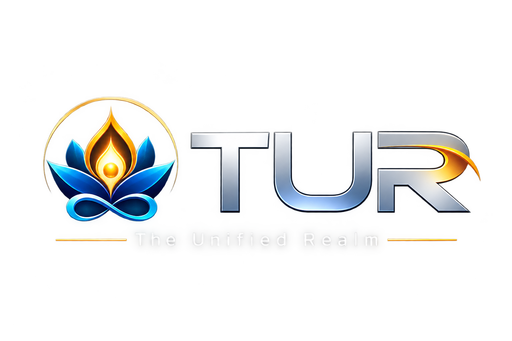
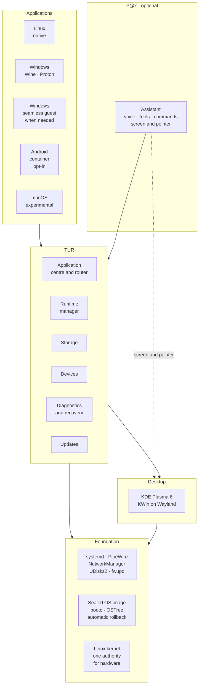

# TUR — The Unified Realm

### The operating system of the future

**One computer. Every application. An assistant that can run it for you. 
And a system that undoes a bad update by itself.**

[Why TUR](#why-tur) ·
[What it does](#what-tur-does) ·
[P@x](#px-your-assistant) ·
[Help build it](#tur-needs-you) ·
[Status](#where-tur-is-today) ·
[Roadmap](#roadmap)

---

## Why TUR

Today your applications decide which computer you can use. Some need Windows, some
need Linux, some live on your phone, and none of them know about each other. When
something goes wrong, the computer tells you nothing useful, and an update can
leave it unable to start.

**TUR is built on a different idea: the computer should adapt to you.**

- You should be able to run the application you need, wherever it came from.
- You should be able to ask your computer to do something, in your own words, and
  have it done.
- Your computer should explain itself when something fails, and repair itself
  when it can.
- A bad update should undo itself.
- And it should stay yours: private by default, with nothing collected behind
  your back.

That is what we believe an operating system should be, and it is what TUR is being
built to be. It is an ambitious project, and it is at the beginning.
[It needs you](#tur-needs-you).

> [!IMPORTANT]
> **TUR is pre-alpha. There is nothing to install yet.**
> The design is in place and the first components are being built and tested.
> This page describes what TUR is being built to do, and says plainly
> [what exists today](#where-tur-is-today).

## What TUR does

### Every application, in one place

You ask for an application. TUR works out the best way to run it and shows it as
an ordinary window, in one launcher, on one desktop.

| You want | How TUR runs it | What to expect |
|---|---|---|
| **A Linux application** | Natively, or from a container when it was made for another Linux distribution | Full support |
| **A Windows game** | Proton, the technology behind the Steam Deck | Very good for most games; games with kernel-level anti-cheat need dual boot |
| **A Windows application** | A compatibility layer first, because it is fastest; a real Windows system running quietly in the background when that is not enough | Aimed at running as smoothly as on Windows. Measured and published per application |
| **An Android application** | An Android system in a container, switched on when you want it | Most applications. Not those that demand a certified phone, such as many banking apps |
| **A macOS application** | The same application's Windows or Linux edition; a macOS compatibility layer is available as an experimental option | Experimental |

**One application centre** brings every store together: you search once, and TUR
shows where an application is available and how well it is known to work. Stores
that belong to someone else, Google Play among them, are offered as a guided
opt-in with your own account.

TUR does not pretend. Compatibility is measured, application by application, and
published, including what does not work and why.

### A system that looks after itself

- **A bad update undoes itself.** The operating system is a sealed image. An
  update is installed alongside the running system; if the new one fails to start
  properly, TUR returns to the previous one by itself. A few failures cannot be
  caught automatically, and the [design](docs/architecture/boot-health-and-rollback.md)
  lists them.
- **It tells you what happened.** Installation, start-up and updates report what
  they are doing in plain language. Every failure has a stable code, an
  explanation, and a safe next step.
- **Diagnostics you can hand to someone.** One command produces a support bundle
  with personal details removed. Nothing is uploaded unless you choose to share
  it.
- **Your data is protected,** including data that belongs to another operating
  system on the same machine. TUR refuses an unsafe write rather than risk it.

### Light, because nothing runs until you need it

TUR starts as a fast, clean desktop. Windows, Android and the assistant cost
nothing until you use them, and step back when you stop.

## P@x, your assistant

**P@x** is the assistant built into TUR. Run it **entirely on your own computer with local AI**, or add your own key from
Anthropic (Claude), OpenAI, Google, DeepSeek or another compatible service, and you can speak or type to your computer and have things done.

- **It can do what you can do.** It opens and operates applications from every
  ecosystem, manages files, changes settings, installs software.
- **It fixes problems.** When an application or the system misbehaves, P@x
  investigates, explains the cause in plain language, repairs it, and checks that
  the repair held, running the same commands a support engineer would.
- **It shows you how.** P@x has its own pointer. Ask where a setting is and it
  opens the right page and points at the exact line, or does it for you.
- **It remembers and gets better.** It keeps a private, local memory of your
  preferences and of what worked, and it runs reminders and scheduled tasks.
- **It is optional.** P@x is off until you turn it on, and TUR is complete
  without it.

### Local AI, built in

TUR can run AI models **on your own computer**. No account, no key, no bill,
and nothing you ask leaves the machine. Choose a model in the application centre;
TUR shows what each one is good at, how much memory it needs, how fast it will be
on *your* computer and what its licence allows, and recommends one that fits.
P@x can use it, a simple chat window uses it, and other applications can be
allowed to use it through a standard local interface. Speech recognition and
speech run locally too, so the assistant can work fully offline. Local AI is off
until you switch it on. ([Design](docs/architecture/local-ai.md); not built yet.)

**You stay in charge.** An assistant that can do anything needs limits you can
trust, so they are built into the system, not left to the AI's judgement:

- Things that can be undone, P@x just does.
- Sending, buying, deleting and installing: it asks first.
- Repairs that need administrator rights: you unlock a short session, once.
- Disks, start-up, firmware and encryption: only you can approve these, through a
  prompt that P@x cannot see or touch.
- Everything it does is logged, and you can always see when it is watching or
  acting.

The full design, including how P@x is protected against being misled by what it
reads, is in [the AI control layer design](docs/architecture/ai-control-layer.md).

## TUR needs you

An operating system for everybody cannot be built by a few. TUR is being developed
in the open so that anyone can see how it works, check its claims, and help make
it better. **Every kind of help counts.**

| If you can… | Then… |
|---|---|
| **Spare a minute** | Star and watch this repository, and tell someone who is tired of their computer getting in their way. Attention is what brings testers and contributors. |
| **Tell us what you need** | [Open an issue](https://github.com/giorgiogiudice/TUR/issues) naming the applications you cannot live without. That list decides what gets tested first. |
| **Read critically** | The [specification](docs/architecture/specification.md) and the [decision records](docs/adr/README.md) are public. If something is wrong, unsafe or unclear, say so. |
| **Test** | When the first images are published, try TUR on your hardware and report what works. Real machines are what a small team has least of. |
| **Build** | Rust, Qt and QML, Linux systems, packaging, testing, security, design, translation and documentation are all needed. Start with [CONTRIBUTING.md](CONTRIBUTING.md). |
| **Know an upstream project** | TUR stands on Wine, Proton, KDE, Fedora, Waydroid and many others. If you work on one, your advice is worth a great deal. |

TUR is free for people to use for themselves, and it is meant to stay that way.
The better it becomes, the better everybody's experience of their own computer
becomes.

## Where TUR is today

**Pre-alpha.** Honest status, updated as work lands:

| Area | State |
|---|---|
| Architecture and decisions | Published: [specification](docs/architecture/specification.md), [decision records](docs/adr/README.md) |
| Operating-system image | Builds reproducibly ([report](docs/reports/TUR-002.md)), installs to a disk and **boots to a graphical login in a virtual machine** on every change ([report and screenshots](docs/reports/TUR-003.md)). Not yet tested on real hardware |
| TUR's own programs | **Eleven programs are built into the image and run on the installed, booted system** with SELinux enforcing: diagnostics, devices, storage, the application catalogue, the Windows runtime, the update manager, boot health, the installer core, and P@x with its memory and AI connections. P@x's 349 end-to-end checks pass there, including its sandbox ([report](docs/reports/TUR-006.md)). The desktop programs are not in the image yet |
| P@x | [Design](docs/architecture/ai-control-layer.md) published. A text assistant runs end to end in continuous integration against a scripted stand-in for the AI: it uses real system tools, runs read-only commands in a sandbox, and refuses everything that would need the user's approval. It runs the same way through its Claude, OpenAI and Gemini connections ([first report](docs/reports/pax-1.md), [second report](docs/reports/pax-2.md)). Never yet run with a real AI model; no voice, screen control or approvals |
| Android | [Design](docs/architecture/android-runtime.md) published; not yet built |
| Running Windows programs | **Five real applications** (7-Zip, Notepad++, PuTTY, VLC, Inno Setup; eight installers of five kinds) are installed unattended, started, checked for one real function and removed without leftovers through TUR's runtime manager, inside a sandbox that keeps them out of the user's files, on every change ([report and screenshots](docs/reports/windows-runtime-2.md)). A small, friendly sample: it says nothing yet about demanding applications. Tested with Ubuntu's Wine on a build machine without a graphics card, not yet on the TUR image |
| Desktop and application centre | The shared interface kit and the first part of the application centre (search, how an application will run and who says so, and a plain answer when it cannot) are built and checked by screenshot tests in both themes ([kit](docs/reports/desktop-1.md), [centre](docs/reports/desktop-2.md)). Not yet run in a real desktop session; cannot install anything yet |
| Settings | The settings program has its first pages (Overview, Appearance, About), search, and **an address for every setting**: it can be opened at an exact row, reports where that row is on screen and highlights it, which is what lets P@x show you where a setting is ([report](docs/reports/desktop-3.md)). Pages for what is not built say so. Not yet run in a real desktop session |
| Rollback of a bad update | **Built and proven in a virtual machine**: a new version that fails its health check, crashes the login screen, cannot mount its disk, panics or hangs is replaced by the previous version within three attempts, and power cuts during an update leave one whole version (26 scenarios on every change; [report](docs/reports/TUR-005.md)). Not yet shown on real hardware or with Secure Boot; nothing tells the user on screen yet |
| Updates | The update manager reads the system's state and decides what should happen and why, with every refusal explained ([design](docs/architecture/update-manager.md), [report](docs/reports/update-1.md)). It does not download or apply anything yet |
| The Windows guest | [Designed](docs/adr/README.md) |
| Desktop, application centre, Windows and Android running | Not started |
| Anything you can install | Not yet |

## How it is built

TUR does not reinvent what already works. The kernel, the desktop and the
compatibility engines are maintained by their own communities. TUR adds what makes
them one system: the application centre and router, the integration between
ecosystems, the diagnostics and recovery, and P@x.

**Principles**

1. **One kernel, one authority over hardware.** Linux owns the machine.
   Everything else is a guest of it.
2. **Fastest route first.** An application runs natively or through a
   compatibility layer whenever that works well, and in a virtual machine only
   when it must.
3. **Integrate before building.** Use maintained upstream projects; send fixes
   back to them.
4. **Diagnose first, repair second.** A failure must leave enough evidence to be
   explained.
5. **Evidence over claims.** Compatibility and performance are published as
   tested results.
6. **Private by default.** Nothing is collected silently.

**What TUR is not**

- Not several operating systems merged into one kernel.
- Not a promise that every application ever written will run.
- Not a way to load Windows or macOS hardware drivers.
- Not a redistribution of Microsoft, Apple or Google software. You bring the
  applications and licences you are entitled to use.
- Not for business or government use. See [License](#license).

## Roadmap

A system that starts, recovers and explains itself comes before any other feature.

| Phase | Focus | Done when |
|---|---|---|
| **0** | Repository, image, continuous integration | A reproducible image starts in a virtual machine and describes itself |
| **1** | Start-up, diagnostics, recovery | A deliberately broken update is undone automatically, with the evidence kept |
| **2** | Hardware and storage | Devices and disks come and go safely, with useful diagnostics |
| **3** | Desktop and application centre | A polished, responsive desktop, and one place to find applications |
| **4** | Windows applications | A published list of applications that run, by which route, and how well |
| **5** | Android applications | A published list of applications that run, and Google Play as an opt-in |
| **6** | macOS (experimental) | An optional feature with a published list of what works |
| **7** | Hardening and release | An independent tester can install, update, break, recover and report unaided |

P@x is built alongside these phases, not after them: each part of the system
becomes something P@x can use as it lands. Detail is in the
[specification](docs/architecture/specification.md#20-development-roadmap-with-concrete-deliverables),
the [AI control layer design](docs/architecture/ai-control-layer.md) and the
[decision records](docs/adr/README.md).

## Documentation

- [Architecture specification](docs/architecture/specification.md) — the project baseline
- [Decision records](docs/adr/README.md) — what was decided, and why
- [P@x: the AI control layer](docs/architecture/ai-control-layer.md) and its [policy engine](docs/architecture/agent-policy.md)
- [Android runtime](docs/architecture/android-runtime.md)
- [Dependency and licence inventory](docs/dependencies/upstream-projects.md) and the [licence review](docs/dependencies/licence-review.md)
- [CONTRIBUTING.md](CONTRIBUTING.md) — how to contribute
- [AGENTS.md](AGENTS.md) — the rules automated contributors work under
- [SECURITY.md](SECURITY.md) — how to report a vulnerability

## How TUR is developed

Much of TUR is written by autonomous engineering agents working under human
direction, in the open, with every change tested by continuous integration before
it is accepted. The same rules apply to every contributor, human or not: small
changes that can be reviewed, tests anyone can re-run, a written decision for
anything that touches safety, and an honest report of what was and was not
tested. They are in [AGENTS.md](AGENTS.md).

## Acknowledgements

TUR stands on the work of the Linux kernel, systemd, bootc and OSTree, Fedora,
KDE, Wine, Proton, DXVK, VKD3D-Proton, Waydroid, Darling, Mesa, PipeWire, QEMU and
many other projects. It intends to be a good citizen of those communities.

## License

TUR is **source-available software, free for people to use for themselves.** Its
own code and documentation are under the
[TUR Noncommercial License](LICENSE.md).

- **Allowed:** personal use, study, research and hobby projects; use by charities
  and by schools and other educational institutions; modifying TUR and sharing it
  for those purposes.
- **Not allowed:** commercial or business use of any kind, including use inside a
  company or offering TUR as a product or service; and use by or for a government.

The full terms are in [LICENSE.md](LICENSE.md), which governs if this summary and
the licence differ. This is not an open-source licence as the Open Source
Initiative defines the term, and it has not yet had legal review.

The licence covers what TUR itself adds. The third-party projects that TUR
integrates are separate works under their own licences, which this licence does
not change; they are listed in [THIRD_PARTY_NOTICES.md](THIRD_PARTY_NOTICES.md).
Contributions that modify or link into such a project are made under that
project's licence; see [ADR-0003](docs/adr/0003-licence.md) and
[ADR-0010](docs/adr/0010-licence-excludes-government.md).

---

TUR and The Unified Realm are names of this project. Linux is a registered
trademark of Linus Torvalds. Windows is a trademark of Microsoft Corporation.
macOS is a trademark of Apple Inc. Android and Google Play are trademarks of
Google LLC. Fedora is a trademark of Red Hat, Inc. TUR is not affiliated with,
endorsed by or sponsored by any of them, or by any project it integrates.

