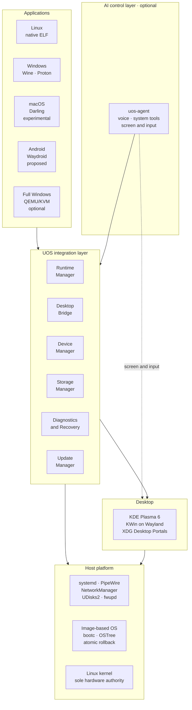

<div align="center">

# UOS — Universal Operating System

**One Linux-based desktop for Linux, Windows and macOS applications —<br/>
image-based, recoverable by design, and optionally driven end to end by AI.**

[](#project-status)
[](LICENSE.md)
[](#license)
[](docs/architecture/specification.md#4-supported-platform-and-hardware-baseline)
[](docs/adr/0001-base-distribution.md)

[Specification](docs/architecture/specification.md) ·
[Roadmap](#roadmap) ·
[Decisions](docs/adr/README.md) ·
[Contributing](CONTRIBUTING.md)

</div>

---

> [!IMPORTANT]
> **UOS is pre-alpha. There is nothing to install yet.**
> The architecture, engineering rules and decision records are in place and the
> first components are being built. The first milestone is an image that boots in
> a virtual machine and proves automatic rollback. See
> [Project status](#project-status).

## What UOS is

UOS is a research operating system built on a single Linux kernel. It aims to give
applications from four ecosystems one coherent desktop, one hardware stack and one
recovery story:

| Ecosystem | How it runs | Expectation |
|---|---|---|
| **Linux** | Natively | Full support; no regression against the base distribution |
| **Windows** | Wine and Proton, with DXVK and VKD3D-Proton for graphics | Application-specific; measured and published |
| **macOS** | Darling | Experimental; command-line tools first, a narrow GUI set later |
| **Android** | Waydroid: an Android system in a container on the host kernel, off by default ([proposed](docs/architecture/android-runtime.md)) | Application-specific; measured and published. Apps that need Google certification (banking, payment, DRM video), phone hardware or ARM-only code are not expected to run |
| **Windows, in full** | A genuine Windows guest under QEMU/KVM, or dual boot | Optional fallback for drivers, anti-cheat and kernel-level software |

Windows and macOS programs run in userspace through compatibility layers. UOS does
not merge kernels, emulate a CPU for same-architecture software, or load foreign
kernel drivers. Compatibility is treated as something to **measure**, not to claim.

## Why it is different

Most of the components UOS relies on already exist and are maintained by their own
communities. What UOS adds is the layer that makes them behave like one system:

- **Recovery is a product feature.** The OS is an immutable image, updated
  atomically. A deployment that fails its boot health checks is rolled back
  automatically, and the evidence is preserved.
- **It explains itself.** Installation, boot and updates report named phases and
  stable error codes such as `UOS-STORAGE-NTFS-004`, each with a plain-language
  message, the technical detail and a safe next step.
- **Diagnostics you can hand to someone.** `uos-diag` produces a versioned,
  checksummed, privacy-redacted support bundle. Nothing is uploaded unless the user
  chooses to share it.
- **One runtime manager.** Executables are inspected rather than guessed from their
  extension, matched to a tested compatibility profile, and run in isolated,
  per-application environments with a pinned runtime version.
- **Safe storage by default.** NTFS is writable only when the volume is clean; APFS
  is read-only. UOS refuses an unsafe write rather than risk another operating
  system's data.
- **AI-drivable, on your terms.** Add your own API key and UOS can be operated by
  voice, with an assistant that can see and control applications on your behalf.

## The AI layer

The AI layer is optional and **off by default**. UOS is fully usable without it and
never requires an account or a network connection to boot, install or recover.

When enabled, the assistant works through four ways of acting, preferring the
most reliable one available:

1. **System tools.** UOS services expose typed operations (launch an application,
   mount a volume, check an update, collect diagnostics), so common tasks do not
   depend on reading the screen.
2. **Commands.** It runs commands in a sandbox to inspect, troubleshoot and repair
   the system, as a support engineer would at a terminal.
3. **Accessibility tree.** Native applications are driven through their semantic
   UI structure.
4. **Screen and input.** For everything else, including Windows and macOS
   applications, the assistant sees the screen and operates keyboard and pointer
   through the compositor.

It is a full assistant, not only a remote control. It keeps a local memory of
what it has been told and what worked, runs reminders and scheduled tasks, and
when something breaks it investigates, explains the cause, fixes it and checks
that the fix held.

It is **provider-agnostic**. The first supported providers are Anthropic (Claude),
OpenAI and Google (Gemini), behind one interface, using a key that you supply and
that is held in the system keyring.

An assistant that can read the screen can also be misled by what is on it, so
authority is tiered. Reversible actions run freely. Consequential ones, such as
sending, purchasing, deleting or installing, ask first. A repair that needs
administrator rights runs in a short session the user opens once. Operations on
disks, boot, firmware and encryption always require confirmation from a person
through a prompt that the assistant cannot operate. Every action is logged, and a visible indicator
shows whenever the assistant is observing or controlling the session.

The detailed design and threat model are in
[`docs/architecture/ai-control-layer.md`](docs/architecture/ai-control-layer.md).

## Architecture



The components UOS itself contributes:

| Component | Responsibility |
|---|---|
| `uos-runtime` | Inspect executables, select a runtime, manage isolated per-app environments |
| `uos-desktop-bridge` | Give applications from every runtime one launcher, identity and set of desktop services |
| `uos-device-manager` | One inventory of devices, drivers and firmware; explicit, exclusive hand-off to a VM |
| `uos-storage` | Safe discovery and mounting; one volume namespace shared by every runtime |
| `uos-diagnostics` | Boot stages, error-code registry, redacted support bundles (`uos-diag`) |
| `uos-update` | Stage, verify, activate and roll back OS deployments |
| `uos-agent` | The optional AI control layer |

Everything else is integrated from upstream rather than rewritten. The
[specification](docs/architecture/specification.md#17-repository-shortlist-and-integration-strategy)
lists each project and how it is used.

## Design principles

1. **One kernel, one hardware authority.** Linux owns scheduling, memory, storage,
   networking and the GPU. Compatibility layers consume host services.
2. **Translate APIs, not instructions.** Same-architecture code runs directly on
   the CPU.
3. **Integrate before building.** Prefer maintained upstream projects; keep patches
   few and send fixes upstream.
4. **Diagnose first, repair second.** A failure must leave enough evidence to be
   explained.
5. **Evidence over claims.** Compatibility and performance are published as tested
   results, with versions, hardware and reproduction steps.
6. **Private by default.** Diagnostics stay local; nothing is collected silently.

## What UOS is not

- Not a merged Linux, Windows NT and XNU kernel, and not three operating systems
  booted side by side.
- Not a promise that every Windows or macOS application will run.
- Not a way to load Windows `.sys` or macOS `.kext` drivers.
- Not a redistribution of Microsoft or Apple software. You supply the applications
  and licences you are entitled to use.
- Not for business use. UOS is licensed for personal, noncommercial use only.

## Project status

**Pre-alpha.** An image builds in CI; nothing is installable yet.

| Area | State |
|---|---|
| Architecture specification | Revision 1.0 published |
| Foundational decisions | Recorded in [`docs/adr`](docs/adr/README.md) |
| AI control layer design | Addendum A, revision 2 |
| OS image | Builds reproducibly in CI from a pinned base ([report](docs/reports/UOS-002.md)); not yet boot-tested |
| Services, installer | In development |

## Roadmap

Work proceeds in a fixed order: a system that boots, recovers and explains itself
comes before any compatibility feature.

| Phase | Focus | Exit criterion |
|---|---|---|
| **0** | Repository, image pipeline, CI | A reproducible image boots in QEMU and emits a build manifest |
| **1** | Boot, diagnostics, recovery | A deliberately broken deployment falls back automatically; a bundle is exported from both paths |
| **2** | Hardware and storage | Hot-plug of USB, disks, audio and network with useful diagnostics |
| **3** | Desktop and shell | A polished, responsive Plasma desktop with no compatibility dependencies |
| **4** | Windows runtime | A defined set of Windows applications launches with reproducible test reports |
| **5** | macOS runtime | A published list of working command-line tools and a limited GUI subset |
| **6** | Full Windows backend | A licensed Windows guest receives an explicitly assigned device without conflict |
| **7** | Hardening and release | An independent tester can install, update, break, recover and report unaided |

The AI control layer is developed alongside these phases rather than after them:
each service ships its assistant-facing tools as it lands, screen control arrives
with the desktop, and voice follows. Full detail is in the
[specification](docs/architecture/specification.md#20-development-roadmap-with-concrete-deliverables).

Android support is proposed in
[addendum B](docs/architecture/android-runtime.md) and is likewise interleaved:
package inspection and the kernel check in phases 0 and 1, the Android container
in CI with phase 2, desktop integration with phase 3, installation, storage and
device grants with phases 4 and 5, and the evaluation of a virtual-machine backend
with phase 6. It never displaces a higher item in the order above.

## Repository layout

```text
docs/
  architecture/   Specification and subsystem designs
  adr/            Architecture Decision Records
AGENTS.md         Binding rules for automated development agents
CONTRIBUTING.md   How changes are proposed, tested and reported
SECURITY.md       How to report a vulnerability
LICENSE.md        PolyForm Noncommercial License 1.0.0
```

Source directories (`image/`, `services/`, `desktop/`, `runtimes/`, `tests/`) are
added as each phase begins; the planned structure is in
[section 18 of the specification](docs/architecture/specification.md#18-build-ci-release-engineering-and-repository-layout).

## Documentation

- [Architecture specification](docs/architecture/specification.md) — the project baseline
- [Architecture Decision Records](docs/adr/README.md) — what was decided, and why
- [Dependency and licence inventory](docs/dependencies/upstream-projects.md) — upstream projects, their licences, and the [licence review](docs/dependencies/licence-review.md)
- [AGENTS.md](AGENTS.md) — constraints for automated contributors
- [CONTRIBUTING.md](CONTRIBUTING.md) — workflow and completion reports
- [SECURITY.md](SECURITY.md) — vulnerability reporting

## Contributing

UOS is developed largely by autonomous engineering agents working under human
direction, and the same rules apply to every contributor: small reviewable changes,
tests with a reproducible command, an ADR for anything touching interfaces, boot,
storage, security or updates, and a completion report that states what was built
and tested. Start with [CONTRIBUTING.md](CONTRIBUTING.md).

## Acknowledgements

UOS stands on the work of the Linux kernel, systemd, bootc and OSTree, Fedora, KDE,
Wine, Proton, DXVK, VKD3D-Proton, Darling, Mesa, PipeWire, QEMU and many other
projects. It is an integration effort, and it intends to be a good upstream citizen.

## License

UOS is **source-available software for personal, noncommercial use**. Its own code
and documentation are licensed under the
[PolyForm Noncommercial License 1.0.0](LICENSE.md).

- **Allowed:** personal use, study, research, hobby projects, and modifying and
  sharing UOS for those purposes.
- **Not allowed:** any commercial or business use, including use inside a company,
  offering UOS as a product or service, or selling it.

The full terms are in [LICENSE.md](LICENSE.md), which governs if this summary and
the licence differ. This is not an open-source licence as the Open Source
Initiative defines the term.

The third-party projects that UOS integrates are separate works and remain under
their own licences, which this licence does not change. Contributions that modify
or link into such a project are made under that project's licence; see
[ADR-0003](docs/adr/0003-licence.md).

The software in the UOS image and its licences are listed in
[THIRD_PARTY_NOTICES.md](THIRD_PARTY_NOTICES.md).

---

<sub>
"UOS" is a working name. This project is not affiliated with UnionTech's UOS or
with any other product of a similar name. Linux is a registered trademark of Linus
Torvalds. Windows is a trademark of Microsoft Corporation. macOS is a trademark of
Apple Inc. UOS is not affiliated with, endorsed by or sponsored by Microsoft, Apple
or any upstream project it integrates.
</sub>
