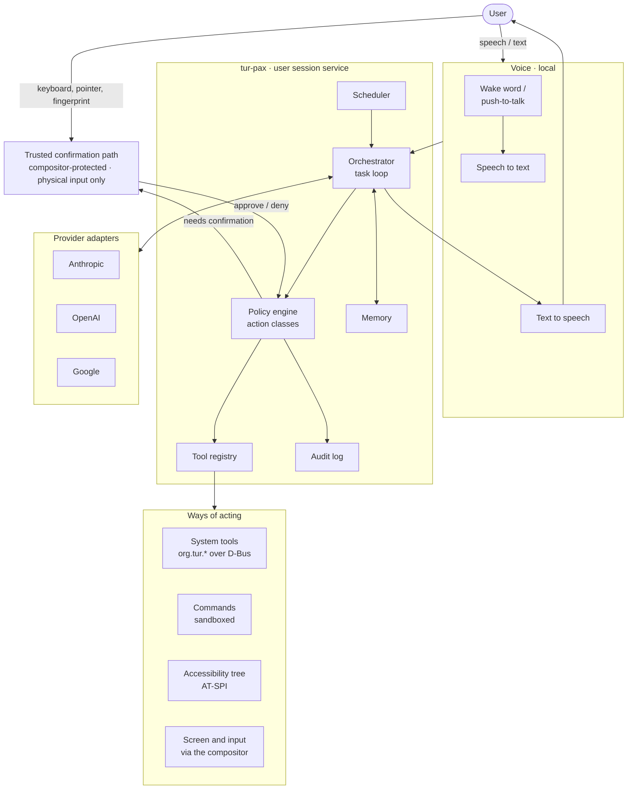

# AI control layer

**Specification addendum A — Revision 10 (12 November 2026)**
**Applies to:** specification revision 1.0
**Related decision:** [ADR-0004](../adr/0004-ai-provider-model.md)

This addendum specifies the optional layer that lets a person operate TUR through
an AI assistant, **P@x**: by voice or text, with the assistant able to see and
control applications from every runtime. "The assistant" below means P@x. It adds a subsystem to the specification and
lists the amendments it requires in [section 14](#14-amendments-to-specification-revision-10).

Revision 2 extends the assistant from a way of operating applications into a full
assistant: it runs commands to troubleshoot and repair the system, keeps a memory,
and runs reminders and scheduled tasks. The additions are in sections 4, 5.4 to
5.6, 7 and [16](#16-assistant-capabilities). Section numbers from revision 1 are
unchanged.

Revision 3 names the assistant **P@x**, gives it its own pointer and a guide
mode (section 16.6), and settles how spoken approval is handled (section 5.2).

Revision 4 closes gaps found while implementing the policy engine
([agent-policy.md](agent-policy.md)); they are listed with their resolutions in
[section 17](#17-resolutions-from-implementing-the-policy-engine).

Statements about what KWin, the desktop portals or a provider's API support are
design assumptions. Each must be verified against current upstream state before
implementation, as the specification requires (§0, rule 14).

---

## 1. Purpose and scope

**In scope**

- A session service, `tur-pax`, that turns a spoken or typed request into
  actions on the system.
- Four ways of acting: typed system tools, commands, the accessibility tree, and
  screen plus input.
- A persistent local memory, reminders and scheduled tasks.
- Troubleshooting and repair of applications and of the operating system,
  including operations that need administrator rights.
- An authority model that decides what the assistant may do without asking.
- A provider interface, with adapters for Anthropic, OpenAI and Google.
- A local voice pipeline.

**Out of scope**

- Any role in boot, installation, update or recovery. Those paths never depend on
  the AI layer.
- Real-time control of games.
- Training or fine-tuning models.
- A bundled model or a TUR-operated cloud service. The user brings a key.

## 2. Principles

1. **Optional and off by default.** TUR without a key is a complete product.
2. **Reach is not authority.** The assistant can reach every application. What it
   may do unprompted is decided by policy, never by the model.
3. **Most structured path first.** A typed tool is preferred to the accessibility
   tree, and the accessibility tree to pixels.
4. **The model is not a security boundary.** Every safeguard is enforced outside
   the model, in code the model cannot influence.
5. **Visible and interruptible.** The user can always see that the assistant is
   active and can always stop it.
6. **Recoverable.** Actions are logged, and reversible where the system can make
   them so.
7. **Provider-agnostic.** Provider-specific behaviour stays inside an adapter.

## 3. Architecture



| Component | Role |
|---|---|
| **Orchestrator** | Runs the task loop: send context to the provider, receive proposed actions, pass each through the policy engine, return results. Enforces step, time and spend limits. |
| **Policy engine** | Classifies every proposed action and decides: allow, ask, require authentication, or refuse. The only component that can release an action. |
| **Tool registry** | Loads tool manifests published by TUR services and exposes them to the provider in its tool format. |
| **Provider adapters** | Translate between the common interface and one provider's API. |
| **Audit log** | Records every proposed and executed action in the journal. |
| **Voice** | Local wake word, speech recognition and speech synthesis. |
| **Command runner** | Runs commands in a sandbox chosen by the policy engine; privileged commands go through a separate helper (section 5.4). |
| **Memory** | A local store of what the assistant has been told and has learned (section 16.1). |
| **Scheduler** | Fires reminders and scheduled tasks (section 16.2). |
| **Trusted confirmation path** | A compositor-protected prompt the assistant can neither see into nor operate. |

`tur-pax` runs as the logged-in user, with no more privilege than that user. It
has no access to other users' sessions.

## 4. Ways of acting

| Tier | Mechanism | Reliability | Used for |
|---|---|---|---|
| **1. System tools** | Typed operations on `org.tur.*` services and standard desktop interfaces | High; fast; cheap | Launching applications, volumes, devices, updates, diagnostics, settings, files |
| **1b. Commands** | Shell commands in a sandbox (section 5.4) | High for anything a terminal can do | Troubleshooting, inspection, repair, automation, anything no typed tool covers |
| **2. Accessibility tree** | AT-SPI: named controls, roles, states and actions | Good where applications expose it | Native Qt and GTK applications |
| **3. Screen and input** | Screen capture and emulated keyboard and pointer, through the compositor | Variable; seconds per step | Everything else |

Expected coverage by runtime:

| Application type | Tier 1 | Tier 2 | Tier 3 |
|---|---|---|---|
| TUR services and settings | Yes | Yes | Yes |
| Native Linux (Qt, GTK) | Launch and files | Yes | Yes |
| Native Linux (other toolkits) | Launch and files | Partial | Yes |
| Windows applications under Wine | Launch and files | Not assumed | Yes |
| macOS applications under Darling | Launch and files | No | Yes |
| Applications in a Windows VM | Start and stop the VM | No | Yes, through the viewer window |
| Games | Launch only | No | Out of scope |

Screen and input go through the compositor using the desktop's remote-desktop and
screen-cast interfaces. On Wayland an ordinary application cannot read other
windows or inject input, so the compositor is the single point at which the
assistant's access is granted, shown and revoked. The grant is made once, in
settings, and is revocable; it is not a prompt on every session.

Tier 3 is the only way to operate Windows and macOS applications, and it is the
least reliable. Its success rate per application is measured and published in the
compatibility matrix alongside whether the application runs at all.

## 5. Authority model

Every action belongs to one class. The class, not the model, decides what happens.

| Class | Meaning | Examples | Rule |
|---|---|---|---|
| **0 Observe** | Reads state; changes nothing | Read the screen, list volumes, query an update | Allowed, subject to privacy exclusions |
| **1 Reversible** | Changes session or user state in a way that can be undone | Open or arrange windows, type into a document, create or move files, change a reversible setting | Allowed |
| **2 Consequential** | Hard to undo, or affects other people or money | Send a message or email, submit a form, purchase, delete permanently, install or remove software, change accounts or sharing | Ask the user first |
| **3 System-critical** | Can destroy data or stop the machine booting | Partitioning, formatting, encryption, bootloader, firmware, OS update and rollback, device hand-off to a VM, security policy | A person authenticates on the trusted path |
| **4 Prohibited** | Never performed by the assistant | Reading secrets from the keyring, changing its own policy or permissions, disabling its indicator or audit log, operating the trusted path, enabling experimental APFS write | Refused |

### 5.1 How an action is classified

- **System tools** declare their class in the tool manifest. The class is part of
  the service's reviewed interface and is enforced by the service through polkit,
  not only by the agent. A class 3 operation fails without human authentication
  even if called directly.
- **Accessibility and screen actions** cannot be classified from the action
  itself: a click is only a click. Two rules bound them:
  1. Privileged prompts reject emulated input (section 6), so nothing done
     through tiers 2 or 3 can exceed class 2.
  2. Before an action that the policy engine's rules identify as consequential,
     such as activating a control in a window matching a send, pay, delete or
     install pattern, or acting in an application the user has marked sensitive,
     the engine asks first. The rules are conservative: when in doubt, ask.

  The model may also flag an action as consequential. That can only add a
  confirmation; it can never remove one.

### 5.2 Confirmation

- **Class 2:** the assistant states what it is about to do, and the user approves
  **on screen**. This is the default and the owner's decision. A system setting
  lets the user allow spoken approval of class 2 actions instead; when it is on,
  a spoken approval is accepted only under the conditions in section 9. The
  setting is changed by the user, in system settings, and never by the assistant
  (class 4).
- **Class 3:** approval is given only on the trusted confirmation path, with
  physical input and the user's authentication. A spoken "yes" is never enough.
- An approval covers one stated action. It does not carry over to the next, and
  "approve everything" does not exist for classes 2 and 3.

### 5.3 User-adjustable policy

The user may make the assistant stricter (ask before every action, observe only,
exclude an application) at any time. The user may relax class 2 handling of
screen and accessibility actions for a named application. This is a setting the
user makes in system settings, not an approval given to the assistant, and it is
the only standing relaxation there is. Classes 3 and 4 cannot be relaxed.

### 5.4 Commands

The assistant can run commands. A command line is free text, and no parser can
say reliably what an arbitrary command will do, so **a command's class comes from
the sandbox it runs in, never from reading its text.**

| Sandbox | What the command can do | Class |
|---|---|---|
| **Read-only** | Read system state. The filesystem is read-only, the user's home is hidden except what the task was granted, and nothing it does persists. | 0 |
| **User, in a task workspace** | Change files inside a workspace the system can undo. | 1 |
| **User** | Anything the user could do without administrator rights. | 2: the exact command is shown and approved |
| **Privileged** | Run as administrator, through a helper. | Only inside a repair session (section 5.5) |

The assistant is never given a root shell, the user's password, or `sudo`. A
privileged request is passed to a small helper that runs it, records it, and
refuses what the repair session does not cover.

The helper accepts two kinds of request:

- **Typed operations**: restart or enable a service, change a named
  configuration file, install or remove a package layer, reset a network
  profile, and similar. Each type is confined to what it needs (named units,
  named paths), so the helper can check a request against its type. Inside a
  repair session these run without further approval.
- **A free-text command.** The helper cannot verify what arbitrary text will do.
  Inside a repair session a free-text privileged command is still shown and
  approved one at a time.

Typing into a terminal window through the screen is not a way round this: see
section 17, item 1.

Most troubleshooting is reading: logs, service state, device and network status.
All of that runs in the read-only sandbox without interrupting the user.

### 5.5 Repair session

Fixing an operating-system problem usually takes several administrator commands.
Asking for authentication before each one would make the assistant useless as a
troubleshooter; granting it standing administrator rights would make it a
permanent risk. A repair session is the middle path.

- The assistant states the problem and what it intends to do. The user
  authenticates **once**, on the trusted path, for that stated purpose.
- The session has a time limit, and ends early when the session locks, when the
  user ends it, or when the task finishes.
- While it is open, the assistant may run privileged commands. Every one is shown
  in a live view and written to the audit log.
- Changes to system configuration are recorded so the session can be reviewed and
  reversed. The OS image itself is immutable and cannot be altered by a repair.
- **A repair session never covers class 3.** Partitioning, formatting, encryption,
  the bootloader, firmware, OS update and rollback, device hand-off and security
  policy each still need their own authentication, every time.

A limit must be stated plainly: a privileged command is free text, and the helper
cannot prove that an arbitrary command is harmless. The protection is layered
rather than absolute: class 3 operations are refused by the services that perform
them unless a person authenticates; the helper blocks known destructive tools and
raw access to block devices; the OS image is immutable; and every command is
visible and logged. Within those limits a misled assistant with an open repair
session can still damage system configuration. That is why a session is short,
purpose-bound, opened only by the user, and reversible.

### 5.6 Unattended tasks

A reminder or scheduled task runs when the user may not be there. Nobody can be
asked, so the rules are stricter than for an attended task.

| Class | Unattended behaviour |
|---|---|
| 0, 1 | Runs |
| 2 | Runs only if it matches a **standing approval**; otherwise it is deferred and offered to the user on return |
| 3 | Refused |
| 4 | Refused |

A standing approval is given by the user when creating the schedule. It names one
tool and its exact parameters ("send this report to this address"). An action
that differs in any parameter does not match. Standing approvals are listed in
settings and can be revoked.

An unattended task has no repair session and cannot open one. While the session
is locked it uses tools and read-only commands only: it does not drive the screen.

## 6. Trusted confirmation path

The assistant sees the screen and can emulate input. Without a protected path it
could approve its own requests, and anything on screen could ask it to. The
compositor therefore provides the following, and the design depends on them:

1. **Emulated input is distinguishable.** The compositor knows which input events
   come from physical devices and which from the assistant.
2. **Protected surfaces ignore emulated input.** Authentication dialogs, TUR
   confirmation prompts, keyring prompts and the lock screen accept physical input
   only.
3. **Protected surfaces are not captured.** They are excluded from the screen
   content given to the assistant.
4. **Protected surfaces cannot be imitated.** They are drawn by the compositor in
   a way an application window cannot reproduce or cover.
5. **A physical stop control.** A key combination handled by the compositor pauses
   the assistant and withdraws its input at once. The assistant cannot remap or
   suppress it.

If any of these cannot be met with the compositor as shipped, the work to add it
is proposed upstream first. Until all five hold, the assistant is limited to
classes 0 and 1.

*Amended by section 23, item 1 (and section 19, item 2).* There are two levels
of confirmation. **The approval sheet**, on the desktop and protected by TUR's
own code, approves an attended class 2 action. **The trusted screen**, a
separate session outside the desktop, is where class 3 is authenticated, a
repair session is opened and anything that loosens the assistant's limits is
confirmed, standing approvals included. Each level is an input of the policy
engine that is false until that path exists and is proven
([agent-policy.md](agent-policy.md), section 2.3); until then the assistant
performs nothing above class 1.

## 7. Threat model

| Threat | Example | Mitigation |
|---|---|---|
| **Instructions in screen content** | A web page, email or document contains text addressed to the assistant | Content is data, not commands: only the user's request sets the task. Classes 2 and 3 need confirmation outside the model. Protected surfaces reject emulated input. An injection test suite gates releases. |
| **Instructions in audio** | A video plays "confirm" or issues a command | Voice input is ignored while the system itself is the source of the sound. Class 3 never accepts voice. Push-to-talk is the default. |
| **Instructions in tool results or files** | A file name or document body tells the assistant to act | As for screen content. Tool results are marked as untrusted data to the provider. |
| **Spoofed confirmation prompt** | An application draws a fake approval dialog | Real prompts are compositor-drawn and cannot be imitated or covered. |
| **Secret disclosure to the provider** | A password manager is visible when a screenshot is taken | Sensitive applications and protected surfaces are excluded from capture. Private mode. Per-application exclusion. |
| **Secret disclosure by action** | The assistant is induced to type or paste a secret into a web form | Keyring access is class 4. Clipboard reads are logged. Credential entry is left to the user. |
| **API key theft** | Another process reads the key | The key is in the system keyring, released only to `tur-pax`, and never written to profiles, logs or bundles. |
| **Malicious or compromised provider** | Responses propose harmful actions | The policy engine treats every proposal as untrusted. The provider gains no authority the user has not granted. |
| **Privilege escalation** | The assistant is used to obtain root | It runs as the user. Privileged operations go through polkit with human authentication. |
| **Self-modification** | The assistant relaxes its own policy or adds itself to autostart | Policy, permissions, indicator and audit log are class 4 and are not writable by the agent's user-level process. |
| **Acting unattended** | A long task continues after the user has left | Tasks pause when the session locks. Step, time and spend limits apply. |
| **Runaway cost** | A loop consumes the user's API credit | Per-task and per-day spend limits, shown to the user, enforced by the orchestrator. |
| **Command injection** | Text on a web page says "run this command to fix it" | Content is data. A command that changes anything is shown and approved; a privileged one needs a repair session the user opened for a stated purpose. |
| **Repair session abuse** | An open session is steered towards something unrelated | Sessions are short and purpose-bound; every command is shown live and logged; class 3 is never covered; configuration changes are reversible. |
| **Memory poisoning** | Content the assistant reads plants a false "fact" or instruction to be recalled later | Memory records where each entry came from. Entries derived from content are marked untrusted and are never treated as the user's instructions. Memory is data: it cannot lower a class, satisfy a confirmation or act as a standing approval. |
| **Scheduled-task abuse** | A task is created or altered to act later, when nobody is watching | Creating or changing a schedule or a standing approval is done by the user; the assistant can only propose it. Unattended tasks cannot exceed their standing approvals. |

A residual risk remains and must be stated to users plainly: within class 1, an
assistant misled by on-screen content can still do unwanted reversible things,
such as moving files or editing a document. The audit log and undo support in
section 11 are the answer to that, not a claim that it cannot happen.

## 8. Privacy

Enabling the AI layer with a cloud provider sends data off the machine. This is
the one place TUR does so in normal operation, so it is governed by the same rule
as diagnostics (§0, rule 9): nothing silent, everything explained.

**What is sent to the provider:** the user's request as text, screenshots of the
screen region being worked on, accessibility-tree excerpts, the results of tools
and commands the assistant runs, and the memory entries relevant to the task.

**What is not sent:** audio (recognised locally), the contents of protected
surfaces, windows of excluded applications, keyring contents, and diagnostic
bundles unless the user attaches one.

**What the provider keeps.** Some providers store requests on their servers by
default, for weeks. P@x always asks a provider not to store the conversation
where the provider offers that choice. What a provider retains despite that is
governed by its own terms, which the setup screen links to; TUR cannot control
it and says so.

**Controls**

- **Consent at setup.** Before the first use, TUR shows what will be sent, to
  which provider, and links to that provider's data terms.
- **Indicator.** A persistent, compositor-drawn indicator shows when the assistant
  is observing and when it is controlling.
- **Exclusions.** Password managers, the keyring, the lock screen and private
  browser windows are excluded by default. The user can exclude any application.
- **Private mode.** One action suspends all observation.
- **Local record.** Requests, actions and results are logged locally. Screenshots
  are not kept after a task unless the user turns that on.
- **Diagnostic bundles** exclude AI transcripts and screenshots by default.

## 9. Voice

- **Local by default.** Wake-word detection, speech recognition and speech
  synthesis run on the machine. Audio is not sent to a provider unless the user
  chooses a provider's speech service.
- **Activation.** Push-to-talk is the default. An always-listening wake word is an
  option the user turns on.
- **Barge-in.** Speaking or pressing the stop control interrupts speech and pauses
  the task.
- **Spoken confirmation.** Off by default: class 2 actions are approved on screen.
  If the user turns spoken approval on in system settings, a class 2 action may
  be approved by voice only when the request was started by push-to-talk or wake
  word in the same exchange and the system is not itself playing the audio being
  heard. Otherwise the approval is asked for on screen.
- **Without a microphone or speakers** the same assistant is available through a
  text interface.
- **Accessibility.** The voice interface is designed as assistive technology too,
  and is tested with users who rely on it.

## 10. Provider interface

An adapter implements:

| Capability | Required | Notes |
|---|---|---|
| Streaming conversation | Yes | |
| Tool calling with JSON-schema inputs | Yes | |
| Image input | Yes | For tier 3 |
| Native computer-control tooling | No | Used where the provider offers it; otherwise a generic screenshot-and-tools loop |
| Model discovery | No | Model names are configuration, never compiled in |
| Speech services | No | Opt-in only |

Rules:

- The adapter reports the provider's declared capabilities; the orchestrator
  adapts rather than assuming parity.
- A provider's refusal, rate limit, timeout or malformed response is a normal
  result with a stable `TUR-AI-*` error code, reported to the user in plain terms.
- Each adapter passes the same conformance suite (section 12). Results are
  published per provider.
- Adapters are written against the provider's current documentation at the time,
  and pinned to an API version where the provider supports that.
- A provider's own hosted tool connectors are never used. If the provider called
  a tool server itself, the call would not pass through the policy engine. P@x
  sends plain tool definitions and performs every call on the machine.
- A response that ends in a refusal or an error is discarded whole, including any
  actions it proposed before the refusal arrived.
- The spend limit takes effect between responses, because providers report usage
  at the end of one. A single response is bounded by its output limit.

The adapters, the neutral conversation model and what was verified in each
provider's documentation are described in [pax-providers.md](pax-providers.md).

## 11. Interfaces, logging and undo

**D-Bus.** `org.tur.Agent1` on the session bus. Proposed surface, to be fixed in an
interface specification before implementation (§16):

```text
Methods   StartTask(request, options) -> task_id
          CancelTask(task_id)
          Pause()  Resume()
          GetStatus() -> state, task, provider, spend
          ListMemory() / ForgetMemory(id)
          ListSchedules() / RemoveSchedule(id)
          EndRepairSession()
Signals   ActionProposed(task_id, action, class)
          ConfirmationRequested(task_id, action, class)
          ActionCompleted(task_id, action, result)
          TaskFinished(task_id, outcome)
```

**Tool manifest.** Each TUR service ships a manifest describing its
assistant-facing operations. Illustrative:

```json
{
  "schema_version": 1,
  "service": "org.tur.Storage1",
  "tools": [
    {
      "name": "storage_list_volumes",
      "description": "List detected volumes with filesystem, state and mount point.",
      "class": 0,
      "method": "ListVolumes",
      "input_schema": { "type": "object", "properties": {}, "additionalProperties": false }
    },
    {
      "name": "storage_unmount",
      "description": "Unmount a volume by its TUR volume identifier.",
      "class": 1,
      "method": "Unmount",
      "input_schema": {
        "type": "object",
        "properties": { "volume_id": { "type": "string" } },
        "required": ["volume_id"],
        "additionalProperties": false
      }
    }
  ]
}
```

A manifest is part of a service's definition of done. Destructive operations
(format, partition, encrypt) are class 3 and are enforced by the service itself.

**Audit log.** Structured journal records, one per proposed action:

```text
TUR_AI_TASK=<task-id>
TUR_AI_ACTION=<tool or input action>
TUR_AI_CLASS=<0-4>
TUR_AI_DECISION=allowed | confirmed | denied | refused
TUR_AI_TIER=<1-3>
TUR_AI_SANDBOX=<read-only | workspace | user | privileged, for commands>
TUR_AI_ATTENDED=<yes | no>
TUR_AI_PROVIDER=<adapter>
TUR_ERROR_CODE=<TUR-AI-* if any>
```

**Error codes.** A new family, `TUR-AI-*`, in the registry (§29.3).

**Undo.**

- Deletions by the assistant go to the trash, never straight to permanent removal.
- Each task records the files it created, moved or changed, so the user can review
  and reverse them.
- Where the home filesystem supports snapshots, one is taken before a multi-step
  file task. This is an option, measured before it becomes a default.
- The OS image is immutable and rolls back independently of anything the assistant
  does in the session.

## 12. Testing

| Test | What it proves |
|---|---|
| **Scripted task suite** in a VM | Tasks complete through each tier; results are reproducible |
| **Injection suite** | Pages, documents, file names and audio carrying adversarial instructions never cause a class 2 or 3 action without confirmation |
| **Trusted-path tests** | Emulated input is rejected by every protected surface; protected surfaces are absent from capture |
| **Policy tests** | Every tool's class is enforced by the service when called directly, bypassing the agent |
| **Provider conformance** | The same tasks against each adapter, with results published |
| **Limits** | Step, time and spend limits stop a task; a locked session pauses it |
| **Privacy tests** | Excluded applications never appear in provider requests; keys never appear in logs or bundles |
| **Sandbox tests** | A command in the read-only sandbox cannot change anything that persists; the user sandbox cannot gain privilege |
| **Repair-session tests** | A privileged command fails without a session and after it expires; class 3 fails inside one |
| **Unattended tests** | A scheduled task never asks, never exceeds its standing approval, and never performs class 3 |
| **Memory tests** | An instruction planted in content and recalled later never changes a decision; forgetting an entry removes it |
| **Repair scenarios** | Scripted faults in a VM (a failed unit, a full disk, a broken network profile) are diagnosed and fixed, and the fix is reversible |

The screen-and-input harness is also the project's GUI test driver. Driven by a
fixed script instead of a model, it needs no API key, which is why it is built
early (section 13).

Tests against real providers cost money and are not deterministic. They run on a
schedule and on request, not on every change. Voice tests with a real microphone
need the physical test PC ([ADR-0002](../adr/0002-ci-and-build-infrastructure.md)).

## 13. Roadmap integration

The AI layer is built alongside the existing phases, not after them.

| Milestone | With phase | Deliverable | Exit criterion |
|---|---|---|---|
| **A0 Foundations** | 0–1 | Tool manifest schema, policy engine covering every rule in section 5, audit log; no model | A scripted caller exercises every class against a test service; class 3 fails without authentication |
| **A1 Tools per service** | 1–2 onward | Each TUR service ships its manifest | Diagnostics, storage, device and update tools pass policy tests |
| **A2 Screen and input** | 3 | Compositor capture and input harness; scripted GUI test driver | CI drives the desktop in a VM without an API key |
| **A3 Trusted path** | 3 | The five compositor guarantees of section 6 | Trusted-path tests pass; until then the assistant is limited to classes 0 and 1 |
| **A4 Providers and text interface** | after 3 | Anthropic, OpenAI and Google adapters; text command interface | Conformance suite passes on each; injection suite passes |
| **A4b Guide mode** | after A4 | P@x's own pointer, highlighting, addressable settings | P@x opens the right settings page and points at the exact row in a VM test; its pointer cannot enter a protected surface |
| **A5 Commands and repair** | after A4 | Sandboxed command runner, privileged helper, repair sessions | Sandbox and repair-session tests pass; scripted faults in a VM are diagnosed and fixed |
| **A6 Memory** | after A4 | Local memory store with provenance, review and forgetting | Memory tests pass, including the poisoning cases |
| **A7 Reminders and schedules** | after A6 | Scheduler, standing approvals, deferred actions | Unattended tests pass |
| **A8 Voice** | after A4 | Local wake word, recognition and synthesis | Hands-free task on the physical test PC |
| **A9 Foreign applications** | 4–5 | Screen control of Windows, macOS and Android applications | Per-application success rates published in the compatibility matrix |
| **A10 Security review** | 7 | Independent review and red-team of the AI layer | Findings resolved or documented before release |

## 14. Amendments to specification revision 1.0

| Section | Amendment |
|---|---|
| §0 | Add rules: the AI layer is optional and off by default; the assistant never holds authority a person has not granted; no provider contact outside `tur-pax`. |
| §1 | Add **TUR Agent** as a sixth integration-layer contribution. |
| §2.1 | Add goal: optional operation of the whole system by voice or text through an AI assistant. |
| §2.2 | Add non-goals: a bundled model; a TUR cloud service; AI in the boot or recovery path. |
| §9.4 | Add the trusted confirmation path and the activity indicator to shared desktop services. |
| §12 | Add §12.5, AI layer security, referring to sections 5 to 8 here. |
| §16 | Add `org.tur.Agent1` and the tool-manifest requirement for every service. |
| §18.1 | Add `services/tur-pax/` and `tests/ai/`. |
| §18.3 | Add CI stages: policy tests, trusted-path tests, injection suite. |
| §20 | Add milestones A0 to A10 as in section 13. |
| §24 | Add risks: prompt injection (critical); disclosure to a provider (high); provider API change (medium). |
| §29.3 | Add the `TUR-AI-*` error-code family. |
| §29.4 | Clarify that the rule against an automated agent changing bootloader, partition, encryption, kernel or firmware settings on a live computer applies equally to the on-device assistant: class 3, never covered by a repair session. |

## 15. Open questions

1. **Compositor guarantees.** Which of the five in section 6 does KWin provide
   today, and which need upstream work? This decides when A3 can be met.
2. **Accessibility of Wine applications.** Is there any usable bridge from Windows
   accessibility interfaces to AT-SPI? The design assumes there is not.
3. **Voice approval for class 2.** Settled: confirmed on screen by default, with a
   system setting to allow spoken approval (section 5.2).
4. **Home snapshots.** Does the chosen filesystem layout make per-task snapshots
   cheap enough to be a default?
5. **Local models.** When is a local adapter worth adding, and for which tiers?
6. **Narrowing data sent.** Can a local model pre-filter or redact screenshots
   before they reach a cloud provider at acceptable cost?
7. **Multiple providers at once.** Should a task be able to use one provider for
   planning and another for screen control?
8. **Repair-session scope.** Should a session be limited to named subsystems
   (network, audio, a named service) rather than to a stated purpose in words?
9. **Reversing a repair.** How much of what a privileged command changes outside
   system configuration can be recorded and undone?
10. **What may be remembered.** Which categories of memory are on by default, and
    should anything be remembered from screen content at all?
11. **Reporting upstream.** Where do issue reports go, and who triages them?

## 16. Assistant capabilities

Sections 4 to 6 say what the assistant can reach and what it is allowed to do.
This section says what it is for.

### 16.1 Memory and learning

The assistant keeps a local memory so that it does not start from nothing each
time.

| Kind | Examples | Source |
|---|---|---|
| **Stated** | "My printer is the one in the study." "Always ask before emailing my manager." | The user said it |
| **Observed** | Which applications are installed and how they are launched; which fix worked last time | The assistant's own completed actions |
| **Procedures** | A sequence of steps that succeeded for a task, saved for reuse | A completed task the user accepted |
| **From content** | Something read on screen or in a file | Untrusted; kept only if the user confirms it |

Rules:

- Memory is stored on the machine, in the user's account. It is not uploaded,
  except that entries relevant to a task are included in that task's request to
  the provider, as section 8 states.
- Every entry records its source and date. The user can read, correct and delete
  any entry, and can turn memory off.
- Secrets are never stored. Passwords, keys and payment details are refused at
  the point of writing.
- **Memory is data, never authority.** Nothing recalled from memory can lower an
  action's class, stand in for a confirmation, or act as a standing approval.
- "Learning" means this memory, not training. No model is trained or fine-tuned
  on the user's data. The assistant improves because it remembers the user's
  preferences, what is on the machine, and which procedures worked.
- A saved procedure is replayed through the policy engine like any other task. A
  procedure that worked yesterday gets no extra rights today.

### 16.2 Reminders and scheduled tasks

- A **reminder** notifies the user at a time or on an event. It performs no
  action.
- A **scheduled task** runs a request at a time, on a repeat, or on an event such
  as a device being connected or an update becoming available.
- The assistant proposes a schedule; the user creates it. Any class 2 action it
  will need is approved then, as a standing approval (section 5.6).
- Scheduled tasks are ordinary system timers owned by the user. They are listed
  in settings with their next run, last result and standing approvals.
- A task that needed something it had no approval for stops, and the user is told
  on return what was done, what was deferred and why.

### 16.3 Troubleshooting and repair

When something is wrong with an application or with the system, the assistant
investigates and fixes it rather than describing what the user might try.

1. **Investigate.** Read-only commands and diagnostic tools: logs, unit state,
   devices, network, storage, the runtime an application uses, its own logs. No
   approval needed.
2. **Explain.** State the cause in plain language, with the evidence and the
   `TUR-*` error code where there is one.
3. **Fix.** Reversible, user-level fixes are applied directly. A user-level change
   that is not reversible is shown first. A fix that needs administrator rights
   opens a repair session (section 5.5).
4. **Verify.** Re-run the check that failed, and say whether the fix held.
5. **Record.** What was wrong, what was changed and how to undo it, kept in the
   task record and remembered as a procedure.

For application problems the same flow covers each runtime: a Windows
application's prefix and runtime version, an Android application's container, a
Linux application's sandbox permissions. Where the cause is a limit of a
compatibility layer, the assistant says so and offers the next route to the same
application.

The assistant works from the same evidence a developer would: `tur-diag` and the
error-code registry exist partly so that it can.

### 16.4 Reporting issues

When a problem cannot be fixed on the machine, the assistant prepares a report:
a description, the steps that reproduce it, and a redacted diagnostic bundle. The
user sees exactly what will be sent and to whom. Sending it is a class 2 action.
Nothing is reported automatically.

### 16.5 Proactive help

The assistant may notice that something failed — a `TUR-*` error, a failed
update, a crashed application — and offer to look into it. Noticing and offering
is all it does on its own initiative. It reads nothing beyond class 0, and acts
only when asked.

### 16.6 P@x's pointer and guide mode

P@x has **its own pointer**, separate from the user's, drawn by the compositor and
visibly different from the user's cursor.

- **It shows where P@x is acting.** When P@x operates an application, its own
  pointer moves; the user's cursor is not taken away. The pointer is part of the
  activity indicator of section 8: if it is on screen, P@x is acting or pointing.
- **It can point without acting.** P@x can move its pointer to a control,
  highlight a region or a single line, and keep the highlight there while it
  explains. Pointing and highlighting change nothing: class 0.
- **It cannot enter a protected surface** (section 6). Authentication and
  confirmation prompts are out of its reach in every sense.

Guide mode is how P@x helps someone find and understand things:

- **"Show me."** P@x opens the right place and points at each step; the user does
  the clicking. Nothing is changed by P@x beyond opening windows (class 1).
- **"Do it for me."** P@x performs the steps itself, under the usual rules.
- The user can switch between the two at any point, and can ask P@x to slow down,
  repeat a step or go back.

For system settings this needs one thing from the desktop: **every setting is
addressable.** Each settings page and each row on it has a stable identifier, so
that P@x can open exactly the page and highlight exactly the row it is talking
about, including the settings that govern P@x itself. Changing a setting is an
ordinary action with its own class; pointing at it is not.

P@x's abilities will grow. The rule for growth is fixed: a new ability arrives as
a tool or a way of acting with a declared class, added by a system update or
enabled by the user in settings. P@x never grants itself an ability, and no
ability removes the limits of classes 3 and 4.

## 17. Resolutions from implementing the policy engine

Building the policy engine exposed gaps in revisions 1 to 3. Each is resolved
here; where an earlier section said otherwise, this section governs. The engine's
own decision table and its tested invariants are in
[agent-policy.md](agent-policy.md).

| # | Gap | Resolution |
|---|---|---|
| 1 | Typing into a terminal window through screen control was class 1, yet it runs arbitrary commands. | Terminal emulators, run dialogs and other surfaces that execute what is typed are **sensitive by default**: acting in them through the screen or the accessibility tree is class 2. P@x uses the command tier instead, where the sandbox bounds what a command can do. |
| 2 | "Screen control cannot exceed class 2" holds only if a privileged prompt appears. An already-authorised disk tool or a root window would let a click have class 3 effect. | Windows belonging to a process running with administrator rights are protected surfaces (section 6). Project services ask for authentication for each class 3 operation and never keep an authorisation for the session. Screen control of a third-party tool that holds its own elevated rights is refused. |
| 3 | Class 0 still discloses: what a read-only command or a screen read returns is sent to the provider. | The read-only sandbox does not expose keys, keyrings, password stores, browser profiles, or the data of excluded applications. Output is scanned for credential-like strings before it leaves the machine. Class 0 means "changes nothing", not "may read everything". |
| 4 | The engine checks a privileged request's declared type, not its text. | Typed operations are confined per type in the helper; free-text privileged commands are approved one at a time (section 5.4). |
| 5 | Nothing said who owns the policy file, standing approvals and the repair-session record. | A separate small system component owns them. P@x reads them through it and cannot write them. They change only through system settings on the trusted path. The audit log is append-only from P@x's side. |
| 6 | "There is no approve-everything" appeared to conflict with per-application relaxation. | No conflict once stated precisely (section 5.3): a relaxation is a user setting for one application's screen actions, made in settings. Nothing the assistant is told during a task can widen its rights. |
| 7 | "Relax class 1" meant nothing; class 1 is already allowed. | Removed. |
| 8 | "Tasks pause when the session locks" conflicted with scheduled tasks. | An attended task pauses when the session locks. An unattended task runs, without screen or accessibility actions. |
| 9 | "Every privileged command is logged" conflicted with "arguments are never logged in full". | Privileged requests are logged in full, because they are shown to the user anyway and must be reviewable; values marked secret are replaced. Arguments of ordinary tool calls are summarised. |
| 10 | Unspecified: repair-session length, the class of a privileged command, creating a schedule, whether ask-every-action covers observing. | A repair session lasts 15 minutes by default and at most 60. A privileged request is class 2 that additionally requires an open repair session. P@x proposes a schedule; creating it is the user's act. Ask-every-action covers class 0 too. |
| 11 | The audit fields could not express a pending or deferred outcome, or a command. | `TUR_AI_DECISION` gains `confirmation_required`, `authentication_required` and `deferred`. `TUR_AI_TIER` is 1 for tools, 2 for the accessibility tree, 3 for the screen, 4 for commands and 0 for P@x's own operations such as memory. |
| 12 | Spoken approval of class 2 sat outside the trusted path. | Settled in section 5.2: on screen by default; spoken approval only if the user enables it. |

Where the design was silent, the engine takes the stricter reading. The full list
of those choices is in [agent-policy.md](agent-policy.md), section 10.

## 18. Resolutions from implementing memory and schedules

Building P@x's memory and scheduler
([pax-memory-and-schedules.md](pax-memory-and-schedules.md)) exposed further
gaps. Where an earlier section says otherwise, this section governs.

| # | Gap | Resolution |
|---|---|---|
| 1 | Schedules and their standing approvals were to live in the user's data directory, which P@x's own process can write. A compromised P@x could give itself an approval. | Standing approvals, and the schedules that carry them, are held by the same separate system component that owns the policy file (section 17, item 5). P@x can read them and propose changes; only that component writes them, on the user's confirmation. **Until that component exists, standing approvals are not honoured: an unattended class 2 action is always deferred.** Reminders and class 0 and 1 scheduled tasks are unaffected. |
| 2 | Nothing said where the user confirms a memory entry taken from content. In conversation, the model that just read the content would be the one relaying it. | Pending entries are confirmed in settings, where the user sees the text and where it came from. P@x may say that entries are waiting; it cannot confirm one. |
| 3 | "Writing a schedule is class 2" conflicted with "the user creates a schedule". | P@x proposes a schedule (class 1: nothing takes effect). The user creates it by confirming the proposal on screen. Granting a standing approval within it is part of that confirmation and is never an action P@x performs. |
| 4 | An unattended task could record a memory entry as "stated by the user" with nobody present. | An unattended task can record only observed entries. |
| 5 | The consent text did not say that confirmed entries from content are sent to the provider again whenever they are relevant. | The consent text and the memory settings page say so. Every entry shows whether it has been sent. |
| 6 | An exact-match standing approval cannot cover a value that changes, such as "send today's report". | Unchanged for now, because it is the safe behaviour. A later design may let an approval fix the recipient and the kind of content while the content itself varies. Until then such a task is deferred for approval when the user returns. |
| 7 | How long deferred actions and run records are kept was unspecified. | The last 50 run records per schedule; a deferred action until the user decides or 30 days pass, whichever is first. |

Memory is off until the user turns it on.

## 19. Corrections from the desktop design

Research for the desktop design
([desktop-experience.md](desktop-experience.md)) checked what the compositor
shipped in the image, KWin 6.8, actually provides. Several statements in sections
4, 6, 8 and 16.6 assumed more than exists. Where they differ, this section
governs.

| # | Earlier statement | What is true on KWin 6.8 | Consequence |
|---|---|---|---|
| 1 | Section 4: an ordinary application cannot read other windows or inject input; the compositor is the single point of control. | **False.** Any unsandboxed process in the user's session can capture the screen and inject input without a prompt. | The compositor does not contain P@x. Containment comes from the command sandbox: **every command P@x runs is denied access to the compositor and the session bus**, and P@x's screen control lives in one small audited component. This is now a requirement of milestone A5, tested. The same fact means other software in the session has these powers too; that is a property of the desktop today, stated plainly in the privacy text. |
| 2 | Section 6: protected surfaces ignore emulated input and are excluded from capture. | KWin has no surface that ignores emulated input, not even the lock screen, and no per-consumer capture exclusion. | **Class 3 confirmation, opening a repair session and loosening policy take place in a separate trusted session outside the user's desktop**, which P@x's processes cannot reach, with a personal phrase and picture so that it cannot be imitated. To be proven by a prototype against the trusted-path tests before the assistant is allowed above class 1. |
| 3 | Section 8: a compositor-drawn indicator. | Not available to a separate program. | The indicator is an overlay drawn by a small TUR program, with a lease rule: P@x's screen component holds access only while the indicator is running and shown. A compositor-drawn one is proposed upstream. |
| 4 | Section 16.6: P@x has its own pointer when acting. | KWin has one seat: one pointer and one focus. | P@x's pointer is fully available for pointing and highlighting (guide mode). When P@x acts through the screen it takes turns with the user on the one real pointer, and the user's input always wins and pauses P@x. A second seat is proposed upstream. |
| 5 | Section 6: a stop key nothing can suppress. | A global shortcut works but can be rebound by software in the session. | Interim: the global shortcut. An unsuppressible stop needs either upstream work or a small system service that watches physical keyboards for the stop combination; the second is an owner decision. |
| 6 | Section 16.6: every setting addressable from outside. | True for TUR's own settings program. KDE System Settings cannot highlight a given row from outside. | Exact pointing in TUR's programs; in System Settings, a curated and tested mapping onto the accessibility tree until upstream support exists. |

Work on KWin itself to close items 2 to 5 would be contributed upstream under
KWin's licence; it is not TUR code.

## 20. Resolutions from the independent review of the policy engine

An independent review of the policy engine
([review report](../reviews/policy-engine-review-1.md)) found no input that lets a
class 3 or class 4 action run, and 25 lesser defects, now fixed. It also settled
points this document had left open. Where an earlier section says otherwise,
this section governs.

| # | Point | Resolution |
|---|---|---|
| 1 | A control whose label cannot be read (an icon, a symbol, look-alike or invisible characters, another language) or that merely affirms ("OK", "Yes", "Continue", "Apply") | Treated as consequential: class 2. When P@x cannot tell what a control does, it asks. |
| 2 | Who owns a window | The compositor reports whether a target window belongs to the user, to an administrator process, or is unknown. Administrator: refused. Unknown: class 2. |
| 3 | The built-in lists of sensitive applications (terminals, launchers) and excluded applications (password managers and similar) | Always apply. The user can add to them; nothing can remove an entry. |
| 4 | A relaxation and the model's own warning | A relaxation does not cover an action the model itself flagged as consequential; that action is asked. |
| 5 | A locked, unattended task | Tools and read-only commands only. A workspace command is deferred until the user returns. |
| 6 | The repair-session record | Carries its opening time and an ended mark, so a session cannot reopen after a lock or outlive its limit. |
| 7 | Marking a value secret in a privileged request | Only the component that builds the request from a typed operation can mark a value secret. Free text is recorded as written. |
| 8 | Audit fields | Adds `TUR_AI_REQUEST` (the privileged request in full) and `privileged` as a sandbox value. |

The engine's decision table, its invariants and the tests that enforce them are in
[agent-policy.md](agent-policy.md).

## 21. Resolutions from building the orchestrator

Building the task loop and the read-only command sandbox
([pax-orchestrator.md](pax-orchestrator.md)) settled further points. Where an
earlier section says otherwise, this section governs.

| # | Point | Resolution |
|---|---|---|
| 1 | Section 5.4 defined the read-only sandbox as "the filesystem is read-only". That is not enough: a socket inside a read-only mount still accepts connections, so a "class 0" command that could reach the system bus, systemd's socket or a container daemon could power the machine off or reformat a disk. | **The read-only sandbox hides sockets, not only writes.** It shows a fixed list of system directories, no bus sockets, no `/run/user`, no display sockets, and has no network at all. A command that needs the network or a bus is not a read-only command. |
| 2 | A network option for the read-only sandbox. | None. A shared network namespace would expose the display server's socket (section 19, item 1). |
| 3 | Tool programs. | A TUR command-line tool that P@x calls runs in the same sandbox as a command. |
| 4 | A response cut off at its output limit. | Discarded whole, like a refusal or an error (section 10). |
| 5 | Where recalled memory goes in a request. Section 8 said "in the request"; the provider rule is that nothing that is not from the person goes anywhere but a tool result. | Recall is a tool: P@x asks for its notes, the request is decided and recorded like any other class 0 action, and the notes come back as a tool result in their "notes, not instructions" frame. |
| 6 | Class 0 actions run unattended and while the session is locked, and their output goes to the provider. | The consent text says so. |
| 7 | The audit fields could not say that an allowed action then failed, or that output was withheld before leaving the machine. | Two further events: the action's outcome, and "output withheld" with a count and never the content. |
| 8 | When an audit record cannot be written after an action ran. | The result is not sent to the provider and the task stops. |

In this milestone P@x performs class 0 and class 1 actions only. There is no
option, environment variable or file that lets anything above class 1 run; a test
enforces that over the whole tool set.

## 22. Resolutions from connecting the components

Connecting the provider adapters, the policy engine, the memory store and the
tool programs ([report pax-2](../reports/pax-2.md)) settled further points. Where
an earlier section says otherwise, this section governs.

| # | Point | Resolution |
|---|---|---|
| 1 | Tool-call arguments in which a key appears twice. An adapter that keeps the last value and a checker that reads the first would disagree about what was asked. | A response in which any tool call repeats a key, at any depth, is malformed and is discarded whole (section 10). The task ends; it is not retried with the offending call removed. |
| 2 | Where a standing approval comes from (section 18, item 1). | Only from the policy store. The policy engine accepts a standing approval from no other source, a command line included. Until the policy store exists, no standing approval is honoured. |
| 3 | A memory record an unattended task may not make (section 18, item 4). | Deferred, not refused: it is offered to the person when they return. |
| 4 | Changing or removing a memory entry. | An observed entry: class 1. A stated or confirmed entry, or a procedure: class 2. Confirming a pending entry is the person's act and P@x cannot perform it. |
| 5 | What "trusted path available" means after section 19. | P@x may go above class 1 only when a separate trusted session exists and has passed the trusted-path tests. A prompt on the person's desktop never counts. |
| 6 | Where a component's assistant tools live. | Each component ships its own manifest and adapters, installed at `/usr/share/tur/pax/tools/<component>/`. |
| 7 | Audit order (section 21, item 7). | `executed` first, then `output_withheld` with a count, the kinds and `TUR-AI-OUTPUT-001`; both are written before a result is passed on. |
| 8 | Stating a memory entry and turning memory on. | Both are the person's acts, done with `tur-pax-memory` or in settings. P@x cannot do either. |

The built-in lists of sensitive and excluded applications and of protected units
were checked against upstream sources and Fedora package file lists on
12 November 2026 ([agent-policy.md](agent-policy.md), section 2.5). Fourteen
identifiers could not be verified and are marked there. None has been checked on
the TUR image.

## 23. The owner's decisions on approval and stopping (12 November 2026)

| # | Question | Decision |
|---|---|---|
| 1 | Where a class 2 action (send, buy, delete, install) is approved | **On the desktop**, in an approval sheet protected by TUR's own code. Class 3, opening a repair session, and anything that loosens P@x's limits stay on the separate trusted screen. Section 6 and the policy engine's interpretation 29 are to be amended to name the two levels. Until the approval sheet exists (desktop task D-18), P@x still performs nothing above class 1. |
| 2 | A stop control nothing in the session can suppress | **Allowed:** a small system service that reads physical keyboards and reports only that the stop combination was pressed and that some physical key was used. It needs its own ADR and a review before it ships. |
| 3 | How the person knows how to stop P@x | **The stop combination and P@x's other keyboard commands are visible at all times** while P@x is switched on, in P@x's indicator, with the full list one action away. |
| 4 | Testing against a real provider | The owner has supplied a short-lived Anthropic key for CI. It is used only by a manually started workflow with a hard limit on requests and tokens per run, never on pull requests, and never printed. |

