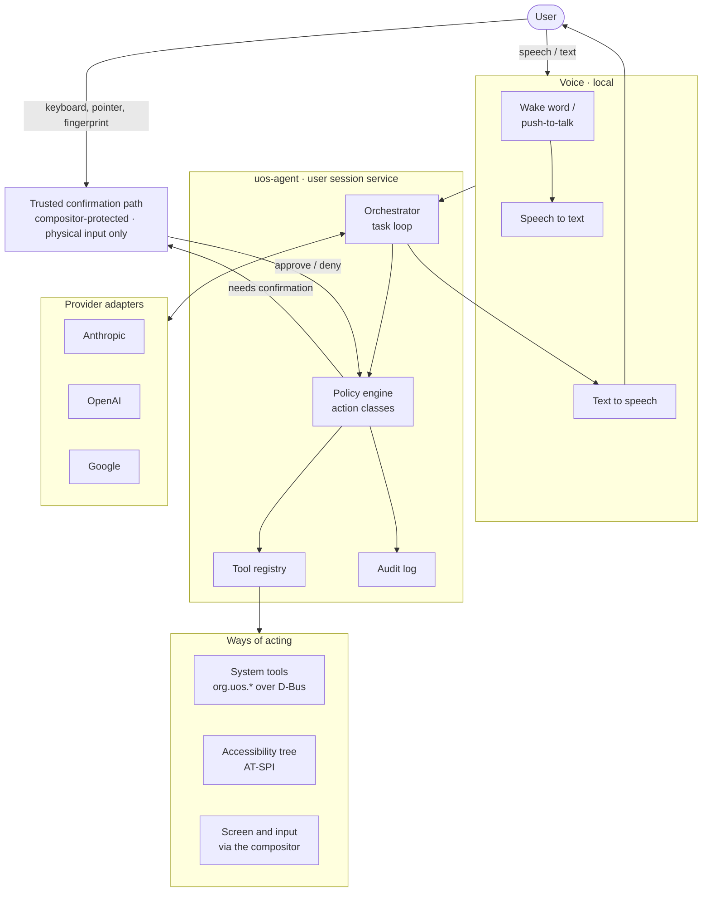

# AI control layer

**Specification addendum A — Draft for review**
**Applies to:** specification revision 1.0
**Related decision:** [ADR-0004](../adr/0004-ai-provider-model.md)

This addendum specifies the optional layer that lets a person operate UOS through
an AI assistant: by voice or text, with the assistant able to see and control
applications from every runtime. It adds a subsystem to the specification and
lists the amendments it requires in [section 14](#14-amendments-to-specification-revision-10).

Statements about what KWin, the desktop portals or a provider's API support are
design assumptions. Each must be verified against current upstream state before
implementation, as the specification requires (§0, rule 14).

---

## 1. Purpose and scope

**In scope**

- A session service, `uos-agent`, that turns a spoken or typed request into
  actions on the system.
- Three ways of acting: typed system tools, the accessibility tree, and screen
  plus input.
- An authority model that decides what the assistant may do without asking.
- A provider interface, with adapters for Anthropic, OpenAI and Google.
- A local voice pipeline.

**Out of scope**

- Any role in boot, installation, update or recovery. Those paths never depend on
  the AI layer.
- Real-time control of games.
- Training or fine-tuning models.
- A bundled model or a UOS-operated cloud service. The user brings a key.

## 2. Principles

1. **Optional and off by default.** UOS without a key is a complete product.
2. **Reach is not authority.** The assistant can reach every application. What it
   may do unprompted is decided by policy, never by the model.
3. **Most structured path first.** A typed tool is preferred to the accessibility
   tree, and the accessibility tree to pixels.
4. **The model is not a security boundary.** Every safeguard is enforced outside
   the model, in code the model cannot influence.
5. **Visible and interruptible.** The user can always see that the assistant is
   active and can always stop it.
6. **Recoverable.** Actions are logged, and reversible where the system can make
   them so.
7. **Provider-agnostic.** Provider-specific behaviour stays inside an adapter.

## 3. Architecture



| Component | Role |
|---|---|
| **Orchestrator** | Runs the task loop: send context to the provider, receive proposed actions, pass each through the policy engine, return results. Enforces step, time and spend limits. |
| **Policy engine** | Classifies every proposed action and decides: allow, ask, require authentication, or refuse. The only component that can release an action. |
| **Tool registry** | Loads tool manifests published by UOS services and exposes them to the provider in its tool format. |
| **Provider adapters** | Translate between the common interface and one provider's API. |
| **Audit log** | Records every proposed and executed action in the journal. |
| **Voice** | Local wake word, speech recognition and speech synthesis. |
| **Trusted confirmation path** | A compositor-protected prompt the assistant can neither see into nor operate. |

`uos-agent` runs as the logged-in user, with no more privilege than that user. It
has no access to other users' sessions.

## 4. Ways of acting

| Tier | Mechanism | Reliability | Used for |
|---|---|---|---|
| **1. System tools** | Typed operations on `org.uos.*` services and standard desktop interfaces | High; fast; cheap | Launching applications, volumes, devices, updates, diagnostics, settings, files |
| **2. Accessibility tree** | AT-SPI: named controls, roles, states and actions | Good where applications expose it | Native Qt and GTK applications |
| **3. Screen and input** | Screen capture and emulated keyboard and pointer, through the compositor | Variable; seconds per step | Everything else |

Expected coverage by runtime:

| Application type | Tier 1 | Tier 2 | Tier 3 |
|---|---|---|---|
| UOS services and settings | Yes | Yes | Yes |
| Native Linux (Qt, GTK) | Launch and files | Yes | Yes |
| Native Linux (other toolkits) | Launch and files | Partial | Yes |
| Windows applications under Wine | Launch and files | Not assumed | Yes |
| macOS applications under Darling | Launch and files | No | Yes |
| Applications in a Windows VM | Start and stop the VM | No | Yes, through the viewer window |
| Games | Launch only | No | Out of scope |

Screen and input go through the compositor using the desktop's remote-desktop and
screen-cast interfaces. On Wayland an ordinary application cannot read other
windows or inject input, so the compositor is the single point at which the
assistant's access is granted, shown and revoked. The grant is made once, in
settings, and is revocable; it is not a prompt on every session.

Tier 3 is the only way to operate Windows and macOS applications, and it is the
least reliable. Its success rate per application is measured and published in the
compatibility matrix alongside whether the application runs at all.

## 5. Authority model

Every action belongs to one class. The class, not the model, decides what happens.

| Class | Meaning | Examples | Rule |
|---|---|---|---|
| **0 Observe** | Reads state; changes nothing | Read the screen, list volumes, query an update | Allowed, subject to privacy exclusions |
| **1 Reversible** | Changes session or user state in a way that can be undone | Open or arrange windows, type into a document, create or move files, change a reversible setting | Allowed |
| **2 Consequential** | Hard to undo, or affects other people or money | Send a message or email, submit a form, purchase, delete permanently, install or remove software, change accounts or sharing | Ask the user first |
| **3 System-critical** | Can destroy data or stop the machine booting | Partitioning, formatting, encryption, bootloader, firmware, OS update and rollback, device hand-off to a VM, security policy | A person authenticates on the trusted path |
| **4 Prohibited** | Never performed by the assistant | Reading secrets from the keyring, changing its own policy or permissions, disabling its indicator or audit log, operating the trusted path, enabling experimental APFS write | Refused |

### 5.1 How an action is classified

- **System tools** declare their class in the tool manifest. The class is part of
  the service's reviewed interface and is enforced by the service through polkit,
  not only by the agent. A class 3 operation fails without human authentication
  even if called directly.
- **Accessibility and screen actions** cannot be classified from the action
  itself: a click is only a click. Two rules bound them:
  1. Privileged prompts reject emulated input (section 6), so nothing done
     through tiers 2 or 3 can exceed class 2.
  2. Before an action that the policy engine's rules identify as consequential,
     such as activating a control in a window matching a send, pay, delete or
     install pattern, or acting in an application the user has marked sensitive,
     the engine asks first. The rules are conservative: when in doubt, ask.

  The model may also flag an action as consequential. That can only add a
  confirmation; it can never remove one.

### 5.2 Confirmation

- **Class 2:** the assistant states what it is about to do, and the user approves
  on screen or by voice. A voice approval is accepted only under the conditions in
  section 9.
- **Class 3:** approval is given only on the trusted confirmation path, with
  physical input and the user's authentication. A spoken "yes" is never enough.
- An approval covers one stated action. It does not carry over to the next, and
  "approve everything" does not exist for classes 2 and 3.

### 5.3 User-adjustable policy

The user may make the assistant stricter (ask before every action, observe only,
exclude an application) at any time. The user may relax class 1 and class 2
handling for a named application. Classes 3 and 4 cannot be relaxed.

## 6. Trusted confirmation path

The assistant sees the screen and can emulate input. Without a protected path it
could approve its own requests, and anything on screen could ask it to. The
compositor therefore provides the following, and the design depends on them:

1. **Emulated input is distinguishable.** The compositor knows which input events
   come from physical devices and which from the assistant.
2. **Protected surfaces ignore emulated input.** Authentication dialogs, UOS
   confirmation prompts, keyring prompts and the lock screen accept physical input
   only.
3. **Protected surfaces are not captured.** They are excluded from the screen
   content given to the assistant.
4. **Protected surfaces cannot be imitated.** They are drawn by the compositor in
   a way an application window cannot reproduce or cover.
5. **A physical stop control.** A key combination handled by the compositor pauses
   the assistant and withdraws its input at once. The assistant cannot remap or
   suppress it.

If any of these cannot be met with the compositor as shipped, the work to add it
is proposed upstream first. Until all five hold, the assistant is limited to
classes 0 and 1.

## 7. Threat model

| Threat | Example | Mitigation |
|---|---|---|
| **Instructions in screen content** | A web page, email or document contains text addressed to the assistant | Content is data, not commands: only the user's request sets the task. Classes 2 and 3 need confirmation outside the model. Protected surfaces reject emulated input. An injection test suite gates releases. |
| **Instructions in audio** | A video plays "confirm" or issues a command | Voice input is ignored while the system itself is the source of the sound. Class 3 never accepts voice. Push-to-talk is the default. |
| **Instructions in tool results or files** | A file name or document body tells the assistant to act | As for screen content. Tool results are marked as untrusted data to the provider. |
| **Spoofed confirmation prompt** | An application draws a fake approval dialog | Real prompts are compositor-drawn and cannot be imitated or covered. |
| **Secret disclosure to the provider** | A password manager is visible when a screenshot is taken | Sensitive applications and protected surfaces are excluded from capture. Private mode. Per-application exclusion. |
| **Secret disclosure by action** | The assistant is induced to type or paste a secret into a web form | Keyring access is class 4. Clipboard reads are logged. Credential entry is left to the user. |
| **API key theft** | Another process reads the key | The key is in the system keyring, released only to `uos-agent`, and never written to profiles, logs or bundles. |
| **Malicious or compromised provider** | Responses propose harmful actions | The policy engine treats every proposal as untrusted. The provider gains no authority the user has not granted. |
| **Privilege escalation** | The assistant is used to obtain root | It runs as the user. Privileged operations go through polkit with human authentication. |
| **Self-modification** | The assistant relaxes its own policy or adds itself to autostart | Policy, permissions, indicator and audit log are class 4 and are not writable by the agent's user-level process. |
| **Acting unattended** | A long task continues after the user has left | Tasks pause when the session locks. Step, time and spend limits apply. |
| **Runaway cost** | A loop consumes the user's API credit | Per-task and per-day spend limits, shown to the user, enforced by the orchestrator. |

A residual risk remains and must be stated to users plainly: within class 1, an
assistant misled by on-screen content can still do unwanted reversible things,
such as moving files or editing a document. The audit log and undo support in
section 11 are the answer to that, not a claim that it cannot happen.

## 8. Privacy

Enabling the AI layer with a cloud provider sends data off the machine. This is
the one place UOS does so in normal operation, so it is governed by the same rule
as diagnostics (§0, rule 9): nothing silent, everything explained.

**What is sent to the provider:** the user's request as text, screenshots of the
screen region being worked on, accessibility-tree excerpts, and the results of
tools the assistant calls.

**What is not sent:** audio (recognised locally), the contents of protected
surfaces, windows of excluded applications, keyring contents, and diagnostic
bundles unless the user attaches one.

**Controls**

- **Consent at setup.** Before the first use, UOS shows what will be sent, to
  which provider, and links to that provider's data terms.
- **Indicator.** A persistent, compositor-drawn indicator shows when the assistant
  is observing and when it is controlling.
- **Exclusions.** Password managers, the keyring, the lock screen and private
  browser windows are excluded by default. The user can exclude any application.
- **Private mode.** One action suspends all observation.
- **Local record.** Requests, actions and results are logged locally. Screenshots
  are not kept after a task unless the user turns that on.
- **Diagnostic bundles** exclude AI transcripts and screenshots by default.

## 9. Voice

- **Local by default.** Wake-word detection, speech recognition and speech
  synthesis run on the machine. Audio is not sent to a provider unless the user
  chooses a provider's speech service.
- **Activation.** Push-to-talk is the default. An always-listening wake word is an
  option the user turns on.
- **Barge-in.** Speaking or pressing the stop control interrupts speech and pauses
  the task.
- **Spoken confirmation.** A class 2 action may be approved by voice only when the
  request was started by push-to-talk or wake word in the same exchange and the
  system is not itself playing the audio being heard. Otherwise the approval is
  asked for on screen.
- **Without a microphone or speakers** the same assistant is available through a
  text interface.
- **Accessibility.** The voice interface is designed as assistive technology too,
  and is tested with users who rely on it.

## 10. Provider interface

An adapter implements:

| Capability | Required | Notes |
|---|---|---|
| Streaming conversation | Yes | |
| Tool calling with JSON-schema inputs | Yes | |
| Image input | Yes | For tier 3 |
| Native computer-control tooling | No | Used where the provider offers it; otherwise a generic screenshot-and-tools loop |
| Model discovery | No | Model names are configuration, never compiled in |
| Speech services | No | Opt-in only |

Rules:

- The adapter reports the provider's declared capabilities; the orchestrator
  adapts rather than assuming parity.
- A provider's refusal, rate limit, timeout or malformed response is a normal
  result with a stable `UOS-AI-*` error code, reported to the user in plain terms.
- Each adapter passes the same conformance suite (section 12). Results are
  published per provider.
- Adapters are written against the provider's current documentation at the time,
  and pinned to an API version where the provider supports that.

## 11. Interfaces, logging and undo

**D-Bus.** `org.uos.Agent1` on the session bus. Proposed surface, to be fixed in an
interface specification before implementation (§16):

```text
Methods   StartTask(request, options) -> task_id
          CancelTask(task_id)
          Pause()  Resume()
          GetStatus() -> state, task, provider, spend
Signals   ActionProposed(task_id, action, class)
          ConfirmationRequested(task_id, action, class)
          ActionCompleted(task_id, action, result)
          TaskFinished(task_id, outcome)
```

**Tool manifest.** Each UOS service ships a manifest describing its
assistant-facing operations. Illustrative:

```json
{
  "schema_version": 1,
  "service": "org.uos.Storage1",
  "tools": [
    {
      "name": "storage_list_volumes",
      "description": "List detected volumes with filesystem, state and mount point.",
      "class": 0,
      "method": "ListVolumes",
      "input_schema": { "type": "object", "properties": {}, "additionalProperties": false }
    },
    {
      "name": "storage_unmount",
      "description": "Unmount a volume by its UOS volume identifier.",
      "class": 1,
      "method": "Unmount",
      "input_schema": {
        "type": "object",
        "properties": { "volume_id": { "type": "string" } },
        "required": ["volume_id"],
        "additionalProperties": false
      }
    }
  ]
}
```

A manifest is part of a service's definition of done. Destructive operations
(format, partition, encrypt) are class 3 and are enforced by the service itself.

**Audit log.** Structured journal records, one per proposed action:

```text
UOS_AI_TASK=<task-id>
UOS_AI_ACTION=<tool or input action>
UOS_AI_CLASS=<0-4>
UOS_AI_DECISION=allowed | confirmed | denied | refused
UOS_AI_TIER=<1-3>
UOS_AI_PROVIDER=<adapter>
UOS_ERROR_CODE=<UOS-AI-* if any>
```

**Error codes.** A new family, `UOS-AI-*`, in the registry (§29.3).

**Undo.**

- Deletions by the assistant go to the trash, never straight to permanent removal.
- Each task records the files it created, moved or changed, so the user can review
  and reverse them.
- Where the home filesystem supports snapshots, one is taken before a multi-step
  file task. This is an option, measured before it becomes a default.
- The OS image is immutable and rolls back independently of anything the assistant
  does in the session.

## 12. Testing

| Test | What it proves |
|---|---|
| **Scripted task suite** in a VM | Tasks complete through each tier; results are reproducible |
| **Injection suite** | Pages, documents, file names and audio carrying adversarial instructions never cause a class 2 or 3 action without confirmation |
| **Trusted-path tests** | Emulated input is rejected by every protected surface; protected surfaces are absent from capture |
| **Policy tests** | Every tool's class is enforced by the service when called directly, bypassing the agent |
| **Provider conformance** | The same tasks against each adapter, with results published |
| **Limits** | Step, time and spend limits stop a task; a locked session pauses it |
| **Privacy tests** | Excluded applications never appear in provider requests; keys never appear in logs or bundles |

The screen-and-input harness is also the project's GUI test driver. Driven by a
fixed script instead of a model, it needs no API key, which is why it is built
early (section 13).

Tests against real providers cost money and are not deterministic. They run on a
schedule and on request, not on every change. Voice tests with a real microphone
need the physical test PC ([ADR-0002](../adr/0002-ci-and-build-infrastructure.md)).

## 13. Roadmap integration

The AI layer is built alongside the existing phases, not after them.

| Milestone | With phase | Deliverable | Exit criterion |
|---|---|---|---|
| **A0 Foundations** | 0–1 | Tool manifest schema, policy engine, audit log; no model | A scripted caller exercises every class against a test service; class 3 fails without authentication |
| **A1 Tools per service** | 1–2 onward | Each UOS service ships its manifest | Diagnostics, storage, device and update tools pass policy tests |
| **A2 Screen and input** | 3 | Compositor capture and input harness; scripted GUI test driver | CI drives the desktop in a VM without an API key |
| **A3 Trusted path** | 3 | The five compositor guarantees of section 6 | Trusted-path tests pass; until then the assistant is limited to classes 0 and 1 |
| **A4 Providers and text interface** | after 3 | Anthropic, OpenAI and Google adapters; text command interface | Conformance suite passes on each; injection suite passes |
| **A5 Voice** | after A4 | Local wake word, recognition and synthesis | Hands-free task on the physical test PC |
| **A6 Foreign applications** | 4–5 | Tier 3 control of Windows and macOS applications | Per-application success rates published in the compatibility matrix |
| **A7 Security review** | 7 | Independent review and red-team of the AI layer | Findings resolved or documented before release |

## 14. Amendments to specification revision 1.0

| Section | Amendment |
|---|---|
| §0 | Add rules: the AI layer is optional and off by default; the assistant never holds authority a person has not granted; no provider contact outside `uos-agent`. |
| §1 | Add **UOS Agent** as a sixth integration-layer contribution. |
| §2.1 | Add goal: optional operation of the whole system by voice or text through an AI assistant. |
| §2.2 | Add non-goals: a bundled model; a UOS cloud service; AI in the boot or recovery path. |
| §9.4 | Add the trusted confirmation path and the activity indicator to shared desktop services. |
| §12 | Add §12.5, AI layer security, referring to sections 5 to 8 here. |
| §16 | Add `org.uos.Agent1` and the tool-manifest requirement for every service. |
| §18.1 | Add `services/uos-agent/` and `tests/ai/`. |
| §18.3 | Add CI stages: policy tests, trusted-path tests, injection suite. |
| §20 | Add milestones A0 to A7 as in section 13. |
| §24 | Add risks: prompt injection (critical); disclosure to a provider (high); provider API change (medium). |
| §29.3 | Add the `UOS-AI-*` error-code family. |
| §29.4 | Clarify that the rule against an automated agent changing bootloader, partition, encryption, kernel or firmware settings on a live computer applies equally to the on-device assistant: class 3. |

## 15. Open questions

1. **Compositor guarantees.** Which of the five in section 6 does KWin provide
   today, and which need upstream work? This decides when A3 can be met.
2. **Accessibility of Wine applications.** Is there any usable bridge from Windows
   accessibility interfaces to AT-SPI? The design assumes there is not.
3. **Voice approval for class 2.** Are the conditions in section 9 strong enough,
   or should class 2 always be confirmed on screen?
4. **Home snapshots.** Does the chosen filesystem layout make per-task snapshots
   cheap enough to be a default?
5. **Local models.** When is a local adapter worth adding, and for which tiers?
6. **Narrowing data sent.** Can a local model pre-filter or redact screenshots
   before they reach a cloud provider at acceptable cost?
7. **Multiple providers at once.** Should a task be able to use one provider for
   planning and another for screen control?
