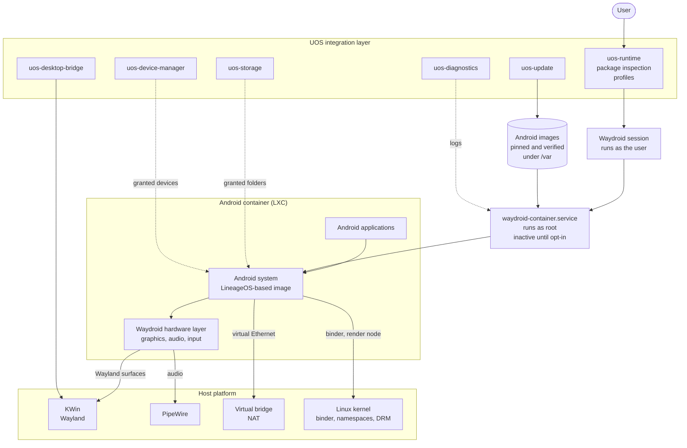

# Android runtime

**Specification addendum B — Draft for review**
**Applies to:** specification revision 1.0
**Related decision:** [ADR-0006](../adr/0006-android-runtime.md) (Proposed)

This addendum specifies how UOS runs Android applications. It adds a fourth
application ecosystem to the specification and lists the amendments that requires
in [section 15](#15-amendments-to-specification-revision-10).

The owner's requirement is that Android applications "should fully work and be
supported". This document pursues that seriously and states plainly where it
cannot be met. A large class of Android applications is tied to Google's device
certification, and no engineering inside UOS changes that
([section 11](#11-what-will-and-will-not-work)). UOS does not claim complete
Android compatibility. Compatibility is application-specific and is measured
(§0, rule 7).

**How to read the claims in this document.** Three kinds of statement appear:

- **Verified.** Checked against the upstream source on 12 November 2026. Each has
  a reference such as [S3] to [section 17](#17-sources).
- **Measured.** Taken from a UOS build manifest produced by CI, with the run
  number.
- **Assumption.** Not verified. Marked as such, and to be verified before
  implementation, as the specification requires (§0, rule 14).

---

## 1. Purpose and scope

**In scope**

- Installing, launching and removing Android applications supplied by the user as
  APK files or split-APK sets, through `uos-runtime`.
- Presenting them as ordinary windows and launcher entries on the Plasma desktop.
- Sharing host services with them under UOS policy: storage, audio, network,
  selected devices, clipboard, notifications.
- Versioning, pinning, updating and rolling back the Android system image on an
  immutable host.
- Diagnostics, error codes and a published compatibility matrix.
- Operation by the AI control layer.

**Out of scope**

- Passing Google's Play Integrity device checks. This is not possible
  ([section 11](#11-what-will-and-will-not-work)).
- Bundling Google Mobile Services, the Play Store, an ARM translation layer,
  Widevine, or any other proprietary component
  ([ADR-0003](../adr/0003-licence.md)).
- Circumventing attestation, DRM, licence checks or anti-cheat. UOS ships no
  tool whose purpose is to defeat them.
- Hardware that a PC does not have: cellular radio, NFC, a secure element.
- A UOS application store.
- Android as a boot target, or any role for Android in boot, installation,
  update or recovery of UOS itself.

## 2. Principles

1. **Optional and off by default.** No Android component runs, and no privileged
   daemon for it is active, until the user turns Android support on.
2. **The host kernel stays the only hardware authority.** Android receives host
   services and explicitly granted devices. It owns no physical device.
3. **Nothing proprietary in the image.** What UOS cannot ship, the user may
   supply or opt into, with the consequences stated first.
4. **Explain before installing.** A package is inspected before it runs. If it
   cannot work, UOS says so and why, with a stable error code, instead of
   installing something that will crash.
5. **Android grants are host grants.** A permission dialog inside Android is not
   a security boundary for the host. Access to a host resource is decided on the
   host.
6. **Measured, not claimed.** Results are published per application, with
   versions and hardware.
7. **Integrate, do not fork.** UOS drives upstream Waydroid through its
   documented interfaces. Fixes go upstream first.

## 3. State of upstream, November 2026

Checked on 12 November 2026. This section records what was found, including
where it differs from what the project assumed when this work was requested.

### 3.1 Waydroid

| Question | Finding | Source |
|---|---|---|
| What it is | A full Android system in an LXC container on the host kernel, drawing to the host Wayland compositor. Licence GPL-3.0. | [S1] |
| Maintained? | Yes. Latest release 1.6.3 on 28 May 2026; commits to October 2026; system image built 27 September 2026 and vendor image 22 October 2026. About 980 open issues and pull requests. | [S1] [S2] [S3] |
| Android version of the official images | **Android 13** (LineageOS 20). No newer official image exists. Release 1.6.3 adds "initial support for Android 16 images", and a `dev/lineage-23.2` branch is under development. | [S1] [S2] [S3] [S11] |
| Security patch status of Android 13 | The November 2026 Android Security Bulletin lists fixes for Android 14, 15, 16 and 17 only. Android 13 no longer receives fixes from Google. Whether LineageOS still backports to version 20 could not be confirmed. | [S20] |
| Image variants | `VANILLA` (no Google software) and `GAPPS` (with Google applications). The documentation also names `FOSS`; its channel is empty. | [S3] [S9] |
| Multi-window | Yes. `persist.waydroid.multi_windows` makes each Android task a desktop window. Open defects exist, including focus stealing and crashes. | [S4] [S5] [S12] |
| GPU | Uses the host's Mesa driver through the DRM render node. Vulkan on Intel `xe` added in 1.6.2. Falls back to software rendering when no usable render node exists. NVIDIA's proprietary driver is treated as unsupported: software rendering. | [S2] [S6] [S10] [S23] |
| Runs in a VM | Yes, with software rendering, or with virtio-gpu acceleration under QEMU. | [S6] |
| Notifications, clipboard | Android notifications are forwarded to the desktop since 1.6.0. Clipboard synchronisation is built in since 1.5.1. | [S2] |
| Debug access | ADB is in secure mode by default since 1.6.0. | [S2] |
| Root daemon | Yes. `waydroid-container.service` is a system service on the system D-Bus, running as root. | [S10] [S14] |
| Container privileges | The generated LXC configuration contains no ID mapping, keeps a broad capability set including `sys_admin`, `net_admin` and `mknod`, applies a seccomp profile and `no_new_privs`. Upstream's README lists a user namespace; the configuration read does not show one. **To be verified on a running system.** | [S10] |
| Device nodes passed in by default | Every `/dev/video*` node, the DRM render node, `/dev/uhid`, `/dev/fuse`, `/dev/net/tun`, and a recursive bind of `/sys/kernel/debug`. | [S10] |
| Camera, Bluetooth, location | Camera: open crash reports on Fedora in September and October 2026. Bluetooth: not supported; requests open since 2021. Location: not supported; request open since 2021. | [S12] |
| ARM applications | Not supported by the official images on x86-64. Upstream's own documentation says ARM-only packages "won't work". | [S9] |

### 3.2 Fedora 45 and Fedora Atomic

| Question | Finding | Source |
|---|---|---|
| Packaged in Fedora 45? | Yes: `waydroid-1.6.3-2.fc45`, with a `waydroid-selinux` subpackage. | [S13] [S14] |
| What the Fedora package adds | An SELinux policy module (`waydroid_t` for the daemon); a `dev-binderfs.mount` unit of type `binder`; firewalld zone assignment for the container interface; D-Bus activation; removal of the AppArmor setting. It has no dependency on any kernel-module package. | [S14] |
| Image download | The Fedora package **blanks the default image URLs**. The user must enter the system and vendor channel URLs at first start. | [S4] [S14] |
| SELinux domain of the Android processes | The policy lets the container's entry point enter `container_runtime_t`, the domain of the container runtime itself; a denial report of October 2026 also shows `spc_t`, the privileged-container domain. Both are domains that SELinux confines little (**assumption**, to be measured). Android's own SELinux policy is not enforced inside the container; a request to add it has been open since 2023. | [S12] [S14] |
| How it is installed on Fedora Atomic desktops | Upstream documents `rpm-ostree install waydroid` (package layering) on Silverblue, Kinoite and other variants. Bazzite, a bootc image derived from Fedora Atomic, ships Waydroid inside the image and configures it with a helper command; it uses its own kernel build. | [S4] [S23] |
| Does it run on the stock Fedora kernel? | A bug report from October 2026 shows Waydroid 1.6.3 running on Fedora 44 with stock kernel `7.2.9-200.fc44`. See section 3.3. | [S12] |
| What this means for UOS | UOS is a bootc image, so the package is added in the `Containerfile` at build time, as Bazzite does, not layered on the installed system. | — |

### 3.3 Binder in the kernel

Waydroid needs the Android binder IPC driver in the host kernel.

**Measured.** From the build manifest of CI run 43147702795, UOS image, kernel
`7.3.3-300.fc45.x86_64`:

| Option | Value | Meaning |
|---|---|---|
| `CONFIG_ANDROID_BINDER_IPC` | `n` | The C binder driver is off |
| `CONFIG_ANDROID_BINDER_IPC_RUST` | `y` | The Rust binder driver is built into the kernel |
| `CONFIG_ANDROID_BINDER_DEVICES` | `"binder,hwbinder,vndbinder"` | Three device names are created by default |
| `CONFIG_ANDROID_BINDERFS` | absent from the configuration | See below |
| `CONFIG_KVM` | `m` | Hardware virtualisation is available |

**Binder is available on the stock Fedora 45 kernel, through the Rust driver.**
No kernel change, module or patch is needed, so
[ADR-0001](../adr/0001-base-distribution.md) holds. The project had expected the
options `CONFIG_ANDROID_BINDER_IPC` and `CONFIG_ANDROID_BINDERFS`. Those name
the C driver, which Fedora does not build and which mainline has removed: at
7.4-rc2 only `ANDROID_BINDER_IPC_RUST` and `ANDROID_BINDER_DEVICES` remain.
[S16] [S17] Fedora 43 and 44 carry the same configuration as Fedora 45. [S15]
Any check in UOS must key on the Rust option, not on the old names.

Three questions follow from "the driver is there". Each answer below is from
reading source, and none is yet a measurement on a running UOS image. The first
container start in CI (milestone B1) is the functional test for all three.

**1. Is binderfs present, although `CONFIG_ANDROID_BINDERFS` is absent?**
Yes, by the source. In Linux 7.3 `ANDROID_BINDERFS` builds the C driver's
binderfs and depends on the C driver, so it cannot appear when the C driver is
off. The Rust driver always builds its own binderfs (`rust_binderfs.c`), which
registers a filesystem of type `binder`, provides the `binder-control` device
for creating further devices, and creates the devices named in
`CONFIG_ANDROID_BINDER_DEVICES` in every mount. [S16] The absence of the
separate option therefore does not matter. To confirm on a running system:
`binder` is listed in `/proc/filesystems` and the mount succeeds.

**2. Does Waydroid work with the Rust driver and the three static names?**
Expected to, with known defects.

- Waydroid looks for device nodes named `binder`, `vndbinder` and `hwbinder`
  among others, and uses them if they exist. If they do not, it mounts binderfs
  itself and creates its own through `binder-control`. [S10]
- Fedora's package mounts binderfs at `/dev/binderfs` with a systemd mount unit
  and links the three nodes into `/dev` before the daemon starts. [S14] With
  this kernel's three default names, Waydroid finds what it looks for. The
  package depends on no kernel-module package.
- A bug report of October 2026 shows Waydroid 1.6.3 running on Fedora 44 with
  stock kernel `7.2.9-200.fc44`, which has the same binder configuration. [S12]
  [S15] That is evidence that the combination runs, not that it runs well.
- Defects of the Rust driver have affected Waydroid: broken audio on 6.18,
  fixed in 6.18.6; and failure of transactions above about 1 MB on 7.2 kernels,
  reported in September 2026 and still open, with crashes of Android system
  services. [S12] Whether 7.3.3 is affected is unknown.
- **Assumption:** the official Android 13 images behave the same on the Rust
  driver as on the C driver, since both implement one user-space interface. Not
  verified.

**3. What does SELinux need?**

- The Rust driver calls the same security hooks as the C driver for setting the
  context manager, for transactions, and for passing binder objects and files.
  [S16] SELinux's `binder` permissions therefore apply, and a policy is needed.
- Fedora's `waydroid-selinux` module supplies it: access to binderfs and the
  binder devices for the daemon, and `binder` call and transfer rules between
  the daemon, the container and the user's session. [S14]
- It labels everything under `/var/lib/waydroid` for the daemon, and mounts the
  Android root filesystem with a fixed label. [S14] Images that UOS manages
  must therefore live under that directory, or UOS must add a file-context rule.
- The policy is not complete. A report of October 2026 on Fedora 44 shows a
  `binder` transfer denied between two container domains. [S12] UOS tests with
  SELinux enforcing and treats any denial on the supported path as a defect to
  report upstream, never as a reason to go permissive.
- **Assumption:** the module installs correctly when the package is added
  during the image build rather than on a running system.

### 3.4 What an Android environment cannot provide

| Topic | Finding | Source |
|---|---|---|
| Play Integrity | On Android 13 and later every device verdict requires hardware-backed key attestation rooted in a Google-provisioned key. `MEETS_DEVICE_INTEGRITY` requires a locked bootloader and a certified manufacturer image. An emulator "that does not pass Google Play integrity checks" returns an empty verdict. Google grants `MEETS_VIRTUAL_INTEGRITY` only to its own Play Games for PC. | [S19] |
| ARM translation | No open translator from ARM to x86-64 for Android was found. Google's open translator, Berberis, supports RISC-V guests only. Intel's `libhoudini` and Google's `libndk_translation` are proprietary; a community script extracts them from a Microsoft and a ChromeOS image. | [S21] [S22] |
| Google Mobile Services | Proprietary. microG is an open reimplementation, Apache-2.0, maintained (release of 29 September 2026). By its own users' reports it reaches at most the basic integrity verdict, not the device verdict. That report was not verified against a primary source. | [S25] |
| Widevine | Level 1 requires a trusted execution environment and device provisioning. Level 3 is a proprietary component. Secondary sources only. | [S26] |

### 3.5 Alternatives

| Project | State | Source |
|---|---|---|
| Android-x86 | Dormant; last releases 2020 and 2021 (secondary source). | [S27] |
| BlissOS | Last release announced June 2024; last blog post August 2025. Android 13 base. | [S27] |
| Cuttlefish | AOSP's reference virtual device, maintained by Google. Built for development and testing. Android runs as a guest with its own kernel. | [S28] |
| crosvm, libkrun | Maintained virtual machine monitors. libkrun is packaged in Fedora; crosvm was not found in Fedora's package sources. | [S28] |
| QEMU virtio-gpu | Documents Wayland passthrough to the host compositor (`cross-domain`), Vulkan (`venus`) and native-context acceleration for AMD and Intel. | [S29] |
| Android Translation Layer | Runs an application's code against a reimplementation of the Android API, with no container. GPL-3.0-or-later, active on 8 November 2026. By its own description early: "chances are that we are missing implementations". | [S24] |
| redroid | Android in a container for servers; needs binder like Waydroid. | [S30] |
| Anbox | Archived. | [S30] |

No newer project was found that replaces Waydroid for desktop use.

## 4. Options and recommendation

The specification separates a compatibility runtime (Wine, Darling) from a full
guest operating system (§3.4, §13). Android adds a third kind, and the
difference must stay visible to users and in diagnostics:

| Kind | Example | Kernel | What is translated |
|---|---|---|---|
| Compatibility runtime | Wine, Darling | Host | The foreign API |
| **OS container** | Waydroid | Host | Nothing. A complete Android userspace runs on the host kernel |
| Full guest | Windows under QEMU/KVM | Its own | Nothing. A complete OS on virtual hardware |

### 4.1 Options considered

| | A. Waydroid container | B. Android in a virtual machine | C. Android Translation Layer | D. Out-of-tree binder module, then A |
|---|---|---|---|---|
| Kind | OS container | Full guest | Compatibility runtime | OS container |
| Host kernel requirement | Binder (measured: present) | KVM (measured: present) | None | A module UOS builds and signs |
| Root on the host | A root daemon; root inside the container is host root with reduced capabilities (to be verified) | The VM monitor runs as the user | None | As A |
| Application compatibility | Highest available: a real Android system | Same as A in principle | Low today | As A |
| Per-application windows | Yes, upstream feature | Unproven. QEMU documents Wayland passthrough; nobody ships it for Android | Yes, by design | As A |
| GPU | Host Mesa directly; no NVIDIA proprietary | virtio-gpu; vendor support depends on the mode | Host directly | As A |
| Memory cost | Shared with the host | Reserved for the guest; to be measured | Lowest | As A |
| Packaged in Fedora 45 | Yes | QEMU and libkrun yes; no Android guest image | No | No |
| Fits §12.1, "no runtime as root" | **No** | Yes | Yes | No |
| Fits ADR-0001, stock kernel | Yes | Yes | Yes | **No** |
| Fixes Play Integrity, ARM-only apps or DRM | No | No | No | No |

No option changes what section 11 lists as impossible. The choice is about
integration, isolation and maintenance, not about reaching the certified-device
applications.

### 4.2 Recommendation

**Waydroid, from the Fedora package, as an opt-in OS container.**

- It is the only option that runs a broad range of applications today, and the
  only one packaged for the base distribution with an SELinux policy.
- It needs no kernel change: binder is in the stock kernel (section 3.3), so
  [ADR-0001](../adr/0001-base-distribution.md) holds.
- Desktop integration that UOS would otherwise have to build already exists
  upstream: per-application windows, launcher entries, notifications, clipboard.
- It is how Android is run on Fedora Atomic desktops today (section 3.2).

Its cost is security. It cannot meet the "no runtime as root" rule of §12.1.
Section 10 sets the conditions under which that deviation is acceptable, and
ADR-0006 records it.

The virtual-machine route (option B) is kept as a planned evaluation, milestone
B7, on the QEMU/KVM stack that phase 6 builds for Windows. Its preferred form is
Waydroid inside a minimal Linux guest, with windows reaching KWin through
virtio-gpu Wayland passthrough and graphics through native context or Venus.
[S29] That would keep per-application windows and remove the root container
from the host kernel. Nobody is known to ship this combination; it is an
**assumption** that it works and performs acceptably. If it does, a VM may later
become the default.

Android Translation Layer is tracked and re-evaluated at each Fedora rebase. It
fits UOS's principles best and runs the fewest applications.

### 4.3 Contingency: if binder stops being usable

Binder is in the stock kernel today, but UOS controls neither Fedora's
configuration nor the Rust driver's quality. If a Fedora rebase removes binder,
or a driver defect makes Waydroid unusable, the order of preference is:

1. **Hold the base pin** on the last good kernel while the defect is reported to
   Fedora and to the kernel maintainers. The base is pinned by digest, so this
   is a decision not to move one file. It also holds back security fixes, so it
   is a short-term measure only.
2. **Move Android into a micro-VM with its own kernel**, as described in 4.2.
   The guest kernel is a file loaded by a user-space VM monitor. It is not part
   of the host boot chain, so Secure Boot is unaffected. It is never installed
   as a host kernel. UOS would have to build, pin and update it.
3. **Not an out-of-tree binder module, and not a custom host kernel.** An
   out-of-tree module must be built in CI for each exact kernel, signed with a
   UOS key that every user enrols in firmware by hand, and would block kernel
   updates until it builds. It would be a private copy of a driver that mainline
   has deleted; the one maintained copy calls unexported kernel functions
   through address lookup. [S18] A defect in it crashes the host. This trades
   priority 1, a system that boots, for Android. ADR-0001 already requires a
   separate ADR for any such module; this document recommends against one.

Changing to a micro-VM changes the kind of runtime (a full guest, with a second
kernel that the UI and diagnostics must name), ends the §12.1 deviation,
reserves memory for the guest, and replaces bind mounts and device nodes with
virtual devices. Sections 6 to 9 would stay as written above that transport.

## 5. Architecture



| Component | Role | Owner |
|---|---|---|
| **Android system image** | LineageOS-based system and vendor images. Read-only at run time. | Upstream Waydroid; pinned by UOS |
| **Container service** | Root daemon that mounts the images, creates the container and the virtual network. | Upstream Waydroid, Fedora package |
| **Session** | Per-user process that connects the container to the user's Wayland and audio sockets and holds the user's Android data. | Upstream Waydroid |
| **Android adapter in `uos-runtime`** | Inspects packages, decides whether they can run, installs, launches, removes, and applies UOS policy to the container. | UOS |
| **Android adapter in `uos-desktop-bridge`** | Window identity, launcher entries, notifications, clipboard and link handling. | UOS |

UOS code talks to Waydroid through its command line and D-Bus interface only. It
does not import or link Waydroid's code, which keeps the licence boundary of
ADR-0003 clear.

### 5.1 Fit with the core principles

| Principle | How the design meets it | Tension |
|---|---|---|
| §3.1 One kernel, one hardware authority | Android runs on the host kernel and has no driver of its own. GPU, audio and network reach it as host services. | Upstream passes raw device nodes into the container by default. UOS removes those (section 10). |
| §3.2 Native execution before translation | x86-64 and architecture-neutral applications run directly. | ARM-only applications need instruction translation, the first case of it in UOS. It is opt-in and not shipped (section 12). |
| §3.3 Host services shared, not duplicated | PipeWire, KWin and NetworkManager stay the only managers of physical resources. | Waydroid runs its own DHCP and DNS service for its virtual bridge. It manages no physical interface. Recorded as accepted. |
| §3.4 Runtime and full OS kept distinct | The OS-container kind is named in the UI and in diagnostics. | None. |
| §3.5 Recovery | The Android image is outside the OS deployment and has its own rollback. A broken Android runtime never affects boot health. | None. |
| §12.1 No runtime as root | Not met. | See section 10.3. |
| §7.2, §12.2 One isolated environment per application | Not met. All of a user's Android applications share one Android system. Isolation between them is Android's own. | Recorded as an amendment. |

## 6. Runtime manager

### 6.1 Package detection

Detection is by content, never by extension (§2.3). Nothing is executed.

| Input | How it is recognised | Result |
|---|---|---|
| **APK** | ZIP archive containing a binary `AndroidManifest.xml` and at least one DEX file; signing block present | Installable, subject to the checks below |
| **Split-APK set** (`.apks`, `.xapk`, `.apkm`) | ZIP archive containing several APKs with a base APK and a set description; optional expansion files | Installable as one session. The matching splits for architecture, density and language are selected. These container formats are community conventions without a formal specification: **assumption**, to be pinned to tested samples |
| **Android App Bundle** (`.aab`) | ZIP archive with a `base/` module and protocol-buffer manifest | **Not installable.** A bundle is a publishing format. Turning it into APKs needs Google's `bundletool` and a signing key, and the result is not signed by the original developer. UOS explains this (`UOS-ANDROID-PKG-006`). An opt-in developer path is an open question |
| **Expansion file** (`.obb`) | Belongs to an installed package | Offered only alongside its package |

The inspector reads from the package: the package name, version, minimum and
target API level, signing certificate digest, native-library architectures,
requested permissions, required hardware features, and whether it declares a
dependency on Google Play services.

### 6.2 Verdict before installation

| Check | Outcome when it fails | Code |
|---|---|---|
| Android support enabled and image present | Offer to enable; nothing is installed | `UOS-ANDROID-RUNTIME-001` |
| Minimum API level is at most the image's level (33 for the current image) | Refuse and explain | `UOS-ANDROID-PKG-003` |
| Native code includes `x86_64`, or the package has no native code | If ARM only: refuse unless the user has supplied a translation layer; then install with a warning | `UOS-ANDROID-ABI-001`, `-002` |
| Required hardware features exist (telephony, NFC, GPS, Bluetooth and so on) | Warn and name the missing feature; the user may continue | `UOS-ANDROID-DEVICE-001` |
| No dependency on Google Play services, or a provider is installed | Warn that features will be missing; the user may continue | `UOS-ANDROID-GMS-001` |
| Signature valid; on update, same signer as the installed version | Refuse | `UOS-ANDROID-PKG-004`, `-005` |

The verdict is shown before anything is installed: who signed the package, what
it asks for, and what is expected not to work. Installation is always started by
the user (§7.2).

### 6.3 Profile

One profile per application, in the schema of §7.3. Illustrative:

```json
{
  "schema_version": 1,
  "app_id": "org.example.reader",
  "display_name": "Example Reader",
  "format": "apk",
  "architecture": "x86_64",
  "runtime": "android-container",
  "runtime_version": "pinned-by-runtime-manifest",
  "android": {
    "package": "org.example.reader",
    "version_code": 412,
    "min_api": 26,
    "target_api": 35,
    "signer_sha256": "value-from-package",
    "native_abis": ["x86_64", "arm64-v8a"],
    "needs_translation": false,
    "needs_google_services": false,
    "missing_features": ["android.hardware.location.gps"]
  },
  "window_mode": "freeform",
  "input_mode": "pointer",
  "isolation_profile": "android-standard",
  "fallback": "explain-unsupported",
  "test_status": "untested"
}
```

`input_mode` records whether the pointer is delivered as a mouse or as touch,
which some applications need. [S5] There is no per-application prefix: the
profile records settings, not an environment.

### 6.4 Operations

Exposed on `org.uos.Runtime1`, not on a new service.

| Operation | Effect | Authorisation |
|---|---|---|
| Enable Android support | Fetch and verify the pinned image, initialise the container, enable the service | Administrator authentication |
| Inspect | Return the verdict of 6.2 | None |
| Install, update | Install a package or split set | User confirmation |
| Launch, stop | Start the session if needed and the application | None |
| Remove | Remove the application and its data | User confirmation |
| Reset | Erase the user's Android data | User confirmation naming what is erased |
| Back up, restore | Archive the user's Android data with the session stopped | User confirmation |
| Disable Android support | Stop and disable the service; optionally remove images and data | Administrator authentication |

### 6.5 Selection and fallback

The fallback tiers of §7.4 gain one entry: Android packages go to the Android
container. There is no second route today. When a package cannot run, the result
is tier 5, an explanation, with the reason from section 11. If a VM backend is
adopted later it becomes the alternative for hosts where the container cannot
be used.

## 7. Desktop, storage, devices, audio and network

### 7.1 Desktop bridge

| Service (§9.3, §9.4) | Status | How |
|---|---|---|
| Windows | Supported | Multi-window mode: one Wayland toplevel per Android task, drawn directly to KWin. No XWayland. Phone-oriented applications open as portrait windows; some refuse to resize |
| Window identity | Supported; **assumption** on the exact identifier | The bridge maps each window's application identifier to the profile, so task switching, pinning and diagnostics show the application, not "Waydroid" |
| Launcher entries and icons | Supported | Waydroid writes desktop entries for installed applications and hides Android system applications. [S2] The bridge normalises them and adds the runtime to application properties |
| Notifications | Supported | Forwarded by Waydroid to the desktop notification service, with actions. [S2] Delivered only while the Android session runs |
| Clipboard | Supported | Built-in synchronisation. [S2] Shared both ways while an Android window has focus; a setting turns it off. Whether upstream offers that switch is an **assumption** |
| File chooser | Partial | Android applications see Android's own picker over the folders granted in 7.2. No portal integration |
| Opening a file with an Android application | Later | The file must be inside a granted folder; the bridge then sends a view intent |
| Links from the host into an application | Partial | `uos-runtime` can send an intent with a URI. Custom URI schemes are registered on the host only when the user chooses. Web links are never claimed: the host browser stays the default |
| Links from Android to the host browser | **Assumption:** not provided upstream | To be built or proposed upstream; until then links open inside Android |
| Share between host and Android applications | Unavailable | No bridge between the Android share sheet and the desktop |
| Drag and drop | Unavailable | |
| Printing | Unavailable | No bridge from Android's print framework to CUPS |
| Screen capture of Android windows | Supported | They are ordinary Wayland windows to the portal |
| Text input | Supported for hardware keyboards; input methods for other scripts are an open question | |

### 7.2 Storage

- **Nothing from the host is visible by default.** Not the home directory, not
  `/run/uos/volumes`.
- Android's own shared storage lives in the user's Waydroid data directory.
  [S8] Files there are owned by Android's identities, not by the user, so the
  desktop cannot simply browse it.
- `uos-storage` offers **grants**: the user picks a folder or a mounted volume,
  and it appears inside Android's shared storage, read-only or read-write. A
  grant is a bind of the one canonical host mount (§11.4), never a second mount
  of the filesystem.
- Ownership must be mapped so that files written by Android applications belong
  to the user on the host. Upstream documents `bindfs` for this. [S8] Whether an
  ID-mapped mount can replace it is an open question.
- Grants are listed in settings, revocable, recorded in the profile store and
  re-applied when the session starts.
- The storage safety rules apply unchanged: a volume that is read-only on the
  host is read-only in Android.

### 7.3 Devices

Linux owns every device (§10.1). The container receives a device only through a
grant from `uos-device-manager`. Upstream's default of passing in every video
node is removed.

| Device | In the container by default | With a grant | Limit and where it can be fixed |
|---|---|---|---|
| GPU | Render node only | — | Intel and AMD through Mesa. NVIDIA proprietary driver: software rendering. Upstream |
| Audio output | Yes | — | Through the host audio socket |
| Microphone | **No** | Yes, per session | Upstream shares the user's whole audio socket, which includes capture. UOS must restrict it; mechanism is an open question |
| Camera | **No** | Yes, per session | Unreliable upstream: open crash reports on Fedora. Treated as not working until measured. Preferred route is a PipeWire camera, not a raw video node. Upstream |
| Location | None | A host-provided location, later | A PC has no satellite receiver. Feeding the host's location service into Android is UOS work, not yet designed |
| Bluetooth | None | No | Not supported upstream. BlueZ owns the adapter; handing it to Android would break §10.1. Not planned |
| USB devices | None | No | No route for Android's USB host interface. Game controllers and keyboards arrive as input devices |
| NFC, cellular, SMS, fingerprint | None | No | No such hardware, or no bridge. Not fixable in a container |
| Motion and orientation sensors | None | On 2-in-1 hardware, later | Upstream has a sensor bridge project. [S11] Assumption |
| Network | Virtual Ethernet | — | Section 7.5 |

### 7.4 Audio

Audio goes to PipeWire through its PulseAudio-compatible socket. Android is one
more client of the host audio graph: volume, routing and device selection stay
on the host. No audio hardware is passed in.

### 7.5 Network

- The container has one virtual Ethernet interface on a bridge that Waydroid
  creates, with address translation to the host's connection. [S10] [S14]
- NetworkManager remains the only manager of physical interfaces. The bridge
  appears in the device inventory as a virtual interface owned by the Android
  runtime.
- Android sees wired Ethernet, never Wi-Fi. Applications that insist on Wi-Fi
  can be told it is present, per application. [S5]
- Traffic follows the host's routing, including a host VPN. **Assumption**, to be
  tested.
- Nothing on the local network can open a connection to Android, and discovery
  protocols do not cross the bridge. Casting and local-device applications are
  expected to fail.
- The bridge is placed in a restrictive firewall zone. Android cannot reach
  services bound to the host's loopback interface.

## 8. Diagnostics and updates

### 8.1 Diagnostics

Sources: the Waydroid log, which upstream rotates at 5 MB; `waydroid logcat`;
`waydroid bugreport`; the journal of the container service; SELinux denials for
the Waydroid domains. [S2]

A support bundle gains `runtimes/android/`:

```text
runtimes/android/
  runtime.json          enabled, image versions and digests, Waydroid version
  kernel.json           binder options and device nodes present
  container-status.txt
  waydroid.log
  properties.txt        effective container properties
  grants.json           folders and devices granted
  selinux-denials.txt
  packages.json         installed packages: name, version, architectures
  logcat-<package>.txt  only for a package the user selected
```

Android's log contains personal data: account names, addresses, message
fragments. It is therefore **not** collected by default. It is added only for a
named application, after redaction, and is shown in the bundle preview (§6.5).

### 8.2 Error codes

The `UOS-ANDROID-*` family is already registered in `crates/uos-core`. Proposed
first entries, each to receive a full registry entry (§29.3) when implemented:

| Code | Meaning |
|---|---|
| `UOS-ANDROID-KERNEL-001` | The kernel provides no binder driver |
| `UOS-ANDROID-KERNEL-002` | Binder devices could not be created or mounted |
| `UOS-ANDROID-RUNTIME-001` | Android support is not enabled |
| `UOS-ANDROID-RUNTIME-002` | The container failed to start |
| `UOS-ANDROID-RUNTIME-003` | The Android system did not finish booting in time |
| `UOS-ANDROID-IMAGE-001` | Image missing, or digest does not match the pin |
| `UOS-ANDROID-IMAGE-002` | Image version not supported by the installed Waydroid |
| `UOS-ANDROID-GPU-001` | No usable render node; software rendering in use |
| `UOS-ANDROID-PKG-001` | Not a valid Android package |
| `UOS-ANDROID-PKG-002` | Split set incomplete for this device |
| `UOS-ANDROID-PKG-003` | Package needs a newer Android than the image provides |
| `UOS-ANDROID-PKG-004` | Signature invalid |
| `UOS-ANDROID-PKG-005` | Update signed by a different key than the installed version |
| `UOS-ANDROID-PKG-006` | File is an App Bundle, which cannot be installed directly |
| `UOS-ANDROID-ABI-001` | Package contains ARM code only and no translation layer is present |
| `UOS-ANDROID-ABI-002` | Package runs through a user-supplied translation layer; not covered by UOS testing |
| `UOS-ANDROID-GMS-001` | Package depends on Google Play services, which are not present |
| `UOS-ANDROID-ATTEST-001` | Application reports that the device failed an integrity check. Not fixable |
| `UOS-ANDROID-DRM-001` | Protected playback unavailable |
| `UOS-ANDROID-DEVICE-001` | Package requires hardware this computer or runtime does not provide |
| `UOS-ANDROID-STORAGE-001` | A granted folder could not be attached |
| `UOS-ANDROID-NET-001` | The container network could not be set up |

`ATTEST-001` and `DRM-001` cannot be detected reliably from outside an
application. They are raised from known log signatures and from the
compatibility database, and their message says plainly that no setting will
change the result.

### 8.3 Where the image lives, and how it is updated

| Item | Location | Updated by |
|---|---|---|
| Waydroid, LXC, SELinux module | In the OS image, under `/usr` | The OS update, atomically, with rollback |
| Android system and vendor images | `/var/lib/waydroid/uos-images/<version>/`, inside Waydroid's state directory so that Fedora's SELinux labels apply (section 3.3) | `uos-update`, as a runtime payload |
| Container configuration and overlay | `/var/lib/waydroid/` | Regenerated by `uos-runtime` |
| The user's Android data and applications | The user's Waydroid data directory under the home directory | The Android system itself |

Rules:

1. **Not in the OS image.** The images are large (about 850 MB and 190 MB
   compressed [S3]) and optional. Baking them in would charge every user for a
   feature that is off by default and would make UOS their redistributor
   (section 12). They are fetched when the user enables Android support.
2. **Pinned.** A runtime manifest shipped in the OS image names the exact system
   and vendor image and their SHA-256 digests. Upstream's image index publishes
   a digest for each image. [S3] UOS installs only what the manifest names.
   This satisfies "never track an unpinned upstream branch".
3. **Upstream's own updater is disabled.** Waydroid treats images found in its
   pre-installed image path as externally managed and disables its updater.
   [S10] UOS points that path at the active version directory. **Assumption**
   that this works through a symbolic link; to be verified.
4. **Staged and verified.** A new image set is downloaded beside the old one,
   verified, and activated with the session stopped.
5. **Rollback.** The previous image set is retained. Rollback is supported
   within one Android major version. A major upgrade, for example 13 to 16,
   migrates the user's Android data forward and cannot be undone by switching
   the image back. Before a major upgrade `uos-update` archives or snapshots
   the user's Android data and says so.
6. **Compatibility is checked.** Each Waydroid version supports a range of
   images. The runtime manifest records the pair, and an OS update that would
   break the pair is reported before it is activated.
7. **Never part of boot health.** A failed Android runtime is reported by
   diagnostics. It never causes an OS rollback.
8. **Not built by UOS.** Building Android from source is beyond hosted CI
   (ADR-0002). UOS pins upstream's published binaries by digest instead of by
   source revision. This is a stated gap against §3.7.

The build manifest (§18.2) gains the Waydroid package version and the pinned
image names and digests.

## 9. AI control layer

Addendum A defines the ways of acting and the action classes. Android adds one
thing of substance: a second semantic tier.

### 9.1 A semantic tier for Android

Android has its own accessibility tree: every standard control exposes a role,
a label, a state, its bounds and the actions it accepts. It is not AT-SPI, and
nothing bridges the two. UOS adds an adapter:

- A small helper inside Android, or Android's own UI-automation interface,
  exports the tree of the foreground application over a channel that only
  `uos-runtime` can open.
- `uos-runtime` presents it to the tool registry in the same node schema as
  AT-SPI, as tier 2.
- Actions are semantic: activate this node, set this text, scroll this list.

This would give Android applications better assistant coverage than Windows or
macOS applications, which have pixels only. It is an **assumption** until
milestone B6 measures it. Known limits:

- Applications drawn by a game engine expose nothing. They fall to tier 3.
- An application may refuse to run while an accessibility service is active.
  Google's integrity service reports such services to applications. [S19]
- Password fields and windows an application marks as secure are not exported.

### 9.2 Coverage

Additional row for the table in addendum A, section 4:

| Application type | Tier 1 | Tier 2 | Tier 3 |
|---|---|---|---|
| Android applications (standard toolkits) | Install, launch, stop, remove, grants, intents | Yes, through the Android accessibility tree (assumed) | Yes |
| Android games | Launch only | No | Out of scope |

Tier 1b, commands, reaches Android only for read-only diagnostics (rule 4 below).

### 9.3 Action classes

| Tool | Class |
|---|---|
| List installed Android applications; inspect a package; read runtime status | 0 |
| Launch or stop an application; start or stop the session; open a URI in a named application | 1 |
| Install, update or remove an application; reset Android data; send content to an application through an intent; grant or revoke a folder, the camera or the microphone | 2 |
| Enable or disable Android support; import a translation layer; switch to an image with Google applications; change the pinned image | 3 |
| Change the container's isolation policy; widen what the container may reach beyond a listed grant | 4 |

Enabling Android support is class 3 because it activates a root service and
changes the host's security posture. It already needs administrator
authentication.

### 9.4 Rules specific to Android

1. **Dialogs inside Android are not a trusted path.** A permission prompt, a
   purchase confirmation or a "device administrator" request drawn by Android is
   an ordinary window. The assistant can click it. Therefore host resources are
   never released by an Android dialog: the camera is absent from the container
   until the host grants it, whatever Android's dialog says.
2. **Input injected inside Android is still emulated input.** Actions through
   the accessibility adapter do not pass through the compositor, so the
   compositor cannot mark them. They pass through the policy engine instead and
   can never exceed class 2.
3. **Payment and purchase patterns ask first.** In-application purchases are
   matched by the same conservative rules as addendum A, section 5.1.
4. **No shell for the assistant.** A shell inside the container is a root shell
   in Android. The assistant gets typed tools and read-only diagnostics, not
   `waydroid shell`. In a repair session the privileged helper may run the
   listed Waydroid maintenance commands only.
5. **Android text is untrusted data.** Notification text, application labels and
   accessibility node text reach the model marked as data, as screen content
   does. A forwarded notification must not be able to instruct the assistant.

## 10. Security and isolation

### 10.1 What upstream does

From the source and the Fedora package, as read on 12 November 2026:

- A root daemon creates the container. Processes in it start as UID 0 with a
  reduced capability set, a seccomp profile and `no_new_privs`. No ID mapping
  was found in the generated configuration. [S10]
- On Fedora the daemon runs in its own SELinux domain. The Android processes run
  in container domains that SELinux confines little (section 3.2). Android's
  internal SELinux policy is not enforced. [S12] [S14]
- The container is given the user's Wayland socket, the user's audio socket, the
  render node, every video device, and several other device nodes. [S10]
- All Android applications share one Android system. Android's permission model
  separates them by UID, without its usual SELinux layer.

The honest summary: **the container is a compatibility mechanism with partial
isolation, not a sandbox to be relied on.** A malicious Android application that
escapes Android's own sandbox reaches a root process confined by capabilities,
seccomp and whatever SELinux allows the container runtime domain. That is a much
shorter path to the host than from a Wine prefix running as the user.

### 10.2 What UOS adds

| Measure | Effect |
|---|---|
| Off by default; service masked until opt-in | Users who never use Android carry no root daemon and no exposure |
| Opt-in dialog states the trust model | The user decides knowing that Android applications are less contained than on a phone |
| Device-node allowlist | Only the render node and the nodes Android cannot start without. No video devices, no kernel debug filesystem, no TUN device unless granted |
| Audio capture withheld until granted | No silent microphone access |
| No host folders by default | An application cannot read the home directory |
| Restrictive firewall zone | Android cannot reach host-local services |
| ADB secure mode kept on; no listening debug port | No unauthenticated control channel |
| Everything through `uos-runtime` with polkit | Users and applications do not call the root daemon directly |
| A tighter SELinux domain for the container payload | Proposed to Fedora and Waydroid first; carried as a UOS policy module only if upstream declines, with an ADR |
| SELinux stays enforcing; no permissive domain is added | Tested in CI: no denials on the supported path |
| Image pinned by digest | No silent replacement of the Android system |
| Published warning on patch level | The current image is Android 13, which Google no longer patches. Stated at opt-in and in the compatibility matrix |

Removing device nodes means changing what Waydroid generates. The preferred
route is an upstream option. Until one exists UOS post-processes the generated
container configuration, and that step is listed in the patch queue with its
reason (§17.1).

### 10.3 The "no runtime as root" rule

§12.1 says: no Wine or Darling runtime as root. Read as a general rule, Waydroid
breaks it twice: a root daemon, and root inside a container on the host kernel.
Neither can be configured away today.

The deviation is proposed in ADR-0006 on these conditions:

1. The measures in 10.2 are implemented before Android support is offered to
   users.
2. The deviation is reviewed in the phase 7 security review.
3. The VM route (section 4.2, milestone B7) is evaluated as the way to end the
   deviation.
4. No further privilege is granted to make a single application work. Any such
   request needs its own ADR, as §12.3 requires for Darling.

If the owner does not accept the deviation, the consequence is the micro-VM of
section 4.3 for everyone, with its cost in integration and time: Android support
then waits for milestone B7.

### 10.4 Threats

| Threat | Example | Mitigation |
|---|---|---|
| **Malicious application** | A sideloaded package from an untrusted site | Inspection and signer shown before install. No host folders, camera or microphone without a grant. No claim that Android's sandbox protects the host |
| **Container escape** | A kernel or binder defect reachable from Android | Opt-in. Reduced device nodes. SELinux enforcing. Kernel updates through the OS image. Residual risk stated to the user. VM route evaluated |
| **Outdated Android system** | A fixed Android vulnerability is still present in the Android 13 image | Patch level shown. Image updates through `uos-update`. Move to a supported Android version when upstream ships one |
| **Covert capture** | An application records the microphone or camera through the shared sockets and nodes | Capture and video withheld from the container until a host grant; an indicator while granted |
| **Clipboard disclosure** | An Android application reads what the user copied on the desktop | Synchronisation only while an Android window has focus; a switch to disable it |
| **Tampered image** | A modified system image is substituted in transit or on disk | Digest pinned in the OS image; verified at install and at each start |
| **Network reach** | An application scans the home network or host services | Restrictive zone; outbound NAT only. The local network remains reachable as it is for any application; an optional block is an open question |
| **Abuse of the root daemon** | A local process asks the daemon to mount or start something | The daemon's bus interface is reachable only through `uos-runtime` and polkit |
| **Unsafe user-supplied component** | A translation library or Google package of unknown origin runs with system privilege inside Android | Imported only by an explicit class 3 action; recorded; marked in diagnostics and in every test result |
| **Spoofed application** | A package imitates a known application's name and icon | The launcher entry shows the package name and signer in properties; an update from a different signer is refused |
| **Assistant misled inside Android** | A notification or screen tells the assistant to approve a purchase | Section 9.4 |
| **Account and data loss** | A game bans the account for running in an emulator; a messaging application moves the account to this device | Stated in the compatibility matrix per application; UOS cannot prevent it |

## 11. What will and will not work

"Expected" means expected, not promised. Each row becomes a measured entry in
the compatibility matrix.

**Fixable by** uses four values. **UOS:** engineering in this project.
**Upstream:** needs a change in Waydroid, Mesa, the kernel or Android.
**User:** the user can supply or opt into something UOS may not ship.
**No:** not fixable by anyone outside Google or the application's vendor.

| Category | Expectation | Reason | Fixable by |
|---|---|---|---|
| Applications with no native code, or with x86-64 code, and no Google dependency. Much of F-Droid; many utilities, readers, note and media applications | Expected to work | A real Android 13 system | — |
| Applications that need a newer Android than 13 | Will not install | The official image is Android 13 | Upstream: an Android 16 image is in development |
| **ARM-only applications.** Many games and a share of other applications | **Do not run as shipped** | Their native code is ARM. No open translator exists. The proprietary ones may not be bundled | User, by supplying a translation layer; then expect slower execution and some crashes. Otherwise No |
| Applications that need Google Play services: push messages, Google sign-in, maps, in-app purchases | Start, with features missing; some refuse to start | Google Mobile Services are proprietary | User, by opting into upstream's image with Google applications, or microG for part of it |
| Google Play Store, paid applications, licence checks | Not present | As above. A licence check passes only for an application installed by Play | User, by opting in. The device must then be registered with Google by hand [S7] |
| **Banking, payment, wallet and many government identity applications** | **Will not work** | They require a Play Integrity device verdict. That needs a certified device with hardware-backed attestation | **No** |
| **Subscription video in HD: Netflix and similar** | **Will not work; some services refuse entirely** | Widevine level 1 needs a trusted execution environment and device provisioning; many of these applications also check certification | **No.** Use the service's website in the host browser |
| **Games with anti-cheat or emulator detection** | Fail, or risk an account ban | The game detects a non-certified or emulated device | **No** |
| Demanding 3D games on Intel or AMD graphics | Application-specific | Host Mesa drivers; many are also ARM-only | Upstream, User |
| Anything graphical on NVIDIA's proprietary driver | Software rendering: usable for simple applications, not for games | Waydroid needs a Mesa driver | Upstream. Community work exists; UOS may evaluate it |
| Camera: scanning, video calls | Unreliable; treated as not working | Open upstream defects | Upstream, then UOS |
| Location: navigation, delivery, ride hailing | No position | No receiver; no upstream bridge | UOS, later, from the host's location service; coarse accuracy |
| Bluetooth: wearables, trackers, smart-home setup | Will not work | Not supported upstream; conflicts with host ownership | Upstream; not planned |
| NFC, tap to pay, fingerprint unlock inside applications | Will not work | No hardware route; payment also fails attestation | No |
| Phone calls and SMS; applications that verify by SMS on this device | No telephony. Verification by a code typed in may work and may move the account away from the phone | No modem | No |
| Casting, local-network discovery, printing | Expected to fail | The container is behind address translation; no print bridge | UOS, partly |
| Push notifications while the Android session is stopped | Not delivered | Nothing is running to receive them | UOS: an option to keep the session running |
| Home-screen widgets, launchers, live wallpapers, keyboards | Not integrated | They belong to an Android home screen UOS does not show | Not planned |
| Work profiles and device-management enrolment | Will not work | Need a certified, policy-compliant device | No |
| Android App Bundles (`.aab`) | Not installable directly | Section 6.1 | UOS, as a developer option |
| Applications that only support touch | Usable with the pointer delivered as touch; multi-touch gestures need a touchscreen | Upstream property per application | UOS exposes the setting |

**In one sentence for users:** applications that do not depend on Google's
certification, on phone hardware, or on ARM-only code are the ones UOS can run;
the best-known commercial applications often depend on at least one of the three.

## 12. Legal and licensing

Subject to the legal review the specification requires before public
distribution (§17.2). This section states the engineering position, not legal
advice.

### 12.1 What UOS ships

| Component | Licence | In the OS image |
|---|---|---|
| Waydroid | GPL-3.0 [S1] | Yes, as the Fedora package. A separate program driven over its command line and D-Bus |
| LXC, libgbinder and other dependencies | Their own; from Fedora | Yes |
| Fedora's Waydroid SELinux module | From the Fedora package | Yes |
| UOS Android adapters | PolyForm Noncommercial, as separate processes | Yes |
| Patches to Waydroid, if any | GPL-3.0, in a marked directory (ADR-0003) | As a patch queue |
| A UOS-built test application | PolyForm Noncommercial | In tests only |

### 12.2 What UOS does not ship

| Component | Why not | How a user gets it |
|---|---|---|
| Android system and vendor images | Not audited: the images are binaries built by upstream from LineageOS sources. Size. Fedora's package also declines to pre-fill their location | Downloaded from upstream when the user enables Android support. Whether UOS may pre-fill the pinned location is a decision for the owner |
| Google Mobile Services, Play Store | Proprietary; licensed by Google to device makers | The user opts into upstream's image variant with Google applications and registers the device with Google. UOS states that it is neither licensed nor certified by Google |
| ARM translation (`libhoudini`, `libndk_translation`) | Proprietary. No redistribution licence was found. A copy of Intel's carries a notice forbidding distribution without Intel's consent (secondary source) [S22] | The user supplies the files. UOS provides an import function and performs no download from third-party mirrors |
| Widevine | Proprietary | Not offered |
| microG | Apache-2.0 [S25]; legally shippable | Offered as an opt-in download, not bundled, because it needs signature spoofing support in the image. Whether upstream's image has that is an **assumption** to verify |
| Applications | Belong to their publishers | The user supplies packages they are entitled to use |
| Tools that defeat attestation, DRM or licence checks | Out of scope | Not provided, not documented |

### 12.3 Other points

- **Names.** "Android" is a trademark of Google. UOS says that it "runs Android
  applications". It does not say "Android compatible", a term tied to Google's
  compatibility programme, and uses no Android logo. To be confirmed in legal
  review. The README's trademark note needs an Android line.
- **Terms of service.** Running an application in a non-certified environment
  may breach that application's terms. UOS says so where it is known.
- **GPL-3.0 and the UOS licence.** UOS code never links to or imports Waydroid.
  If a feature can only be built inside Waydroid, it is written as an upstream
  patch under GPL-3.0.
- **Developer verification.** Google has announced that from September 2026,
  certified devices in some countries install only applications from verified
  developers. This is reported to apply to certified devices; its effect on an
  uncertified image with Google applications is unknown. Not verified against a
  primary source. [S31]

## 13. Testing and acceptance

In the style of §19. This becomes §19.7.

### 13.1 Android acceptance

- The build manifest records `CONFIG_ANDROID_BINDER_IPC_RUST` and the binder
  device names, and the image test fails if the driver is missing.
- On the booted image `binder` is listed in `/proc/filesystems`, binderfs
  mounts, and the three device nodes exist.
- With Android support never enabled, no Waydroid process runs and the service
  is inactive.
- An APK, a split set and an App Bundle are each identified correctly from
  content, with the extension changed.
- An ARM-only package is refused with `UOS-ANDROID-ABI-001` before installation.
- A package needing a newer API level is refused with `UOS-ANDROID-PKG-003`.
- The pinned image is fetched, verified against its digest and rejected when a
  byte is changed.
- The UOS test application installs, launches from the application launcher,
  and is removed, through `org.uos.Runtime1`.
- Its window is a separate entry in KWin task switching, with the application's
  own name and icon.
- A notification it posts appears through the desktop notification service.
- Text copied on the desktop can be pasted into it, and the reverse.
- A file in a granted folder is readable in it; a file outside is not; a file it
  writes is owned by the user on the host.
- With no grant, it finds no camera and cannot record audio.
- It cannot connect to a service bound to the host's loopback interface.
- SELinux is enforcing throughout, with no denial on the supported path.
- An image update is staged, activated and rolled back; the test application's
  data survives both.
- A support bundle contains `runtimes/android/` and no Android log unless
  requested.
- A deliberately broken image produces `UOS-ANDROID-RUNTIME-003` and leaves the
  OS boot health unaffected.
- No claim of complete Android compatibility is made anywhere in the product.

### 13.2 Where each test runs

| Test | CI, in a VM | Real hardware |
|---|---|---|
| Package inspection, verdicts, error codes | Yes; unit tests, no container | — |
| Binder presence and binderfs | Yes; from the build manifest and the booted image | — |
| Container start and Android boot | Yes, with software rendering [S6]; boot time to be measured | — |
| Install, launch, remove; windows; notifications; clipboard | Yes, driven by the scripted GUI harness of addendum A | — |
| Storage grants, device defaults, network isolation, SELinux | Yes | — |
| Image update and rollback | Yes | — |
| AI: accessibility tree, class enforcement, notification injection | Yes, scripted, without a provider | — |
| GPU acceleration on Intel and AMD; the NVIDIA fallback | No | **Required** |
| Camera, microphone, touchscreen, sensors, game controllers | No | **Required** |
| Performance, memory, battery, suspend and resume | No | **Required** |
| The published application matrix | Smoke subset only | **Required** |

Hardware tests are recorded as **not run** until a hardware runner exists
(ADR-0002). A VM result is never reported in their place.

### 13.3 Compatibility matrix

For each tested application: package and version, image version, Waydroid
version, kernel, GPU and driver, whether Google applications or a translation
layer were present, result, known defects, steps to reproduce. Results obtained
with a user-supplied component are marked and listed separately.

## 14. Roadmap integration

Android support is built alongside the existing phases. It never displaces a
higher item in the priority order.

| Milestone | With phase | Deliverable | Exit criterion |
|---|---|---|---|
| **B0 Foundations** | 0–1 | Binder probe in the build manifest (done) and a binderfs check on the booted image; ADR-0006 decided; package inspector in `uos-runtime`; first `UOS-ANDROID-*` registry entries; licence review of the image | Binderfs mounts on the booted image in CI; the inspector classifies a fixture set including ARM-only, split and bundle inputs |
| **B1 Container in CI** | 2 | Waydroid in the image, inactive by default; image fetch, pin and verify; container policy of section 10.2 | The test application installs and runs in a CI VM; no Waydroid process without opt-in; no SELinux denial |
| **B2 Desktop integration** | 3 | Multi-window, launcher entries, notifications, clipboard through the desktop bridge | Window, notification and clipboard acceptance tests pass |
| **B3 Runtime, storage and devices** | 4 | `org.uos.Runtime1` operations, profiles, verdicts, storage and device grants | Section 13.1 passes in CI |
| **B4 Image updates** | 4–5 | `uos-update` handling of Android images | Update and rollback test passes with data preserved |
| **B5 Matrix and optional components** | 5 | Opt-in Google applications, microG, translation-layer import; first hardware results | A published matrix for a defined application set on Intel and AMD hardware |
| **B6 Assistant** | with A9 | Android tools and the accessibility adapter | Per-application success rates published |
| **B7 VM backend evaluation** | 6 | Prototype of Android in a micro-VM with Wayland passthrough; review of Android Translation Layer | An ADR deciding whether a VM backend ships, and whether it replaces the container |
| **B8 Security review** | 7 | Independent review of the container policy and the §12.1 deviation | Findings resolved or documented before release |

If the contingency of section 4.3 is ever invoked, B1 to B4 depend on the
micro-VM and B7 moves to the front.

## 15. Amendments to specification revision 1.0

| Section | Amendment |
|---|---|
| §0 | Extend rule 7: never claim complete Android compatibility. Add: never bundle Google proprietary software, an ARM translation layer or Widevine; never ship a tool that defeats attestation or DRM. |
| §1 | Four ecosystems. Add **Android:** APK packages on an Android system in an OS container. |
| §2.1 | Add goal: run a defined and tested set of Android applications. |
| §2.2 | Add non-goals: passing Play Integrity; bundling Google Mobile Services; phone hardware; a UOS application store. |
| §3.2 | Note that ARM-only Android applications are the first case of instruction translation, opt-in and user-supplied. |
| §3.4 | Add the OS-container kind between compatibility runtime and full guest. |
| §7.1 | Add the Android runtime type. |
| §7.2 | Add Android package formats to detection. State that Android applications share one environment per user. |
| §7.3 | Add the `android` block and the `android-container` runtime value. |
| §7.4 | Add the Android container to the fallback tiers. |
| §9.3, §9.4 | Add the Android adapter and its statement of supported, partial and unavailable services (section 7.1). |
| §10.3 | Add an Android column: section 7.3. |
| §11.4 | Add Android grants as namespace mappings of the canonical mount. |
| §12.1 | Change "No Wine/Darling runtime as root" to a general rule with the recorded exception of ADR-0006. |
| §12 | Add §12.6, Android isolation, referring to section 10 here. (§12.5 is taken by addendum A.) |
| §15.2 | Add Android images as a runtime payload with the rules of section 8.3. |
| §17 | Add Waydroid, LXC, libgbinder and microG to the shortlist. |
| §17.2 | Add the positions of section 12. |
| §18.1 | Add `runtimes/android/` and `tests/android/`. |
| §18.2 | Add to the manifest: Waydroid version, pinned image names and digests. The binder options are already recorded. |
| §18.3 | Add a CI stage: Android smoke test. |
| §19 | Add §19.7, Android compatibility acceptance: section 13.1. |
| §20 | Add milestones B0 to B8. |
| §23 | Add the open questions of section 16. |
| §24 | Add risks: container escape through a root container (high); upstream image on an unpatched Android version (high); binder driver regression in the stock kernel (medium/high); user expectation of full compatibility (high); dependence on one small upstream (medium). |
| §29.1 | Add `runtimes/android/` to the bundle layout. |
| §29.3 | Add `UOS-ANDROID-*`. The family exists in `crates/uos-core` but not in the specification. |
| Addendum A §4 | Tier 2 is "an accessibility tree", of which AT-SPI is one source. Add the Android rows of section 9.2. |
| `AGENTS.md` | Add Android to the priority order where the owner places it, and the two "never" rules of §0 above. |

## 16. Open questions

1. **Binder in practice.** The driver is present (section 3.3). Do binderfs,
   Waydroid and the Android 13 image work on it under SELinux enforcing, and is
   the open large-transaction defect present on this kernel? Settled by B1.
2. **Priority.** Where does Android sit in the priority order of `AGENTS.md`?
   This document assumes after macOS. Android is likely to produce more working
   applications sooner than Darling; the owner may prefer it earlier.
3. **The §12.1 deviation.** Is a root container acceptable under the conditions
   of section 10.3, or should UOS wait for a VM backend?
4. **Android 13.** Is an image on an Android version that Google no longer
   patches acceptable for a first release, with a warning? Or does Android
   support wait for upstream's Android 16 image?
5. **Image location.** May UOS pre-fill the pinned image location, or must the
   user enter it, as on Fedora?
6. **Google applications.** Is an opt-in switch to upstream's image with Google
   applications acceptable, given that UOS only points to it?
7. **Translation layer.** Is "user supplies the files" the right line, or should
   UOS decline even an import function?
8. **Guest kernel for a micro-VM.** Built from Fedora's source with one option
   changed, or an Android common kernel?
9. **Wayland passthrough from a guest.** Does it carry Waydroid's multi-window
   mode with acceptable performance on Intel and AMD?
10. **File ownership in grants.** ID-mapped mounts, `bindfs`, or an Android
    documents provider backed by a portal?
11. **Audio capture.** How is the microphone withheld from a client that holds
    the user's audio socket?
12. **Tighter SELinux domain.** Will Fedora or Waydroid accept one, and what
    breaks under it?
13. **One user at a time.** Can two logged-in users each have an Android session?
    The design assumes not.
14. **Application source.** Should UOS offer an open application catalogue such
    as F-Droid as an opt-in installation?
15. **App Bundles.** Is a developer option that converts a bundle locally worth
    carrying a Java dependency?
16. **Input methods.** How do host input methods reach Android text fields?
17. **Local network.** Should Android be blocked from the local network by
    default?

## 17. Sources

Measured values come from the UOS build manifests of CI runs 43146811082
([UOS-002 report](../reports/UOS-002.md)) and 43147702795.

All external sources were checked on 12 November 2026. "Secondary" marks a
claim taken from a source other than the project concerned, or from a search
summary where the primary page could not be opened.

| Ref | Source | Used for |
|---|---|---|
| S1 | https://github.com/waydroid/waydroid (README, repository metadata) | Description, licence, activity, Android 13 statement |
| S2 | https://github.com/waydroid/waydroid/releases | Releases 1.5.1 to 1.6.3 and their contents |
| S3 | https://ota.waydro.id/system/lineage/waydroid_x86_64/VANILLA.json, `GAPPS.json`, `FOSS.json`; https://ota.waydro.id/vendor/waydroid_x86_64/MAINLINE.json | Image versions, dates, sizes, digests |
| S4 | https://docs.waydro.id/usage/install-on-desktops | Fedora and Fedora Atomic installation, multi-window |
| S5 | https://docs.waydro.id/usage/waydroid-prop-options | Properties |
| S6 | https://docs.waydro.id/faq/get-waydroid-to-work-through-a-vm | Software rendering, VM operation, unsupported GPUs |
| S7 | https://docs.waydro.id/faq/google-play-certification | Device registration |
| S8 | https://docs.waydro.id/faq/setting-up-a-shared-folder | Data location, shared folders |
| S9 | https://docs.waydro.id/usage/waydroid-command-line-options; https://docs.waydro.id/usage/install-and-run-android-applications | Commands, image types, ARM statement |
| S10 | Waydroid source, `main`: `tools/helpers/lxc.py`, `tools/helpers/drivers.py`, `data/configs/config_base`, `config_3`, `config_4`, `tools/config/__init__.py`, `systemd/waydroid-container.service` | Container configuration, device nodes, binder probing, image paths, service |
| S11 | https://github.com/waydroid (organisation repositories and branches) | `dev/lineage-23.2`, `waydroid-sensors`, recent activity |
| S12 | Waydroid issues #155, #226, #1179, #1446, #2041, #2157, #2415, #2422, #2426, #2440, #2445 (https://github.com/waydroid/waydroid/issues) | Bluetooth, location, SELinux, multi-window, Rust binder, camera, Fedora 44 |
| S13 | https://packages.fedoraproject.org/pkgs/waydroid/waydroid/ | Fedora 45 package version |
| S14 | https://src.fedoraproject.org/rpms/waydroid (`waydroid.spec`, `waydroid.te`, `waydroid.fc`, `dev-binderfs.mount`, patches) | Fedora packaging and SELinux policy |
| S15 | https://src.fedoraproject.org/rpms/kernel, branches `f43`, `f44`, `f45`: `kernel-x86_64-fedora.config`, `kernel.spec` | Fedora kernel binder and Rust options |
| S16 | https://github.com/torvalds/linux, tag `v7.3` and `master` at 7.4-rc2: `drivers/android/Kconfig`, `Makefile`, `binder/Makefile`, `binder/rust_binderfs.c`, `binder/thread.rs`, `binder/context.rs`, `rust/kernel/security.rs` | Binder options and their dependencies; binderfs in the Rust driver; security hooks |
| S17 | https://hwbusters.com/news/linux-7-4-deletes-11470-lines-of-android-binder-c-code-and-the-rust-binder-driver-takes-over/ (secondary) | Removal of the C driver |
| S18 | https://github.com/choff/anbox-modules (README, commits of 24 October 2026); https://discussion.fedoraproject.org/t/ashmem-and-binderfs-copr-for-anbox-and-waydroid/36492 (secondary) | Out-of-tree binder module |
| S19 | https://developer.android.com/google/play/integrity/improvements; https://developer.android.com/google/play/integrity/verdicts | Play Integrity verdicts |
| S20 | https://source.android.com/docs/security/bulletin/2026/2026-11-01 | Android versions receiving fixes |
| S21 | https://android.googlesource.com/platform/frameworks/libs/binary_translation/+/refs/heads/main/README.md | Berberis |
| S22 | https://github.com/casualsnek/waydroid_script; https://github.com/HazouPH/android_vendor_intel_houdini (secondary) | Origin and terms of translation layers |
| S23 | https://docs.bazzite.gg/Installing_and_Managing_Software/Waydroid_Setup_Guide/ | Waydroid on a bootc image; NVIDIA |
| S24 | https://gitlab.com/android_translation_layer/android_translation_layer | Android Translation Layer |
| S25 | https://github.com/microg/GmsCore; e/OS and iodéOS community reports (secondary) | microG licence, release, integrity limits |
| S26 | https://www.androidauthority.com/widevine-explained-821935/ (secondary) | Widevine levels |
| S27 | https://blog.blissos.org; https://en.wikipedia.org/wiki/Android-x86 (secondary) | BlissOS and Android-x86 state |
| S28 | https://source.android.com/docs/devices/cuttlefish; https://github.com/google/crosvm; https://github.com/containers/libkrun; Fedora package metadata | VM candidates |
| S29 | https://www.qemu.org/docs/master/system/devices/virtio/virtio-gpu.html | virtio-gpu modes, Wayland passthrough |
| S30 | https://github.com/remote-android/redroid-doc; https://github.com/anbox/anbox | redroid, Anbox |
| S31 | https://support.google.com/android-developer-console/answer/16561738 (secondary; not opened directly) | Developer verification |

Sources that could not be opened and are therefore not relied on: the Arch Linux
wiki page for Waydroid, the Arch Linux kernel issue on the Rust binder driver,
and the LineageOS blog post on backported patches.
