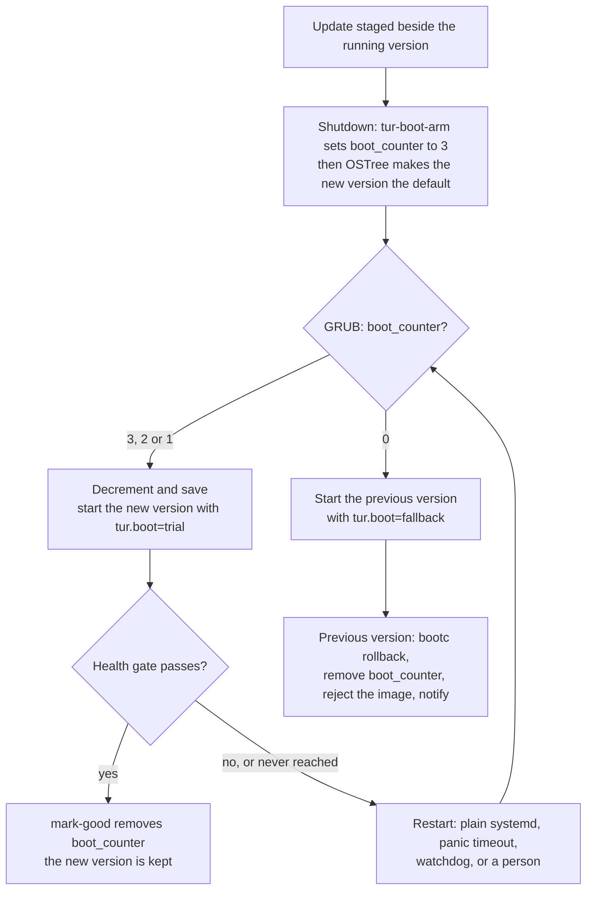

# Boot health and rollback

**Specification addendum C — Proposed 12 November 2026 (ADR-0014)**
**Applies to:** specification revision 1.0
**Related decisions:** [ADR-0001](../adr/0001-base-distribution.md),
[ADR-0013](../adr/0013-bootloader.md),
[ADR-0014](../adr/0014-boot-health-and-rollback.md) (Proposed)
**Tasks:** TUR-005 (boot fallback proof); builds on
[TUR-003](../reports/TUR-003.md)

TUR's central promise is that an update can never leave the machine unable to
start. A new OS version is deployed beside the running one. If it does not
boot properly, the machine returns to the previous version by itself, and the
evidence of what went wrong is kept.

This addendum specifies how TUR keeps that promise on the boot stack it
actually has: GRUB loaded by Fedora's signed shim, an OSTree deployment
managed by bootc, and no boot counting in the loader. It replaces the
assumption of systemd-boot boot counting in specification §5.3, and lists the
amendments that requires in
[section 14](#14-amendments-to-specification-revision-10).

It is a design. Nothing described here has been built or booted. The promise
is not kept until the proof in [section 11](#11-the-proof) passes in CI, and
it is not kept on real hardware until a hardware runner says so (ADR-0002).
Where the honest answer is that a failure cannot be recovered automatically
on this stack, [section 5.13](#513-what-cannot-be-made-automatic) says so and
says what the user has to do.

**How to read the claims in this document.** Three kinds of statement appear:

- **Verified.** Checked against the upstream source on 12 November 2026. Each
  has a reference such as [S3] to [section 16](#16-sources). "Verified" means
  the documentation or the source code was read. It does not mean the
  behaviour was observed on a TUR image.
- **Measured.** Observed on the TUR image in CI, in the runs recorded in
  [TUR-003](../reports/TUR-003.md) and the TUR-002 build manifest.
- **Assumption.** Not verified. Marked as such, and assigned to a step of the
  [implementation brief](#15-implementation-brief) that verifies it before
  anything depends on it (§0, rule 14).

---

## 1. Purpose and scope

**In scope**

- Counting the boot attempts of a newly deployed OS version, and returning to
  the previous version when they run out.
- The health gate that decides whether a boot was good (§5.4).
- Boot stage records (§27.1, §27.4) and the evidence kept across a rollback
  (§5.5, §5.6).
- Boots that hang: watchdogs and deadlines.
- What the image must contain for all of this.
- The test plan that proves it (TUR-005, §19.5).

**Out of scope**

- Fetching, verifying and scheduling updates. That is the updater's design
  (§15.1). This document fixes only what the updater must respect
  ([section 5.10](#510-avoiding-a-rollback-loop)).
- Updates of the bootloader itself (shim and GRUB on the EFI system
  partition). They are not transactional and cannot be rolled back by this
  mechanism ([section 13](#13-risks-and-open-questions), risk 3).
- The recovery menu, safe graphics mode and rescue media (§15.4, §27.2,
  §27.3).
- Rolling back user data or anything under `/var`. A rollback returns the OS
  to its previous version. It does not undo what the failed version wrote.
- A user's own desktop session crashing after login. It is not rolled back
  ([section 6.4](#64-when-the-boot-is-marked-good)).

## 2. Principles

1. **The version under trial is not trusted to repair anything.** A new
   deployment may be broken in ways nobody predicted, including in TUR's own
   code. Abandoning it is decided by the bootloader, from a counter, and
   carried out by the previous deployment, which is known to work. The new
   deployment's code has two jobs only: say "good", or restart.
2. **Fail towards counting.** When state is ambiguous, the mechanism prefers a
   boot that is counted to one that is not. An unprotected trial is the worst
   outcome.
3. **Bounded.** A trial ends after a fixed number of attempts. Outside a trial
   nothing reboots the machine automatically. No path retries indefinitely
   (§3.6).
4. **No clock, no network, no person.** A boot is judged without wall-clock
   time, without networking, and without waiting for anybody to log in.
5. **The stock signed boot chain is untouched.** TUR adds configuration and
   userspace programs. It builds and signs no bootloader, kernel or initramfs
   (ADR-0001, ADR-0013).
6. **State that must survive a rollback lives outside the deployment.** That
   means the GRUB environment block and `/var`. Never `/etc`
   ([section 8](#8-persistent-evidence)).
7. **The stored state is an interface.** One OS version arms a trial and a
   different one finishes it. The format is versioned and frozen like a D-Bus
   interface.
8. **Diagnose first.** Every automatic restart is preceded by a record of
   why, flushed to disk, where the stage of boot allows it (§3.6).

## 3. State of upstream, November 2026

Checked on 12 November 2026. This section records what was found, including
where it differs from what [ADR-0013](../adr/0013-bootloader.md) and
[TUR-003](../reports/TUR-003.md) expected.

### 3.1 The measured stack

| Item | Value | Source |
|---|---|---|
| Firmware path | UEFI; shim 16.1 loads GRUB 2.12 (`grub2-2.12-83.fc45`); both installed by bootupd | Measured, TUR-003 |
| GRUB configuration | bootupd's static `grub.cfg` in `/boot/grub2`, reached from a stub on the ESP; entries from `blscfg`; menu shown for one second | Measured; [S12] |
| Boot counting in the loader | None. `bootctl` lists GRUB's features without it | Measured |
| GRUB environment block | `/boot/grub2/grubenv` exists and is empty | Measured |
| Layout | GPT; 512 MiB FAT ESP; one ext4 root; no separate `/boot` | Measured |
| Deployment | bootc 1.17.1, OSTree 2026.4, OSTree backend; `/` is a read-only composefs mount; `/etc` and `/var` writable | Measured |
| systemd, dracut | systemd 262.1 (TUR-002 manifest); dracut 111 in Fedora 45 | Measured; [S27] |
| First boot | KDE's setup wizard in an automatic login of the system user `plasma-setup`; no user account exists | Measured |
| Later boots | Plasma Login Manager's greeter (`plasmalogin.service`, logind class `greeter`) | Measured |
| Units failing on a healthy boot | `mcelog.service` on AMD CPUs; none on Intel | Measured |
| SELinux | Enforcing; 9 to 13 harmless denials per boot | Measured |
| greenboot | Not in the image | Measured |

### 3.2 greenboot

| Question | Finding | Source |
|---|---|---|
| Which greenboot is maintained | **greenboot-rs**, a Rust rewrite, "designed for bootc based systems". Repository created March 2025; five releases between December 2025 and November 2026; latest 0.16.5 on 4 November 2026; 40 open issues and pull requests. The shell implementation is in maintenance mode and deprecated in its favour. | [S1] [S4] |
| Licence | greenboot-rs: BSD-3-Clause. The shell implementation: LGPL-2.1. | [S1] [S4] |
| In Fedora 45 | Yes. Binary package `greenboot`, built from source package `greenboot-rs`: 0.16.4 in the stable repository since 19 August 2026, 0.16.5 in updates-testing since 4 November. It requires `rpm-ostree`. | [S2] [S5] |
| Who ships it | The stock Fedora IoT image does. Fedora Kinoite does not (measured). Fedora CoreOS has no automatic rollback: its tracking issue has been open since 2018. Whether the `fedora-bootc` base image includes it was not established. | [S3] [S6] [S24] |
| GRUB side | A 20-line snippet, `08_greenboot.cfg`, installed to `/usr/lib/bootupd/grub2-static/configs.d/`, from where bootupd concatenates it into `grub.cfg` at installation. If `boot_counter` is set and `boot_success` is `0`, it decrements the counter; at `0` or `-1` it sets `default=1` and the counter to `-1`. It then sets `boot_success=0` and saves it, on every boot. | [S2] [S12] |
| When the counter is armed | **Only after a health check has already failed.** In 0.16.5 `boot_counter` is written in one place: the branch that handles a failed check when no counter exists. Staging an update writes `greenboot_next_deployment_id` and GRUB's own `fallback=1`, not the counter. The shell implementation armed the counter when the update was staged; the rewrite does not. | [S2] [S4] |
| Consequence | A new deployment that never reaches the health check is not counted: a kernel panic, an initramfs that cannot find root, emergency mode, a hang. GRUB's `fallback` covers one more case only, an entry GRUB itself fails to start. | [S2] [S14] |
| Health checks | Executables in `required.d` and `wanted.d` under `/usr/lib/greenboot/check` and `/etc/greenboot/check`, run one after another. A failing required check fails the boot; wanted checks only log. Then `red.d` or `green.d` scripts run. | [S1] [S2] |
| Timeouts | **None.** Each check is run to completion, and `greenboot-healthcheck.service` is a oneshot, for which systemd applies no start timeout by default. A check that hangs blocks the boot indefinitely. Requested upstream in July 2025; still open. | [S2] [S3] [S16] |
| On failure | Sets `boot_success=0`; reboots while the counter is above zero; at zero runs `bootc rollback` (or `rpm-ostree rollback`) **from the failing deployment** and reboots, provided the rollback trigger was recorded at shutdown. | [S2] |
| Known defects, open | The shutdown unit that records the trigger never runs its stop action in 0.16.4 and 0.16.5, so no rollback happens (issue 218; fix in pull request 230, open). A finalisation failure after the trigger is recorded makes a healthy host roll back (219). With `/boot` on software RAID GRUB cannot write the block and a failing boot restarts forever (220). The snippet lacks a final newline, so bootupd joins its last line to a comment (228). Reported by users; **not reproduced by TUR**. | [S3] |
| Default checks | The optional `greenboot-default-health-checks` package has a *required* DNS check of the update server, and a drop-in that makes the health check wait for `network-online.target`. Upstream proposes removing them. | [S2] [S3] |
| What the user sees | A line in `/etc/motd.d/boot-status`, shown at SSH login. Nothing on a desktop. | [S2] |
| State kept | GRUB environment variables `boot_counter`, `boot_success`, `fallback`, `greenboot_next_deployment_id`. The last was renamed between 0.16.2 and 0.16.4, which broke rollback for the first update from the stock Fedora IoT 44 image until 0.16.5 accepted both names. | [S2] [S3] |
| Relation to systemd | The health check is ordered before `boot-complete.target`, but greenboot manages the restart itself. systemd's maintainers asked for the duplication to be removed; open. | [S2] [S3] |

Two corrections to earlier TUR documents follow from this table.
[ADR-0013](../adr/0013-bootloader.md) and TUR-003 describe greenboot as
counting attempts and falling back. That was true of the shell implementation.
The implementation Fedora 45 ships counts only what its own health check has
already seen fail.

### 3.3 bootc and OSTree

| Question | Finding | Source |
|---|---|---|
| `bootc upgrade`, `bootc switch` | Fetch an image and stage a deployment beside the running one. `switch` also changes the image reference. `--apply` restarts. `--download-only` stages a deployment that is not applied at shutdown until released. | [S7] |
| Finalisation | A staged deployment is recorded under `/run`. `ostree-finalize-staged.service` does its work in its *stop* action at shutdown: it merges `/etc`, writes the new loader entries and swaps the boot configuration. | [S7] [S10] |
| Atomicity | "If the system crashes or you pull the power, you will have either the old system, or the new one." `/boot/loader` is a symbolic link swapped between two directories; a filesystem freeze and thaw, or `syncfs`, makes it durable. | [S10] |
| Power loss while staging | The staged marker is in `/run` and disappears. The machine boots the old deployment. Objects already fetched stay in the repository. | [S7] [S10] |
| Finalisation failure | Leaves `/boot/ostree/finalize-failure.stamp`; `ostree-boot-complete.service` then fails early in the next boot. This detects an update that was not applied. It does not detect a deployment that boots badly. | [S7] [S10] |
| `bootc rollback` | "Change the bootloader entry ordering": the rollback deployment becomes first. Manual. Any staged deployment is discarded. It logs journal message ID `26f3b1eb24464d12aa5e7b544a6b5468`. The manual warns that an agent doing automatic upgrades may undo it. | [S7] |
| `bootc rollback` from the second entry | When the booted deployment is not the first one, `status.rollbackQueued` is true and `bootc rollback` makes the **booted** deployment first ("Next boot: current deployment"). | [S8] |
| `/etc` and rollback | Each deployment has its own `/etc`, produced by a three-way merge when the deployment is created. A rollback reorders deployments; changes made to `/etc` in the newer one "won't carry over". | [S7] |
| `/var` | "There is exactly one `/var`", shared by all deployments. It is never rolled back. | [S7] |
| `bootc status --json` | `apiVersion: org.containers.bootc/v1`, `kind: BootcHost`. `status.booted`, `status.staged`, `status.rollback` are boot entries with `image.image` (reference and transport), `image.imageDigest`, `image.version`, `image.timestamp`, `ostree.checksum`, `ostree.deploySerial`, `ostree.stateroot`, `pinned`, `incompatible`, `downloadOnly`, `softRebootCapable`. Also `status.rollbackQueued`, `status.otherDeployments`, `spec.bootOrder` (`default` or `rollback`). | [S7] [S8] |
| Is the booted deployment the default | `ostree admin status --is-default` prints `default` or `not-default`. | [S10] |
| Soft reboot | `--soft-reboot=required` or `auto` restarts userspace without restarting the kernel. The bootloader does not run. | [S7] |
| Kernel arguments | From the image in `/usr/lib/bootc/kargs.d/*.toml`, applied at installation and on upgrade as a difference; or machine-local with `bootc install --karg`. Tools may also edit the entries in `/boot/loader/entries`. | [S7] |
| Updating without a registry | `bootc switch --transport oci <directory>` or `oci-archive`, or `containers-storage`. An OCI layout directory can hold several images selected by reference. | [S7] [S20] |
| Boot health in bootc itself | None, and none announced. The documentation defers to OSTree's two services for the OSTree backend. No issue proposing a health or automatic-rollback feature was found in a search of the tracker. | [S7] [S9] |
| Native boot counting, OSTree backend | OSTree can write Boot Loader Specification counters into entry file names (`sysroot.boot-counting-tries`, since July 2025). The loader must implement them. Fedora's GRUB does not (measured), and in bootc "systemd-boot is only supported for Composefs Backend and not for Ostree". | [S7] [S11] |
| Native boot counting, composefs backend | The composefs backend is released and under bootc's stability guarantee since 1.16.0, with GRUB or systemd-boot. But: "There is no `bootc-boot-complete.service` and no boot counting"; "likely to be added in the future". There is no in-place transition from an OSTree system. Sealed images need a UKI signed with the image owner's key and a signed systemd-boot; Fedora packages systemd-boot unsigned. | [S7] [S27] |
| Default update timer | Upstream ships `bootc-fetch-apply-updates.timer`, daily, and expects distributions to choose. Whether Kinoite enables it is **an assumption to verify** (step 1). | [S7] |

### 3.4 GRUB on Fedora, and bootupd

| Question | Finding | Source |
|---|---|---|
| The environment block | A preallocated 1024-byte file. GRUB "deliberately does not implement support for writing files"; it overwrites the block in place. Available only "on a plain disk (no LVM or RAID), using a non-checksumming filesystem (no ZFS)". Btrfs is supported through a reserved area in the filesystem header; Fedora 45's GRUB carries that patch. | [S13] [S14] |
| `load_env`, `save_env` | Load and save named variables. bootupd's static configuration loads the block from the ESP directory if a `grubenv` exists there, otherwise from `/boot/grub2`. | [S12] [S14] |
| `increment`, `decrement` | A Fedora addition, compiled into the signed `grubx64.efi` together with `blscfg`, `loadenv` and `test`. No unsigned module has to be loaded. | [S13] |
| `fallback` | "Identifies a menu entry that should be selected if the default menu entry fails to boot." It acts when GRUB cannot start an entry. It cannot see a kernel that fails after GRUB has handed over. | [S14] |
| Variables in loader entries | Fedora's `blscfg` expands `$name` in the `options` field of an entry from GRUB's environment when it builds the menu. This is how `$kernelopts` worked. | [S13] |
| Fedora's own boot flags | `08_fallback_counting`, `10_reset_boot_success` and `12_menu_auto_hide` exist only as `grub2-mkconfig` fragments. They are not in bootupd's static configuration (measured: no counter logic). A user timer, `grub-boot-success.timer`, sets `boot_success=1` two minutes into a login session. | [S13] |
| Does Fedora's mechanism fall back by itself | No. `boot_success` and `boot_indeterminate` only decide whether the menu is hidden. The counting fragment needs something in userspace to set the counter. | [S13] |
| What bootupd manages | The EFI binaries on the ESP, and at installation the static `grub.cfg`, assembled from `grub-static-pre.cfg` and every `*.cfg` in `configs.d`, sorted by name. It creates an empty `grubenv`. | [S12] |
| Is `grub.cfg` updated later | The source read shows it written at installation and by an explicit migration command. Whether `bootupctl update` ever rewrites it is **an assumption to verify**; this design assumes it does not. | [S12] |
| Bootloader updates | bootc does not run bootupd after installation. bootupd's updates are safe against power loss on UEFI, but "not ... safe against a buggy bootloader update that fails to boot the system". They are enabled by default on Fedora Atomic Desktops. | [S7] [S12] |

### 3.5 systemd, dracut and the kernel

| Question | Finding | Source |
|---|---|---|
| `boot-complete.target` | A generic synchronisation point. Units that must succeed for a boot to count are ordered before it and required by it. Units that act on success are ordered after it and pull it in. It is not part of the boot transaction unless something pulls it in. Usable with any loader. | [S15] [S16] |
| `systemd-bless-boot` | Renames the loader entry named by the EFI variable `LoaderBootCountPath`. Its generator pulls it in only when systemd-boot-style counting is in use. Not usable with GRUB. | [S15] |
| `systemd-boot-check-no-failures` | A generic check that fails if any unit has failed. Usable without systemd-boot. Unsuitable here: `mcelog.service` fails on every AMD boot. | [S15]; measured |
| Other loaders | The specification of automatic boot assessment says a loader that keeps its counters elsewhere should provide its own replacement for the bless service and keep using `boot-complete.target`. This design does that. | [S15] |
| Hardware watchdog | `RuntimeWatchdogSec=` makes PID 1 ping a hardware watchdog; the hardware resets the machine if the pings stop. Off by default. `RebootWatchdogSec=` defaults to ten minutes. "No effect if a hardware watchdog is not available." The kernel argument `systemd.watchdog_sec=` overrides all of them. | [S16] |
| Job timeouts | `TimeoutStartSec=` on a service is enforced by PID 1. `OnFailure=` starts units when a unit enters the failed state. `ConditionKernelCommandLine=` matches a word or an exact assignment. | [S16] |
| Stop ordering | "When two units with an ordering dependency between them are shut down, the inverse of the start-up order is applied." | [S16] |
| Initramfs failure | dracut retries device discovery for `rd.retry` seconds (default 180) and then runs its emergency action. With the default `rd.shell` that is a shell. With `rd.shell=0` it is `rd.emergency=`: `reboot`, `poweroff` (the default) or `halt`. | [S17] |
| Watchdog in the initramfs | dracut includes its watchdog modules only when asked. Whether Kinoite's initramfs has a watchdog driver is **an assumption to verify**; this design assumes it has none. | [S17] |
| Kernel panic | `panic=<seconds>` restarts after a delay; `0` waits for ever. | [S18] |
| pstore | `systemd-pstore.service` archives `/sys/fs/pstore` to `/var/lib/systemd/pstore` and clears it. The kernel log reaches pstore on a panic; `printk.always_kmsg_dump` extends that to every shutdown. Backends are firmware-dependent and small. | [S16] [S18] |
| Journal | `Storage=persistent` writes to `/var/log/journal`. Data is synced every five minutes, and immediately after a message of priority critical or higher. | [S16] |

### 3.6 How comparable systems do it

| System | Mechanism | Lesson taken |
|---|---|---|
| ChromeOS | Each kernel partition has `priority`, `tries` and `successful` in its GPT entry. Firmware decrements `tries` before starting a kernel that is not yet successful, and gives up on it at zero. The OS sets `successful` after it has booted. [S23] | The counter is decremented by the stage *before* the thing under test, and the mark is set by the thing under test. This design copies that split. |
| Android A/B | Slots are `active`, `bootable`, `successful`. The bootloader falls back after "some number of attempts". `update_verifier` marks the slot successful after verifying the system, before the user interface starts. [S22] | Success is declared by a system service early enough not to depend on a person. |
| Container Linux, Fedora CoreOS | Container Linux marked a boot successful 45 seconds after start. Fedora CoreOS has no automatic rollback; the design question is open since 2018, with "flapping" between versions named as the thing to avoid. [S24] | Flapping is designed out explicitly ([section 5.10](#510-avoiding-a-rollback-loop)). |
| Fedora IoT | greenboot, by default. [S3] [S6] | See 3.2. |
| Universal Blue (Bazzite, Aurora) | Manual. The user picks `ostree:1` in the GRUB menu or runs `rpm-ostree rollback`. Two deployments are kept. No health check. [S25] | The manual path must keep working and must be explained. |
| openSUSE MicroOS | `health-checker` runs plugins at boot. With systemd-boot, or openSUSE's GRUB with boot-counting patches, each snapshot's entry carries a counter of three tries and `systemd-bless-boot` marks it good. A snapshot that worked before and now fails gets one restart, then an emergency shell. [S21] [S26] | A previously good version that fails must not loop. openSUSE patches its GRUB for native counting; Fedora's signed GRUB has no such patch. |

## 4. Options and recommendation

### 4.1 Options compared

| | A. greenboot as packaged | B. greenboot, extended by TUR | C. A small TUR mechanism on the GRUB environment block | D. A boot path with native counting |
|---|---|---|---|---|
| What it is | Install `greenboot` 0.16.x; put TUR's checks in `required.d` | A plus TUR units that arm the counter, guard stale state, add timeouts and report to the desktop | TUR's own GRUB snippet through bootupd, and one TUR program for arming, the gate and the record | systemd-boot with bootc's composefs backend and UKIs, or a patched GRUB |
| Stock signed boot chain and Secure Boot | Unchanged | Unchanged | Unchanged | **Broken.** Needs TUR to sign UKIs and systemd-boot, or to build and sign GRUB (ADR-0001, ADR-0013) |
| Failure coverage today | Health-check failures only. Nothing before the check runs [S2]. Rollback itself blocked by an open defect [S3] | All of C's, if every extension works against greenboot's private state | All rows of [section 5.8](#58-sequences-on-a-bad-boot), with the limits of [section 5.13](#513-what-cannot-be-made-automatic) | Would cover early failures natively, but bootc configures no counting on either backend yet [S7] |
| Hung checks | Block the boot for ever [S3] | TUR wraps every check | Enforced by PID 1 | Not applicable |
| Maintenance burden | Lowest in code. Highest in surprises: releases 0.16.4 and 0.16.5 both changed the rollback logic or its stored state [S2] [S3] | Highest. TUR code depends on greenboot's internal variables, which changed name within one minor series [S3] | One Rust crate and about 20 lines of GRUB script, owned by TUR, with no upstream sharing the testing | A second storage backend, a signing chain, and a reinstall of every machine [S7] |
| Licence boundary | No TUR code inside another program | TUR programs stay separate; checks are executables | The program is a separate TUR program. The GRUB snippet is interpreted by GRUB and is kept outside the project licence ([section 10](#10-what-goes-into-the-image)) | Not assessed |
| Networking required | Yes with the default checks; avoidable | Avoidable | No | No |
| What the user is told | A message of the day | TUR's notice | TUR's notice | TUR's notice |
| Proof in CI | A few days, but the proof would show the gaps above | Weeks; two state machines to reason about | Step 4 of the brief proves the GRUB half with no TUR code at all; the full proof is steps 5 to 11 | Not before upstream adds counting |

### 4.2 Recommendation

**Option C.** TUR ships its own boot-attempt counter in GRUB's environment
block and one program, `tur-boot-health`, hooked to systemd's
`boot-complete.target`. greenboot is not installed.

The reasons, in order of weight:

1. **greenboot as shipped does not protect the boots that matter most.** Its
   counter starts only after its own health check has run and failed. A
   kernel that panics, an initramfs that cannot mount root, or a boot that
   hangs is never counted [S2]. Those are exactly the failures a person
   cannot fix from a desktop.
2. **Extending it costs more than replacing it.** To close the gaps TUR would
   have to arm the counter itself, write greenboot's private variables,
   clear them when they go stale, wrap its checks for timeouts and replace
   its reporting. What would remain of greenboot is a loop over a directory
   of scripts and one call to `bootc rollback`.
3. **The part that is hard to change later stays compatible.** The GRUB
   snippet is written into `grub.cfg` once, at installation. TUR's snippet
   uses the same variable, `boot_counter`, with the same meaning as Fedora's
   GRUB fragment and greenboot's [S2] [S13]. If greenboot matures, TUR can
   adopt its userspace without touching installed machines.
4. **It can be proven in halves.** The GRUB half is about 20 lines and can
   be exercised from the test harness before any TUR program exists.

This is a deviation from "integrate upstream projects rather than forking
them" (`AGENTS.md`) and from ADR-0013's expectation that greenboot would be
wrapped. It is recorded in
[ADR-0014](../adr/0014-boot-health-and-rollback.md). TUR does not fork
greenboot; it declines to depend on it yet.

Option D remains the long-term direction (ADR-0013). It is not available
today, and not cheap when it is.

### 4.3 What would change the recommendation

Re-evaluate at each Fedora rebase. Adopt greenboot's userspace in place of
`tur-boot-health`'s gate and rollback when all of these hold:

- it arms the counter before the first boot of a new deployment;
- checks have enforced timeouts (issue 83);
- issues 218 and 219 are fixed in the version Fedora ships;
- its stored state is documented as a stable interface.

Move to option D when bootc configures boot counting for the backend TUR
uses, and a signing chain exists for other reasons.

## 5. The mechanism



### 5.1 Components

| Component | What it is | Runs | Licence |
|---|---|---|---|
| `08_tur_boot_count.cfg` | GRUB script fragment, in `/usr/lib/bootupd/grub2-static/configs.d/`. bootupd concatenates it into `/boot/grub2/grub.cfg` at installation [S12] | Inside GRUB, before the menu, on every boot | BSD-3-Clause, in a marked directory ([section 10](#10-what-goes-into-the-image)) |
| `10-tur-boot.toml` | bootc kernel-argument file carrying one argument, `$tur_boot_args` | Read by bootc at installation and upgrade | Project licence (data) |
| `tur-boot-health` | One Rust program with subcommands `classify`, `gate`, `mark-good`, `record-failure`, `arm`, `export-evidence`, `status`, `acknowledge` | As root, from the systemd units below | Project licence; standalone program |
| systemd units | Section 6.1 | PID 1 | Project licence (configuration) |
| `tur-boot-notify` | Small session program that shows the pending notice through `org.freedesktop.Notifications` | In the user's session | Project licence; standalone program |

`tur-boot-health` talks to other software only through command lines:
`grub2-editenv`, `bootc status --format=json`, `bootc rollback`,
`ostree admin status --is-default`, `systemctl`, `loginctl`, `journalctl`.
Each call has a time limit and no shell. The specification names two
programs, `tur-boot-health` (§5.4) and `tur-boot-agent` (§27.4). They are one
program here, because the gate and the stage records observe the same boot.

### 5.2 State, and where it lives

| State | Where | Written by | Read by |
|---|---|---|---|
| `boot_counter` | GRUB environment block, `/boot/grub2/grubenv` | `arm` sets it to 3. GRUB decrements it, or sets it to `-1`. `classify` sets it to 2 during a fallback. `mark-good` and `classify` remove it | GRUB; `tur-boot-health` |
| `tur_trial_args` | Same block | `arm` | GRUB |
| `tur.boot=…` kernel arguments | Computed by GRUB for this boot only; visible in `/proc/cmdline` and on the kernel's console | GRUB | systemd unit conditions; dracut; `tur-boot-health`; the test harness |
| Trial record | `/var/lib/tur/boot-health/trial.json` | `arm` creates it. `classify` appends each attempt that reaches userspace. Removed when the trial ends | `tur-boot-health` in either deployment |
| History | `/var/lib/tur/boot-health/history.jsonl`, last 200 events | `tur-boot-health` | `status`; `tur-diag` |
| Rejected images | `/var/lib/tur/boot-health/rejected.json` | `classify`, after a fallback | The updater; `status` |
| Pending notice | `/var/lib/tur/boot-health/notice.json` | `classify`, `record-failure` | `tur-boot-notify`; `status` |
| Evidence | `/var/lib/tur/boot-health/evidence/<event>/` | `export-evidence` | `tur-diag` |
| Stage records | The journal, under `/var/log/journal` | `tur-boot-health` | `tur-diag` |

Rules:

- **The environment block is the authority for "a trial is in progress".**
  Writing it needs no free space: the block is preallocated. The trial record
  is information about the trial. If the record is missing, the trial still
  runs and ends correctly, with the identities recorded as unknown.
- **Nothing is stored in `/etc`.** Each deployment has its own `/etc`. A file
  written there by the failing version is not seen by the version that
  replaces it [S7].
- **`/boot` is mounted read-only.** Every write to the block happens in a
  private mount namespace (`PrivateMounts=yes`) with `/boot` remounted
  read-write, as OSTree's own units do [S10].
- **Order of writes.** `arm` writes the trial record, syncs it, then writes
  the block, before finalisation starts. A fallback makes the counter
  positive, then changes the boot order, then removes the counter
  ([section 5.9](#59-selecting-the-previous-deployment)).
- **Schema.** The trial record, history events and the `status --json`
  output get JSON schemas under `schemas/`, with `schema_version: 1`. The
  environment variables and kernel arguments of this section and the next
  two are **contract version 1**. A change to any of them needs an ADR,
  because the version that writes them is not the version that reads them.

### 5.3 The GRUB snippet (contract version 1)

```text
# TUR boot-attempt counting, contract version 1.
# bootupd writes this into grub.cfg at installation. It is not updated later.
insmod increment
set tur_boot_args="tur.boot_contract=1"
if [ -n "${boot_counter}" ]; then
  if [ "${boot_counter}" = "0" -o "${boot_counter}" = "-1" ]; then
    # Attempts used up. Start the previous deployment, the second entry.
    set default=1
    set boot_counter=-1
    set timeout=5
    set tur_boot_args="tur.boot_contract=1 tur.boot=fallback"
  else
    decrement boot_counter
    # If GRUB cannot start the new entry at all, try the second one.
    set fallback=1
    set tur_boot_args="tur.boot_contract=1 tur.boot=trial tur.boot_tries_left=${boot_counter} ${tur_trial_args}"
  fi
  save_env boot_counter
fi
```

What it does:

- **No counter: nothing.** On an ordinary boot GRUB writes nothing to disk.
  greenboot's snippet writes `boot_success` on every boot [S2]; this one
  writes only during a trial.
- **Counter above zero: count, then boot the default entry.** The counter is
  decremented and saved *before* the kernel is loaded. A boot that dies at
  any later point has already been counted.
- **Counter at zero: boot the second entry**, and keep doing so (`-1`) until
  userspace removes the counter. The menu is shown for five seconds instead
  of one, so that a person can choose differently.
- With three attempts allowed the new deployment is started with
  `tur.boot_tries_left` 2, 1 and 0. The fourth boot is the fallback.

It sorts before bootupd's `10_blscfg.cfg`, so the variables exist when the
menu entries are built [S12]. It ends with a newline (compare greenboot
issue 228).

**Why index 1 is the previous deployment.** OSTree writes one loader entry
per deployment, ordered newest first, and `blscfg` lists them in that order.
After an update there are two: the new one, and the one that was running
when the update was staged. The firmware-settings entry that bootupd adds
comes after them [S12]. With a single deployment, index 1 is that
firmware-settings entry; a counter can then only exist as stale state
([section 5.6](#56-classifying-a-boot)).

Assumptions to verify (step 2 of the brief), all on the real image under
UEFI, and again with Secure Boot enforced (step 14):

- `save_env` succeeds on this layout: ext4, plain partition, `/boot` on the
  root filesystem.
- `increment` is usable when Secure Boot forbids loading modules. It is
  compiled in [S13], so `insmod` should be a no-op.
- `fallback=1`, set as a plain variable, is honoured by the menu.
- `set timeout=5` here is not overridden by a later fragment.

### 5.4 How GRUB tells the booted system what kind of boot this is

The image carries one kernel argument, in
`/usr/lib/bootc/kargs.d/10-tur-boot.toml`:

```toml
kargs = ["$tur_boot_args"]
```

OSTree copies it into every loader entry. Fedora's `blscfg` replaces
`$tur_boot_args` with the value the snippet computed when it builds the menu
[S13]. The kernel therefore starts with one of:

| Boot | Kernel arguments added |
|---|---|
| Ordinary | `tur.boot_contract=1` |
| Trial attempt | `tur.boot_contract=1 tur.boot=trial tur.boot_tries_left=N` and the trial arguments |
| Fallback | `tur.boot_contract=1 tur.boot=fallback` |

The trial arguments are stored in the block by `arm`, as `tur_trial_args`.
Version 1 sets:

```text
panic=30 rd.shell=0 rd.emergency=reboot systemd.watchdog_sec=180
```

This is the piece that makes early failures recoverable without changing any
signed or generated boot artefact:

- The initramfs learns that it is in a trial from its own kernel command
  line. It needs no access to the root filesystem, which is the thing that
  may be missing. dracut then restarts instead of opening a shell [S17].
- A kernel panic restarts after 30 seconds, instead of waiting for ever
  [S18].
- PID 1 arms the hardware watchdog, in the initramfs and after it [S16].
- systemd units use `ConditionKernelCommandLine=tur.boot=trial`. The retry
  path of [section 6.1](#61-units) therefore contains no TUR code.
- The kernel prints its command line on the console. The attempt number of
  every boot, including boots that die before any log is written, is visible
  to a person and to the test harness.
- None of these settings applies to an ordinary boot. A machine that fails
  outside a trial shows its emergency shell or panic screen, and stays there.

The trial arguments live in the block and not in the snippet so that the
previous, known-good deployment decides them. The snippet cannot be changed
after installation; the arguments can.

Assumptions to verify (step 2):

- bootc and OSTree pass a `$`-prefixed argument through `kargs.d`, the
  loader entry and `bootc container lint` unchanged.
- With the variable unset or empty the expansion leaves a valid command
  line.
- An argument that expands to several words reaches the kernel as several
  arguments.

**If the expansion cannot be relied on**, the contingency is: `classify`
reads the block after the root filesystem is mounted and creates
`/run/tur/boot-trial`; unit conditions test that file as well. Everything
from the real root onwards keeps working. Failures inside the initramfs, and
panics, then need a person to restart the machine. Each such restart is
still counted, and the third still falls back. The design does not proceed
past step 2 without a decision on this.

### 5.5 Arming a trial

A trial is armed at shutdown, when a staged deployment is about to be
finalised, by `tur-boot-arm.service`.

```ini
[Unit]
Description=Arm boot-attempt counting for a staged deployment
DefaultDependencies=no
ConditionPathExists=/run/ostree-booted
RequiresMountsFor=/boot /var/lib/tur
After=ostree-finalize-staged.service
Before=final.target
Conflicts=final.target

[Service]
Type=oneshot
RemainAfterExit=yes
ExecStop=/usr/libexec/tur/tur-boot-health arm
TimeoutStopSec=60
PrivateMounts=yes
```

It is started on every boot and does nothing until it is stopped.

- `Conflicts=final.target` is what makes the stop action run at shutdown.
  greenboot's equivalent unit lacks it, and its action never runs [S3].
- `After=ostree-finalize-staged.service` makes this unit stop *before*
  OSTree's, because stop order is the reverse of start order [S16]. The
  counter is on disk before the boot configuration changes.
- Arming at shutdown, not when the update is staged, covers every way an
  update can be staged: `bootc upgrade`, `bootc switch`, rpm-ostree,
  Discover, or a future TUR updater. It also means nothing is armed for an
  update the user has not yet restarted into.

`arm` does the following, and exits zero whatever happens, so that shutdown
is never blocked:

1. Reads `bootc status --format=json`. If `status.staged` is null, or
   `downloadOnly` is true, it does nothing.
2. Checks that the installed `grub.cfg` implements contract version 1: the
   running kernel has `tur.boot_contract=1`.
3. Checks that GRUB can write the block: the filesystem holding
   `/boot/grub2` is ext4 on a plain partition. The list of supported layouts
   is extended only by a CI test of that layout.
4. If check 2 or 3 fails, it locks finalisation with
   `ostree admin lock-finalization` [S10], so the update is not applied, and
   leaves a notice: "The update was not applied: this installation cannot
   count boot attempts." An unprotected trial is refused (principle 2).
   That locking at this point in shutdown stops OSTree's stop action is
   **an assumption to verify** (step 6).
5. Writes the trial record: schema version, an event identifier, the boot
   ID, the attempts allowed, and for both the booted and the staged
   deployment the image reference, image digest, OSTree checksum, deployment
   serial and TUR build ID. Syncs it.
6. Writes `tur_trial_args` and `boot_counter=3` to the block, in one
   `grub2-editenv` call. Syncs.

A soft reboot does not pass through GRUB, so its first boot is not counted.
TUR does not use soft reboot for OS updates in version 1. If one happens
anyway, the trial is armed and the first full restart is counted.

### 5.6 Classifying a boot

`tur-boot-state.service` runs `tur-boot-health classify` early in every
boot, after local filesystems are mounted and the journal is on disk. It
decides what kind of boot this is and acts on the cases that need action.

The trial record has a `phase`: `trial` from arming, `reverting` once a
fallback has begun ([section 5.9](#59-selecting-the-previous-deployment)).

| # | `tur.boot` argument | Trial record | Booted deployment is the default | Booted deployment is | Classification | Action |
|---|---|---|---|---|---|---|
| 1 | none | none | yes | — | `normal` | None |
| 2 | none | none | no | — | `manual` | None. A person chose the other entry. The boot order and the block are not touched |
| 3 | `trial` | phase `trial` | yes | the new one | `trial` | Append this attempt to the record. Compare `tur.boot_tries_left` with `boot_counter` read from the block: if they differ, GRUB could not save the counter (see below) |
| 4 | `trial` | phase `trial` | yes | not the new one | `stale` | The update was never finalised. Remove the counter and the record. Notice: "The update was not applied." No rollback |
| 5 | `trial` | phase `trial` | no | the previous one | `fallback` | GRUB's own `fallback` started the second entry because it could not start the first, or a person chose it. Section 5.9 |
| 6 | `fallback` | phase `trial`, or missing | no | the previous one, or unknown | `fallback` | Section 5.9 |
| 7 | any | phase `reverting` | no | the previous one | `fallback` | An interrupted fallback. Section 5.9, from step 3 |
| 8 | any | phase `reverting` | yes | the previous one | `fallback` | An interrupted fallback. Section 5.9, from step 5 |
| 9 | any | phase `reverting` | either | the new one | `rejected` | An interrupted fallback started the failed version again. If it is not the default, remove the counter. Restart at once. The gate does not run and the version cannot be marked good |
| 10 | `trial` | missing | yes | — | `trial` | Proceed with identities unknown; record them from `bootc status` |
| 11 | none | phase `trial` | yes | the new one | `trial` | The block was unreadable to GRUB. Recreate it, set the counter to the attempts not yet used, create `/run/tur/boot-trial`, continue as a trial |
| 12 | none | none, but the block has a counter | — | — | `inconsistent` | Remove the counter. Record `TUR-BOOT-STATE-002` |
| 13 | `fallback` | phase `trial` | yes | the new one | `manual-retry` | A person chose the failed version in the menu of a fallback boot. The gate runs. If it passes, the version is marked good. If it fails, nothing restarts, and the next boot is a fallback again |

Any combination not listed changes nothing and records `TUR-BOOT-STATE-001`.

"The booted deployment is the default" is `ostree admin status --is-default`
[S10], confirmed by `status.rollbackQueued` being false [S8].

Row 4 is the case that makes a healthy greenboot host roll back (issue 219).
Here it is told apart by a fact GRUB cannot fake: the booted deployment is
still the default one.

**When GRUB cannot save the counter.** If `tur.boot_tries_left` and the
stored `boot_counter` differ during a trial, the counter will never reach
zero and GRUB will never fall back. This is the infinite loop of greenboot
issue 220. `classify` then counts attempts itself, in the trial record. When
they are used up and the gate fails once more, `record-failure` runs
`bootc rollback` from the failing deployment before restarting. This is the
one exception to principle 1, and it is reachable only when the bootloader
cannot do its part and userspace is alive.

### 5.7 Sequence on a good boot

1. The update is staged beside the running system. Nothing about the running
   system changes.
2. At shutdown the trial is armed, then OSTree makes the new deployment the
   default.
3. GRUB counts the attempt and starts the new deployment with the trial
   arguments.
4. `classify` records the attempt. The gate
   ([section 6](#6-the-health-gate)) observes the boot.
5. When every required check has passed, `boot-complete.target` is reached
   and `tur-boot-mark-good.service` removes the counter and the trial
   record. That is the moment the boot is marked good.
6. The watchdog and panic settings of the trial stay in force until the next
   restart. They do no harm on a healthy system.
7. The next boot is ordinary. GRUB finds no counter and writes nothing.

### 5.8 Sequences on a bad boot

In every row, "counted" means GRUB decremented the counter before the kernel
started. After the third counted attempt, the next boot is the fallback of
[section 5.9](#59-selecting-the-previous-deployment). Rows marked † depend on
the argument expansion of section 5.4. Without it the machine waits for a
person to restart it, and the attempt is still counted.

| Failure of the new deployment | What detects it | What happens | What the user sees | Evidence kept |
|---|---|---|---|---|
| GRUB cannot load or start the kernel (missing, corrupt, rejected by Secure Boot) | GRUB | GRUB starts the second entry in the same boot (`fallback=1`). `classify` in the previous deployment makes it permanent | A GRUB error for a moment, then a normal start of the previous version; the notice after login | Fallback event with reason `loader`; no journal of the failed start exists |
| Kernel panics before or in the initramfs | Nothing at the time | † Restart after 30 s (`panic=30`). Counted | The kernel's panic screen for 30 s, three times, then the previous version | The counter; the console; the panic in pstore where the firmware provides it (section 8) |
| Initramfs cannot find or mount root | dracut, after `rd.retry` (180 s) or when the mount fails | † Restart (`rd.shell=0 rd.emergency=reboot`). Counted | A wait of up to three minutes per attempt, then the previous version | The counter. **No log**: nothing writable exists at that point |
| Initramfs cannot unlock an encrypted root | Not a failure. The passphrase prompt waits for the user | Nothing | The prompt | — |
| systemd enters emergency mode in the real root | `emergency.target` | † `tur-boot-emergency-retry.service` syncs the journal and restarts | A few seconds of emergency text, then a restart | Journal of the attempt, if `/var` was mounted |
| The default target is not reached, or a required unit fails | The gate (R3, R4, R5) | Gate fails. `record-failure` writes the verdict. `tur-boot-retry.service` restarts | The boot stops progressing or shows a broken desktop for up to the deadline, then restarts | Journal, stage records, the failed check and its output |
| The display manager or its compositor crash-loops | The gate (R6, R7, R8) | As above | A flickering or black screen for up to two minutes, then a restart | As above, with the display manager's journal |
| A required TUR service fails | The gate (R5) | As above | As above | As above |
| A required health check fails or exceeds its time | The gate | As above | As above | As above |
| The boot stalls while PID 1 is alive | The gate: R3's limit of 240 s. If the gate itself is stuck, PID 1, through the unit's `TimeoutStartSec` (600 s) | The gate fails, or is killed and counts as failed. Restart | A stalled boot for four to five minutes, ten at worst, then a restart | Journal up to the stall |
| PID 1 or the kernel stops, after a watchdog driver is loaded | The hardware watchdog (180 s) | The hardware resets the machine. Counted at the next GRUB run | A frozen screen for three minutes, then a restart | Journal up to the last sync |
| The machine hangs with no working watchdog | Nothing | **Nothing happens until a person holds the power button.** Each forced restart is counted | A frozen screen | The counter only |
| TUR's own program is broken in the new deployment | PID 1: the gate unit fails to start or times out | `tur-boot-retry.service` is plain systemd and still restarts | As for a failed gate | Journal; no stage records |
| The fallback deployment is itself broken | Section 5.13 | No automatic action | An emergency shell or a stalled boot of the previous version | Whatever that boot can write |

What happens when the failure is in a deployment that is **not** under
trial: nothing automatic. The gate records the failure, the user gets the
notice "TUR started, but some checks failed", and the system stays up if it
can (§27.5, "TUR service fails"). A machine that restarts itself must be in a
bounded trial.

### 5.9 Selecting the previous deployment

There are two selections, by two components.

**For one boot: GRUB.** With the counter at zero, the snippet starts the
second entry and marks the state `-1`. This needs nothing but GRUB and a
readable `/boot`. It works however badly the new deployment is broken.

**Permanently: the previous deployment.** It starts with `tur.boot=fallback`.
`classify` then:

1. Confirms the picture with `bootc status`: the booted deployment is not the
   default (`rollbackQueued` is true), and, where the trial record exists,
   the booted deployment is the one recorded as previous. If the picture
   does not match, it changes nothing and records `TUR-BOOT-STATE-001`.
2. Sets the record's phase to `reverting`, and syncs.
3. Writes `boot_counter=2` to the block.
4. Runs `bootc rollback`. Booted from the second entry, this makes the booted
   deployment the default [S8]. OSTree swaps the boot configuration
   atomically [S10].
5. Confirms `ostree admin status --is-default` now prints `default`.
6. Removes `boot_counter` and `tur_trial_args` from the block.
7. Adds the failed image's digest to the rejected list, writes the fallback
   event to the history, writes the notice, and removes the trial record.

**Why step 3.** The boot order is in OSTree's files and the counter is in
GRUB's block. They cannot change in one atomic step. "Start the second
entry" (`-1`) is right before step 4 and wrong after it, when the second
entry is the failed version. A positive counter means "start the first
entry and count it", which is safe in both orders: before step 4 it is one
more counted attempt of the failed version, and after step 4 it starts the
previous version. So the counter is made positive before the order changes
and removed after.

| Power is lost | GRUB then | Outcome |
|---|---|---|
| After step 3, before step 4 completes | Counts, and starts the first entry: still the failed version | Row 9 of section 5.6 restarts it at once, or it fails as before. After two such starts GRUB selects the previous version again and row 7 resumes. Two short extra starts |
| After step 4, before step 6 | Counts, and starts the first entry: now the previous version | Row 8 resumes at step 5 |
| Three times in a row between steps 4 and 6 | The counter has gone 2, 1, 0 on starts of the previous version; GRUB now starts the second entry, the failed version | Row 9 removes the counter and restarts, and the previous version then finishes. If the failed version cannot reach `classify`: [section 5.13](#513-what-cannot-be-made-automatic), item 4 |

The counter is 2, not 1, so that the previous version gets two further
starts after an interruption before GRUB would turn to the failed one.

The failed deployment is kept on disk as the second entry. It is evidence,
and the next update replaces it. The GRUB menu and `bootc status` both list
it; `tur-boot-health status` marks it rejected.

`bootc rollback` refuses a deployment that is not based on a container image
[S8]. TUR does not support package layering in version 1, so both
deployments are image-based. Whether `ostree admin set-default` should be
the fallback for that case is an open question.

### 5.10 Avoiding a rollback loop

A loop needs something to bring the bad version back, or something to keep
restarting. Each is closed separately.

| Loop | Why it cannot happen |
|---|---|
| GRUB alternates between the two deployments | The counter only counts down. At zero GRUB stays on the second entry until the previous version takes over. The one way back to the failed version is an interrupted fallback, and those starts are counted and bounded (section 5.9) |
| The previous deployment is put on trial | A counter is armed only when a deployment is staged and finalised. A fallback arms nothing. If the previous deployment fails, that is a failure outside a trial: no automatic restart |
| The updater fetches the same bad image again | The rejected list. The updater must not stage a rejected digest unless a person asks for it explicitly, which removes the entry. `tur-boot-health status --json` exposes the list |
| An automatic update agent undoes the rollback | bootc warns of exactly this for its own timer [S7]. `bootc-fetch-apply-updates.timer` is masked in the image. Any future TUR updater is "the agent in active control" and reads the rejected list |
| A failing gate restarts a machine for ever | Restarts happen only in a trial, a trial has three attempts, and when GRUB cannot count, userspace does ([section 5.6](#56-classifying-a-boot)) |
| A trial is never closed, so every later restart is counted | Marking good does not wait for a person ([section 6.4](#64-when-the-boot-is-marked-good)) |

A person who runs `bootc upgrade` by hand after a rollback gets the same
image staged again. That is their decision; it gets a new, bounded trial.

### 5.11 What the user is told

| Event | Text | Where |
|---|---|---|
| Fallback | "The update to TUR *version* did not start correctly after 3 attempts. TUR has restored the previous version, *version*. Your files were not changed. System settings changed while the failed version was running were not kept. The update will not be tried again automatically." | Desktop notification at the next login, repeated at each login until acknowledged; `tur-boot-health status`; journal |
| Update not applied | "The update was not applied. TUR is still on *version*." with the reason where known | As above |
| Unhealthy boot outside a trial | "TUR started, but some checks failed. Diagnostics are available." | As above |
| During a fallback boot | GRUB shows its menu for five seconds with the previous version selected | Screen |

Each notice carries the event identifier, the build IDs of both versions,
the number of attempts, the first failed check and its error code, and the
path of the evidence. It offers `tur-diag collect`. Nothing is uploaded
(`AGENTS.md`).

On a machine that has no user yet, the notice waits. The first-run wizard is
not TUR's program and cannot show it.

The notification is shown by `tur-boot-notify`, a separate program in the
user's session. It is not a Plasma applet, so it can carry the project
licence. A graphical way to act on the notice belongs to the desktop work.

### 5.12 Power loss

| Power is lost | On disk | Next boot | Outcome |
|---|---|---|---|
| While the update is fetched or staged | Some new objects in the repository; the staged marker was in `/run` | Previous deployment, `normal` | Update not applied. Nothing to clean but disk space, which the next update reclaims (**assumption**) |
| After staging, before shutdown | As above | As above | As above |
| At shutdown, after `arm`, before OSTree swaps the boot configuration | Counter armed; previous deployment still default | Previous deployment with `tur.boot=trial`; `stale` | Disarmed. "The update was not applied." |
| During the swap | Either configuration, never a mixture [S10] | `stale`, or a trial of the new deployment | Either is valid and handled |
| After the swap | New deployment default; counter armed | Trial | Protected |
| During a trial boot, anywhere | Counter already decremented | Next attempt | The interrupted boot counts as an attempt |
| While `mark-good` rewrites the block | The old block, the new block, or an invalid block | Counter still set: one more trial boot. Counter gone or block invalid: ordinary boot | The new deployment had passed its gate. At worst it is tested once more |
| While GRUB saves the counter | The old value, the new value, or an invalid block | Invalid block: GRUB loads no variables and starts the default entry with no trial arguments | `classify` finds a trial record without a counter, recreates the block and continues the trial (section 5.6). If the new deployment cannot reach `classify`: section 5.13, item 4 |
| During the fallback, at any step | Either order [S10]; a positive counter | The first entry, counted | Converges on the previous version (table in section 5.9) |

"Power is lost" in CI means the QEMU process is killed. That is a weaker
model than a real power cut ([section 11.6](#116-where-each-scenario-runs)).

### 5.13 What cannot be made automatic

On this stack, with this design:

1. **A hang before any watchdog is armed.** If the kernel or the initramfs
   stops without panicking, and no hardware watchdog driver is loaded yet,
   nothing resets the machine. Nothing in this boot chain arms a watchdog
   before the kernel does. *The user must force a restart.* Each forced
   restart is counted, so three of them reach the previous version.
2. **A machine with no usable hardware watchdog.** The same, for any hang
   in which PID 1 has stopped. A PC's chipset watchdog may be absent, or
   disabled by its firmware. TUR cannot know until it runs on the hardware,
   and no TUR target machine has been checked.
3. **A failure GRUB itself causes or cannot survive.** A corrupt
   `grub.cfg`, an unreadable `/boot`, a broken shim or GRUB after a
   bootloader update, firmware that forgets its boot entry. Nothing below
   GRUB is under TUR's control. *The user needs rescue media* (§5.7).
4. **Lost counter state combined with a new deployment that cannot reach
   userspace.** Two ways there: the environment block becomes invalid while
   a trial is armed (a power cut during a write of one or two sectors, or
   disk corruption); or a fallback is interrupted by power loss three times
   in a row in the window of section 5.9. GRUB then starts the broken version
   with nothing counting. *The user must pick the other entry in the GRUB
   menu*, which is shown on every boot, for one second or for five.
5. **Both deployments broken.** For example, the failed version changed
   something under `/var` that the previous version cannot read. GRUB keeps
   starting the previous version; it does not start. *The user needs the
   GRUB menu or rescue media.*
6. **A failure after the boot was marked good.** A desktop session that
   crashes after login, an application that no longer starts, a device that
   stopped working. *The user chooses the previous version*: `bootc
   rollback` from a terminal, or the second entry in the GRUB menu and then
   `bootc rollback`.
7. **A layout GRUB cannot write to.** `/boot` on LUKS, LVM, software RAID
   or an untested filesystem. TUR refuses to apply updates there
   (section 5.5). The installer must not produce such a layout
   ([section 10](#10-what-goes-into-the-image)).

## 6. The health gate

### 6.1 Units

| Unit | When | What it does | TUR code |
|---|---|---|---|
| `tur-boot-state.service` | Every boot, after `local-fs.target` and `systemd-journal-flush.service` | `classify` | Yes |
| `tur-boot-health.service` | Every boot, after `basic.target`; a oneshot with `TimeoutStartSec=600`, above the 555 s the limits of section 6.2 add up to; `OnFailure=tur-boot-failed.target` | `gate`: observes the boot and runs the checks. Does not delay any target | Yes |
| `boot-complete.target` | Standard systemd target; a drop-in adds `Requires=` and `After=tur-boot-health.service` | Reached only when the gate has passed [S15] | No |
| `tur-boot-mark-good.service` | `Requires=` and `After=boot-complete.target`; this is what pulls the target into the boot | `mark-good` | Yes |
| `tur-boot-failed.target` | Started by the gate's `OnFailure=` | Pulls in the two units below | No |
| `tur-boot-record-failure.service` | In `tur-boot-failed.target`; `TimeoutStartSec=60` | `record-failure`: verdict, notice, `journalctl --sync` | Yes |
| `tur-boot-retry.service` | In `tur-boot-failed.target`, after the record; runs only on `tur.boot=trial` or when `/run/tur/boot-trial` exists | `systemctl reboot` | **No** |
| `tur-boot-emergency-retry.service` | Wanted by `emergency.target`; same condition | `journalctl --sync`, then `systemctl --force reboot` | **No** |
| `tur-boot-arm.service` | Stop action at shutdown (section 5.5) | `arm` | Yes |
| `tur-boot-evidence.service` | After `boot-complete.target`, low priority, only when a fallback event has no evidence yet | `export-evidence` | Yes |

Design points:

- **PID 1 enforces the deadline, not TUR.** If `tur-boot-health` hangs, or is
  missing or broken in a new image, the unit fails or times out and the
  failure path still runs.
- **The restart is plain systemd.** `tur-boot-retry.service` runs
  `systemctl reboot` under a kernel-command-line condition. A new deployment
  in which every TUR binary is broken still restarts, still gets counted,
  and still ends at the previous version.
- **The gate is not part of the boot's critical chain.** A target orders
  itself after the units it wants, unless they set `DefaultDependencies=no`
  [S16]. The gate waits for the default target (R3), so if
  `multi-user.target` waited for the gate, or for anything ordered after
  it, the boot would deadlock. `tur-boot-health.service`,
  `tur-boot-mark-good.service` and `tur-boot-evidence.service` therefore
  all set `DefaultDependencies=no`, and declare `Conflicts=` and `Before=`
  `shutdown.target` themselves. The gate observes; it does not hold the
  display manager back. The unit graph is checked with
  `systemd-analyze verify`, and the boot test asserts that
  `graphical.target` is reached while the gate is still running.
- **Further checks join the same way.** A future service that must be
  healthy ships a unit ordered before `boot-complete.target` and required by
  it, or an entry in `required-units.d` (section 6.5).
- **The restart condition is the kernel argument, not the classification.**
  In the rare boots where the two differ (rows 5 and 8 of section 5.6: the
  previous version started with `tur.boot=trial`), a failed gate causes one
  restart. The next boot has no counter and is ordinary.

### 6.2 Required checks

A required check that fails, or runs out of time, fails the gate. The checks
run in this order. Waits are measured from the moment the previous condition
held.

| ID | §5.4 item | Check | Passes when | Time limit | How |
|---|---|---|---|---|---|
| R1 | Root mounted and verified | Root | `/` is the composefs mount of the deployment `bootc status` reports as booted, and the kernel's `ostree=` argument names it | 20 s | In-process; `bootc status --booted --format=json` |
| R2 | `/usr` and critical paths readable | Paths | `/usr/lib/os-release` and `/usr/lib/tur/release` are readable; `/var/lib/tur` is writable; `/boot/grub2/grubenv` is readable | 5 s | In-process |
| R3 | The intended target | Default target | The unit `default.target` resolves to is active | 240 s | `systemctl` |
| R4 | Core services | Core units | `dbus.service`, `systemd-logind.service`, `systemd-journald.service` and `systemd-udevd.service` are active, and none is failed | 60 s | `systemctl` |
| R5 | TUR core services; storage manager; diagnostics | TUR units | Every unit named in `required-units.d` is active. Today the list is empty and the check reports `skipped` | 60 s | `systemctl` |
| R6 | Display manager | Display manager | `display-manager.service` is active | 60 s | `systemctl` |
| R7 | A session can be created | Seat session | `seat0` has an active session of type `wayland` or `x11`, of class `greeter` or `user`, and a compositor process (`kwin_wayland`) owned by that session's user | 90 s | `loginctl`; `/proc` |
| R8 | Compositor starts and stays | Stability | 15 s later: the same session, the same compositor process, and the display manager's restart count unchanged | 20 s | As R6 and R7 |

How the measured facts are accounted for:

- **First boot.** There is no user and the display manager starts the setup
  wizard as the system user `plasma-setup`, in a session of class `user`. R7
  accepts class `user` or `greeter` and does not ask who the user is. The
  wizard and the greeter both prove the same things: PAM, logind, the seat,
  DRM and KWin work.
- **Plasma Login Manager.** R6 uses the `display-manager.service` alias, so
  the check does not name it. R8 uses the unit's `NRestarts`, which is how a
  crash loop looks from outside: the unit is "active" most of the time.
- **mcelog on AMD.** No check asks whether *any* unit failed. Required units
  are a named list. `mcelog.service` lands in W1 and marks the boot
  degraded, not failed. The defect should still be fixed in the image
  (TUR-003, open item 1).
- **SELinux denials.** Counted in W5. Never part of the verdict.
- **Networking.** No required check touches the network. The gate does not
  wait for `network-online.target`.
- **Headless.** If `default.target` is not `graphical.target`, R6 to R8
  report `skipped`. This is the "explicitly configured headless mode" of
  §5.4.

R3 can take four minutes because a first boot does one-off work; in CI it
took 25 seconds. On a healthy boot the gate finishes about 15 seconds after
the greeter appears.

### 6.3 Non-blocking checks

Recorded with the verdict. A failure marks the boot `degraded` and never
causes a restart or a rollback. None waits longer than its limit.

| ID | Check | Recorded | Time limit |
|---|---|---|---|
| W1 | Failed units | Every failed unit not in a required list | 5 s |
| W2 | Device enumeration | `udevadm settle` result; driver-probe failures in the kernel log | 30 s |
| W3 | Graphics | DRM devices and their drivers | 5 s |
| W4 | Network | NetworkManager's state, as available or unavailable. Never waited for | 5 s |
| W5 | SELinux | Mode; number of denials this boot | 10 s |
| W6 | Crash records | Whether `systemd-pstore` archived anything this boot | 5 s |
| W7 | Clock | Whether the system time is earlier than the image's build time | 1 s |
| W8 | Finalisation | Whether `ostree-boot-complete.service` failed: the previous update was not applied | 5 s |
| W9 | Space | Free space on `/` and `/boot` | 5 s |
| W10 | Counting usable | Contract version on the command line; filesystem and device under `/boot/grub2` | 5 s |
| W11 | Bootloader state | `bootupctl status` | 20 s |
| W12 | Watchdog | Whether a hardware watchdog device exists, and which | 5 s |

### 6.4 When the boot is marked good

**A boot is marked good when `tur-boot-mark-good.service` has removed
`boot_counter` from the GRUB environment block and written the `marked-good`
event.** That unit runs only after `boot-complete.target`, which is reached
only when R1 to R8 have all passed or been skipped by rule. Stage `BOOT-150`
is recorded after the write has been synced.

Outside a trial there is no counter to remove; the event and the stage are
still recorded.

Marking good does **not** wait for a person to log in. §5.4 asks for "a
usable session". This design reads that as: the machine has reached the
point where a person can log in, and the session that shows this (greeter
or first-run wizard) stays up. The reason is loop avoidance. A machine left
at the login screen after an update would otherwise stay in its trial, and
three ordinary restarts would throw away a good update.

The price is stated in section 5.13, item 6: a failure that appears only
after login is not rolled back automatically. Version 1 adds no observer for
user sessions; such a failure is in the journal like any other. Automatic
rollback on a user-session failure would roll back good updates because of
broken user configuration, and is not proposed. Whether to *offer* a
rollback is open question 10.

### 6.5 Configuration

Configuration is part of the image, under `/usr/lib/tur/boot-health/`. It is
read-only, belongs to the deployment and is covered by the image's
integrity. There is no `/etc` override in version 1: a local override would
be carried into every later deployment by the `/etc` merge [S7], and could
fail every future update.

| File | Content |
|---|---|
| `gate.toml` | Attempts allowed (3); the time limits of 6.2; the hold (15 s); the trial arguments of 5.4 |
| `required-units.d/*.conf` | One unit name per file. A TUR service that must be up for the system to be usable ships its own |
| `checks.d/*.toml` | Additional checks: an executable, its arguments, `required` or `wanted`, a time limit. Run without a shell |

Changing the trial arguments or the attempts in an image takes effect for
the *next* update that image arms. The version that arms decides.

## 7. Boot stages

The stage names of §27.1 map onto this image as follows. "Live" means
`tur-boot-health gate` records the stage when it observes it. "Afterwards"
means it reconstructs the stage, with its real monotonic time, from
systemd's manager timestamps and the journal of the same boot, once it is
running. What firmware and GRUB did cannot be observed at all. Only the
results they leave behind are visible to the kernel that follows: EFI
variables, and the kernel command line.

| Stage | Meaning on this image | Observed through | Recorded |
|---|---|---|---|
| `BOOT-001` UEFI handoff | Firmware started shim | EFI variables `BootCurrent` and `SecureBoot`; `/sys/firmware/efi` | Afterwards, results only. **Not observable:** the firmware's progress, errors and time; GRUB does not pass timings to systemd (measured) |
| `BOOT-010` Bootloader selection | GRUB chose an entry | `tur.boot` arguments; `ostree=`; the `LoaderInfo` variable | Afterwards, results only. **Not observable:** GRUB's menu, its errors, a failed attempt to load a kernel. The attempt counter is `tur.boot_tries_left` |
| `BOOT-020` Kernel load | Kernel running | `uname`; `/proc/cmdline`; lockdown and module-signature state | Afterwards |
| `BOOT-030` Initramfs start | systemd started in the initramfs | Manager timestamp `InitRDTimestamp` | Afterwards |
| `BOOT-040` Storage discovery | `initrd-root-device.target` | Journal | Afterwards |
| `BOOT-050` Root unlock | `systemd-cryptsetup@*.service` | Journal | Afterwards; `skipped` without encryption |
| `BOOT-060` Root filesystem mount | `sysroot.mount`, `ostree-prepare-root.service`, `initrd-root-fs.target` | Journal; `findmnt` | Afterwards |
| `BOOT-070` Switch-root | `initrd-switch-root.service`; PID 1 of the real root starts | Manager timestamp `UserspaceTimestamp` | Afterwards |
| `BOOT-080` Core system services | `basic.target`, then check R4 | `systemctl` | Live |
| `BOOT-090` Device enumeration | `systemd-udev-trigger.service` done; W2 | `udevadm` | Live; non-blocking |
| `BOOT-100` Graphics initialisation | A DRM device with a driver; W3 | `/sys/class/drm` | Live; non-blocking |
| `BOOT-110` Display manager | `display-manager.service` active; R6. On first boot its session is the setup wizard | `systemctl` | Live |
| `BOOT-120` Wayland compositor | `kwin_wayland` on `seat0`; R7 | `loginctl`; `/proc` | Live |
| `BOOT-130` TUR session services | The units of `required-units.d`; R5 | `systemctl` | Live; `skipped` while the list is empty |
| `BOOT-140` Seat session healthy | R8: the greeter, wizard or user session stays up | `loginctl` | Live |
| `BOOT-150` Boot marked successful | `tur-boot-mark-good.service` finished | Its own action | Live |

Consequences:

- **Stages 001 to 070 are never recorded live.** They happen before any TUR
  code can run, and TUR does not add code to the initramfs (principle 5).
  If the boot dies in that range, no stage record exists for it at all. The
  absence is itself the evidence: the fallback event states how many of the
  counted attempts never reached `classify`.
- **A boot that fails later** has records up to the last stage reached, each
  synced as it is written.
- Stage `BOOT-140` is about the seat's session, not a named user's
  ([section 6.4](#64-when-the-boot-is-marked-good)).

Each record is one journal entry:

```text
MESSAGE=Boot stage completed: display manager
MESSAGE_ID=<one fixed ID for stage records>
SYSLOG_IDENTIFIER=tur-boot-health
PRIORITY=6
TUR_BOOT_STAGE=BOOT-110
TUR_BOOT_STAGE_STATE=succeeded
TUR_BOOT_MODE=trial
TUR_BOOT_TRIES_LEFT=2
TUR_BOOT_ID=<boot-id>
TUR_DEPLOYMENT=<ostree-checksum>.<serial>
TUR_IMAGE_DIGEST=sha256:<digest>
TUR_BUILD_ID=<build-id>
TUR_STAGE_MONOTONIC_USEC=11900000
TUR_DURATION_MS=824
TUR_ERROR_CODE=
```

`TUR_BOOT_STAGE_STATE` is one of `succeeded`, `failed`, `timeout`,
`skipped`. `TUR_BOOT_MODE` is the classification of section 5.6. Verdicts,
trial events and fallbacks have their own fixed message IDs, so that
`tur-diag` can select them without parsing text (§5.5). During a trial,
`tur-boot-health` calls `journalctl --sync` after each record: journald
otherwise syncs every five minutes [S16], and a watchdog reset would lose
the last of them.

The boot splash of §27.1 is not designed here. It can show the current stage
from these records later.

## 8. Persistent evidence

**journald.** The image sets, in
`/usr/lib/systemd/journald.conf.d/10-tur.conf`:

```ini
[Journal]
Storage=persistent
```

The journal is already persistent on this image (measured), because
`/var/log/journal` exists. The setting makes that a decision instead of an
accident. Size limits stay at systemd's defaults until TUR-004 decides them.

**What `/var` and `/etc` mean for evidence and state.**

| Location | Behaviour across deployments | Consequence |
|---|---|---|
| `/var` | One copy, shared, never rolled back [S7] | The journal of the failed version's boots is still there after the rollback, in the same journal, under their boot IDs. The trial record, history and evidence live here for the same reason |
| `/etc` | One per deployment; merged three ways when a deployment is created; a rollback returns to the previous deployment's own copy [S7] | Nothing that must survive a rollback is written there. greenboot's status file in `/etc/motd.d` would not survive one. Settings changed during a failed trial are lost, and the notice says so |
| `/boot` | Shared | The environment block is visible to GRUB and to both deployments |
| `/usr` | Per deployment, read-only | Configuration and programs of the mechanism belong to the version they came with |

There is a second consequence of a shared `/var`. **A new version must not
change shared state in a way the previous version cannot read, before its
boot has been marked good.** Otherwise the rollback lands on a system that
no longer starts (section 5.13, item 5). This becomes a rule for every TUR
service: migrations of data under `/var` run after `boot-complete.target`,
or keep the old format readable.

**Tying logs to deployments.** `classify` writes one record at the start of
every boot that reaches it, with the boot ID, the deployment, the image
digest, the build ID, the classification and the tries left. The trial
record lists the boot IDs of the attempts. Nothing else is needed to select
the failed version's logs: `journalctl --boot=<id>`.

**Keeping them.** Journal files rotate. After a fallback,
`tur-boot-evidence.service` exports the journal of each recorded attempt to
`/var/lib/tur/boot-health/evidence/<event>/journal-<boot-id>.export.zst`,
capped at 16 MiB per boot, with a `summary.json`: both versions, the
attempts, which reached userspace, the last stage of each, the failed check,
and any pstore files archived since the trial was armed. The five most
recent events are kept. These files are raw. `tur-diag` redacts them when it
builds a bundle and never copies them anywhere unasked.

**pstore.** `systemd-pstore.service` archives crash records to
`/var/lib/systemd/pstore` at the next boot [S16]. A kernel panic in a trial
is therefore readable from the previous version after the fallback, if the
firmware offers a pstore backend. On a PC that is normally EFI variables.
Whether the service is enabled on this image, and whether the backend works
under OVMF, are **assumptions to verify** (steps 1 and 9). pstore is small
and firmware-dependent (§5.6); the design does not rely on it. Dumping the
kernel log to pstore on every trial restart (`printk.always_kmsg_dump`)
would capture initramfs failures too, at the cost of writes to firmware
storage on each attempt. It is not enabled in version 1; see open question
6.

**What is kept for each kind of failure** is the last column of the table
in section 5.8. The weakest case is plain: for a boot that dies before the
root filesystem is mounted, the only evidence is the count.

## 9. Hung boots

Nothing in the boot path may wait for ever during a trial. Four layers,
from the cheapest:

| Layer | Covers | Mechanism | Active |
|---|---|---|---|
| Deadlines in the gate | A condition that never becomes true, including a boot that stalls while PID 1 lives | The time limits of 6.2 | Every boot; restarts only in a trial |
| PID 1's start timeout | The gate itself hanging | `TimeoutStartSec=600` on `tur-boot-health.service`, then `tur-boot-retry.service` | Every boot; restarts only in a trial |
| Kernel panic timeout | A panic | `panic=30` | Trial only |
| Hardware watchdog | PID 1 or the kernel stopping | `systemd.watchdog_sec=180`: PID 1 pings `/dev/watchdog0`; the hardware resets the machine when the pings stop [S16] | Trial only |

Decisions:

- **Trial only.** A watchdog that resets a desktop during ordinary use is a
  new way to lose work. The promise is about updates. An always-on watchdog
  is left as open question 5.
- **180 seconds.** PID 1 pings at half the interval. The value is generous
  on purpose; the hardware watchdog is the last resort, not the first.
- **Shutdown.** `systemd.watchdog_sec=` also sets the reboot watchdog, so a
  trial boot that hangs while restarting is reset as well [S16].
- **No software watchdog in version 1.** `softdog` cannot catch a hung
  kernel, and loading it changes which device is `/dev/watchdog0`.
- **Which hardware.** Whatever the kernel exposes as `/dev/watchdog0`. On a
  PC that would be a chipset timer, if the firmware leaves it usable; no
  TUR target machine has been checked. W12 records whether a device exists,
  so that `tur-boot-health status` can say that this machine has none.
  Section 5.13, items 1 and 2, state what follows.

What the watchdog does not cover: the time before its driver is loaded. On
this image that is assumed to be the whole initramfs (section 3.5). Kernel
lock-up detectors that panic (`softlockup_panic`) would turn some hangs into
panics, which are covered; they also turn a slow machine into a failed
update. Not enabled in version 1.

**In CI.** QEMU provides an emulated watchdog, `-device i6300esb`, and an
action for its expiry, `-action watchdog=reset`; the expiry is reported as
a QMP event [S19]. `-device pvpanic-pci` reports guest panics the same way
[S19], once the guest has loaded its driver; a panic before that is seen on
the serial console only. The harness uses these to assert the *cause* of a
restart, not only that one happened.

## 10. What goes into the image

**Added**

| Path | Purpose |
|---|---|
| `/usr/lib/bootupd/grub2-static/configs.d/08_tur_boot_count.cfg` | The snippet of section 5.3 |
| `/usr/lib/bootc/kargs.d/10-tur-boot.toml` | `kargs = ["$tur_boot_args"]` |
| `/usr/libexec/tur/tur-boot-health` | The program; `/usr/bin/tur-boot-health` is a link for `status` and `acknowledge` |
| `/usr/libexec/tur/tur-boot-notify` and an XDG autostart entry | The notice |
| `/usr/lib/systemd/system/tur-boot-*.service`, `tur-boot-failed.target` | Section 6.1, enabled by links in `multi-user.target.wants` and `emergency.target.wants` |
| `/usr/lib/systemd/system/boot-complete.target.d/10-tur.conf` | `Requires=` and `After=tur-boot-health.service` |
| `/usr/lib/systemd/journald.conf.d/10-tur.conf` | `Storage=persistent` |
| `/usr/lib/tmpfiles.d/tur-boot-health.conf` | Creates `/var/lib/tur/boot-health` and `evidence`, mode 0755 |
| `/usr/lib/tur/boot-health/gate.toml`, `required-units.d/`, `checks.d/` | Section 6.5 |
| `/usr/lib/systemd/system/bootloader-update.service.d/10-tur.conf` | `ConditionKernelCommandLine=!tur.boot=trial`: no bootloader update during a trial. Only if step 1 finds that unit in the image |

**Masked or disabled**

| Unit | Why |
|---|---|
| `bootc-fetch-apply-updates.timer` | Would undo a rollback [S7]. Masked whether or not Kinoite enables it |
| `grub-boot-success.timer` (user unit) | Sets a GRUB variable that means nothing with bootupd's static configuration [S13] |

**Packages.** None added. `grub2-editenv`, `bootc`, `ostree`, `systemd` and
`journalctl` are in the base. Step 1 confirms each path.

**Building the program.** No TUR service is in the image yet, so this is
the first. Step 6 adds a build stage to the `Containerfile`, on a pinned
toolchain image, that compiles `services/tur-boot-health` with its lock
file. The `image` workflow builds the image twice and compares the results;
the stage must not break that.

**Kernel arguments.** One, `$tur_boot_args`, in every deployment. The trial
arguments exist only on trial boots and come from the block.

**GRUB configuration.** Only the fragment. TUR does not run
`grub2-mkconfig`, does not edit `grub.cfg` on an installed system, and does
not use `custom.cfg`.

**Licence of the fragment.** The fragment is not a program of its own: GRUB
interprets it as part of `grub.cfg`. By the rule in `AGENTS.md` for code
that runs inside another program, it does not carry the project licence. It
follows greenboot's fragment [S2] and keeps that fragment's licence,
BSD-3-Clause, and copyright notice. It lives in a marked directory,
`image/third-party-licensed/grub/`, with its own licence file. ADR-0014
records this.

**What stays out**

- greenboot and `greenboot-default-health-checks`.
- systemd-boot, UKIs and any TUR-signed boot component.
- Any change to the initramfs. No dracut module, no rebuilt image.
- kdump and a `crashkernel=` reservation (§27.6: opt-in, developer image).
- An always-on watchdog, `softdog`, and panic-on-lock-up settings.
- Any `/etc` file.
- Test hooks. The boot test's agent stays in the test layer.

**Requirements on the installer** (TUR-006). The filesystem that holds
`/boot/grub2` must be ext4 on a plain partition: either the root filesystem
as installed today, or the separate unencrypted `/boot` that
[installer.md](installer.md) already plans for encrypted and Btrfs roots.
Not LUKS, LVM, software RAID or Btrfs, until a CI test of that layout
passes. The installer's validation phase should run
`tur-boot-health status` and fail if counting is reported unusable.

**Existing installations.** `grub.cfg` is written at installation, so a
machine installed from an image without the fragment has no counting and
cannot gain it through an update. No such machine exists. From the first
image that is installed anywhere, the fragment is frozen.

## 11. The proof

Task TUR-005 and §19.5 require a failed new deployment to return to the
previous one within the attempt policy, and a power interruption to leave
either the old or the new deployment. This section extends `tests/boot/`.
Nothing here runs outside CI (ADR-0002).

### 11.1 Harness

- `tests/boot/run-vm.py` keeps its role. Its QEMU and QMP code moves into a
  module the new driver shares.
- A new driver, `tests/boot/rollback.py`, runs one scenario: start the VM,
  follow the serial console and QMP events, kill or reset the VM at chosen
  moments, collect the result.
- Each scenario starts from a copy-on-write overlay of one prepared disk:
  the disk the existing boot test leaves after its second boot, with a user
  and first-run setup done.
- The scenario name reaches the guest through QEMU's `fw_cfg`. The disk is
  not rebuilt per scenario.
- QEMU gains `-device i6300esb -action watchdog=reset` and
  `-device pvpanic-pci` [S19].
- The guest agent gains a scenario mode: stage the named image, report,
  restart cleanly, report on every later boot it reaches. As today it
  decides nothing. `tests/boot/report.py` turns facts into checks.
- **The host reads the kernel command line of every boot from the serial
  console.** The kernel prints it before anything can fail. The sequence of
  `tur.boot` values is the primary evidence in every scenario, and exists
  even when the guest never reaches userspace.

### 11.2 Images

Each broken image is built `FROM` the boot-test image with one deliberate
change, in `tests/boot/scenarios/<name>/Containerfile`. Building `FROM` the
first image keeps every other layer identical, so only the change is under
test.

### 11.3 Deploying without a registry

The host exports all scenario images into one OCI layout directory, one
reference per scenario, writes that directory into an ext4 image, and
attaches it as a second, read-only virtio disk. In the guest:

```sh
bootc switch --transport oci /run/tur-test/images:<scenario>
```

This is bootc's documented offline path [S7], and an OCI layout can hold
several images selected by reference [S20]. No network and no registry are
involved, which matches principle 4.

Assumptions to verify (step 3):

- bootc accepts `path:reference` for the `oci` transport.
- Exporting uncompressed layers lets bootc reuse the layers it already has,
  so that staging takes seconds. If not, each staging costs about as long
  as the installation did (154 s measured).

`--transport containers-storage` and `oci-archive` are documented
alternatives [S7]. A local registry reached over QEMU's user network would
also work, but needs configuration in `/etc` and a network.

### 11.4 Scenarios

Times are estimates for one scenario on a hosted runner, after the image
and the disk exist.

| ID | Scenario | How the deployment is broken | Expected `tur.boot` sequence and result | Specific assertions | Time |
|---|---|---|---|---|---|
| G1 | A good update is kept | A marker file only | `trial/2`, then none. New version kept | `marked-good` event; no counter; next boot writes nothing to the block; `bootc status` shows the previous version as rollback | 4 min |
| F1 | A required health check fails | `checks.d` entry that exits 1 | `trial/2`, `trial/1`, `trial/0`, `fallback`. Previous version restored | Verdict names the check and its error code in all three attempts | 6 min |
| F2 | A required unit fails | A unit running `false`, listed in `required-units.d` | As F1 | R5 named; unit status in the evidence | 6 min |
| F3 | The display manager crash-loops | Drop-in replacing its command with one that exits after 2 s, restarting for ever | As F1 | R6, R7 or R8 named; restart count above zero | 10 min |
| F4 | The kernel command line makes root unmountable | `kargs.d` adds `rootflags=` with an option ext4 does not know (**assumption**: the mount then fails; otherwise a `root=` naming no device, with `rd.retry=20`) | As F1, with no attempt reaching userspace | dracut's failure text on the console; no reset by the harness; the fallback event says 0 of 3 attempts reached userspace | 5 min |
| F5 | Panic in early boot | The initramfs replaced by garbage | As F4 | Three kernel panic messages on the console, each followed 30 s later by a restart the harness did not cause; `GUEST_PANICKED` events only if the guest's pvpanic driver is loaded that early (informational); pstore archive after the fallback, if the backend works | 4 min |
| F6 | GRUB cannot start the kernel | The kernel image truncated | `trial/2` on the previous version in the same boot. Previous version restored | GRUB's error on the console; event reason `loader` | 3 min |
| F7 | Emergency mode in the real root | A mount unit for a device that does not exist, required by `local-fs.target` | As F1 | `emergency.target` in each attempt's journal | 6 min |
| H1 | PID 1 stops | A unit that sends SEGV to PID 1, which then freezes | As F1 | Three QMP `WATCHDOG` events; no reset by the harness | 11 min |
| H2 | The boot stalls, PID 1 alive | A unit ordered before the display manager that never finishes | As F1 | R3's time limit in each attempt. Pull requests use a shortened limit from the scenario's `gate.toml`; a nightly run uses the product's 240 s | 6 or 18 min |
| H3 | A hang nothing can see | None: the harness pauses the guest just after the kernel starts | `trial/2`, `trial/1`, `trial/0`, `fallback`, with a harness reset after each | Shows that forced restarts are counted. Recorded as "manual recovery", not as automatic | 5 min |
| P1 | Power cut while staging | G1's image; QEMU killed during `bootc switch` | None. Previous version, `normal` | Nothing staged; system healthy; a second `bootc switch` succeeds | 4 min |
| P2 | Power cut during finalisation | G1's image; QEMU killed 0, 0.2, 0.5, 1 and 2 s after systemd announces the stop of `ostree-finalize-staged.service` | Either `trial/2` on the new version, or `trial/2` on the previous one and `stale` | Each run boots, is healthy, and is entirely one version; never a rollback | 12 min |
| P3 | Power cut while marking good | G1's image; killed at the agent's marker | New version kept in every run | At most one extra trial boot | 5 min |
| P4 | Power cut during the fallback | F2's image; QEMU killed at the markers `tur-boot-health` prints after steps 3 and 4 of section 5.9, once and three times in a row | Converges to the previous version as default in every run | Every row of the interruption table in section 5.9 | 12 min |
| S1 | Finalisation fails | G1's image; a runtime drop-in makes `ostree-finalize-staged` fail | `trial/2` on the previous version; `stale` | Counter removed; notice "not applied"; **no** rollback (greenboot issue 219) | 4 min |
| L1 | No loop after a fallback | Continues from F1: two more restarts | None, none | Previous version each time; no counter; the failed digest is in the rejected list | 2 min |
| SB | Secure Boot enforced | G1 and F5 on firmware with Secure Boot on and Microsoft's keys enrolled | As G1 and F5 | `save_env`, `increment` and the expansion work under lockdown | 8 min |

### 11.5 What every scenario asserts

1. The scenario failed **for its intended reason**. Each has a positive
   marker of its cause (console text, QMP event, failed check). A fallback
   for another reason fails the test.
2. The sequence of `tur.boot` arguments, read from the console, is exactly
   the expected one. No attempt is uncounted and none is counted twice.
3. At the end the booted deployment is the expected one, it is the default,
   `bootc status` agrees, and its own gate passed.
4. The block holds no `boot_counter` and no `tur_trial_args`.
5. After a fallback: the history has one fallback event with both versions,
   three attempts, the count that reached userspace and the reason; the
   rejected list has the digest; the notice exists; the journal has bootc's
   rollback message ID; the evidence directory has a journal export for
   each attempt that reached userspace.
6. The journal of the surviving version identifies the failed deployment
   and the reason (TUR-005).
7. `tur-diag collect` succeeds on the final system and the bundle contains
   the boot-health files (Phase 1 exit criterion).
8. Total time is below the scenario's bound. Every wait in the driver has a
   limit.

### 11.6 Where each scenario runs

| Scenario | Hosted runner (KVM, measured available) | Needs more |
|---|---|---|
| G1, F1 to F7, H1, H2, H3, P1 to P4, S1, L1 | Yes | — |
| SB | Yes, **if** the runner's OVMF package has a Secure Boot build with enrolled keys (assumption; TUR-003 used a build without) | Otherwise a firmware image TUR prepares |
| Power loss with a drive's write cache | No. Killing QEMU stops the guest at once but keeps every write the guest had already issued. A real power cut can drop them | QEMU's write-logging driver with replay to chosen points on a hosted runner, as a later and separate test; and a real power cut on a hardware runner |
| Real firmware: boot-order handling, firmware storage for pstore, Secure Boot with a vendor's keys | No | **Hardware runner** |
| Real hardware watchdogs on Intel and AMD | No | **Hardware runner** |
| Encrypted root with a separate `/boot`; Btrfs | Yes, once the installer produces the layout | — |
| Graphics-driver failures on real GPUs | No | **Hardware runner** |

Hardware scenarios are recorded as **not run** until a hardware runner
exists (ADR-0002). A VM result is never reported in their place.

Run sequentially after one image build and one installation, the hosted
scenarios take roughly two hours. The workflow should build once and run
them as a matrix of four groups from a shared disk artefact, or build per
group; TUR-003 measured ten minutes for build and installation.

## 12. Error codes

Family `TUR-BOOT-*` (§29.3). Stage identifiers such as `BOOT-110` are not
error codes; codes carry a component so the two cannot be confused.

| Code | Meaning |
|---|---|
| `TUR-BOOT-HEALTH-001` to `-008` | Required check R1 to R8 failed |
| `TUR-BOOT-HEALTH-020` | A required check exceeded its time limit |
| `TUR-BOOT-HEALTH-021` | A required check from `checks.d` failed |
| `TUR-BOOT-HEALTH-030` | The gate itself exceeded `TimeoutStartSec` |
| `TUR-BOOT-TRIAL-001` | The update was not applied: finalisation did not happen |
| `TUR-BOOT-TRIAL-002` | The update was refused: boot attempts cannot be counted on this installation |
| `TUR-BOOT-TRIAL-003` | Fallback: the new version failed all attempts |
| `TUR-BOOT-TRIAL-004` | Fallback: the loader could not start the new version |
| `TUR-BOOT-TRIAL-005` | GRUB could not save the counter; attempts counted in userspace |
| `TUR-BOOT-STATE-001` | The boot order does not match the trial record; nothing was changed |
| `TUR-BOOT-STATE-002` | A counter existed without a trial; removed |
| `TUR-BOOT-STATE-003` | The environment block was invalid and was recreated |
| `TUR-BOOT-STATE-004` | `bootc rollback` failed during a fallback |

Each gets the registry fields of §29.3 when implemented.

## 13. Risks and open questions

**Risks**

| # | Risk | Severity | Mitigation |
|---|---|---|---|
| 1 | The `blscfg` variable expansion is Fedora-specific behaviour, kept for an old purpose. A Fedora release could remove it | High | Tested on every image build by the boot test. The contingency of section 5.4 keeps everything from the real root onwards. Re-check at each rebase |
| 2 | TUR owns boot-critical logic that no other distribution exercises | High | Principle 1 keeps the failing version's code out of the recovery. The GRUB half is small and frozen. The proof runs on every change that can affect boot |
| 3 | A bootloader update breaks GRUB or shim. Not transactional, not covered [S12] | High | No bootloader update during a trial. When they happen at all is for the update design (ADR-0013) |
| 4 | The snippet is frozen in `grub.cfg` at installation. A defect in it cannot be fixed by an update | High | Keep it minimal; prove it before any image is installed outside CI; version the contract. A migration path through bootupd is open question 2 |
| 5 | The previous version cannot start after the failed one changed `/var` | Medium | The rule in section 8; a test once a TUR service keeps state |
| 6 | The watchdog resets a slow but healthy trial boot | Medium | 180 s; trial only; a reset costs one attempt of three |
| 7 | A stalled update takes three attempts of four to five minutes each, about a quarter of an hour, before it falls back | Medium | Accepted for version 1. Most failures are detected in seconds |
| 8 | `bootc status` output or `bootc rollback` semantics change | Medium | Both are documented interfaces [S7]; the behaviour from the second entry was read from source [S8] and is asserted by the proof |
| 9 | A person picks the other menu entry during a trial | Low | Classified as a fallback and made permanent, which is what the choice meant |
| 10 | The hosted runner's KVM, QEMU or OVMF changes | Low | The boot test already fails loudly without KVM |

**Open questions**

1. **Argument expansion.** Does it work through bootc, OSTree and `blscfg`
   as section 5.4 assumes? Settled by step 2. Everything else waits for it.
2. **Changing the snippet on an installed machine.** Can bootupd rewrite
   the static `grub.cfg`, and safely? Needed before the first release that
   must change contract version 1.
3. **Bootloader updates.** When does TUR run `bootupctl update`, and what
   is the recovery when it goes wrong? Belongs to the update design.
4. **Three attempts for every failure?** A deterministic failure, such as a
   required unit that fails identically, could end the trial at once. That
   needs the failing version to write the block, against principle 1.
5. **An always-on watchdog.** Should PID 1 ping a hardware watchdog outside
   a trial, on machines where one is proven to work?
6. **Kernel log to pstore on every trial restart.** It would give evidence
   for initramfs failures. It writes to firmware storage up to three times
   per failed update. Decide with real firmware, not in a VM.
7. **A separate `/boot`, and Btrfs.** Fedora 45's GRUB can keep the block
   in a Btrfs header area [S13]. Is that usable for `/boot` on Btrfs, and
   should the installer avoid the question with an ext4 `/boot`?
8. **Deployments not based on a container image.** Should the fallback use
   `ostree admin set-default` when `bootc rollback` refuses?
9. **Acting on the notice.** Where does a person press "try the update
   again" or "restore the previous version"? Needs desktop work and the
   licence boundary for Plasma integration.
10. **User-session failures.** Not handled in version 1. Is an *offer* to
    roll back, shown at the greeter, wanted?
11. **Soft reboot.** Never for OS updates, or allowed once the gate can
    stand in for the missing GRUB pass?
12. **The first-run wizard as a session.** It runs as a system user in a
    session of class `user`. If KDE changes that, R7 changes with it.
13. **mcelog.** Fix in the image (TUR-003, open item 1), independent of
    this design.
14. **Upstream.** Report to greenboot that the counter is not armed for a
    new deployment's first boot, with the source reference of section 3.2.

## 14. Amendments to specification revision 1.0

| Section | Amendment |
|---|---|
| §5.1 | Replace "Evaluate systemd-boot and GRUB" with the decision of ADR-0013. Add: boot assessment uses systemd's `boot-complete.target` with a TUR counter in GRUB's environment block (ADR-0014). |
| §5.3 | Replace the paragraph on systemd-boot boot counting and its two references. New text: the loader is GRUB and has no boot counting. A new deployment is started at most three times under a counter that GRUB decrements before loading the kernel. The fallback is selected by GRUB and made permanent by the previous deployment. Refer to this addendum. Keep "validate the actual combination in a hardware test". |
| §5.4 | Name the program `tur-boot-health` and list its units (section 6.1). Replace the bullet list with the required and non-blocking checks of sections 6.2 and 6.3. State that the boot is marked good without waiting for a person to log in, and why (section 6.4). "A user session can be created" becomes "the seat has a stable greeter, first-run or user session". |
| §5.5 | "Boot attempt number" is `tur.boot_tries_left` from the kernel command line. Add the trial record and history under `/var/lib/tur/boot-health`. State that nothing needed after a rollback is stored in `/etc`. |
| §5.6 | "Initramfs emergency shell with explicit instructions" applies outside a trial. During a trial the initramfs restarts instead. Add: no log exists for a boot that fails before the root filesystem is mounted. |
| §5.7 | Item 1: the previous deployment is the second GRUB entry, and `bootc rollback` makes the choice permanent. |
| §15.1 | "Bounded boot attempts": three. Add: a rejected image is not staged again automatically; the automatic update timer of bootc is masked; bootloader updates are outside the rollback guarantee and never run during a trial. |
| §15.4, §27.2 | Note what the static GRUB configuration provides today: the two deployments and firmware setup. The other entries are not designed here. |
| §18.1 | Add `services/tur-boot-health/`, `tests/boot/scenarios/`, `image/third-party-licensed/`. |
| §18.3 | Add a CI stage: rollback scenarios (section 11). |
| §19.5 | "A failed new deployment returns to the previous deployment within the configured boot-attempt policy": add "within three counted attempts, for the failures of section 5.8; forced restarts by a person are counted". "A power interruption ...": add the note of section 11.6 on what a VM can show. |
| §22, TUR-005 | Replace the four bullets with the scenarios of section 11.4. Add as a first bullet the verification of section 5.4. |
| §23 | Question 1 is answered by ADR-0013 and ADR-0014. |
| §24 | Add the risks of section 13. |
| §27.1 | `BOOT-001` to `BOOT-070` are recorded after the fact, or not at all if the boot dies there. `BOOT-010`: the attempt counter comes from GRUB's environment block through the kernel command line. `BOOT-110`: on first boot the display manager's session is the setup wizard. `BOOT-140`: "Seat session healthy". Add the column of section 7. |
| §27.4 | `tur-boot-agent` is not a separate program; `tur-boot-health gate` writes the stage records. Add the fields `TUR_BOOT_MODE`, `TUR_BOOT_TRIES_LEFT`, `TUR_IMAGE_DIGEST`, `TUR_BUILD_ID`, `TUR_STAGE_MONOTONIC_USEC` and the `timeout` and `skipped` states. No local status interface in version 1. |
| §27.5 | Row "New deployment repeatedly fails": the response is as section 5.8, the message as section 5.11. Add rows: "Update could not be finalised" (keep current; "The update was not applied"); "Machine hangs with no watchdog" (none; the user forces a restart; counted). Row "KWin fails": in a trial this is a failed gate and is restarted; the text console applies outside a trial. |
| §27.6 | pstore is archived by `systemd-pstore`; a panic in a trial is read from the previous version after the fallback. |
| §29.1 | Add `boot/boot-health/` (trial record, history, rejected list, evidence summaries) and `boot/boot-stages.jsonl`, produced from the journal by message ID. |
| §29.3 | Add the `TUR-BOOT-HEALTH-*`, `TUR-BOOT-TRIAL-*` and `TUR-BOOT-STATE-*` codes of section 12. |
| `AGENTS.md` | Add under hard rules: no TUR service changes shared state under `/var` incompatibly before the boot is marked good. Add: the GRUB fragment and the stored trial state are frozen interfaces. |
| ADR-0013 | Not rewritten. Its statement that greenboot "counts boot attempts ... and falls back" describes the shell implementation; ADR-0014 records the difference. |

## 15. Implementation brief

For the implementation agent. One step per pull request. Each step is
verified by one CI run, and each later step assumes the earlier ones are
merged. New files use `tur-` names. Add `services/tur-boot-health/**`,
`crates/**` and `image/third-party-licensed/**` to the path filters of the
`boot` and `image` workflows when they first matter.

| # | Change | Files | Verified in CI by |
|---|---|---|---|
| 1 | **Measure.** Extend the guest agent and report with facts this design assumes: mount options and block-device stack of `/boot`; whether `grub.cfg` has bootupd's fragment markers; the content of `configs.d` in the image; enabled state of `bootloader-update.service`, `bootc-fetch-apply-updates.timer`, `rpm-ostreed-automatic.timer`, `systemd-pstore.service` and the user unit `grub-boot-success.timer`; `wdctl`; the pstore backend; watchdog modules in the initramfs; `ostree admin status --is-default`; which units already order against `boot-complete.target`; whether the guest kernel has the `i6300esb` and pvpanic drivers; the OVMF files the runner offers | `tests/boot/guest/…/guest-agent`, `tests/boot/report.py` | New informational checks appear in `boot-report.json`. No product change |
| 2 | **GRUB half.** Add the fragment and the kernel-argument file. In the test: assert the fragment is in the installed `grub.cfg`, `/proc/cmdline` has `tur.boot_contract=1` and no `$`. Then have the agent set `boot_counter=2` by hand, restart, and report | `image/third-party-licensed/grub/` (fragment, licence), `image/rootfs/usr/lib/bootc/kargs.d/10-tur-boot.toml`, `image/Containerfile`, `tests/boot/*` | Third boot shows `tur.boot=trial tur.boot_tries_left=1` and the block holds `1`. **Go or no-go for section 5.4.** If the expansion fails, stop and take the contingency to the owner |
| 3 | **Second deployment.** Scenario driver, shared QEMU module, OCI layout disk, `fw_cfg`, image G1 | `tests/boot/rollback.py`, `tests/boot/vm.py`, `tests/boot/scenarios/good/`, `.github/workflows/boot-rollback.yml` | The guest stages G1 with `bootc switch --transport oci`, restarts, runs the new version; staging time is reported |
| 4 | **Counting and fallback with no TUR program.** The agent arms by hand (`boot_counter=3`, `tur_trial_args`), then switches to image F5 | `tests/boot/scenarios/panic/` | Console shows `trial/2`, `trial/1`, `trial/0`, `fallback`; three panics on the console, each restarted by `panic=30`; the previous version runs. Proves the snippet, `panic=`, and index 1 |
| 5 | **The program, without the image.** Crate with the classification table, the state files, block access and command calls behind a host trait with a fake; `status`; schemas | `services/tur-boot-health/`, `schemas/boot-trial.schema.json`, `schemas/boot-health-status.schema.json` | `rust` workflow: every row of section 5.6, every row of the interruption table in section 5.9 and every write-order rule has a test |
| 6 | **Into the image: classify, arm, gate R1 to R5, mark-good, retry.** Build the binary in the image build; units; tmpfiles; journald drop-in; masks | `image/Containerfile`, `image/rootfs/usr/lib/systemd/system/`, `image/rootfs/usr/lib/tur/boot-health/` | The existing boot test passes with the gate reporting; G1 ends with `marked-good` and no counter; S1 ends `stale`. The image still builds reproducibly |
| 7 | **Gate R6 to R8.** Display manager, seat session, stability; first boot accepted | crate; `gate.toml` | Boot test: gate passes on first boot (wizard) and second boot (greeter). F3 restarts three times |
| 8 | **Fallback made permanent.** `classify` for `fallback`; rejected list; notice file; `record-failure`; evidence export | crate; `tur-boot-evidence.service` | F1, F2, F3, F5, F6 and L1 pass all assertions of section 11.5 |
| 9 | **Early failures.** `tur-boot-emergency-retry.service`; pstore check | units; scenarios `root`, `emergency` | F4 and F7 pass; F5 reports whether a pstore archive appeared |
| 10 | **Hangs.** Watchdog devices in the harness; scenarios | `tests/boot/*`, scenarios `pid1`, `stall`, `silent` | H1, H2 and H3 pass; a nightly run uses the product deadline |
| 11 | **Power cuts.** Kill points and sweeps | `tests/boot/rollback.py` | P1 to P4 pass on every sweep point |
| 12 | **Stage records and diagnostics.** `BOOT-001` to `BOOT-150`; `tur-diag` collectors for the stage records and the boot-health files | crate; `services/tur-diagnostics/` | Boot test asserts the sixteen stages on a good boot; bundles from a good and a failed path contain the files |
| 13 | **The notice.** `tur-boot-notify`; `acknowledge` | `services/tur-boot-notify/` | After F1 the agent's session receives the notification over D-Bus; acknowledging clears it |
| 14 | **Secure Boot.** Scenario SB | workflow; harness | G1 and F5 pass with Secure Boot enforced, or the step reports what the firmware lacks |
| 15 | **Report.** `docs/reports/TUR-005.md` with measured results against every assumption in this document; move ADR-0014 to Accepted or amend it | docs | — |

Rules for every step:

- No step is done because it compiles. It is done when its row's CI check
  passes (`AGENTS.md`).
- A step that finds an assumption false stops and reports. It does not
  design around it.
- Product timeouts are never shortened in the product to make a test fast.
  Tests that need speed use their own `gate.toml` in the scenario image, and
  one run uses the product values.
- Tests that need hardware are recorded as not run.

## 16. Sources

Measured values come from the CI runs recorded in
[TUR-003](../reports/TUR-003.md) (runs 43153380759 and 43152105040) and the
TUR-002 build manifest.

All external sources were checked on 12 November 2026. "Secondary" marks a
claim taken from a search summary or from a source other than the project
concerned, because the primary page could not be opened.

| Ref | Source | Used for |
|---|---|---|
| S1 | https://github.com/fedora-iot/greenboot-rs (README, repository metadata, tags and releases through v0.16.5 of 4 November 2026) | Description, licence, activity, check directories |
| S2 | greenboot-rs source at tag `v0.16.5`: `src/main.rs`, `src/lib/handler.rs`, `src/lib/grub.rs`, `src/lib/greenboot.rs`, `grub2/08_greenboot.cfg`, `usr/lib/systemd/system/*`, `usr/lib/greenboot/check/*`, `greenboot-rs.spec` | When the counter is set; rollback logic; no timeouts; units; default checks; package contents |
| S3 | greenboot-rs issues 83, 99, 171, 175, 212, 217, 218, 219, 220, 228 and pull request 230 (https://github.com/fedora-iot/greenboot-rs/issues) | Open defects; timeouts; Fedora IoT stock image; state renamed between versions |
| S4 | https://github.com/fedora-iot/greenboot (README; `usr/libexec/greenboot/greenboot-grub2-set-counter`; `greenboot-rpm-ostree-grub2-check-fallback`; `redboot-auto-reboot`; `LICENSE`) | Deprecation; the shell implementation armed the counter at upgrade; LGPL-2.1 |
| S5 | https://bodhi.fedoraproject.org/updates/?packages=greenboot-rs ; https://src.fedoraproject.org/rpms/greenboot-rs (branch `f45`) | Versions in Fedora 45 and their dates |
| S6 | Fedora change "Release of Greenboot Rust Rewrite" (https://fedoraproject.org/wiki/Changes/Greenboot_RS_Change_Proposal; devel-announce thread). **Secondary**: the pages sit behind bot protection | Fedora IoT as the consumer; bootc and rpm-ostree support |
| S7 | bootc documentation at tag `v1.17.1` (https://github.com/bootc-dev/bootc/tree/v1.17.1/docs/src): `bootc-boot-failure-detection.7.md`, `bootc-bootloaders.7.md`, `bootc-upgrades.7.md`, `bootc-filesystem.7.md`, `bootc-composefs.7.md`, `bootc-registries-and-offline.7.md`, `bootc-local-builds.7.md`, `building/bootc-kernel-arguments.7.md`, `building/bootc-sealed-images.7.md`, `man/bootc-rollback.8.md`, `man/bootc-switch.8.md`, `man/bootc-status.8.md`, `man/bootc-fetch-apply-updates.service.5.md`, `host-v1.schema.json` | Upgrade, switch, rollback, status schema, `/etc` and `/var`, kernel arguments, offline updates, backends, counting |
| S8 | bootc source at tag `v1.17.1`: `crates/lib/src/deploy.rs` (`rollback`), `crates/lib/src/status.rs` (`rollback_queued`), `crates/lib/src/spec.rs` | Behaviour of `bootc rollback` from a non-default deployment; API version |
| S9 | https://github.com/bootc-dev/bootc/releases (1.17.1 of 7 October 2026; 1.17.4 of 4 November 2026); issue search for "boot counting", "greenboot", "automatic rollback", "health check rollback" | Release state; absence of a boot-health feature |
| S10 | OSTree at tags `v2026.4` and `v2026.6` (https://github.com/ostreedev/ostree): `docs/atomic-upgrades.md`, `docs/atomic-rollbacks.md`, `docs/bootloaders.md`, `src/boot/ostree-finalize-staged.service`, `src/boot/ostree-boot-complete.service`, `man/ostree-admin-status.xml`, `man/ostree-admin-lock-finalization.xml` | Atomic swap; finalisation at shutdown; failure stamp; `--is-default`; locking finalisation |
| S11 | OSTree commit 08487091256b93493f8d692e37ab3d892c758da1, "sysroot: Support boot counting for boot entries" (10 July 2025) | `sysroot.boot-counting-tries` |
| S12 | https://github.com/coreos/bootupd (`README.md`; `src/grub2/grub-static-pre.cfg`; `src/grub2/configs.d/*`; `src/grubconfigs.rs`; `src/bootupd.rs`; `src/cli/bootupctl.rs`; release 0.3.2 of 11 September 2026) | Static GRUB configuration and drop-ins; when `grub.cfg` is written; update safety |
| S13 | Fedora `grub2` package, branch `f45` (https://src.fedoraproject.org/rpms/grub2): `grub2.spec` (2.12-83), `grub.macros` (built-in modules), patches 0017 and 0370 (`blscfg` variable expansion), 0074 (`grub-set-bootflag`, boot-success timer), 0092 (`increment`, `boot_counter`), 0097 (`08_fallback_counting`, `10_reset_boot_success`, `12_menu_auto_hide`), 0399 and 0402 (Btrfs environment block) | GRUB on Fedora |
| S14 | GRUB manual: https://www.gnu.org/software/grub/manual/grub/html_node/Environment-block.html , `fallback.html`, `save_005fenv.html` | Environment block limits; `fallback`; `save_env` |
| S15 | https://systemd.io/AUTOMATIC_BOOT_ASSESSMENT/ ; https://www.freedesktop.org/software/systemd/man/latest/systemd-bless-boot.service.html | Boot assessment components; what needs systemd-boot |
| S16 | systemd manual pages, latest (https://www.freedesktop.org/software/systemd/man/latest/): `systemd.special`, `systemd.unit`, `systemd.service`, `systemd.target`, `systemd-system.conf`, `kernel-command-line`, `journald.conf`, `systemd-pstore.service` | `boot-complete.target`; conditions; start timeouts; stop order; watchdog; journal; pstore |
| S17 | dracut-ng at tag `111` (https://github.com/dracut-ng/dracut-ng): `man/dracut.cmdline.7.adoc`, `modules.d/77dracut-systemd/dracut-emergency.sh`, `modules.d/14watchdog/module-setup.sh` | `rd.shell`, `rd.emergency`, `rd.retry`; watchdog module inclusion |
| S18 | Linux kernel documentation: `Documentation/admin-guide/kernel-parameters.txt`, `Documentation/watchdog/watchdog-parameters.rst` (https://github.com/torvalds/linux) | `panic=`, `printk.always_kmsg_dump`, `softlockup_panic`, watchdog parameters |
| S19 | https://www.qemu.org/docs/master/system/invocation.html (`-action`, `-watchdog-action`, `i6300esb`); https://www.qemu.org/docs/master/specs/pvpanic.html | Watchdog and panic devices for the test |
| S20 | https://github.com/containers/image/blob/main/docs/containers-transports.5.md | `oci:path[:reference]` and other transports |
| S21 | https://github.com/openSUSE/health-checker (README) | MicroOS health checks |
| S22 | https://source.android.com/docs/core/ota/ab | Android A/B slot states |
| S23 | https://www.chromium.org/chromium-os/developer-library/reference/device/disk-format/ | ChromeOS priority, tries, successful |
| S24 | https://github.com/coreos/fedora-coreos-tracker/issues/47 (opened 2018, open) | Fedora CoreOS has no automatic rollback; Container Linux's model |
| S25 | https://docs.bazzite.gg/Installing_and_Managing_Software/Updates_Rollbacks_and_Rebasing/rolling_back_system_updates/ | Universal Blue: manual rollback |
| S26 | openSUSE `grub2` package patches for BLS boot counting (https://src.opensuse.org/pool/grub2). **Secondary**: search summary | openSUSE patches GRUB for counting |
| S27 | Fedora package metadata, https://mdapi.fedoraproject.org/f45/pkg/ for `greenboot`, `bootc`, `ostree`, `bootupd`, `systemd`, `dracut`, `systemd-boot-unsigned` | Versions in Fedora 45 |

Not verified, and marked as assumptions where they are used: whether
`bootupctl update` rewrites `grub.cfg`; whether Kinoite enables
`bootc-fetch-apply-updates.timer`, `bootloader-update.service` and
`systemd-pstore.service`; whether Kinoite's initramfs contains a watchdog
driver; whether PID 1 opens a watchdog device that appears after it started;
how OSTree cleans up after an interrupted staging; whether the `fedora-bootc`
base image includes greenboot; every behaviour of the snippet and of the
argument expansion on the real image.

## 17. Measured (TUR-005)

**Added by the implementation, 12 November 2026. Sections 1 to 16 are the
design as accepted and are unchanged.** This section records what CI measured
against the design's assumptions. The evidence, the run numbers and what is
still unproven are in [TUR-005](../reports/TUR-005.md). Everything here was
measured in QEMU/KVM with OVMF on hosted runners, without Secure Boot. None of
it is a result on real firmware, a real drive or a real watchdog.

### 17.1 Assumptions

| Section | Assumption | Result |
|---|---|---|
| 5.3 | `save_env` succeeds on this layout | **Confirmed.** GRUB saved the decremented counter on ext4 on a plain partition with `/boot` on the root filesystem, in every counted boot of every scenario |
| 5.3 | `increment` is usable without loading a module | **Confirmed without Secure Boot.** Not tested with Secure Boot enforced |
| 5.3 | `fallback=1`, set as a plain variable, is honoured by the menu | **Confirmed** with an empty kernel image: GRUB reported `kernel is too small` and started the second entry in the same boot. See 17.2 for a kernel image that is merely cut short |
| 5.3 | `set timeout=5` is not overridden by a later fragment | **Confirmed.** A fallback boot spends about 8.4 s between reset and kernel start, every other boot about 4.4 s |
| 5.3 | Index 1 is the previous deployment | **Confirmed.** The fallback boot's `ostree=` argument ends in `/1` and the previous version runs |
| 5.4 | A `$`-prefixed argument passes through `kargs.d`, `bootc container lint`, OSTree and the loader entry unchanged | **Confirmed.** The entry on the installed disk has `$tur_boot_args` verbatim. This was the go or no-go of ADR-0014: **go** |
| 5.4 | An unset or empty variable leaves a valid command line | **Confirmed** |
| 5.4 | An argument that expands to several words reaches the kernel as several arguments | **Confirmed.** A trial boot has all of `tur.boot_contract=1 tur.boot=trial tur.boot_tries_left=N panic=30 rd.shell=0 rd.emergency=reboot systemd.watchdog_sec=180` |
| 5.2, 5.5 | `/boot` is mounted read-only and a unit may require it | **Refuted in part.** `/boot` is read-only, but it is an automount with a two-minute idle timeout (`systemd-gpt-auto-generator`) over a bind mount of `/sysroot/boot` (`ostree-system-generator`). systemd stops a unit that requires the mount when the automount expires. The arming unit acts when it is stopped: as designed it would have fired two minutes after boot and no longer existed at shutdown. No TUR unit requires `/boot` now; they are ordered after it. See 17.2 |
| 5.5 | `ostree admin lock-finalization` at that point in shutdown stops OSTree's stop action | **Not tested** |
| 5.6 | `ostree admin status --is-default` and `rollbackQueued` agree | **Confirmed** |
| 5.9 | `bootc rollback` from the second entry makes the booted deployment the default | **Confirmed** in every fallback |
| 3.3 | `bootc rollback` logs journal message ID `26f3b1eb24464d12aa5e7b544a6b5468` | **Refuted** for bootc 1.17.1 as Fedora 45 ships it. It logs `Rolling back to image: sha256:…` with no message ID, and the digest it names is that of the image being left |
| 3.3 | Kinoite enables `bootc-fetch-apply-updates.timer` | It does not (disabled). Masked in the image regardless |
| 3.4 | `bootupctl update` does not rewrite `grub.cfg` | **Not contradicted.** `bootloader-update.service` is enabled and runs on every boot; the fragment was still in `grub.cfg` after it. No bootloader update was pending in any run |
| 3.5 | Kinoite's initramfs has no watchdog driver | **Refuted as stated, confirmed in effect.** The initramfs contains the watchdog drivers as files (37 of them, `iTCO_wdt` among them). In a trial boot the driver was initialised 9.0 s after kernel start, after the switch to the real root, so the initramfs is not covered by a watchdog |
| 3.5, 16 | PID 1 opens a watchdog device that appears after it started | **Confirmed.** systemd logged "Using hardware watchdog /dev/watchdog0" 0.9 s after the driver appeared |
| 8 | `systemd-pstore.service` is enabled, and a pstore backend works under OVMF | The service is enabled. **No backend is registered** (`backend: (null)`), so a panic in a trial left no pstore record in the VM |
| 11.3 | bootc accepts `path:reference` for the `oci` transport | **Confirmed** |
| 11.3 | Uncompressed layers let bootc reuse what it has | **Confirmed.** "layers already present: 72; layers needed: 1 (9.2 kB)"; staging took 31 to 66 s, of which 11 s is the deployment itself |
| 11.4 | An unknown `rootflags=` option makes the root unmountable | **Confirmed** |
| 11.6 | The runner's OVMF package has a Secure Boot build with enrolled keys | The files are there (`OVMF_CODE_4M.secboot.fd`, `OVMF_VARS_4M.ms.fd`). Scenario SB was **not run** |
| 9 | The hardware watchdog resets a machine whose PID 1 has stopped after 180 s | **Confirmed that it resets; the time was 360 s** after PID 1 stopped, on QEMU's ICH9 watchdog, which resets on its second expiry. Real chipsets are untested |

### 17.2 What the design did not foresee

1. **GRUB can act on an environment block that is out of date.** GRUB reads
   ext4 without replaying its journal, and `grub2-editenv` rewrites the block
   by truncating the file, which moves it to another disk block (measured).
   When the program only fsynced the file after such a write, a power cut
   left GRUB reading the block as it was before the write, until Linux had
   mounted the filesystem again. Seen three ways: after a power cut following
   step 3 of a fallback GRUB still acted on `-1`; after a power cut following
   `mark-good` it still counted the removed counter; after a power cut
   following arming it saw no counter at all. Each case converged, and the
   last one needed a row the table of section 5.6 does not have (below).
   GRUB's own `save_env` then writes into the old block, which the
   filesystem considers free. A sync of the whole filesystem after the write
   puts the block where GRUB looks; the program now does that, and TUR-005
   records what the scenarios showed afterwards. A window remains between the
   rewrite and the end of that sync. Section 5.12 and the interruption table
   of section 5.9 assume GRUB sees what userspace wrote. **This needs a
   decision in ADR-0014**: write the block in place, without truncating,
   instead of through `grub2-editenv`.
2. **A state the table of section 5.6 does not list**, and which point 1
   produces: no `tur.boot` argument, a trial record in phase `trial`, the
   booted deployment is the default and is the *previous* one, and the block
   holds a counter. It is what a power cut between arming and OSTree's
   finalisation leaves. The implementation classifies it as `stale` (row 4):
   the update was not applied.
3. **Check R1 must not resolve `ostree=` after a rollback.** `bootc rollback`
   re-points the links that the kernel's `ostree=` argument goes through. The
   argument is resolved once, when the boot is classified.
4. **A kernel image that is cut short is not caught by GRUB** without Secure
   Boot. GRUB starts it, the firmware stops in an exception handler, and
   nothing restarts the machine. The row "GRUB cannot load or start the
   kernel (missing, corrupt, …)" of section 5.8 holds for an image GRUB
   refuses to load, not for a corrupt one. The attempt is counted, so forced
   restarts reach the previous version (section 5.13, item 1).
5. **The gate is ordered after `basic.target`**, so a boot that stalls before
   that target has no deadline from the gate. systemd's own start timeouts
   turn most such stalls into emergency mode, which is covered.
6. **An update staged while a trial is still running** makes the unproven
   version the "previous" one of the next trial. Not handled; not tested.
7. **`systemd-analyze`'s "Startup finished" now includes the gate**: about
   29 s where it was 14 s. The time to `graphical.target` is unchanged.
