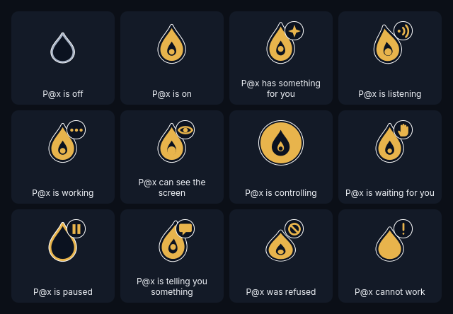
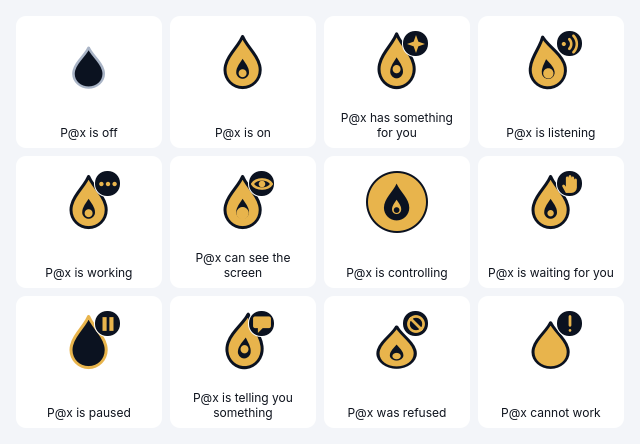
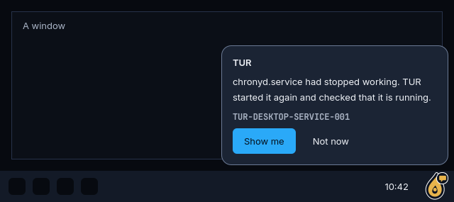
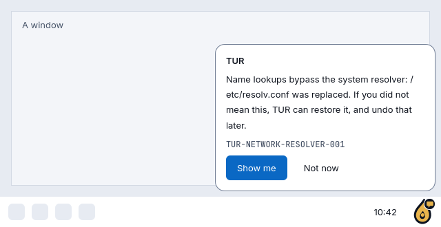
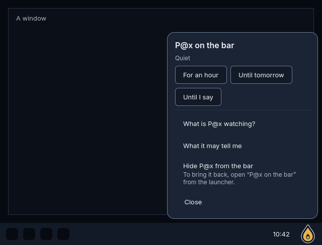

<!-- SPDX-License-Identifier: LicenseRef-TUR-Noncommercial-1.0.0 -->
# tur-pax-companion: P@x's character on the bar

**The owner's wish** (14 November 2026): "I'd like P@x to be a sort of old
Clippy, kind of omnipresent also on the GUI, especially in the bottom bar."
**Design it rests on:** [desktop-experience.md](desktop-experience.md),
sections 2, 4, 5, 7 and 9; [tur-pax-ui.md](tur-pax-ui.md);
[tur-pax-overlay.md](tur-pax-overlay.md); [pax-service.md](pax-service.md);
[self-healing.md](self-healing.md); [ai-control-layer.md](ai-control-layer.md)
**Code:** `desktop/apps/tur-pax-companion/`
**Report:** [desktop-8](../reports/desktop-8.md)

P@x gets a face on the desktop: a small flame that lives in the bottom bar,
shows at a glance what P@x is doing, says the one sentence that matters when
something happened that the person should hear of, and opens P@x's ask bar
beside itself when pressed.

People were fond of the assistant characters of the 1990s, and switched them
off. They interrupted, they guessed wrong, they could not be reasoned with,
and they would not go away. This design keeps the first thing and is built
round not doing the others: section 3 is a list of rules, each with the test
that holds it.

**Not on the image.** Nothing installs or starts the program yet (section 8).

---

## 1. The character

A flame: the flame at the heart of TUR's mark, the one that is already P@x's
icon (`Tur.Kit.Pax`'s `PaxFlame`, the same drawing). It is TUR's own and
resembles no other system's assistant in shape, name or manner: it is not an
object with a face stuck on it, it has no eyes, eyebrows or mouth, it does
not wave, dance or knock on the glass, and it has no name but P@x's.

What it has is a body, an inner flame, and a **core**, the bright dot inside
the inner flame, which is its eye: it grows when P@x listens or looks, rises
when the character has something to say, sways while P@x works, and goes
out when P@x is off. Beside the flame there is room for one small **mark**.
Posture, core and mark carry every state; colour never carries one alone,
and every state has its own words, which are what a screen reader reads.

| State | When | The flame | The mark | Words |
|---|---|---|---|---|
| asleep | P@x is off (and the person keeps the character on the bar) | Small, dark with a grey line, no inner flame, no core | none | P@x is off |
| idle | P@x is on and doing nothing | Upright, gold, inner flame and core | none | P@x is on |
| noticing | Something waits for the person to ask (it was quiet, busy, or the bubble was left alone) | A little taller, the core raised | a spark | P@x has something for you |
| listening | The ask bar is open | Leans towards it, the core larger | two arcs | P@x is listening |
| thinking | A task runs (the design's *working*) | Upright; the core sways, slowly, while it does | three dots | P@x is working |
| observing | P@x's indicator says P@x can see a window or the screen | The core at its largest | an eye, the indicator's | P@x can see the screen |
| acting | P@x's indicator says P@x is controlling an application | A gold disc with a dark line and a white hairline, the flame dark inside it: the indicator's own loud look; the line beats | none | P@x is controlling |
| waiting | Something of P@x's waits for the person's yes or no | Still, the core small | a raised hand, the indicator's | P@x is waiting for you |
| paused | The task is paused | Dark with a gold line, no inner flame | a pause sign, the indicator's | P@x is paused |
| telling | The bubble is open | Leans up towards it, the core raised | a speech bubble | P@x is telling you something |
| refused | A task ended with a refused step, or a limit stopped it | Lower and wider | a barred circle | P@x was refused |
| error | P@x is on and cannot work, or a task failed | Lower, no inner flame | an exclamation mark | P@x cannot work |





The pictures are the reference pictures of the tests
(`tests/shots/render_companion.qml`), the character at 64 px on the bar's
colour; on the bar it is 40 px, or as much as a thinner bar allows.

**One state at a time**, the one that tells the person most: acting,
observing, an error after a task, waiting, paused, refused, thinking, an
error that stands, listening, telling, noticing, idle. Asleep when P@x is
off, whatever else.

**Palette.** Fixed, like the overlay's (`PaxTheme.overlay*`), because the
character sits on a bar and over windows TUR does not draw: gold, a dark
line, a white hairline outside. Each shape has a layer that stands 3:1 from
every surface colour of both of TUR's variants, from white and from the
overlay's dark (`tests/tst_character.qml`; gold alone is 1.9:1 on white,
which is why the dark line is there). What opens above the character (the
bubble, the menu) follows the desktop's light or dark variant, as P@x's
window does.

**Motion.** The design's rule is that nothing loops except an indicator of
real activity (desktop-experience.md, 5.5), so the character is still when
P@x is still. Two things loop, and only while they are true: the core sways
while P@x works, and the disc's line beats while P@x controls. A change of
state is one short movement (`Kit.Motion.control`). With reduced motion, or
with motion frozen for a picture, nothing loops and nothing moves; the mark
and the posture still say everything.

**Honest signals.** Small things the character does are statements of fact,
not decoration:

| Signal | What is true | Built |
|---|---|---|
| The inner flame burns lower as the day goes | The share of today's spending limit that is left (org.tur.Agent1's status) | Yes |
| It dims and keeps still | The computer runs on its battery, so the character itself draws nothing it need not | Yes |
| It leans when the pointer is on it | It can be pressed | Yes |
| The mark and the look are the indicator's | P@x's indicator at the top of the screen says the same thing | Yes |
| It glances towards the window P@x is reading | Needs the window's place from P@x's indicator | Idea (section 11) |
| It nods once when a task ends well | A short task that is not announced otherwise | Idea |
| It turns to the screen P@x works on | More than one screen | Idea |

## 2. Where it lives

"In the bottom bar", without running inside Plasma. Three routes were
weighed.

| Route | What it gives | What it costs | Verdict |
|---|---|---|---|
| **(a) A StatusNotifierItem** (a tray icon over D-Bus, from a standalone program) | A standard interface; Plasma draws the icon in its tray; a menu | Plasma decides the size (16 to 22 px) and may put the icon in the hidden part of the tray; an icon cannot hold a speech bubble, be dragged along the bar or be long-pressed; a moving icon is a new picture sent over D-Bus for every frame; it is gone when a window is full screen. The KDE library for it needs Qt Widgets, which TUR's programs may not link (desktop/ALLOWED_IMPORTS), so the interface and its menu protocol would be written by hand | Not what the owner asked for. It remains the right small anchor for P@x in the tray (design 7.5, `tur-notifier`, task D-09), for a person who hides the character |
| **(b) A layer-shell surface of TUR's own**, placed over the bar | A standalone program under TUR's licence; any drawing and motion; a bubble beside the character; drag, long press, right click; above a full-screen window when wanted; on any compositor that has layer shell | It is over the bar, not part of it: it does not push the bar's own items aside, so it needs a free place (see "The seat"); it must find the bar's thickness itself | **Chosen and built** |
| **(c) A Plasma applet** | Truly part of the bar: laid out with the other items, moved in the bar's edit mode, following its edge, size and hiding | It is QML that Plasma's shell loads and runs, so it cannot carry TUR's licence: it would live in `desktop/upstream-licensed/plasma/` under GPL-2.0-or-later with its own entry in ADR-0016, and could import nothing of TUR's. The character's drawing would exist twice, or the applet would be a hollow box for a surface of TUR's anyway. A fault in it is a fault in Plasma's shell. It follows libplasma's QML interfaces from release to release. It is not above a full-screen window, and exists only on Plasma | Not needed. Side C stays empty |

**How (b) is in the bar.** The program has two layer-shell surfaces
(`src/surfaces.cpp`), through LayerShellQt, which is LGPL and already used
by P@x's window and indicator:

```text
 the screen
 ┌──────────────────────────────────────────────────────────────┐
 │                                                              │
 │                                        ┌──────────────────┐  │
 │                                        │ TUR              │  │  the bubble: above the bar,
 │  the probe: one transparent            │ One sentence.    │  │  beside the character
 │  column, background layer,             │ [Show me][Not now]│ │
 │  zone 0: its height is what            └──────────────────┘  │
 │  the compositor leaves                                       │
 ├──────────────────────────────────────────────────────────────┤ ← the bar's top edge
 │ ❂  ▣ ▣ ▣ ▣        (Plasma's panel)              10:42   🔥  │ ← the character, in the bar
 └──────────────────────────────────────────────────────────────┘
   the strip: as wide as the screen, anchored to the bottom edge, exclusive zone -1,
   as high as what is shown; only the character and the bubble take a click
```

- **The strip** is anchored to the bottom edge and both sides, with exclusive
  zone -1, so that it reaches the screen's own edge through the strip the
  bar reserves. It is as high as what is shown: the character's row, or the
  row and what is open above it. Its input region is the character's box
  and what is open, nothing else, so every other pixel of it lets a click
  through to the bar or the window under it. It asks for no keyboard.
- **The probe** finds the bar's thickness with nothing of Plasma's. It is
  one transparent column on the background layer, anchored to the top and
  bottom edges, that takes no input and has exclusive zone 0, which in the
  layer-shell protocol means "place me beside the surfaces that reserve
  room". The height the compositor gives it is the height left beside the
  bar; the screen's height less that is the bar's thickness. No Plasma
  D-Bus call, no script run inside Plasma, no file of Plasma's read, no
  KWayland.
- **The character** is drawn in the middle of that thickness, 40 px, or
  smaller in a thinner bar (`src/placement.cpp`). With no bar, or one that
  hides, it rests 4 px above the screen's edge. What opens above it starts
  8 px above the bar's top edge, centred on the character as far as the
  screen allows, and never overlaps the bar or the character.
- **Along the bar** it sits at the end by default (the right, or the left in
  a right-to-left layout) and can be dragged anywhere; where it was left is
  kept as a share of the bar's length, so it survives a change of
  resolution.

**The seat.** Over Plasma's default panel the end of the bar is where the
clock is. So that the character covers nothing, TUR's panel for new
accounts should end with a fixed spacer 48 px wide: Plasma's own spacer
applet, configured in `desktop/data`'s applets file, which is data (side B)
and not code. That change is not in this slice, so as not to cross pull
request #128; it is proposed in section 9. On a panel a person arranged
themselves the character may sit over one of their items until they drag it
to a free place.

**Over a full-screen window.** Plasma's panel is on the layer-shell top
layer, which KWin puts under an active full-screen window. The overlay
layer is above it. The person chooses (section 5):

- *Stay* (the default, the owner's "omnipresent"): the strip is on the
  overlay layer, always.
- *Step aside*: the strip is on the top layer, so it leaves with the bar,
  and moves to the overlay layer only while P@x's indicator says P@x is
  controlling, can see the screen, or waits for the person. Those are the
  moments the person must be able to see P@x and stop it, and P@x's
  indicator is on screen then too.

Both were run under KWin (section 10). Two costs of *stay* are stated in
section 9: a flame over a film is something on what the person is looking
at, and a surface over a full-screen window keeps the compositor from
handing that window straight to the display.

**Licence.** `Tur.PaxCompanion` and `libturpaxcompanion` are the project's.
The program links Qt Core, Gui, Qml, Quick and D-Bus (LGPL-3.0-only),
`libturpaxui` (the project's; for its client of org.tur.Agent1) and, by the
program and not by its module, LayerShellQt (every source file of `src/`
"LGPL-2.1-only OR LGPL-3.0-only OR LicenseRef-KDE-Accepted-LGPL", read file
by file at Plasma 6.8.2 for the overlay, tur-pax-overlay.md section 8).
Nothing new was added to the allowed list but the program's own names
(`desktop/ALLOWED_IMPORTS`); `boundary.py` and `boundary.py --linked` check
sources and binaries.

## 3. The rules

Each rule is a sentence a test can fail. "Unit" is
`tests/unit/tst_logic.cpp`, "bus" `tests/unit/tst_bus.cpp`, "stage"
`tests/tst_stage.qml`, "character" `tests/tst_character.qml`, "walks"
`tests/tst_walks.qml`, "KWin" `desktop/tests/compositor/tst_companion.cpp`.

| | Rule | Held by |
|---|---|---|
| R1 | **It never takes the keyboard by itself.** The surface asks for no keyboard. Keys typed while it is there, while it speaks and while P@x controls reach the window that had them, which never loses focus | KWin: `it_never_takes_the_keyboard_and_never_blocks_a_click`, `over_a_full_screen_window…`; stage: `test_it_never_takes_the_keyboard_by_itself` |
| R2 | **It never covers what the person works on and never blocks a click.** The character is inside the bar; what opens is above the bar, beside the character, and only while open; every other pixel of the strip passes a click to what is under it | KWin: a click on the bar in the character's row reaches the bar, a click beside the bubble reaches the window; `it_sits_in_the_bar`. Stage: `test_only_the_character_and_what_is_open_take_a_click`, `test_the_character_sits_inside_the_bar`. Unit: `the_character_sits_in_the_bar` |
| R3 | **It never makes a sound.** The program has no code that plays one and links no library that could | `boundary.py --linked`: no audio library is on the allowed list |
| R4 | **It speaks first only for things that matter and are true**: a repair TUR made, a problem waiting for the person, P@x waiting for an answer, a task that ended in a way the person should hear of, an update that undid itself. Each kind has its own switch. Each notice is said once. Its words are the words of the service it came from, which the character read itself; no program can hand it words to say | Unit: `it_speaks_once_about_what_is_switched_on`, `a_kind_switched_off_is_never_said`, `the_healing_services_notices_are_said_in_its_words`, `what_the_person_chose_is_kept`. Bus: the refusal's and the limit's sentences are the recorded service's. Stage: `test_each_kind_of_notice_has_its_switch`. The interface has no method that carries words (section 6) |
| R5 | **Quiet is one press away, and it is quiet**: for an hour, until tomorrow, or until the person says. While quiet nothing is said; what would have been said waits as a mark. When quiet ends nothing pops up: the person asks. It never speaks over itself, over the ask bar or over its own menu, never more than a set number of times an hour (6), and answering one bubble never brings the next | Unit: `quiet_is_quiet_and_nothing_pops_up_afterwards`, `going_quiet_takes_back_what_was_being_said`, `quiet_for_an_hour_until_tomorrow_and_until_i_say`, `it_does_not_speak_over_itself_the_ask_bar_or_its_menu`, `it_speaks_only_so_often_in_an_hour`. Stage: `test_quiet_is_one_press_away`, `test_quiet_until_tomorrow` |
| R6 | **One press, or P@x's key, opens the ask bar beside the character.** If something waits, the first press says it | Stage: `test_one_press_opens_the_ask_bar`, `test_what_waits_is_said_before_the_ask_bar`. KWin: `one_press_opens_the_ask_bar_beside_it` |
| R7 | **A long press, a right click or the menu key gives quiet, "What is P@x watching?", what it may tell, hide, and stop** while P@x works | Stage: `test_a_right_click_or_a_long_press_opens_the_menu`, `test_stop_is_there_while_pax_works_and_only_then`, `test_what_is_pax_watching_says_what_is_read`. Bus: `a_task_the_person_stopped_is_not_announced` (Stop cancels the task) |
| R8 | **It can be dragged along the bar, hidden entirely, and brought back. With P@x off it is absent, or asleep if the person keeps it** | Stage: `test_it_can_be_dragged_along_the_bar`, `test_it_can_be_hidden_and_brought_back`. Unit: `dragged_it_stays_where_it_is_left_and_snaps_to_an_end`, `asleep_while_pax_is_off_and_absent_unless_the_person_keeps_it`. KWin: `dragged_it_moves_along_the_bar_and_stays`, `hidden_it_is_gone_and_it_comes_back`. Bus: Show, Hide, a second start |
| R9 | **Everything it shows can be reached with the keyboard and read by a screen reader**, once the person asks for the keyboard; Esc gives it back | Walks: Tab reaches the character and every control once, each has a name and a role, in both directions; nothing is cut at 200 % text. Stage: `test_asked_for_everything_is_reachable_with_the_keyboard`. KWin: `asked_for_it_has_the_keyboard_and_esc_gives_it_back` |
| R10 | **It runs nothing.** A notice's commands are text to copy. A bubble has at most two actions, and an action is one of three things the character itself does: show the whole notice, open P@x's window, close | Stage: `test_show_me_opens_the_whole_notice_and_runs_nothing`, `test_the_bubble_has_one_sentence_and_at_most_two_actions`. Unit: `one_sentence_and_at_most_two_actions` |
| R11 | **Suggestions are off unless the person switches them on**, come only from what is listed under "What is P@x watching?", are made on this computer by plain rules, send nothing anywhere, and are at most 2 an hour; one that cannot be shown now is dropped, not kept | Unit: `suggestions_are_off_unless_switched_on_and_then_limited`, `the_one_suggestion_is_a_plain_rule_over_the_status`. Stage: `test_each_kind_of_notice_has_its_switch` |
| R12 | **It never contradicts P@x's indicator.** While the indicator says P@x controls, sees or waits, the character says the same, whatever else is true; it says "controlling" only then; when the indicator goes, so does that state | Unit: `it_says_what_the_indicator_says`. Bus: `what_the_indicator_shows_is_followed`. KWin: the indicator's stand-in says acting and the character is acting, over a full-screen window |
| R13 | **It never starts P@x, and holds no authority.** P@x counts as on only while its service is running and says so. What the character does (open P@x's window, cancel a task) any program of the person could do | Bus: `the_character_never_starts_pax` (the bus could start the service; it is not started, not even to stop it) |

## 4. The bubble, and the hand-over

**The bubble** (`qml/Bubble.qml`) is who says it, one sentence, a code if
there is one, and at most two actions: "Show me" and "Not now".





- **Who says it** is always there, and TUR is not P@x
  (desktop-experience.md, 9.2): a repair, a refusal, a limit, a task that
  ended are the system speaking about the computer or about P@x, under TUR's
  name, in the third person. Only P@x's own words would carry P@x's name in
  gold, and in this version the character says none: no text a model wrote
  goes into a bubble.
- **One sentence**: at most 280 characters. For the healing service it is
  the notice's own text, or its title when the text is longer than 180
  characters.
- **It does not stay.** Left alone for 12 seconds it folds into a mark on
  the character and waits there; it never comes back by itself. "Not now"
  is the end of it.

**How it grows.** The bubble, the whole notice, the menu and P@x's ask bar
all open in the same place: beside the character, their bottom edge 8 px
above the bar.

| From | To | How |
|---|---|---|
| The bubble of a notice of TUR's | **The whole notice** (`qml/NoticeCard.qml`): title, code, the service's explanation, its commands as text that can be selected, and, while P@x is on, "Ask P@x to explain" | "Show me". The same surface, the same place; it grows upwards |
| The bubble of a notice about P@x's task or proposal | **P@x's conversation panel** (`tur-pax-ui`), where the task, its steps and the refusal are | "Show me" calls `org.tur.PaxUi1.Show("panel")`. The panel is along the screen's right edge (design 9.2), so with the character at the end of the bar it opens directly above it |
| The character, pressed; or P@x's key | **P@x's ask bar** | `org.tur.PaxUi1.Show("ask")`. `tur-pax-ui` reads the character's `Anchor` and opens its bar on the character's screen, centred on the character as far as the screen allows, 8 px above the bar: where the bubble was. The bubble makes room the moment the bar opens (`org.tur.PaxUi1.Mode`), and the character listens |
| "Ask P@x to explain" on the whole notice | **A task** | The character sends fixed words with the notice's code and title to `org.tur.Agent1.StartTask`, as the person's own request, and asks for the panel. Under P@x's rules like any request |

The two programs stay two programs: the character shows and hands over,
`tur-pax-ui` is where a person talks to P@x. There is one ask bar.

**How a notice reaches it.** The character pulls; nothing is pushed into it.

| From | How | Becomes |
|---|---|---|
| The healing service | The program `tur-diag heal notices --json` is run (a separate program: the command-line side of the boundary) when the character starts and when `/var/log/tur/heal/state.json` changes. Fields `id`, `at_utc`, `code`, `kind`, `title`, `body`, `actions`, declared stable by that component | `repaired`, `held`, `fixed-by-update`, `undone`: kind *repair*. `detected`, `not-repaired`, `report-offered`, `recurred-after-update`: kind *fault*. Its `actions` are the commands shown as text |
| `org.tur.Agent1` | `TaskFinished`, with the steps seen before it | Kind *task*: refused steps ("P@x finished, but one step was refused", with the service's reason); a limit or a failure (the service's own sentence and code); a task that ran 20 s or more, or with nobody there. A task the person stopped is not announced; a short task that ended well is not either |
| `org.tur.Agent1` | `ScheduleProposed`; `proposals` in the status | Kind *approval*, and the state *waiting* for as long as a proposal waits |
| The update manager | Not built: nothing in the session says "the system went back to the previous version" yet | Kind *update* exists, with its switch; its source is proposed in section 9 |

## 5. What the person can do

| With | What happens |
|---|---|
| A press on the character, or Return on it | What waits is said, if something waits; otherwise the ask bar opens beside it |
| P@x's key (Meta+Space) | The ask bar opens beside the character |
| A right click, a long press (0.7 s), or the menu key | The menu |
| A drag | The character moves along the bar and stays where it is left; within 24 px of an end it goes to the end |
| `tur-pax-companion --attend`, the launcher's "Go to P@x on the bar", `org.tur.PaxCompanion1.Attend` | The character has the keyboard: Tab goes from it through what is open, Esc gives the keyboard back. If nothing is open, the menu opens |
| `tur-pax-companion --hide`, "Hide P@x from the bar" | It is gone until brought back |
| `tur-pax-companion`, the launcher's "P@x on the bar", `org.tur.PaxCompanion1.Show` | It is back |

**The menu** (`qml/MenuCard.qml`):



- **Stop P@x**, at the top, only while a task runs. It is the system's blue,
  not gold: it is the person's control over P@x.
- **Quiet**: "For an hour", "Until tomorrow" (07:00), "Until I say"; one
  press each. While quiet the menu says so and offers "Speak again".
- **What is P@x watching?** (`qml/WatchingCard.qml`): what P@x is doing now
  in the service's words, with the step it is on and why it was allowed;
  what is left of today's limit; exactly what the character reads; what it
  never reads; and "See everything P@x did", which opens P@x's record.
- **What it may tell me** (`qml/SettingsCard.qml`): a switch for each kind
  of notice; suggestions, with what they are made from; "Stay over
  full-screen windows"; "Stay on the bar while P@x is off".
- **Hide P@x from the bar**, with how to bring it back.

**What is kept**: `$XDG_CONFIG_HOME/tur/pax-companion.json`, a file of the
person's: which kinds are off, suggestions, quiet until when, hidden, where
along the bar, the two "stay" choices, and the identifiers of the last 400
notices said, so that none is said twice. No words of a notice are kept.

**Keyboard and screen reader.** The character is a button whose name is its
state in words and whose description says what pressing it does. The bubble
is an alert whose name is who speaks and whose description is the sentence.
Every control is the kit's, with its name and role. The walks hold this for
every scene in both directions (R9). Two things are not built: an
announcement to a screen reader when a bubble opens (the kit has none yet),
and a key of P@x's own for "Go to P@x on the bar" (section 9).

## 6. What it reads, and its interfaces

**The character reads four things, and says so** ("What is P@x watching?"):

| What | How | Why |
|---|---|---|
| P@x's own state | `org.tur.Agent1`: `GetStatus`, `StateChanged`, `TaskStarted`, `ActionProposed`, `ActionCompleted`, `TaskFinished`, `ScheduleProposed`. Listening only; never starting the service | On or off, working, paused, why it cannot work, today's spending against the limit, the step it is on, how a task ended |
| TUR's record of repairs and problems | `tur-diag heal notices --json` | Notices |
| What P@x's indicator shows | `org.tur.PaxOverlay1.Activity` | So that the two agree (R12) |
| Whether the computer is on battery | `org.freedesktop.UPower.OnBattery`, system bus | To keep still and dim |

and, to stay out of the ask bar's way, what P@x's window shows
(`org.tur.PaxUi1.Mode`).

**It never reads** the screen, a window or its title, what is typed, the
clipboard, a file of the person's, the microphone or the camera. It has no
code for any of them and links nothing that could: no KWayland (the
window-management protocol stays the overlay's alone, ADR-0020), no screen
capture, no input capture. A click on the strip that is not on the
character is not even delivered to it.

**Suggestions.** Off unless the person switches them on. When on, a
suggestion may be made only from the four things above, on this computer,
by a plain rule; nothing is sent to a model, local or remote, to make one,
and nothing on the screen is read. At most 2 an hour. This version has one
rule: when nine tenths of today's spending limit are used and the limit is
not reached, once that day: "It looks like P@x has used most of today's
spending limit. You can change the limit in P@x's setup." A suggestion that
needs a model, even a local one, is a later step with its own decision,
because it means reading more than the character reads today; what it would
read then must be added to this list and to the card first.

**org.tur.PaxCompanion1** (`dbus/org.tur.PaxCompanion1.xml`; session bus;
proposed, not frozen; the program's offer is held to the XML by the bus
test):

```text
Methods     Show()   Hide()   Attend()   SetQuiet(s mode)      mode: hour | tomorrow | always | off
Properties  State (s)   Shown (b)   Quiet (b)   Anchor (a{sv})   InterfaceVersion (u) = 1
            Anchor: screen (s), x (d: the character's middle from the screen's left edge),
                    lift (d: how far above the bar's top edge what opens beside it starts), shown (b)
```

It carries no words. Nothing can make the character say anything through it.

**Additions to two interfaces of the desktop's own programs**, both built
here and both additions (nothing that used them changes):

| Interface | Addition | For |
|---|---|---|
| `org.tur.PaxOverlay1` (proposed, not frozen) | Property `Activity` (s, read, with `PropertiesChanged`): what the pill says P@x is doing; empty while P@x is not on | R12 |
| `org.tur.PaxUi1` (frozen as version 1) | Property `Mode` (s, read, with `PropertiesChanged`): what the window shows. And behaviour: `Show("ask")` opens the bar beside the character when `org.tur.PaxCompanion1.Anchor` says it is on the bar (read with a 0.4 s limit, never starting the character) | The hand-over (section 4) |

**Proposed for the services, as text; nothing under `services/` was
changed:**

1. `tur-pax`: when P@x is switched on, start the character (call
   `org.tur.PaxCompanion1.Show`, which the bus can start); when P@x is
   switched off, nothing (the character sleeps or leaves by itself).
2. `tur-pax`: `Activity` values the service does not have yet
   (`observing`, `acting`, `waiting`) come from the indicator today; when
   `org.tur.Agent1.State` gains them, the character should prefer the
   service's.
3. `tur-update` or boot health: a way for a session program to learn that
   the system went back to the previous version (a line of
   `tur-update status --json`, or a signal of `org.tur.Update1`), for the
   kind *update*.
4. `tur-diagnostics`: section 7.

## 7. The healing service's notices: who marks one seen

Today `tur-heal-notify.service` runs `tur-diag heal notify` in the session,
which shows each notice this person has not seen through the desktop's
notification service and marks it seen once the service accepted it. The
character reads the same list. Uncoordinated, a repair would be announced
twice, once by each; and if the character marked notices seen, one could be
lost when the character could not speak.

**In this slice** the character reads and says, and marks nothing: it runs
`tur-diag heal notices --json`, never with `--mark-shown`. A notice is said
once by the character (its own list) and shown once as a notification. That
is two announcements of one event, known, and the reason for what follows.

**Proposed** (for `services/tur-diagnostics`, and one method on the
character): one announcement, by whoever can make it at that moment, with
the healing service's own program still the only one that marks a notice
seen.

```text
tur-diag heal notify, for each notice N that this person has not seen:

  1. Is org.tur.PaxCompanion1 owned on the session bus? (No activation: a
     notice is not a reason to start the character.)
       no  ─▶ 3
  2. Call org.tur.PaxCompanion1.Announce(s source = "heal", t id = N.id) -> b taken,
     with a 5 s limit.
       The character runs `tur-diag heal notices --json` itself, finds N by its
       id, and answers true only once N's bubble is on the screen. It answers
       false, at once, if it is hidden, asleep, quiet, already speaking, has
       spoken its number for the hour, or the person switched that kind off.
       taken ─▶ mark N seen. No notification is sent.
       not taken, no answer, an error ─▶ 3
  3. Show N through org.freedesktop.Notifications, as today, and mark it seen
     when the notification service accepts it.
```

What this keeps:

- **One announcement.** Either the character says it or the desktop's
  notification shows it, never both.
- **Nothing is lost.** The character takes a notice only when it is saying
  it. Quiet, hidden, asleep, P@x off, the character not running or not
  installed: `notify` does what it does today. The owner's rule for the
  healing service ("the person is always kept aware") never depends on the
  character.
- **One writer.** Only `tur-diag heal notify` writes the list of notices
  seen. The character never does.
- **No words through the bus.** `Announce` carries an identifier. The words
  are the ones the character reads from the healing service's own program,
  so `Announce` cannot make it say anything that is not a notice of TUR's.
- **Quiet means quiet for the character only.** A person who made the
  character quiet still gets TUR's notifications, under the desktop's own
  Do Not Disturb; the menu says so.

With it, the character no longer watches the state file: `Announce` is what
tells it. "Show me" on such a notice should then open the healing history
(`tur-diag heal history --json`: `at_utc`, `code`, `kind`, `who`, `text`,
from pull request #117), in the page P@x's window or Settings gets for it.

## 8. Starting, stopping, installing

```text
tur-pax-companion [--show] [--attend] [--background] [--hide] [--quiet MODE]
                  [--variant dark|light] [--standalone] [--settings FILE]
                  [--bus ADDRESS] [--heal-command COMMAND] [--heal-state FILE]
                  [--bar-inset PIXELS] [--no-dbus] [--check]
```

One character per person: the program owns `org.tur.PaxCompanion1`, and a
second start speaks to the first and ends (`--show`, `--attend`, `--hide`,
`--quiet`; `--background` changes nothing). `--hide` and `--quiet` need no
display, and with no character running they write the choice down for the
next one.

**With P@x off** the character is not on the bar (the default), or asleep
on it if the person chose that. Design principle 8 says that nothing of
P@x's runs while P@x is off. In this slice the program, once started, stays
in memory with no surface, no timer and nothing polled until P@x comes on;
that is a departure, stated in section 11, and what removes it is item 1 of
section 6: `tur-pax` starts the character when P@x is switched on, and the
character ends when P@x goes off.

**Nothing is installed.** The image has no rule for this program, and this
change adds none, so as not to cross pull request #128. What the image will
need:

| From | To |
|---|---|
| the built `tur-pax-companion` and `libturpaxcompanion.so` (with `libturpaxui.so`, `libturkit.so`, `libturkitpax.so`) | `/usr/bin`, `/usr/lib64` |
| `data/org.tur.PaxCompanion.desktop` | `/usr/share/applications/` (the launcher's "P@x on the bar", "Go to P@x on the bar", "Hide P@x from the bar") |
| `data/org.tur.PaxCompanion1.service` | `/usr/share/dbus-1/services/` |
| runtime: LayerShellQt, Qt 6 D-Bus, Quick, Shapes | packages already needed by P@x's window |
| the seat: a fixed spacer at the end of the panel of new accounts | `desktop/data`'s applets file (section 9, decision 4) |

## 9. For the owner

Decisions taken here that the owner may want to reverse, and questions only
the owner can answer.

1. **The character has no name of its own.** It is P@x; the flame is P@x's
   face. A second name would make two things of one, and "an assistant with
   a pet name" is the manner this design stays away from. If a name is
   wanted, it is a string in `qml/Words.qml`.
2. **Which notices are on by default: all five** (a repair TUR made, a
   problem waiting, P@x waiting for an answer, a task that ended or was
   refused, an update that undid itself). Each is rare, true and about this
   computer. The alternative worth weighing is *a repair TUR made* off by
   default once the handshake of section 7 exists, since the notification
   says it anyway.
3. **Suggestions: never on by default.** Recommended as a standing rule, not
   only for this version. The character is liked for as long as it speaks
   only when something is true and matters; a guess, however good, spends
   that.
4. **The seat.** Add a fixed 48 px spacer at the end of TUR's default panel
   (data, in `desktop/data`), so that the character covers nothing on a new
   account. Until then it sits over the end of the bar.
5. **Over a full-screen window: stay** is the default, because the owner
   asked for "omnipresent" and the brief asks that the character work over a
   full-screen window. The designer's recommendation is the other choice,
   *step aside*, as the default: a film, a game or a presentation is what
   the person is working on (R2), and a surface over a full-screen window
   costs that window its direct path to the display. It is one switch
   either way.
6. **With P@x off: absent** by default (design principle 8 and 9.1: TUR
   never reminds the person that P@x is off). "Stay on the bar while P@x is
   off" shows it asleep.
7. **A key for "Go to P@x on the bar".** Everything is reachable with the
   keyboard through the launcher today. A key of its own would be a fifth
   command in `desktop/kit/pax/commands.json` (the proposal: `Meta+Alt+Space`,
   not verified to be free), bound by the action `attend` of the character's
   desktop file; it changes the list of keys P@x's indicator and window
   show, and their pictures.
8. **Two interfaces gained a property** (`org.tur.PaxOverlay1.Activity`,
   `org.tur.PaxUi1.Mode`), and the ask bar opens beside the character.
   `org.tur.PaxUi1` was frozen as version 1; the addition leaves every
   existing caller as it was, and the version stays 1.
9. **It speaks at most 6 times an hour**, and a bubble stays 12 seconds.
   Both are numbers in one place (`CompanionSettings`, `Companion`).
10. **The character uses P@x's window's client of the service**
    (`libturpaxui`'s `AgentClient`) rather than a second one, so that the
    two cannot understand `org.tur.Agent1` differently. If more programs
    need it, it should move to a library of its own.

**A decision record is needed** for two things: a new program of P@x's on
the desktop with an interface of its own, and the standing rule about
suggestions. The text is in section 12.

## 10. Tests

All in CI, in the desktop workflow.

| Test | Where | What it proves |
|---|---|---|
| `pax-companion-unit-logic` | ctest | The rules, with the clock in the test's hands: section 3's unit column; the person's choices kept across a restart; the healing service's notices mapped and said in its words, its program run and its file watched; where the character and what opens above it go |
| `pax-companion-bus` | ctest, private bus | Against the stand-in for `org.tur.Agent1` that answers as the real service did (`desktop/apps/tur-pax-ui/fixtures/agent1`, recorded in CI): off is asleep, on is idle, on and not ready is an error; a task is *thinking* with its step, then idle; a refused step, the day's limit, a long task are told, in the service's words; a stopped task is not; the character never starts the service. `org.tur.PaxUi1.Show` asked of a stand-in. A property of another program followed and dropped. The running program's `org.tur.PaxCompanion1` against the XML; Show, Hide, SetQuiet, Attend, Anchor; a second start |
| `pax-companion-qml` | ctest, offscreen | `tst_character`: every state its own words and shape; contrast of every state over every background, dimmed too; nothing loops unless P@x works or controls, and never with reduced motion, frozen, or on battery. `tst_stage`: section 3's stage column. `tst_walks`: for each of 27 scenes, contrast in both variants, gold only in the character and P@x's name, keyboard and accessible names in both directions, no text cut at 200 %, right-to-left long, and both |
| `pax-companion-starts-*`, `-hide-without-a-bus`, `-desktop-file` | ctest | The program loads with no QML warning, dark and light; `--hide` needs no bus and no display; the desktop file is valid |
| Pictures | `screenshots` job | `tests/shots/render_companion.qml`: 27 scenes and the sheet of states, dark and light, compared with `desktop/tests/screenshots/companion-*` |
| `tst_compositor_companion` | `compositor` job, under KWin | Below |
| `pax-overlay-bus` (extended) | ctest | The indicator's `Activity`: empty with P@x off, then what the pill says |

**Under KWin** (`desktop/tests/compositor/tst_companion.cpp`, run by
`desktop/ci/compositor.sh` after the overlay's tests, in four arrangements:
dark and light, at scale 1 and 1.5). The bar is a **stand-in**: a
layer-shell surface of the test's own on the top layer along the bottom
edge, 64 px thick, reserving its thickness as Plasma's panel does. 64 and
not 44, so that "in the middle of the bar" and "just above the screen's
edge" are 8 px apart and a screenshot can tell which happened. Under it, a
maximised window of the test's that writes down every key and click.

1. In the bar: the character's gold is inside the bar's strip, at its end,
   in the middle of its thickness; `Anchor` says where; KWin lists no window
   of the program's.
2. Keys typed while it is there and while it speaks reach the window, which
   never loses focus. A click on the bar in the character's row reaches the
   bar; a click beside the bubble reaches the window. The bubble is above
   the bar, beside the character.
3. `Attend`: a key no longer reaches the window; Esc: the bubble waits as a
   mark and the window types again.
4. A press says what waits; the next opens `tur-pax-ui`'s ask bar, 640 wide,
   reaching the character's side, its bottom edge 8 px above the bar; the
   character listens.
5. Dragged 240 px, it is 240 px along and stays; `Anchor` follows.
6. Hidden: no gold on the bar. Shown: back.
7. Over a full-screen window (which covers the stand-in bar): the character
   is visible and the window keeps the keyboard. Started again with "step
   aside": no gold. The indicator's stand-in says *acting*: the character is
   acting and visible over the full-screen window. The stand-in goes: gone
   again.

What the job measured is in the report.

## 11. Not built, known gaps, ideas kept

**Not run:**

- **Plasma's own panel.** The builder image has KWin and not Plasma's shell.
  Everything about the real bar is untested: a floating panel and what it
  reserves; a panel at the top or a side (the character assumes the bottom
  edge: the probe gives a thickness, not an edge); a panel that hides itself
  or dodges windows (thickness 0: the character rests at the screen's edge,
  over the panel when it appears); two panels on one screen (their
  thicknesses add up); the look of the fixed palette on Plasma's panel in
  TUR's two schemes.
- **The real image, a real session, real hardware.** Not installed, not
  started with a session, not run with `tur-pax` (only its recorded
  answers), not run with `tur-diag` (only the hand-written fixture of its
  output), not run on a battery.
- **A screen reader on the real program.** The walks read Qt's accessibility
  interfaces, not AT-SPI; no person who uses a screen reader has tried it.
- **Voice.** Not built anywhere in P@x; the character's *listening* is the
  ask bar being open.
- **More than one screen.** The character is on the primary screen. The
  compositor test skips the two-output arrangement.

**Known gaps:**

- **Two announcements of one repair** until section 7's handshake exists.
- **The program stays in memory while P@x is off** (section 8).
- **The seat** is not in the default panel (section 9, decision 4).
- **The healing fixture is written by hand** from the service's struct and
  catalogue, not recorded from a run, unlike `tur-pax-ui`'s. Recording it in
  the `heal` workflow is a follow-up.
- **"Step aside" on the top layer shares it with the bar.** Which of two
  top-layer surfaces KWin draws above the other is the order they were last
  raised in; after the person clicks Plasma's panel the character may be
  under it. Observed with the stand-in in the report; the reliable form
  needs to know that a window is full screen, which needs the
  window-management protocol (KWayland, ADR-0020's program only today) or
  the indicator to say so.
- **No announcement to a screen reader** when a bubble opens.
- **An update that undid itself** has no source (section 6, item 3).
- **A drag is followed pixel by pixel only as fast as the compositor
  delivers motion to a small input region**; not measured on a real pointer.
- **The 12 s after which a bubble folds** is not paused while the pointer is
  on it.

**Ideas kept, not built:**

- It glances towards the window P@x reads (the core moves towards it): the
  indicator knows the window's place; a second property would carry the
  direction.
- One nod when a short task ends well, instead of saying nothing at all.
- On several screens, it lives on the bar's screen and turns towards the
  one P@x works on.
- "While you were away": one bubble when the person comes back, with how
  many scheduled tasks ran (`org.tur.Agent1.GetAway`).
- A tray item as the fallback anchor when the character is hidden (route
  (a), `tur-notifier`).
- The character as the place P@x's stop key is shown while P@x works.

## 12. Proposed decision record

For `docs/adr/` (number to be given; not added to the index here).

> **ADR: P@x has a character on the bar, as a standalone program, bound by
> rules**
>
> **Status:** Proposed. **Date:** 2026-11-15.
> **Sections:** specification §9; desktop-experience.md 2, 4, 7.5, 9;
> ADR-0003, ADR-0016, ADR-0020. As built: tur-pax-companion.md.
>
> **Context.** The owner asked on 14 November 2026 that P@x be present on
> the desktop as a character, "especially in the bottom bar". The desktop
> design gave P@x a tray item and nothing else on the bar, and its second
> principle of calm ("TUR does not interrupt, advertise, nag or animate for
> its own sake") stands. Code that runs inside Plasma's shell cannot carry
> TUR's licence.
>
> **Options.** (a) A StatusNotifierItem: standard and standalone, but an
> icon Plasma draws, with no room for a state that moves or a sentence.
> (b) A layer-shell surface of TUR's own over the bar. (c) A Plasma applet,
> under GPL in `desktop/upstream-licensed/`.
>
> **Decision.**
> 1. P@x's character is `tur-pax-companion`, a standalone program under the
>    project's licence that draws a layer-shell surface over the bar. It
>    finds the bar's thickness from the layer-shell protocol alone. Side C
>    stays empty; no applet is written.
> 2. The character is bound by the rules R1 to R13 of tur-pax-companion.md,
>    each held by a test. A change that removes or weakens one needs a
>    decision record.
> 3. The character speaks first only about facts the system recorded, which
>    it reads itself. No interface lets another program give it words.
> 4. Suggestions are off by default in every version of TUR. When a person
>    switches them on they are made on the person's computer, from what the
>    character already reads and lists, and never by sending anything
>    anywhere.
> 5. `org.tur.PaxCompanion1` is added (proposed, not frozen).
>    `org.tur.PaxOverlay1` gains `Activity` and `org.tur.PaxUi1` gains
>    `Mode`; both are additions.
> 6. Desktop design principle 8 is amended: while P@x is on, P@x's
>    character may run in an idle session beside the notifier. While P@x is
>    off it does not, once `tur-pax` starts and ends it.
>
> **Consequences.** P@x is visible at all times while it is on, in one
> place, in the same words and signs as its indicator. A person can make it
> quiet, move it, hide it, and ask what it reads. The character can sit
> over an item of a panel the person arranged themselves, until they move
> it; TUR's own panel reserves it a seat. It does not follow a panel at
> another edge until that is built. The healing service's notices need the
> handshake of section 7 to be announced once.
>
> **Verification.** The tests of tur-pax-companion.md, section 10; KWin
> 6.8.2's treatment of exclusive zone 0 and -1 and of the top and overlay
> layers under a full-screen window, as the compositor job observed it.
