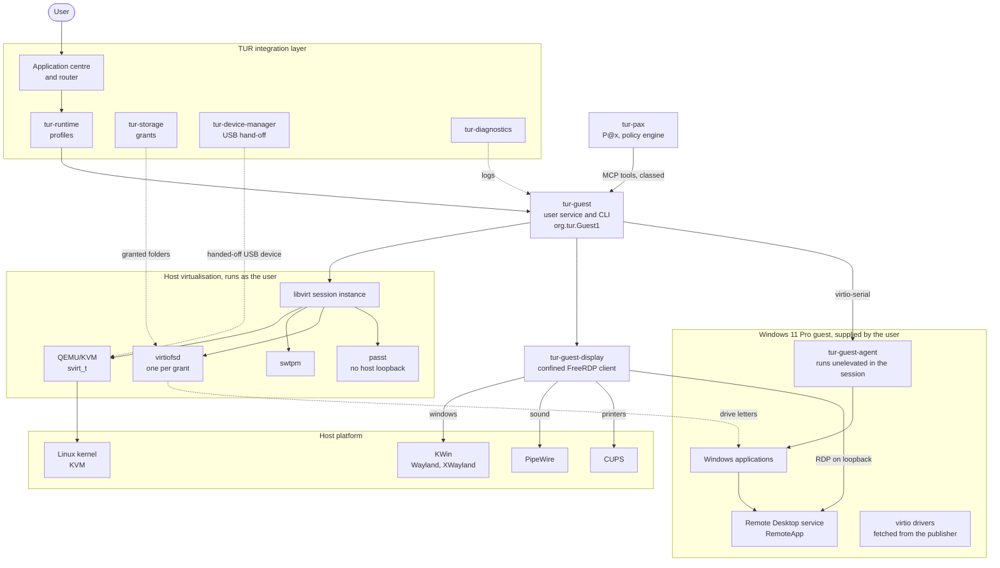

# Seamless Windows guest

**Design proposal — 12 November 2026**
**Applies to:** specification revision 1.0
**Related decisions:**
[ADR-0007](../adr/0007-app-centric-routing.md) (Accepted),
[ADR-0015](../adr/0015-seamless-windows-guest.md) (Accepted)

This document designs the tier that ADR-0007 calls the seamless Windows guest: a
real Windows installation in a virtual machine whose applications appear as
ordinary individual windows on the Plasma desktop, with no Windows desktop
visible. It is used only for applications that a compatibility layer does not
run well, typically Microsoft Office and Adobe's applications. It replaces
specification §13 as the description of how a Windows guest is used, and lists
the amendments that requires in
[section 17](#17-amendments-to-specification-revision-10).

The project is TUR and the assistant is P@x
([ADR-0009](../adr/0009-project-name.md)). Components that exist today under a
`uos-` name are written here with the name they will have after the rename:
`tur-runtime` is today's `uos-runtime`, `tur-pax` is today's `uos-agent`, and
so on. New components are named `tur-guest…`.

TUR does not claim complete Windows compatibility. A guest raises compatibility
for productivity software and lowers it for anything that needs a graphics
card. [Section 12](#12-what-will-and-will-not-work) says which is which.

**How to read the claims in this document.** Three kinds of statement appear:

- **Verified.** Checked against the source named on 12 November 2026. Each has
  a reference such as [S3] to [section 19](#19-sources).
- **Measured.** Taken from a TUR build manifest, SBOM or CI report, with the
  run number.
- **Assumption.** Not verified. Marked as such, and to be verified before or
  during implementation (§0, rule 14).

Nothing in this document is legal advice. The reading of Microsoft's terms in
[section 13](#13-legal-and-licensing) is an engineer's reading and goes to the
legal review that §17.2 requires.

---

## 1. Purpose and scope

**In scope**

- One Windows 11 guest per user under QEMU/KVM, created from installation media
  and a licence that the user supplies.
- Presenting applications installed in that guest as individual windows,
  launcher entries and task-switcher entries on the Plasma Wayland desktop.
- Start on demand, a keep-warm policy, suspend and resume, snapshots, updates
  and removal.
- Shared folders, clipboard, audio, printing and explicit USB hand-off, each
  under host policy.
- A small TUR agent inside the guest for integration and for P@x.
- Diagnostics, a `TUR-WINDOWS-GUEST-*` error-code family and a published
  compatibility matrix with a route column (ADR-0007).

**Out of scope**

- Games. They go to Proton, or to dual boot where kernel anti-cheat requires it
  (ADR-0007).
- Shipping, downloading without the user, or pre-selecting any Microsoft
  binary: installation media, product keys, fonts, runtimes, drivers.
- Windows editions that Microsoft does not let be reached by Remote Desktop
  (Home), and any tool that lifts a technical limit of Windows.
- More than one concurrent user of one guest, and guests reached from another
  machine.
- GPU passthrough as a default. It stays an expert option
  ([section 6.11](#611-graphics-and-the-expert-option)).
- A macOS guest (ADR-0007: Apple permits it only on Apple hardware).
- Any role for the guest in boot, installation, update or recovery of TUR.
- Showing the Windows desktop. A console view exists for setup and repair
  only.

## 2. Principles

1. **A compatibility layer comes first.** The router offers the guest only
   where the catalogue says Wine is inadequate, or where the user overrides it
   (ADR-0007). The owner's condition is that virtualisation is avoided wherever
   an application runs well without it.
2. **Optional and absent by default.** Until the user sets the tier up, no
   guest exists, no virtual-machine process runs and no daemon for it is
   active.
3. **The user supplies Windows.** Media, licence and acceptance of Microsoft's
   terms are the user's. TUR ships nothing from Microsoft and scripts no
   Microsoft download.
4. **Never work around Windows.** No bypass of the TPM, Secure Boot, processor
   or memory checks; no activation tool; no patch that enables a feature an
   edition lacks. If Windows refuses, TUR explains with an error code.
5. **The guest is untrusted.** Everything that comes out of it, including what
   the TUR agent reports, is data. Host resources are released on the host,
   never by a dialog inside Windows.
6. **Runs as the user, confined.** No part of the tier runs as root on the
   host.
7. **Start in seconds, cost nothing when unused.** The guest runs while it has
   windows, then is paused, then saved to disk. Budgets are targets until
   measured.
8. **Integrate, do not fork.** QEMU, libvirt, FreeRDP, swtpm and the firmware
   come from Fedora packages and are driven through their documented
   interfaces. Fixes go upstream first.
9. **Measured, not claimed.** Results are published per application, with
   versions and hardware (§0, rule 7).

## 3. State of upstream, November 2026

Checked on 12 November 2026. This section records what was found, including
where it differs from what ADR-0007 assumed.

### 3.1 FreeRDP and RemoteApp on Wayland

RDP RemoteApp, also called RAIL (Remote Applications Integrated Locally), sends
each top-level window of a remote session to the client as a separate window.
It is the mechanism used by WinApps, WinBoat and, in the opposite direction, by
Microsoft's own WSLg. [S8] [S13] [S39]

| Question | Finding | Source |
|---|---|---|
| Current FreeRDP | 3.33.1, released 10 November 2026. Releases in the last two months: 3.32.0 (23 September), 3.32.1, 3.32.2 (12 October, described as a security release hardening against malicious client and server messages), 3.33.0 (2 November), 3.33.1. Licence Apache-2.0. | [S1] |
| Version in the TUR image | **Measured:** `freerdp` and `freerdp-libs` 3.33.1 (run 43147702795). | [S6] |
| Clients Fedora builds | `xfreerdp` (X11), `wlfreerdp` (Wayland, on FreeRDP's own `uwac` library) and `sdl-freerdp` (SDL3), all in the `freerdp` package. `freerdp-shadow-cli` and `freerdp-proxy` are in `freerdp-server`. The sample server is not built (`WITH_SAMPLE=OFF`). | [S5] |
| RemoteApp in `xfreerdp` | Yes; the long-standing implementation. Fixes continue: "hopefully no longer shrinking windows" (3.32.0), a repaint deadlock (3.33.0), hidden and override-redirect windows (3.33.1). On Plasma Wayland it runs under XWayland. | [S1] [S2] |
| RemoteApp in `wlfreerdp` | No. FreeRDP's own wiki: "It seems wlfreerdp doesn't support remoteapp … if you want to use remoteapp use xfreerdp." | [S3] |
| RemoteApp in `sdl-freerdp` | **New, and labelled beta.** 3.32.0: "[beta] Basic SDL client RAILS support for X11/wayland". 3.33.0: "improved SDL client RAILS", with fixes for multiple monitors, popups, position, size and minimise. 3.33.1: further fixes, and "set the app_id of RemoteApp windows from the RAIL application ID". | [S1] [S2] |
| Native Wayland RemoteApp | Therefore possible since 23 September 2026, through `sdl-freerdp`, and seven weeks old. How it behaves on KWin is an **assumption** to be measured. Wayland gives a client no way to place its own top-level windows, which RemoteApp was designed around. | [S1] |
| Launching an application | `/app:program:[path\|\|\|alias],cmd:…,file:…,guid:…`. | [S4] |
| Clipboard | `/clipboard` with `direction-to:[all\|local\|remote\|off]` and `files-to:[all\|local\|remote\|off]`. File transfer uses FUSE on Linux; Fedora builds with FUSE. The SDL client's Wayland clipboard was fixed in 3.32.2 ("stale data, stale updates, threading"). | [S1] [S4] [S5] |
| Audio | `/sound` and `/microphone`. Fedora builds the PulseAudio and ALSA back ends; the image carries `pipewire-pulseaudio`. | [S4] [S5] [S6] |
| HiDPI | `/scale-desktop:<100–500>`, `/scale:[100\|140\|180]`. 3.33.0 keeps "desktop and device scale factors apart"; 3.33.1 makes the SDL client "send the display scale in the core data". Per-monitor scale for RemoteApp windows on a mixed-DPI desktop: **assumption**, not found in the notes read. | [S1] [S4] |
| Fractional scaling under XWayland | An X11 client has one scale for the whole desktop. KDE's tracker holds open reports of `xfreerdp` misbehaving on Wayland sessions with scaling and several monitors. | [S44] (secondary) |
| Multi-monitor | SDL: "fix RemoteApp with multiple monitors" (3.33.0). 3.33.1 refuses RemoteApp together with monitor spanning. | [S1] |
| Window identity, icons, grouping | SDL sets the Wayland `app_id` per window from the RAIL application identifier (3.33.1). `xfreerdp` has `/wm-class`, one value per process. That KWin then takes the icon and grouping from a desktop entry of the same name is an **assumption** (standard behaviour, not tested here). | [S1] [S4] |
| Drag and drop between host and guest windows | Not found in any release note or option read. Treated as **not available**. | [S1] [S4] |
| Input methods | `/kbd:unicode` sends committed text as Unicode (3.33.0). Composition in a host input method while typing into a guest window: **assumption**, to be measured. | [S1] [S4] |
| Printing, smart cards, USB | `/printer` (Fedora builds with CUPS), `/smartcard` (PC/SC), `/usb`. | [S4] [S5] |
| Graphics modes | `/gfx` with `progressive`, `RFX`, `AVC420`, `AVC444`; `/network:lan`; `/gdi:sw\|hw`. | [S4] |
| H.264 on Fedora | Fedora builds FreeRDP **without FFmpeg** and with OpenH264. **Measured:** the image carries `noopenh264`, Fedora's placeholder, not Cisco's codec. The AVC420 and AVC444 modes are therefore not usable on the image as built. The design must work without them. | [S5] [S6] |
| Credentials on the command line | `/args-from:file\|stdin\|fd:<n>\|env:<name>` and `/from-stdin` keep a password out of the process list. | [S4] |

### 3.2 Windows as a RemoteApp host

| Question | Finding | Source |
|---|---|---|
| Which editions accept Remote Desktop connections | Microsoft: Windows 11 Pro and Enterprise, Windows 10 Pro and Enterprise, Windows Server. "Windows SKUs that aren't listed in this section, such as Windows 10 Home, aren't compatible with connecting remotely." | [S17] |
| Which systems Microsoft names for RemoteApp | Under "Supported operating systems for Remote Desktop Gateway, Web Access and RemoteApp", **only Windows Server** 2016, 2019 and 2022. No client edition is named. | [S17] |
| What works in practice on client editions | A third-party compatibility list reports RemoteApp working on Windows 11 Pro and on Windows 10 Pro, Education and Enterprise, and not on Home or Pro Education; one active connection at a time on client editions. WinApps states that "Professional", "Enterprise" or "Server" editions are required and that Home "will NOT suffice". | [S48] [S13] (third party) |
| How it is switched on | The allow list for remote programs is controlled by `fDisabledAllowList`, which Microsoft documents as a setting of the unattended-setup component `Microsoft-Windows-TerminalServices-Publishing-WMIProvider` (0: allow list enforced, the default; 1: not enforced), valid in the `specialize` pass. Which editions honour it is not stated on the page read. | [S18] |
| Fragility | Press reports describe Windows 11 24H2 and 25H2 updates that broke RemoteApp connections and were withdrawn by Known Issue Rollback. Not checked against Microsoft's release-health page. | [S49] (secondary) |
| Consequence | RemoteApp on Windows 11 Pro is **a working but undocumented configuration**. It is the central technical and legal risk of this tier ([sections 13](#13-legal-and-licensing) and [16](#16-risks)). | — |

### 3.3 WinBoat, WinApps, dockur/windows and quickemu

| Question | Finding | Source |
|---|---|---|
| WinBoat: what it is | "An Electron app which allows you to run Windows apps on Linux using a containerized approach. Windows runs as a VM inside a Docker/Podman container", controlled through "the WinBoat Guest Server"; windows through "FreeRDP together with Windows's RemoteApp protocol". Licence MIT. | [S8] |
| WinBoat: state | README: "currently in beta". Latest release v0.9.2 on 25 August 2026, called the final 0.9 release; before it v0.9.0 on 23 November 2025, a gap of nine months. Last commit on `main` 10 September 2026. 333 open issues and pull requests. GPU acceleration is announced for 1.0. | [S8] [S9] |
| WinBoat: requirements | Docker with Compose v2, or Podman with Podman Compose; FreeRDP 3 with sound; KVM; 4 GB RAM, 2 threads, 32 GB disk. "USB passthrough via Podman is currently unsupported." | [S8] |
| WinBoat: provisioning | Through dockur/windows (6.05 in v0.9.2). Its home-folder share became optional in v0.8.7, with a warning about the risk. | [S8] [S9] |
| WinBoat: guest agent | A Go program (`guest_server/`) installed with `install.bat`, run as a service by a bundled `nssm.exe`, with a registry file `RDPApps.reg`. Its interface was not read. v0.9.1 fixed a flaw that let PowerShell commands be run inside the guest through its icon lookup, and added a read timeout for request headers. | [S10] [S9] |
| WinBoat: display client | A user report of October 2026 says WinBoat still starts `xfreerdp`, and describes crashes with fractional scaling on Plasma. Not confirmed in WinBoat's source. | [S44] (secondary) |
| dockur/windows | MIT. Runs the guest with KVM inside a container that is given `/dev/kvm`, `/dev/net/tun` and the `NET_ADMIN` capability. Installs Windows 11 Pro by default, hands-free. | [S11] |
| dockur/windows: where Windows comes from | Its `mido.sh` calls Microsoft's download service directly: it generates a session identifier, registers it with what the script's own comment calls "Microsoft's anti-abuse endpoint", answers a script challenge, then requests the link. It also knows Microsoft's Evaluation Center pages and a third-party catalogue. | [S12] |
| dockur/windows: on legality | The project "contains only open-source code and does not distribute Windows itself." "Any product keys found in the code are generic installation keys published by Microsoft for trial purposes." "You are responsible for ensuring that you have a valid Windows license." | [S11] |
| WinApps | Shell scripts over the same idea: Windows in Docker, Podman or libvirt; FreeRDP 3 for windows; applications found by scanning the guest. AGPL-3.0 with files of no licence ([licence review](../dependencies/licence-review.md), F3). **Read for comparison only. Nothing is adapted from it.** | [S13] |
| quickemu | MIT. A shell wrapper that drives QEMU directly, with TPM 2.0 and Secure Boot support; packaged in Fedora 45 (4.9.9). Whole-desktop display through SPICE. | [S14] [S7] |

### 3.4 Other display paths

| Path | What it shows | Why it does or does not suit individual windows | Source |
|---|---|---|---|
| RDP RemoteApp | Each top-level window separately, with title, icon and application identifier | Designed for exactly this. Windows contains the server side. | [S39] |
| Guest-side Wayland proxy (ChromeOS Sommelier over virtio-wl; virtio-gpu Wayland passthrough) | Each guest window as a host Wayland surface | Needs a Wayland or X11 client stack inside the guest: Sommelier is a nested Wayland compositor that forwards Linux Wayland programs, and X11 programs through Xwayland, to a host compositor. Windows has no such layer. Building one means a Windows display driver and a window-manager hook that nobody has published. | [S41] [S50] |
| WSLg "in reverse" | — | WSLg is not an alternative to RDP: it **is** RDP RemoteApp, with Weston as the server and a shared-memory variant (VAIL) for the same-machine case. It is the precedent that this approach scales to daily use. No shared-memory variant with Windows as the server was found. | [S39] |
| SPICE, VNC | The whole guest desktop in one window | No per-window mode (**assumption**, from general knowledge; not re-checked). Useful as the console view only. | — |
| Looking Glass | The whole guest desktop, copied from a passed-through graphics card | Its README describes it as "for guests with VGA PCI Passthrough". Needs a second GPU and, for its fast path, the out-of-tree `kvmfr` module, which needs its own ADR. One frame, not windows. | [S42] |
| virtio-gpu with a 3D driver | A faster whole desktop | See 3.6: no usable driver for an x86-64 Windows guest today. Still not per-window. | [S31] [S32] |

### 3.5 Host platform: Fedora 45 and the TUR image

| Question | Finding | Source |
|---|---|---|
| KVM | **Measured:** `CONFIG_KVM=m` in kernel 7.3.3-300.fc45 (run 43147702795). | [UOS-002](../reports/UOS-002.md) |
| Desktop | **Measured:** Plasma 6.8.2, KWin 6.8.2, Wayland sessions, Xwayland 24.1.15, PipeWire 1.6.11, SELinux enforcing. | [UOS-002](../reports/UOS-002.md), [UOS-003](../reports/UOS-003.md), [S6] |
| In the image today | FreeRDP 3.33.1, passt, CUPS, `pipewire-pulseaudio`, `pcsc-lite`, FUSE 3. Of QEMU only the guest agent and a user-mode emulator; **no system emulator, no libvirt, no firmware, no TPM emulator.** | [S6] |
| Packaged in Fedora 45 | `qemu-system-x86-core` 11.1.2, `libvirt-daemon-driver-qemu` 12.6.0, `edk2-ovmf` 20260812, `swtpm` 0.10.2, `virtiofsd` 1.14.0, `passt`, `wimlib-utils` 1.14.5, `mingw64-gcc` 16.2.1. This answers the "not checked" note in the [upstream inventory](../dependencies/upstream-projects.md). | [S7] |
| QEMU as an ordinary user | libvirt's session instance (`qemu:///session`) runs the guest "as the same user/group ID as the client application". | [S34] |
| SELinux confinement (sVirt) | libvirt gives each guest "an automatically assigned unique label", for example `svirt_t:s0:c34,c44`. The page describes the system instance. That session guests are confined the same way is reported by users and by Fedora bug reports, and is an **assumption** to be measured on the image. | [S34] [S45] (secondary) |
| virtiofs as an ordinary user | Supported in the session instance since libvirt 10.0.0; needs shared guest memory (memfd). Versions of virtiofsd before 1.11 do not support migration, and "migration, save/managed-save, or snapshots with memory may not [be] supported if a VM has a virtiofs filesystem connected". Fedora has 1.14.0. | [S35] [S7] |
| Network as an ordinary user | passt needs no privilege and isolates itself. **By default it maps the guest's gateway address to the host**, so the guest can reach services bound to the host's loopback interface. `--no-map-gw` turns that off. Forwarded ports can be bound to one address. | [S38] |
| CI runner | **Measured:** GitHub-hosted runners give working KVM, 4 vCPUs, 15 GiB RAM, QEMU 8.2.2 (run 43153380759). Whether a guest can be started inside the booted TUR test VM (nested twice) is not known. | [UOS-003](../reports/UOS-003.md) |

### 3.6 Guest drivers and graphics

| Question | Finding | Source |
|---|---|---|
| virtio drivers for Windows | Source BSD-3-Clause. Binaries "are from builds done on Red Hat's internal build system". "Windows 10+ drivers are signed with Microsoft attestation signature"; they are not WHQL-signed: "WHQL signed builds are only available with a paid RHEL subscription". Published on `fedorapeople.org` as `virtio-win.iso`, in a "stable" and a "latest" channel. | [S29] |
| Why Fedora does not package them | "They cannot be built automatically as part of Fedora's build system … shipping pre-compiled sources is generally against Fedora policies." | [S30] |
| **Redistribution terms of the signed image** | **Not found.** The packaging README states origin and signing, not a licence for the binary image. The licence review's "unverified" stands. | [S29] |
| Secure Boot and the drivers | The README warns that drivers not signed by Microsoft "will not be loaded by some versions of Windows when Secure Boot is enabled". Whether attestation-signed drivers load in Windows 11 26H2 under Secure Boot is an **assumption** to be tested on a real guest. | [S29] |
| virtiofs in Windows | Needs WinFsp, the `viofs` driver and a `VirtioFsSvc` service; the share appears as a drive letter. WinFsp is GPL-3.0 with an exception for free software, or commercial. | [S36] [S37] |
| Memory ballooning | The Windows balloon driver exists. A guest-side defect report says ballooned memory is shown as in use. **Free-page reporting in the Windows driver: not confirmed**; a Red Hat request for it exists and could not be opened. | [S46] |
| Idle processor use | QEMU: "it is recommended to enable all currently implemented Hyper-V enlightenments". Without `hv-stimer` some Windows versions fall back to HPET or RTC timers, which "can lead to significant CPU consumption, even when virtual CPU is idle". `hv-passthrough` is for development, not production. | [S33] |
| 3D in a Windows guest without passthrough: virtio-win `viogpu3d` | Pull request open since 18 July 2023, never merged. The last maintainer response is a requested change from July 2023. On 30 July 2026 a contributor wrote "I think this PR is dead and everyone should move on". **Experimental and unmaintained.** | [S31] |
| 3D in a Windows guest without passthrough: Triton | v0.5, reported 29 October 2026. DirectX 11. It "requires Linux with KVM or Apple Silicon macOS with a Windows ARM64 guest" and its author's forks of QEMU and virglrenderer; described as "still very unstable". **Not usable for an x86-64 guest on stock QEMU.** ADR-0007 cites v0.4 and calls it unstable; the more important limit is the guest architecture. | [S32] (secondary) |
| What RDP itself does | Without a GPU in the guest, RDP uses "software encoding", in "mixed-mode": text with a codec "optimized for text", images with AVC/H.264 or RemoteFX depending on the client, video with H.264. Hardware encoding and HEVC need "a compatible GPU-enabled remote virtual machine". The page describes Azure Virtual Desktop; that a client edition's Remote Desktop host behaves alike is an **assumption**. | [S26] |
| Consequence | A Windows guest on TUR has **no graphics acceleration** by default. Applications draw with Windows' software renderer and RDP encodes on the CPU. Suitable for office work; not for video, 3D or games. | — |

### 3.7 Windows versions in support

From Microsoft's release information, updated 10 November 2026. [S20]

| Version | Available | End of updates: Home, Pro | End of updates: Enterprise, Education |
|---|---|---|---|
| Windows 11 26H2 | 2026-09-29 | 2028-10-10 | 2029-10-09 |
| Windows 11 26H1 | 2026-02-10 | 2028-03-14 | 2029-03-13 |
| Windows 11 25H2 | 2025-09-30 | 2027-10-12 | 2028-10-10 |
| Windows 11 24H2 | 2024-10-01 | ended | 2027-10-12 |
| Windows 11 23H2 | 2023-10-31 | ended | ended |
| Windows 11 Enterprise LTSC 2024 | 2024-10-01 | — | 2029-10-09 |

- 26H1 "is not offered as an in-place update from 24H2 or 25H2 on existing
  devices"; it is for new hardware. The media Microsoft offers for download
  today is 26H2. [S20] [S22]
- Windows 10 Home and Pro ended on 14 October 2025. The consumer Extended
  Security Updates programme "ends on October 12, 2027" and gives security
  updates only. [S25]
- Windows 11 needs a 64-bit processor with two or more cores, 4 GB of memory,
  64 GB of storage, UEFI firmware that is "Secure Boot capable" and a TPM 2.0.
  For a virtual machine Microsoft lists the same, with "two or more virtual
  processors" and a virtual TPM. Home "requires an internet connection and a
  Microsoft Account to complete device setup". [S21]

**Baseline for TUR: Windows 11 Pro, the release Microsoft currently offers
(26H2 today).** Windows 10 is not offered for new guests. The setup flow reads
the version from the media and warns when it is out of support (§13.4).

## 4. Options and recommendation

### 4.1 Options compared

| | A. Build on QEMU/KVM and FreeRDP RemoteApp directly | B. Adopt WinBoat | C. A different display path |
|---|---|---|---|
| What TUR would ship | A manager (`tur-guest`), a guest agent, Fedora's QEMU, libvirt, firmware, swtpm and FreeRDP | WinBoat (Electron), a container engine workflow, the dockur/windows container image, FreeRDP | QEMU with SPICE or Looking Glass, or a new guest-side window proxy |
| Individual windows on Plasma Wayland | Yes. `xfreerdp` under XWayland today; `sdl-freerdp` natively, beta since September 2026. TUR chooses the client per measurement and can change it | The same RemoteApp windows, through whichever client WinBoat starts (reported: `xfreerdp`). TUR could not choose | **No** for SPICE and Looking Glass: one desktop window. A guest-side proxy for Windows does not exist |
| Licence and redistribution | QEMU GPL-2.0, libvirt LGPL, FreeRDP Apache-2.0, all from Fedora and driven as separate programs. Clean under ADR-0003 | MIT, so permitted. But it brings dockur/windows, whose default path scripts Microsoft's download service and carries generic product keys. TUR must not ship that behaviour (principles 3 and 4) | Looking Glass is GPL-2.0 with a kernel module; a new proxy would be TUR's own |
| Maintenance burden | TUR owns the manager and the agent: the largest piece of new code in this tier. Engines stay upstream | Lowest at first. Then TUR depends on a beta project with a nine-month release gap, an Electron runtime, a compose tool and a third-party container image, and would carry patches to remove what it may not do | Highest: a Windows display driver and shell hook, written from nothing |
| Start-up time | TUR controls pause, save and restore | Not examined beyond the README and release notes; no save-to-disk path was found in what was read | As A |
| Memory | Guest memory plus one FreeRDP client | The same, plus an Electron application and a container engine | As A |
| Security | QEMU as the user under sVirt (to be measured); agent on a private virtio channel; network policy set by TUR | QEMU inside a container holding `NET_ADMIN`, `/dev/kvm` and `/dev/net/tun`; the guest server is reached over the guest network (inferred from its release notes; the interface was not read); one injection flaw fixed in 0.9.1 | As A for the VM; the display path would be new, unreviewed code |
| How P@x sees and acts inside | TUR's agent is an MCP tool server exposing applications and the UI Automation tree (ADR-0008) | WinBoat's guest server would need the same additions, in Go, upstreamed or forked | As A |
| Fit with TUR's desktop | One application centre, one router, one diagnostics path | A second application window with its own launcher, settings and installer beside TUR's | — |
| Fit with "CI is the only builder" | The whole path except Windows itself is testable on hosted runners | End-to-end tests need the container image to download Windows | — |

### 4.2 Recommendation

**Option A: `tur-guest`, a TUR manager that drives QEMU/KVM through libvirt's
session instance and presents windows through FreeRDP RemoteApp.**

- It is the only option in which every engine comes from a Fedora package,
  nothing proprietary is fetched by a script, and the security boundary is the
  one Fedora already maintains.
- The display path that works today is the one WinBoat and WinApps use, so
  adopting WinBoat buys the provisioning and the launcher, not the windows.
  Those two parts are exactly where TUR's rules differ: the user supplies the
  media, and the application centre is the launcher (ADR-0011).
- WinBoat stays a reference. Its MIT licence allows reading and reuse with
  notices; where its approach is sound, for example how installed applications
  are enumerated, TUR may follow it and say so. WinApps is not read for code.
- Option C is rejected for individual windows. Looking Glass remains the
  expert option for a whole-desktop, GPU-passthrough mode.

The cost is honest: TUR writes and maintains a virtual-machine manager and a
Windows program. The first is bounded by leaning on libvirt; the second is
small and is needed for P@x in every option.

### 4.3 Decisions inside the recommendation

| Question | Decision | Why | Fallback |
|---|---|---|---|
| Which FreeRDP client | **`xfreerdp` under XWayland as the baseline; `sdl-freerdp` on native Wayland as the target.** Both sit behind `tur-guest-display`, and the choice is a setting that the acceptance tests of [section 14](#14-testing) decide | The X11 implementation is mature and positions windows freely. The SDL one is native, per-window `app_id` included, and seven weeks old | If neither passes on KWin: fixes proposed to FreeRDP first; a TUR window client on `libfreerdp` only by a new ADR |
| One RDP connection or many | **Target: one connection per guest session**, with further applications started by the agent inside that session. Baseline with `xfreerdp`: one connection per application, to give each its own `WM_CLASS` | One login, faster second launch, per-window identity from RAIL. That a client edition accepts several RemoteApp connections from one user, and that windows of agent-started programs are remoted, are **assumptions** to be measured | The other mode |
| How QEMU is driven | **libvirt, session instance, through `virsh` and domain XML**; no library linked | sVirt labels, swtpm, firmware selection, virtiofsd, save and restore are libvirt's maintained work. Not linking keeps licence question 3 of the review out of this tier | QEMU through QMP under a policy TUR writes itself: rejected for now, because TUR would then own a security policy and a lifecycle engine |
| Shared folders | **virtiofs** as the default transport, **RDP drive redirection** as the fallback | virtiofs appears as a local drive letter. RDP redirection needs nothing in the guest but appears as a network path, which some applications treat as untrusted (**assumption**) | The other transport; both sit behind one grant model |
| Agent channel | **virtio-serial**, a private port, not a network socket | The guest network then carries nothing of TUR's except RDP. No port for other guest software to probe from outside | None. No network listener is opened as a fallback |
| Network back end | **passt** with the gateway mapping off | User-mode, unprivileged, and the only back end read that can deny the guest the host's loopback | Guest starts without network rather than with a weaker policy |

### 4.4 Contingencies

1. **Microsoft stops RemoteApp working on Pro.** The tier falls back to a
   single-window desktop view through the same RDP connection, labelled as a
   degraded mode, while the options are reviewed: Enterprise media supplied by
   users who have it, or a Windows Server guest for users licensed for one.
   TUR does not patch Windows to restore the feature.
2. **Legal review finds the remote-use clauses block this use**
   ([section 13.3](#133-what-microsofts-terms-say)). The tier is withheld. A
   local console view is not a seamless tier and would be a different product.
3. **`virtio-win` binaries cannot be fetched or used.** Windows installs on
   QEMU's emulated SATA and e1000e devices without them (**assumption**).
   Slower disk and network, no virtiofs, no balloon, and no agent channel
   unless a different transport is designed. This would need a revision of
   this document.

## 5. Where the tier sits in the routing ladder

ADR-0007's ladder for a Windows productivity application is: Wine where the
catalogue says it works, then the seamless guest.

| Situation | What the router does | What the user sees |
|---|---|---|
| Catalogue: works under Wine | Wine | Nothing about the guest |
| Catalogue: Wine inadequate, guest route known, guest tier set up | Guest | The application installs and opens. Its properties say "Runs in Windows (virtual machine)" |
| Catalogue: Wine inadequate, guest route known, guest tier **not** set up | Offers the guest | One page, before anything is downloaded: what a guest is, that it needs the user's own Windows 11 Pro licence and media, the disk and memory it will use, how long setup takes, and the alternatives (a web or Linux edition, if the catalogue lists one) |
| Unknown application, Wine launch fails or the user reports it unusable | Offers the guest as an alternative route | The same page, plus "not tested in the guest" |
| Program that needs a Windows kernel driver | Offers the guest, with the statement that device drivers work only for devices handed to the guest | `TUR-WINDOWS-RUNTIME-002` with that explanation |
| Game | Never the guest by default | "Games do not run acceptably in the Windows guest" with the Proton or dual-boot route |
| Host cannot run a guest | Does not offer it | `TUR-WINDOWS-GUEST-001` or `-002` with the reason |

Rules:

- The guest is never chosen silently the first time. Setting it up is the
  user's decision; after that, routing to it is automatic for applications
  whose profile says so.
- The user can move an application between Wine and the guest. Data is not
  migrated between them automatically (§7.4).
- Application properties, the compatibility matrix and diagnostics always name
  the route (§3.4).

## 6. Architecture



| Component | Role | Owner |
|---|---|---|
| **`tur-guest`** | Manager. A per-user service with a command line. Owns the guest's state machine, the libvirt domain definition, first-time setup, keep-warm, save and restore, snapshots, launcher entries, the agent channel and the guest's tool manifest for P@x | TUR |
| **`tur-guest-display`** | Starts, confines and supervises the FreeRDP client. Not an RDP implementation. Translates TUR policy (clipboard, sound, printers, scale) into client options and passes credentials by file descriptor | TUR |
| **`tur-guest-agent`** | A small Windows program in the user's session. Reports installed applications and icons, starts applications, exposes the UI Automation tree and actions, reports status. Speaks only to `tur-guest` | TUR |
| **libvirt, QEMU/KVM, OVMF, swtpm, virtiofsd, passt** | The virtual machine and its devices | Upstream, Fedora packages |
| **FreeRDP** | RDP client with RemoteApp | Upstream, Fedora package |
| **Windows 11 Pro, Remote Desktop service** | The guest and the server side of RemoteApp | Microsoft; supplied and licensed by the user |
| **virtio-win drivers, WinFsp, QEMU guest agent** | Guest drivers, the virtiofs helper, time and shutdown | Their publishers; fetched ([section 13.2](#132-what-the-user-supplies-and-what-is-fetched)) |

TUR code reaches libvirt, QEMU and FreeRDP through command lines, sockets and
files only. Nothing of theirs is linked or imported, which keeps the licence
boundary of ADR-0003 clear.

### 6.1 Fit with the core principles

| Principle | How the design meets it | Tension |
|---|---|---|
| §3.1 One kernel, one hardware authority | The guest sees virtual devices. A physical device reaches it only by explicit, exclusive hand-off | None |
| §3.2 Native before translation | The router tries a layer first (section 5) | None |
| §3.3 Host services shared | Sound, printing and files go through PipeWire, CUPS and `tur-storage`. The guest manages no physical resource | passt gives the guest its own DHCP and DNS on a virtual link. Accepted, as for Android |
| §3.4 Layer and guest kept distinct | Route shown in properties, matrix and diagnostics | None |
| §3.5 Recovery | Guest state lives outside the OS deployment. A broken guest never affects boot health | None |
| §12.1 No runtime as root | Met: everything runs as the user | None |
| §12.2 Least-privilege file mapping | Nothing is shared except what the user grants (6.5) | Smoothness: the default grant must cover where people keep documents |
| §12.4 VM security | UEFI, virtual TPM, virtio, explicit network policy, licensing stated | Section 13 |

### 6.2 Virtual hardware profile

One profile, generated by `tur-guest` and recorded with the guest. It does not
change after installation: Windows ties activation to the hardware it sees.
[S23]

| Item | Value | Note |
|---|---|---|
| Machine | `q35`, a **versioned** machine type, pinned at creation | So that a QEMU update or an OS rollback does not change the virtual hardware |
| Firmware | OVMF with Secure Boot and Microsoft's keys enrolled; a per-guest variable store | Required by Windows 11. [S21] The exact Fedora firmware descriptor is an **assumption** to confirm on the image |
| TPM | TPM 2.0 from swtpm, state in the guest's directory | Required. [S21] Included in every snapshot |
| Processor | Host model, 2 to 4 virtual processors by default, never more than half the host's threads; the Hyper-V enlightenments QEMU recommends, `hv-stimer` among them; no nested virtualisation | [S33] No pinning by default (section 8) |
| Memory | 8 GiB by default where the host has 16 GiB or more; never below 4 GiB; shared memfd backing; virtio balloon | [S21] [S35] |
| Disk | One qcow2 image, sparse, 80 GiB virtual by default, never below 64 GiB; virtio; discard passed through | [S21] On Btrfs the guest directory is created without copy-on-write (**assumption** that TUR's home is Btrfs, from the installer design) |
| Network | One virtio interface on passt | Section 6.9 |
| Display adapter | A minimal framebuffer for the console view | Application windows do not use it: a Remote Desktop session draws through Windows' own remote display driver (**assumption**) |
| Channels | virtio-serial port `org.tur.guest.0` for the TUR agent; the standard port for the QEMU guest agent | |
| Shared folders | One virtiofs device per grant | Section 6.5 |
| USB | An xHCI controller, empty until a hand-off | Section 6.8 |
| Identity | Machine UUID, disk serial, MAC address and TPM generated once and kept | Activation stability |
| Sound, graphics card | None | Sound travels in RDP |

### 6.3 Display path

- `tur-guest-display` starts the FreeRDP client with RemoteApp, the `/gfx`
  pipeline without H.264 (section 3.1), `/network:lan`, the scale of the
  desktop, and the clipboard, sound and printer options that policy allows.
- The connection goes to a port that passt forwards to the guest's Remote
  Desktop service, **bound to the host's loopback address only**. Network Level
  Authentication is on. The guest's certificate is pinned at setup.
- The account and a random password are created at setup. The password is kept
  in the user's wallet and reaches FreeRDP by file descriptor, never on a
  command line. [S4]
- The client runs confined: it can reach the compositor, the audio socket, the
  print service if allowed, and nothing in the user's home directory. It parses
  data from an untrusted guest; FreeRDP's own October 2026 release was a
  hardening release for exactly that case. [S1] The confinement mechanism (a
  dedicated SELinux domain, a systemd sandbox or bubblewrap) is to be chosen in
  milestone W2.
- **Window identity.** Each guest application has a host identifier,
  `tur.guest.<guest>.<app>`. The desktop entry carries it, and the window must
  carry it too: through the Wayland `app_id` with `sdl-freerdp`, through
  `WM_CLASS` with `xfreerdp`. How the SDL client derives `app_id` from the RAIL
  application identifier, and whether TUR can set it, is an **assumption** to
  settle in W2.
- **Scale.** The client is told the scale of the screen it starts on. With
  `xfreerdp`, XWayland is set so that X11 clients scale themselves, and the
  guest renders at the true pixel size. Mixed scales across monitors are a
  known limit of that path.
- **Console view.** A whole-desktop viewer over a local socket, for setup,
  repair and Windows prompts that RemoteApp does not carry. It is the only
  place the Windows desktop appears. The viewer is a Fedora package to be
  chosen in W4; none is in the image today.

### 6.4 Guest agent

`tur-guest-agent` is one executable, written in Rust like TUR's services
(ADR-0005), built in CI for Windows.

| Aspect | Design |
|---|---|
| Runs as | The guest user, **unelevated**, started at logon. No service of TUR's runs as SYSTEM |
| Transport | The virtio-serial port. Framed JSON-RPC; the Model Context Protocol on top for tools (ADR-0008). The host end is a socket only `tur-guest` can open |
| Functions | List installed applications with stable identifiers, names and icons; start an application, optionally with files; list windows; UI Automation tree and actions (section 10); session state; version and protocol negotiation |
| Not its job | Time, shutdown and file-system freeze: those go to the QEMU guest agent, limited to that list of commands (**assumption** that its Windows build supports an allow list) |
| Updates | The host carries the agent in the OS image. `tur-guest` offers a newer agent on a read-only media image at guest start; the agent replaces itself. Protocol versions are negotiated; an agent too old to talk to is `TUR-WINDOWS-GUEST-013` |
| Trust | None. Every message is validated against a schema, bounded in size, and treated as untrusted data. Tool classes come from the manifest that `tur-guest` ships, never from the agent |
| Portability | The protocol is not Windows-specific. A Linux build with an AT-SPI back end exists for tests (section 14) |

Whether the agent can be built for Windows on a Linux runner with Fedora's
MinGW toolchain, with no Microsoft SDK, is an **assumption**; it is the first
thing the agent milestone checks.

### 6.5 Shared storage

- **Nothing from the host is visible by default except what setup grants.**
  Setup proposes `Documents` and a dedicated exchange folder, and lets the user
  add or remove folders. Sharing the whole home directory is possible and is
  shown with a warning: software in the guest, including malware, can then
  read and encrypt everything in it.
- A **grant** is a host folder or a mounted volume, read-only or read-write.
  Volumes are granted by their canonical mount `/run/tur/volumes/<volume-id>`
  (§11.4); the filesystem is never mounted a second time.
- Each grant is one virtiofs export, served by a `virtiofsd` that runs as the
  user and sees only that folder. Inside Windows it is a drive letter, chosen
  by the same letter plan `tur-storage` uses for Wine, so a volume has the same
  letter under both routes where possible ([storage.md](storage.md) §6).
  Several virtiofs devices and service instances in one guest are an
  **assumption** to be tested.
- Fallback transport: RDP drive redirection, where a grant appears as
  `\\tsclient\<name>` while a session is connected.
- A host file opened with a guest application must lie inside a grant. If it
  does not, the user is asked, in a portal-style dialog on the host, to share
  its folder or to copy it into the exchange folder
  (`TUR-WINDOWS-GUEST-021`).
- A grant that is read-only on the host is read-only in the guest. Grants are
  listed in settings, revocable, and recorded in the profile store.
- Shared files are not covered by guest snapshots. [S35]
- File-name rules differ: Windows reserves names and characters that Linux
  allows, and compares names without case. The capability registry of
  `tur-storage` gains a row for this view; files that Windows cannot name are
  reported, not renamed.

### 6.6 Clipboard, sound and printing

| Service | Default | Mechanism | Exposure and control |
|---|---|---|---|
| Clipboard, text and images | Both directions | RDP clipboard channel | While a session is connected the guest can read whatever is copied on the host. A setting restricts the direction or turns it off. Limiting it to moments when a guest window has focus needs client support that was not found: open question 5 |
| Clipboard, files | Off | RDP file clipboard over FUSE | Opt-in per direction. Files already travel through grants |
| Sound output | On | RDP audio to PipeWire through its PulseAudio socket | The guest is one more stream; volume and routing stay on the host |
| Microphone | **Off** | RDP audio input | Granted per session from the host, with the usual indicator |
| Camera | Off | USB hand-off of the camera (6.8). An RDP camera channel is an **assumption** not relied on | Exclusive while handed off |
| Printing | Off until the user shares printers | RDP printer redirection to CUPS | The guest can then submit jobs to the shared printers. Driver fidelity is an **assumption** to be measured. "Print to PDF into a granted folder" always works |
| Smart cards | Off | RDP smart-card redirection to PC/SC | Per session |

### 6.7 Launcher entries, icons and file associations

**Launcher.** After setup, after an installation, and on request, the agent
lists installed applications. For each, `tur-guest` writes a desktop entry
under the user's applications directory:

- The `Exec` line is always `tur-guest launch --guest <id> --app <id> %F`,
  generated on the host. No text from the guest is ever placed in a command.
- Name and icon come from the guest and are therefore untrusted. Names are
  sanitised and cut; icons are decoded and re-encoded on the host. An entry
  never replaces an existing one, and every entry is marked as a Windows
  application in the launcher, so that a guest cannot pass something off as a
  host application.
- Entries carry `X-TUR-Runtime=windows-guest` and the profile identifier, and
  are removed when the application or the guest is removed.
- Windows system tools are hidden by default, as addendum B does for Android
  system applications.
- Icons extracted from Windows programs stay on the user's machine. They are
  the publishers' works: they are not put in the catalogue or in a diagnostics
  bundle.

**Host to guest.** The agent reports the file types each application has
registered. `tur-guest` maps them to MIME types and lists them in the desktop
entry, so the application appears under "Open with". It becomes the default for
a type only when the user chooses it, or accepts the application centre's
offer for a type that has no host handler.

**Guest to host.**

| Direction | Design | Status |
|---|---|---|
| Web links clicked in a guest application | Open inside the guest by default. An optional "open links on the host" handler passes `http` and `https` addresses to the host, which opens them in the default browser after a first-use confirmation and with a rate limit. Windows does not let a program make itself the default browser silently; the user selects the handler in Windows settings | Later; **assumption** on feasibility |
| "Show in folder" for a file inside a grant | The agent translates the path; the host file manager opens | Later |
| Notifications from guest applications | Not forwarded at first. A notification listener in Windows needs user consent and packaging that the agent does not have | Open question 8 |
| System-tray icons | Not shown: no client support was found. An application that hides to the tray is reached again through its launcher entry, which asks the agent to show its window | Known gap |

### 6.8 USB device hand-off

The guest uses the state machine of §10.4 unchanged, driven by
`tur-device-manager`:

`available -> handoff_requested -> host_driver_unbound -> guest_attached ->
guest_owned -> guest_detached -> host_rebind_attempted -> available`

- A hand-off is requested by the user from the device's entry or from the
  guest's menu. It is exclusive, logged at every transition, and shown in the
  device inventory as owned by the Windows guest.
- `tur-device-manager` grants the user's QEMU process access to that one
  device for the duration and attaches it through libvirt. `tur-guest` never
  touches device nodes itself.
- Refused: the keyboard and pointer in use, hubs, internal devices, any
  storage device with a mounted host volume (it is unmounted through
  `tur-storage` first, or the request fails), and devices the user has marked
  never to hand off.
- When the guest is paused, saved or shut down, handed-off devices are
  detached first and return to the host. If detaching fails, the device is
  shown as unavailable with a recovery action; ownership is never assumed
  (§10.4).
- A device that has been in the guest's hands has been in untrusted hands
  (section 11).
- For P@x a hand-off is class 3 (addendum A, section 5).

### 6.9 Network

- One virtual interface behind passt, which translates to the host's
  connection and follows its routing, a host VPN included (**assumption**, to
  be tested).
- **The guest cannot reach services bound to the host's loopback interface.**
  The gateway mapping is off. [S38] If the policy cannot be applied, the guest
  does not start (`TUR-WINDOWS-GUEST-022`).
- Default policy: the internet, yes; the local network, no. A setting allows
  the local network for users who need a network printer or a file server from
  inside Windows. How passt or a firewall rule enforces the "no local network"
  half is to be designed in W1; until it is tested the limit is not claimed.
- Nothing outside the machine can open a connection to the guest. The only
  forwarded port is Remote Desktop, on loopback.
- Windows needs the internet for activation and updates, and Microsoft 365 and
  Adobe applications need it to sign in. A guest with no network is supported
  as a setting, with those consequences stated.

### 6.10 Guest configuration applied at setup

Applied through the answer file and a first-logon script, all by documented
Windows settings:

- Remote Desktop on; Network Level Authentication on; the RemoteApp allow list
  setting of section 3.2; a disconnected session is kept, not logged off.
- One local standard account for the user, and a separate administrator
  account whose password the user sets. Whether Windows 11 Pro setup accepts a
  local account from an answer file without a Microsoft account is an
  **assumption**; Microsoft says Home requires an account and its consumer
  page says the same of Pro "for personal use". [S21]
- No automatic device encryption tied to the virtual TPM (**assumption** that
  a documented setting exists); otherwise the TPM state becomes a single point
  of data loss.
- Sleep and hibernation off inside the guest: the host does the suspending.
- Windows Update left on, with active hours set by `tur-guest` (section 7.5).
  Microsoft Defender left on.
- Drivers, the TUR agent, WinFsp and the QEMU guest agent installed from local
  media.
- Nothing is removed from Windows, and no "debloating" is applied.

### 6.11 Graphics and the expert option

By default the guest has no graphics acceleration (section 3.6).

The expert option of ADR-0007 is a second graphics card passed through to the
guest. It needs hardware with an isolated device, a reboot to detach the card
from the host, and VFIO (§12.4). Two display modes then exist:

- **Seamless stays.** Windows renders and encodes on the passed-through card,
  and RemoteApp still carries the windows (**assumption**, from [S26]).
- **Whole desktop** through Looking Glass, for the cases RemoteApp does not
  serve. This is the mode specification §13.2 describes, and its kernel module
  needs its own ADR.

Neither is designed here. Milestone W9 evaluates them.

## 7. Lifecycle

### 7.1 States

```text
absent -> provisioning -> stopped
stopped -> starting -> running
running -> paused -> running          (vCPUs stopped; memory kept)
paused  -> saved  -> starting         (memory written to disk and freed)
running -> stopping -> stopped
any     -> failed                     (with a TUR-WINDOWS-GUEST code)
stopped -> removing -> absent
```

`tur-guest` logs every transition to the journal with the guest identifier.

### 7.2 First-time setup

A guided flow in the application centre. P@x can open it and point at each
step (guide mode); the steps marked **user** are done by the person.

| Step | What happens | What the user supplies or agrees to |
|---|---|---|
| 1. Explain | What the tier is, what it costs in disk and memory, what it cannot do (section 12), that Windows sends data to Microsoft under Microsoft's privacy terms | Decision to continue (**user**) |
| 2. Check the host | KVM available and usable; memory; free disk; processor meets Windows 11's list | — |
| 3. Windows media | TUR opens Microsoft's download page in the browser. The user downloads the Windows 11 disk image there and selects the file. TUR checks that it is Windows installation media, reads version, architecture and editions (with wimlib's tools, run as a separate program), shows its SHA-256 for comparison with the value Microsoft's page lists, and warns if the version is out of support | The file (**user**) |
| 4. Edition | Pro, Enterprise or Education are accepted. Home is refused with `TUR-WINDOWS-GUEST-005` and the reason | Choice (**user**) |
| 5. Licence | TUR links Microsoft's licence terms and states the points of section 13.3 in plain words. The user confirms holding a licence for this installation and accepting the terms, and either enters a product key or chooses to activate inside Windows later. TUR never supplies a key | Confirmation, key (**user**) |
| 6. Drivers and helpers | The virtio driver image and WinFsp: who publishes each, under what terms, and the pinned version and digest TUR expects. The user downloads them, or approves TUR fetching them if the legal review has allowed that (section 13.2) | Files or approval (**user**) |
| 7. Resources and sharing | Memory, processors, disk size, folders to share, clipboard and printer policy, with defaults | Choices |
| 8. Accounts | A Windows user name; the administrator password | Password (**user**) |
| 9. Install | `tur-guest` creates the guest, builds a small media image holding the answer file, the agent and the scripts, and starts Windows Setup unattended. Progress is shown by phase; the console view is available | Nothing; target under 30 minutes, to be measured |
| 10. Finish | Drivers and agent installed, settings of 6.10 applied, activation state read, first snapshot "clean installation" taken, applications listed | — |
| 11. First application | If setup was started from an application's page, its installation begins (section 9.1) | Sign-in to the publisher, inside the guest (**user**) |

Rules for setup:

- The answer file accepts Microsoft's terms on the user's behalf. It is
  therefore generated only after step 5, and the acceptance is recorded with
  its time.
- The product key is written to the answer media and nowhere else. The media
  is deleted after installation, and the copy Windows Setup caches is removed
  as Microsoft advises. [S19] The key is never logged, never placed in a
  profile, and never included in a diagnostics bundle.
- A failed or interrupted setup can be resumed or discarded. Discarding
  removes everything created.
- No requirement check of Windows Setup is bypassed. If Setup refuses the
  virtual hardware, that is a TUR defect to fix in the profile.

### 7.3 Start on demand

Launching a guest application, from the launcher, a file, the application
centre or P@x:

1. `tur-runtime` resolves the profile and calls `Launch` on `tur-guest`.
2. `tur-guest` brings the guest to `running` from whatever state it is in, and
   shows start-up feedback under the application's own name and icon.
3. It waits for the agent and for the Remote Desktop service, then starts or
   reuses the display client.
4. The application starts, with its files translated to guest paths.

A cold start, a restore from disk and a resume from pause are the same call
with different durations (section 8).

### 7.4 Keep-warm, suspend and resume

| When | Action | Cost while in that state |
|---|---|---|
| The last guest window closes | The RDP connection is closed; the Windows session stays logged on. The guest keeps running for a **grace period** (default 2 minutes) | Memory and some processor time |
| Grace period ends | **Pause**: virtual processors stop | Memory only |
| Pause has lasted a set time (default 10 minutes), or the host is short of memory, or on battery | **Save**: guest memory is written to the guest's directory and the QEMU process ends | Disk only |
| The host suspends, hibernates, shuts down or the user logs out | Save | Disk only |
| An OS update is about to be finalised | The guest is shut down cleanly, not saved, so that no saved state crosses a QEMU version change | — |

- Settings: "Keep Windows ready" (never save while the user is logged in),
  "Free memory quickly" (save at once), and the two timers.
- After a resume the guest clock is corrected before any application starts
  (`TUR-WINDOWS-GUEST-029` if that fails).
- If a saved state cannot be restored, it is discarded and Windows boots
  normally. Because a save only happens when no window is open, the loss is
  limited to background work; the user is told (`TUR-WINDOWS-GUEST-017`).
- **A paused or saved guest does nothing.** No mail arrives, nothing
  synchronises, no reminder fires. This is stated to the user where the
  keep-warm setting is.
- If a guest application still has unsaved work in a hidden window when the
  last visible window closes, the agent reports it and the guest is not
  paused; the user is shown which application is holding it.

### 7.5 Updates

| What | How |
|---|---|
| Windows | Windows Update, inside the guest. Because a saved guest receives nothing, `tur-guest` runs a **maintenance window**: by default weekly, on mains power, when the user is idle, it starts the guest without a display for a bounded time so that updates install and restarts complete, then saves it again. Active hours are set so that Windows does not restart while windows are open. A pending restart is shown as a host notification (`TUR-WINDOWS-GUEST-027`) |
| Windows feature updates | A snapshot is taken first. The support end date of the installed version is tracked from the table in section 3.7, refreshed with the catalogue |
| Applications in the guest | By their own updaters, or by the guest's package manager when the application was installed that way (section 9.1) |
| `tur-guest`, the agent, QEMU, libvirt, FreeRDP, firmware | With the OS image. Their versions go into the build manifest (§18.2). The guest's machine type is pinned, so an update or a rollback of the OS does not change the virtual hardware |
| virtio drivers, WinFsp | Only when the user approves a newer pinned version |

### 7.6 Snapshots

- A snapshot is taken only while the guest is `stopped` or `saved`. It is a
  copy-on-write layer of the disk together with copies of the firmware
  variables and the TPM state, and the saved memory if there is one. The three
  must stay together: a disk without its TPM state may not unlock.
- Automatic: after setup; before a Windows feature update; before an
  installation started from the application centre (a setting). Three
  automatic snapshots are kept by default. The user can take and name others.
- **Restore** returns Windows to that point. Everything written inside the
  guest since then is lost, and files in shared folders are **not** restored.
  The dialog says both.
- Snapshots are the recovery tool against a broken update and against malware
  inside the guest. They do not protect shared folders (section 11).

### 7.7 Removal

Removing the tier deletes the guest definition, disk, firmware variables, TPM
state, snapshots, saved memory, launcher entries, icons, grants and the stored
credentials, after a confirmation that lists them and their size. The user's
licence is unaffected; a retail licence is free to be used elsewhere once the
installation is gone (section 13.3). Logs are kept or removed by the user's
choice.

## 8. Performance and footprint

**Every number in this section is a target to be measured on the reference
hardware, not a claim.** None is published before measurement (ADR-0007,
Verification).

| Budget | Target | Depends on |
|---|---|---|
| Resume from pause to first window | 2 s | RDP reconnect time |
| Restore from disk to first window | 10 s with 8 GiB of guest memory on NVMe storage | Write and read speed; size of memory actually used |
| Cold start to first window | 45 s | Windows boot and logon |
| Second application while the guest runs | 3 s | The application |
| Host processor use, guest running with no window, after 5 minutes | Under 2% of one core | Hyper-V enlightenments; Windows background tasks |
| Host processor use, paused or saved | 0 | — |
| Host memory, paused | Up to the guest's configured memory | — |
| Host memory, saved | 0 | — |
| Disk, fresh installation | Under 40 GiB allocated | Windows |
| Typing latency in a guest window | Not perceptibly worse than a native window; measured with the method of §30.1 | Display client, encoder |
| First-time setup, unattended part | 30 minutes | Media, disk |

Decisions and their reasons:

| Topic | Decision | Reason |
|---|---|---|
| Memory size | Fixed maximum, 8 GiB default; ADR-0007's "16 GB with the guest tier" stands as the indicative host size | Windows 11's minimum is 4 GB [S21]; Office and Adobe applications need more |
| Ballooning | Device present. Used only by policy under host memory pressure, and only after it has been measured that Windows gives memory back without harm | A defect report says the guest counts ballooned memory as in use [S46] |
| Free-page reporting | Not relied on | Not confirmed for the Windows driver [S46] |
| KSM | Off | One guest has little to merge with; it costs processor time and has a side-channel history |
| Huge pages | Transparent huge pages only | Reserved huge pages hold memory while the guest is not running |
| Processor pinning | Off by default; an expert setting | A desktop needs its cores back when the guest is idle. On processors with fast and slow cores the scheduler decides (**assumption** that this is adequate) |
| Disk format | qcow2 with discard | Sparse, and snapshots are layers. No copy-on-write beneath it on Btrfs |
| Suspend method | Host-side pause, then host-side save. Not hibernation inside Windows | Works whatever the guest is doing, and needs nothing from Windows |
| Save with virtiofs and a TPM attached | **To be proven** in CI with a stand-in guest before anything else is built on it | libvirt documents that it "may not" work [S35] |
| Idle processor use | Enlightenments on; then measure. Windows background tasks are not disabled by TUR | Disabling indexing or Defender trades security and behaviour for a number |
| Nested virtualisation | Off | Smaller attack surface, less overhead. Consequence in section 12 |

## 9. Integration contracts

### 9.1 Application catalogue, router and installation

**Catalogue.** An entry for a Windows application gains, per route, a status
and notes. For the guest route it also records: how the application is
obtained (publisher's installer address, or an identifier in the guest's
package manager), whether a sign-in to the publisher is needed, the file types
it handles, and known limits. The catalogue never contains an installer, a key
or an extracted icon.

**Profile.** The application profile already has the runtime value
`windows-vm` and the fallback `windows-vm-offer`
([runtime-manager.md](runtime-manager.md)). A guest-hosted application's
profile uses `runtime: "windows-vm"` and gains a `guest` block: guest
identifier, the application's identifier in the guest, and the grants it
needs. `prefix_id` is not used. All of a user's guest applications share one
Windows installation; this is recorded as an amendment, as it was for Android.

**Host facts.** Today the runtime manager treats the VM back end as present
when `qemu-system-x86_64` and `/dev/kvm` exist. That becomes three values:
`unavailable` (the host cannot run a guest), `available` (it can; none is set
up) and `ready` (a guest exists).

**Installing a guest-hosted application.**

| Route | How | Class for P@x |
|---|---|---|
| Publisher's installer supplied by the user | The file is copied into the exchange folder and started in the guest; its installer window appears on the desktop | 2 |
| Guest package manager | The agent asks Windows' own package manager to install a named package from its community source. ADR-0011 lists "a package manager inside the Windows guest". Terms of that source are shown first (**assumption** on what must be accepted) | 2 |
| Publisher's sign-in installer (Microsoft 365, Adobe Creative Cloud) | The publisher's page opens in the guest's browser window; the user signs in and installs | The sign-in is the user's |

After any installation the agent lists applications again; new ones are
registered as profiles and launcher entries, and the catalogue's status for
them is shown.

**Launching.** `Launch` on `org.tur.Guest1` with the profile's application
identifier and a list of host files. Files outside every grant are refused
before the guest is touched.

**Removal.** Uninstalling goes through Windows; the profile and entries are
removed when the agent no longer reports the application.

### 9.2 D-Bus contract (proposed)

`org.tur.Guest1` on the **session** bus, object `/org/tur/Guest1`. Proposed,
to be frozen in an interface specification before other components depend on
it (§16). JSON documents follow a schema `schemas/guest.schema.json`, to be
written.

| Method | Authorisation | Returns | Timeout | Cancellation |
|---|---|---|---|---|
| `GetStatus` | The session's user | Status document: state, versions, activation, support end date | 5 s | Not cancellable |
| `ListApplications` | The session's user | Application list | 5 s; from cache if the guest is not running | Not cancellable |
| `Launch(app, files, options)` | The session's user | Operation identifier | 120 s | `Cancel` stops waiting; a guest already started stays up and follows keep-warm |
| `Suspend(mode)`, `Resume`, `Shutdown` | The session's user | Nothing | 120 s | `Suspend` cannot be cancelled once saving has begun |
| `InstallApplication(source)` | The session's user, with confirmation | Operation identifier | 30 min | Until the installer has started |
| `CreateSnapshot`, `ListSnapshots`, `DeleteSnapshot` | The session's user | Snapshot document | 300 s | Until the copy starts |
| `RestoreSnapshot` | The session's user, with confirmation | Nothing | 300 s | Not once begun |
| `SetGrants`, `SetPolicy` (clipboard, sound, printers) | The session's user, with confirmation | Nothing | 5 s | — |
| `ShowConsole` | The session's user | Nothing | 30 s | — |
| `BeginSetup`, `RemoveGuest`, `SetNetworkPolicy` | **polkit action with the user's authentication**; never kept for the session | Operation identifier | Setup: none; it reports progress | Setup can be cancelled at any phase and discards what it made |
| `Cancel(operation)` | The caller that started it | Nothing | 5 s | — |

Signals: `StateChanged`, `ApplicationsChanged`, `SetupProgress`,
`AttentionNeeded` (a Windows prompt on the console, a pending restart).
Property: `SchemaVersion`.

Errors are `org.tur.Guest1.Error.*`; the message starts with the
`TUR-WINDOWS-GUEST-*` code, then the user message. No secret is ever an
argument: the product key and passwords are entered into a prompt owned by
`tur-guest`'s setup, not passed over the bus. USB hand-off is not on this
interface; it belongs to `org.tur.Device1`.

### 9.3 Storage

- `tur-storage` gains a runtime view "Windows guest" beside those in
  [storage.md](storage.md) §6: a grant is a virtiofs export of the one
  canonical mount, with a pinned drive letter.
- Decisions about a volume are `tur-storage`'s: a volume it mounts read-only
  is granted read-only; a volume it refuses is not grantable.
- Unmounting a volume that is granted to a running guest first withdraws the
  grant; if the guest has files open there, the unmount waits or fails as for
  any busy volume.

### 9.4 Devices

- `tur-device-manager` owns the hand-off (section 6.8) and exposes the
  guest as a possible owner in the inventory.
- The guest's virtual network link appears in the inventory as a virtual
  interface owned by the Windows guest.
- GPU hand-off is not part of this design (6.11).

### 9.5 Diagnostics

Sources: the journal entries of `tur-guest` (fields `TUR_GUEST_ID`,
`TUR_GUEST_STATE`, `TUR_ERROR_CODE`); the libvirt and QEMU logs of the guest;
the display client's log; the agent's log; SELinux denials for the guest's
processes.

A support bundle gains `runtimes/windows-guest/`:

```text
runtimes/windows-guest/
  guest.json            state, profile, versions of QEMU, libvirt, FreeRDP,
                        agent, drivers; Windows version and edition;
                        activation state as reported; support end date
  domain.xml            the guest definition, with identifiers that could
                        serve activation removed
  transitions.txt       state changes with times and codes
  qemu.log
  display.log
  agent.log
  setup.log             phases of the last setup or maintenance run
  grants.json           folders and devices granted; policy settings
  selinux-denials.txt
  budgets.json          last measured start, restore and resume times
```

Never collected: the product key, any password, the answer file, Windows event
logs, file names inside the guest, window titles, clipboard content,
extracted icons. Windows' own logs can be added for one named problem only
after the user has seen them in the bundle preview (§6.5).

### 9.6 Error codes

The family is `WINDOWS`, already registered in the shared core crate; the topic
is `GUEST`. Proposed entries, each to receive a full registry entry (§29.3)
when implemented. Severity in brackets.

| Code | Meaning |
|---|---|
| `TUR-WINDOWS-GUEST-001` | Hardware virtualisation is unavailable or `/dev/kvm` cannot be used (error) |
| `TUR-WINDOWS-GUEST-002` | Not enough memory or disk space for a guest (error) |
| `TUR-WINDOWS-GUEST-003` | The guest tier is not set up (notice). Distinct from `TUR-WINDOWS-RUNTIME-003`, which reports that the host components are missing |
| `TUR-WINDOWS-GUEST-004` | The file is not Windows installation media, or is for another architecture (error) |
| `TUR-WINDOWS-GUEST-005` | The chosen edition cannot be reached by Remote Desktop (error) |
| `TUR-WINDOWS-GUEST-006` | The Windows version is out of support (warning) |
| `TUR-WINDOWS-GUEST-007` | Driver or helper media missing, or digest differs from the pin (error) |
| `TUR-WINDOWS-GUEST-008` | Unattended installation did not finish in time (error) |
| `TUR-WINDOWS-GUEST-009` | Unattended installation failed in a named phase (error) |
| `TUR-WINDOWS-GUEST-010` | Firmware or virtual TPM could not be prepared (error) |
| `TUR-WINDOWS-GUEST-011` | The virtual machine failed to start (error) |
| `TUR-WINDOWS-GUEST-012` | The guest agent did not answer in time (error) |
| `TUR-WINDOWS-GUEST-013` | The guest agent's protocol version is not supported (error) |
| `TUR-WINDOWS-GUEST-014` | The Remote Desktop service in the guest cannot be reached (error) |
| `TUR-WINDOWS-GUEST-015` | Windows refused the remote application session (error) |
| `TUR-WINDOWS-GUEST-016` | The display client stopped unexpectedly (error) |
| `TUR-WINDOWS-GUEST-017` | Saved state could not be restored; Windows was started normally (warning) |
| `TUR-WINDOWS-GUEST-018` | Saving to disk failed; the guest was left paused (warning) |
| `TUR-WINDOWS-GUEST-019` | A snapshot could not be taken or restored (error) |
| `TUR-WINDOWS-GUEST-020` | A shared folder could not be attached (error) |
| `TUR-WINDOWS-GUEST-021` | The file is outside every shared folder (notice) |
| `TUR-WINDOWS-GUEST-022` | The network policy could not be applied; the guest was not started (error) |
| `TUR-WINDOWS-GUEST-023` | Confinement is not in effect; the guest was not started (error) |
| `TUR-WINDOWS-GUEST-024` | A device could not be handed to or taken back from the guest (error; with the `DEVICE` code) |
| `TUR-WINDOWS-GUEST-025` | Windows reports that it is not activated (notice) |
| `TUR-WINDOWS-GUEST-026` | The guest disk is nearly full (warning) |
| `TUR-WINDOWS-GUEST-027` | Windows needs a restart to finish updating (notice) |
| `TUR-WINDOWS-GUEST-028` | The application was not found in the guest (error) |
| `TUR-WINDOWS-GUEST-029` | The guest clock could not be corrected after resume (warning) |
| `TUR-WINDOWS-GUEST-030` | The virtual hardware differs from the recorded profile (error) |

## 10. P@x

Addendum A says of applications in a Windows VM: tier 2, no; tier 3, "through
the viewer window". ADR-0007 and ADR-0008 change that: a small agent inside
the guest gives the assistant a semantic view.

### 10.1 The agent as a tool server

- `tur-guest-agent` is an MCP server (ADR-0008) reached only through
  `tur-guest`. `tur-pax` never talks to the guest directly.
- `tur-guest` ships the reviewed manifest for the guest's tools, with the
  class of each. Names, descriptions and classes come from that manifest. What
  the agent says about itself is ignored, as ADR-0008 requires of any tool
  server.
- Windows has its own accessibility framework. UI Automation "provides
  programmatic access to most UI elements on the desktop" as a tree of elements
  with a name, a control type and control patterns, across Win32, WPF and other
  toolkits. [S27] The agent exports the tree of a guest application's windows
  in the node schema that addendum A uses for AT-SPI, as tier 2. Actions are
  semantic: invoke this element, set this value, select this item.
- Microsoft now documents "MCP on Windows", a registry through which Windows
  and applications expose MCP servers, marked as pre-release. [S28] Bridging
  to it later, so that P@x could use tools that applications themselves
  publish, is open question 9. It is not relied on.

Known limits, each an **assumption** until milestone W8 measures it:

- Applications that draw their own interface expose little. Parts of Adobe's
  applications are expected to fall to tier 3.
- The agent runs unelevated. Windows does not let it drive windows of
  elevated programs, or the secure desktop of an elevation prompt.
- Password fields are identified by UI Automation; their values are never
  exported.

### 10.2 Coverage

Replacement row for the table in addendum A, section 4:

| Application type | Tier 1 | Tier 2 | Tier 3 |
|---|---|---|---|
| Applications in the Windows guest (standard toolkits) | Start, stop, list, install, open files, snapshots, grants | Yes, through UI Automation exported by the agent (assumed) | Yes: guest windows are ordinary windows to the compositor |
| Applications in the Windows guest (self-drawn interfaces) | As above | Partial | Yes |

Tier 1b, commands, does not reach into the guest (rule 4 below).

### 10.3 Action classes

| Tool | Class |
|---|---|
| Read guest status; list applications, windows and snapshots; read a window's UI Automation tree | 0 |
| Launch an application; open a granted file in it; pause or resume the guest; activate, type into or select elements of an ordinary application window; take a snapshot | 1 |
| Install or remove an application in the guest; restore or delete a snapshot; shut down the guest with windows open; change clipboard, sound or printer policy; grant or revoke a folder, the microphone or a smart card; act in a window that matches a send, pay, delete or install pattern | 2 |
| Set the tier up or remove it; hand a USB device to the guest; change the network policy | 3 |
| Enter a product key or a password; accept licence terms; change the guest's confinement; reach the QEMU monitor or the libvirt definition; run commands inside the guest | 4 |

### 10.4 What the trusted-path rules mean inside a guest

1. **Nothing inside Windows is a trusted path.** A User Account Control
   prompt, a Windows security dialog or a purchase confirmation in a guest
   application is content of an untrusted machine. The compositor's five
   guarantees (addendum A, section 6) apply to host surfaces only.
2. **So no host resource is released from inside.** Folders, devices, the
   microphone, printers and the network policy change only through host
   prompts, which are protected surfaces. Whatever P@x or malware clicks
   inside Windows, the guest gains nothing on the host.
3. **Agent actions are emulated input.** They do not pass through the
   compositor, so the compositor cannot mark them. They pass through the
   policy engine instead and can never exceed class 2, as in addendum B.
4. **No shell for the assistant in the guest.** The agent has no "run
   command" tool. Terminals and run dialogs inside the guest are sensitive by
   default (addendum A, section 17, item 1): acting in them is class 2.
5. **Elevation inside the guest is the user's.** The agent cannot answer an
   elevation prompt. Through tier 3 P@x could in principle click one, because
   the guest cannot tell emulated from physical input; such windows are
   therefore matched as consequential and asked about first. This is a rule of
   the policy engine, not a guarantee. The real boundary is the virtual
   machine: an elevated program in the guest is still in the guest.
6. **Guest text is untrusted data.** Window titles, element names, document
   text and application names reach the model marked as data. A document open
   in Word must not be able to instruct the assistant; the injection suite
   gains guest cases.
7. **Privacy.** A UI Automation tree is screen content. Excluded applications
   and private mode apply to guest applications by their profile.

## 11. Security

### 11.1 Position

The guest is a stronger boundary than a Wine prefix (ADR-0007). It is also a
complete, networked Windows system on the user's machine, with everything that
implies. The design assumes the guest may be hostile and limits what a hostile
guest can reach.

- QEMU runs as the user under SELinux confinement, with no added capability.
  If confinement is not in effect the guest does not start
  (`TUR-WINDOWS-GUEST-023`).
- The guest reaches the host through six channels only: the virtual disk, the
  network link, granted folders, the RDP connection, the agent channel and
  handed-off devices. Each has a row below.
- libvirt is needed for this as designed. Driving QEMU directly is possible,
  and quickemu does it, but TUR would then have to write and maintain the
  confinement that libvirt and Fedora's policy already provide.

### 11.2 Threats

| Threat | Example | Mitigation | Residual risk |
|---|---|---|---|
| Escape from QEMU | A defect in an emulated device | QEMU as the user; sVirt label per guest; few devices (no sound card, no graphics card, no legacy devices); QEMU updated with the OS | A kernel or KVM defect. Stated, not removed |
| Malware in the guest reads or encrypts shared folders | Ransomware reaches `Documents` | Nothing shared beyond the grants; read-only grants; whole-home sharing carries a warning; the user is told that snapshots do not cover shared folders | **Real.** A read-write grant is exactly as exposed as a folder on a Windows PC |
| Clipboard disclosure | A password copied on the host is read in the guest | Direction and on/off settings; file clipboard off by default | **Real** with the default setting while a session is connected (open question 5) |
| Hostile RDP server data | A compromised guest attacks the FreeRDP client's parsers | Client confined with no access to the home directory; current FreeRDP; credentials by descriptor | Client defects within the confinement |
| Hostile agent messages | A name or icon crafted to attack the host; a fake "Firefox" entry | Schema and size limits; `Exec` generated on the host; icons re-encoded; entries marked as Windows applications and never replacing existing ones | Parser defects in TUR code: fuzzed in CI |
| Guest reaches host services | A database bound to the host's loopback | passt with the gateway mapping off; guest refused if the policy fails; tested | — |
| Guest scans the local network | Attacks on a router or printer | Local network denied by default (mechanism to be designed, section 6.9) | Until designed and tested, not claimed |
| Another local user connects to the guest | Port scan of loopback | Port bound to loopback; Network Level Authentication with a random credential in the user's wallet; pinned certificate | A loopback port is visible to every local user. Open question 6 |
| Credentials leak | Password in a process list or a log | Descriptor passing; redaction; never in a profile or bundle | — |
| Device returned from the guest is hostile | Firmware of a USB stick rewritten in the guest | Hand-off is explicit and logged; the user is told that a device lent to the guest has been in untrusted hands | **Real**, as for any PC |
| Printing abuse | The guest floods a shared printer | Printers shared only by choice; host print limits | Low |
| Link handler abuse | The guest opens addresses on the host | Off by default; `http` and `https` only; confirmation and rate limit | Phishing pages opened on the host |
| Windows compromised and persistent | A rootkit in the guest | Restore a snapshot; Defender and updates left on; removal deletes everything | Shared folders, and credentials typed into the guest, are outside the snapshot |
| Unsupported Windows | A guest left on an ended version | Lifecycle check and warning; maintenance window so that updates arrive | The user can ignore it |
| Prompt injection through guest content | A document tells P@x to delete files | Guest text marked as data; classes from the host manifest; class 2 and 3 confirmed on the host | The residual risk addendum A states for class 1 |
| Saved memory on disk | The memory image holds whatever was in RAM | Stored in the user's home with the user's permissions; removed on restore | Readable by anyone who can read the home directory. Disk encryption is the answer |
| Data sent to Microsoft and publishers | Windows diagnostics, sign-ins | Stated at setup. TUR does not alter Windows' privacy settings; the user sets them in Windows | Outside TUR's control |
| Supply chain of fetched drivers | A replaced driver image | Version and digest pinned in the OS image; refused on mismatch | The pin is only as good as the first verification |

## 12. What will and will not work

"Expected" means expected, not promised. Each row becomes a measured entry in
the compatibility matrix, with the route.

| Application type | Expectation | Reason |
|---|---|---|
| **Microsoft Office: Word, Excel, PowerPoint, Outlook, Access, Visio, Project** | Expected to work well. This is what the tier is for | A real Windows runs them. Text-heavy windows are what RDP encodes best |
| Office add-ins, macros, mail merge, linked workbooks | Expected to work | Same Windows, same Office. Files on a shared folder must be on a path Office trusts |
| OneDrive and Outlook in the background | **Only while a window is open** | The guest is paused, then saved, when it has no window. "Keep Windows ready" trades memory for it |
| Accounting, tax, engineering-office and vendor tools that exist only for Windows | Expected to work | The usual case of an application Wine does not run |
| **Adobe Photoshop, Illustrator, InDesign, Acrobat** | Start and are usable for light work. **Slow where they expect a graphics card; some features unavailable** | No graphics acceleration in the guest. Adobe's current requirements could not be read today ([S47]); that many features require a GPU is an **assumption** from earlier versions |
| **Adobe Premiere Pro, After Effects, DaVinci Resolve, any video editor** | **Not usable for real work** | Playback, effects and export depend on a GPU; every frame is also re-encoded on the CPU to reach the screen |
| 3D, CAD and rendering applications | Viewports are slow; simple 2D drafting may be acceptable | Software rendering |
| **Games** | **No** | No GPU; anti-cheat detects virtual machines. Use Proton or dual boot (ADR-0007) |
| Video playback inside guest applications | Plays; not smooth at high resolution | Software decode, then software encode. Watch video on the host |
| Colour-critical work | Not suitable | The picture is compressed in transit; without H.264 4:4:4 or a lossless mode the colour is not guaranteed. To be measured |
| Video calls from guest applications (Teams, Zoom) | Poor. Use the host or web edition | Camera by exclusive USB hand-off; microphone and picture pass through RDP with added delay |
| USB devices: scanners, label printers, programmers, licence dongles, phones for vendor tools | Work after an explicit hand-off, one device at a time, and not while the host uses the device | §10.1: one owner per device |
| Printing | Expected to work through shared printers; layout may differ from a native driver | RDP printer redirection |
| Drag and drop between a guest window and a host window | **Does not work** | Not provided by the protocol path. Use a shared folder or the clipboard |
| System-tray icons of guest applications | Not shown | Not provided by the client |
| Window snapping, tiling, virtual desktops, task switcher | Work as for other windows, with rough edges: menus and tooltips can appear misplaced; a window may remember a position the desktop does not honour | RemoteApp assumes it positions windows; Wayland does not allow it. To be measured on both clients |
| Screens with different scale factors | One of them looks soft or wrongly sized | Section 3.1 |
| Typing Chinese, Japanese or Korean with the host's input method | Uncertain. The guest's own input method works | Open question 7 |
| Dark and light theme, fonts, file dialogs | Windows' own. Guest applications look like Windows applications | They are |
| Software that needs virtualisation inside Windows: WSL 2, Docker Desktop, Hyper-V, Android emulators | **No** | Nested virtualisation is off |
| Software with hardware-bound licences or DRM | Application-specific; may refuse a virtual machine | Vendor's choice |
| Protected video (HD streaming in a guest browser) | Expected to be refused or downgraded | No hardware protection path. Use the host browser |
| First launch after the guest has been saved | Takes seconds; after a cold start, most of a minute | Section 8, to be measured |
| Using the guest with 8 GB of host memory | Not offered | ADR-0007: 16 GB with the guest tier |
| Windows Home licences | **Not usable** | Microsoft does not allow Remote Desktop connections to Home [S17] |

**In one sentence for users:** office and business applications that only
exist for Windows are what this tier runs well; anything that needs a
graphics card, a camera in real time, or to keep working in the background
with no window open is what it runs badly or not at all.

## 13. Legal and licensing

Subject to the legal review the specification requires before public
distribution (§17.2). This section states the engineering position and what
was read, not legal advice. It answers part of question 10 of the
[licence review](../dependencies/licence-review.md) and leaves the rest
explicitly open.

### 13.1 What TUR ships

| Component | Licence | In the OS image |
|---|---|---|
| `tur-guest`, `tur-guest-display` | TUR's licence (ADR-0003, ADR-0010); separate programs | Yes |
| `tur-guest-agent` (a Windows executable built by TUR's CI from TUR's source) | TUR's licence. It uses Windows' public programming interfaces at run time and contains no Microsoft code (**assumption** to confirm when the toolchain is chosen: no Microsoft runtime may be linked statically or bundled) | Yes, as a file the guest receives |
| The answer-file template and guest scripts | TUR's licence. Written by TUR against Microsoft's documented format | Yes |
| QEMU, libvirt, OVMF, swtpm, virtiofsd, passt, FreeRDP, wimlib | Their own (GPL-2.0, LGPL-2.1, BSD and others per Fedora's tags; Apache-2.0; see the [inventory](../dependencies/upstream-projects.md)) | Yes, Fedora packages, unmodified. OVMF's enrolled Secure Boot variables contain Microsoft's public certificates as Fedora ships them; to be listed for the review |
| WinBoat, WinApps, dockur/windows, quickemu | — | **No** |

### 13.2 What the user supplies, and what is fetched

| Item | From whom | How it reaches the machine | Never |
|---|---|---|---|
| Windows 11 installation media | Microsoft's download page [S22] | **The user downloads it in a browser.** TUR opens the page and checks the file afterwards | TUR never calls Microsoft's download service itself, never imitates a browser session to it, and never uses another mirror. dockur/windows does the former [S12]; that is the behaviour TUR declines |
| Windows licence and product key | The user | Typed by the user at setup, or entered in Windows | TUR ships no key of any kind, generic keys included, and no activation tool |
| Acceptance of Microsoft's terms | The user | Recorded at setup before the answer file is written | Never implied |
| virtio-win driver image | Red Hat's builds on `fedorapeople.org` [S29] | **By default the user downloads it**; TUR verifies version and digest against a pin. Assisted fetching is switched on only if the legal review answers its question 6 in favour | Not shipped, not re-hosted, while its redistribution terms are unverified |
| WinFsp | Its publisher's releases [S37] | As above | Not shipped |
| QEMU guest agent for Windows | Part of the virtio-win image | With it | — |
| Microsoft 365, Adobe and other applications | Their publishers | Installed by the user inside the guest, with the user's account | TUR ships none and stores no publisher credential |
| Application icons | Extracted from the user's installed applications | Kept locally | Never uploaded or placed in the catalogue |

### 13.3 What Microsoft's terms say

Read from the "Microsoft Software License Terms — Windows Operating System",
"Last updated April 2024", for Windows 11. [S15] The file read is the one
Microsoft stores under "OEM (pre-installed)". Its own text says it covers
software "preinstalled on your device, or acquired from a retailer and
installed by you", and that it is an agreement with Microsoft "if you acquired
the software from a retailer". A separately published retail variant was not
found; the review should compare the two. Volume-licence customers are under
their own agreement instead.

| Clause | Text | What it means for this design | Status |
|---|---|---|---|
| 2(a) Licence | "the right to install and run one instance of the software on your device (the licensed device), for use by one person at a time" | One guest, one user at a time. Met by design | Clear |
| 2(b) Device | "'device' means a local hardware system (whether physical or virtual) with an internal storage device capable of running the software" | A virtual machine can be the licensed device | Clear |
| 2(d)(iv) Virtualised use | "This license allows you to install only one instance of the software for use on one device, whether that device is physical or virtual. If you want to use the software on more than one virtual device, you must obtain a separate license for each instance." | **A retail licence may be used in a virtual machine**, one instance per licence. It needs its own licence, separate from any Windows on the same PC | Clear |
| 4(b) Stand-alone software | "you may transfer the software to another device that belongs to you … Every time you transfer the software to a new device, you must remove the software from the prior device." | A retail licence can be moved from a PC to the guest if it is removed from the PC | Clear |
| 4(a) Preinstalled software | "you may transfer the license to use the software directly to another user, only with the licensed device" | A licence that came with a PC belongs to that PC. Microsoft's commercial guidance adds that such a licence "typically doesn't include virtualization rights (with some exceptions)". [S16] **TUR does not tell users that the Windows their PC came with may be used for the guest**, and never copies a key from the PC's firmware into the guest | Not established that it is permitted |
| 5 Activation | "You are authorized to use this software only if you are properly licensed and the software has been properly activated with a genuine product key or by other authorized method." "You may not bypass or circumvent activation." | See 13.4 | Clear |
| 2(b), last sentence | "'device' does not include any hardware system (whether physical or virtual) on which the software is installed or accessed solely for remote use over a network" | The guest is used through RDP. Whether a guest on the user's own machine, reached over a virtual link that never leaves it, is "accessed solely for remote use over a network" | **Unresolved. For legal review** |
| 2(c)(v) | "[you may not] install the software on a server for remote access or use over a network; or install the software on a device for use only by remote users" | As above | **Unresolved** |
| 2(d)(v) Remote access | "you may designate a single user who physically uses the licensed device as the licensed user. The licensed user may access the licensed device from another device using remote access technologies for a period of up to 365 days from the last physical use." | Written for a person who also sits at the licensed PC. What "physically uses" means for a virtual device is not said. TUR keeps a console view so that the guest is not usable *only* remotely; whether that matters is for the review | **Unresolved** |
| 2(c)(i) | "[you may not] use or virtualize features of the software separately" | RemoteApp presents applications, not parts of Windows. Whether presenting windows without the desktop touches this clause | **Unresolved** |
| 2(c)(iv) | "[you may not] work around any technical restrictions or limitations in the software" | Remote Desktop into Home, concurrent-session patches and requirement bypasses are excluded by principle 4. RemoteApp on Pro is switched on by a setting Microsoft documents [S18], but Microsoft's list of systems supported for RemoteApp names only Windows Server [S17]. Whether enabling it on Pro is "working around" a limitation | **Unresolved** |
| 6 Updates | "you agree to receive these types of automatic updates without any additional notice" | TUR does not block Windows Update | Clear |
| 7(a) Hardware | Versions "are only compatible with hardware that meets specified system requirements" | No bypass of the Windows 11 requirement checks | Clear |

**What could not be established**, stated plainly:

1. Whether same-machine RDP into a guest is the "remote use" that clauses
   2(b), 2(c)(v) and 2(d)(v) restrict. Nothing found on Microsoft's site
   addresses a local virtual machine displayed by RDP on a non-Windows host.
2. Whether RemoteApp on Windows 11 Pro is a use Microsoft permits, as opposed
   to one that happens to work.
3. Whether an answer file may create a local account on Pro where interactive
   setup asks for a Microsoft account, and whether an answer file's acceptance
   of the terms, backed by TUR's recorded consent, is a valid acceptance.
4. Whether a licence preinstalled on the PC that now runs TUR carries any
   right to run in a guest on that same PC.
5. Whether TUR distributing an agent that runs inside Windows raises anything
   under these terms. Nothing read suggests it; installing software in Windows
   is what Windows is for.

Until 1 and 2 are answered, the tier is built and tested but **not released
to users**. ADR-0015 records this as a condition.

### 13.4 Activation, and a user without a licence

- Activation "pairs the product key or digital entitlement" with the device's
  hardware. A device that has never had an activated copy needs "a valid
  product key" or a purchased digital licence, and a major hardware change can
  require reactivation. [S23] This is why the virtual hardware identity is
  generated once and never changed (6.2), and why snapshots keep it.
- Whether restoring a snapshot, or a save and restore, can upset activation is
  an **assumption** (that it does not) to be tested on a real guest.
- **A user without a licence:** Windows Setup can be completed without a key,
  and Windows then asks for activation. Clause 5 says such use is not
  authorised. TUR therefore asks for the confirmation of step 5 and does not
  present "skip the key" as a way to use Windows free of charge. It reports
  the activation state Windows gives (`TUR-WINDOWS-GUEST-025`) and links
  Microsoft's page for buying a licence. It does not police the user further.
- **Evaluation media.** Microsoft offers Windows 11 Enterprise as "a 90-day
  evaluation", "designed for IT professionals interested in trying Windows 11
  Enterprise on behalf of their organization". When it expires the desktop
  turns black and the PC "will shut down every hour". [S24] The licence terms
  forbid using evaluation software "in a live operating environment". [S15]
  TUR does not offer it as a route for users. Whether it may be used for
  TUR's own testing is a question for the review; the stated route for
  testing is the owner's licence.
- **Windows Home:** a licence for Home cannot be used for this tier. The user
  needs Pro. This is said on the first page of setup, before any download.

### 13.5 Other points

- **Fonts.** Guest applications use the fonts inside the guest. Nothing is
  copied to the host.
- **Publisher terms.** Microsoft 365 and Adobe subscriptions have their own
  terms about devices and virtual machines. Adobe's pages on virtualised
  environments could not be opened today; search summaries describe support
  there as limited and best-effort. [S47] The catalogue records, per
  application, what the publisher states.
- **GitHub-hosted Windows runners** (section 14.3) contain Windows supplied
  and licensed by GitHub. Using one to build and test the agent ships nothing
  and installs nothing of Microsoft's on a TUR system. That GitHub's terms
  cover this use is an **assumption** to confirm.
- **Trade marks.** "Windows", "Office" and product names are used to describe
  compatibility only. Launcher entries use the names the applications give
  themselves.

## 14. Testing

In the style of §19. This becomes §19.8.

### 14.1 Guest tier acceptance

- With the tier never set up, no QEMU, libvirt, swtpm, virtiofsd, passt or
  FreeRDP process of the tier runs, and no socket of it is active.
- The generated guest definition matches the profile of section 6.2 and passes
  libvirt's validation.
- The guest's QEMU process runs as the user with a per-guest SELinux label,
  and cannot read a file in the user's home outside the guest directory and
  the grants.
- From inside the guest, a connection to a service bound to the host's
  loopback fails. From another local account, the forwarded Remote Desktop
  port refuses a session without the credential.
- A guest with a TPM, Secure Boot firmware and a virtiofs grant is paused,
  resumed, saved, restored, snapshotted and rolled back; its TPM state and
  firmware variables match after each.
- A file in a granted folder is readable in the guest; a file outside is not;
  a file the guest writes is owned by the user on the host; a read-only grant
  refuses writes.
- Two applications started in the guest appear as two entries in KWin's task
  switcher, each with its own name, icon and application identifier; closing
  one leaves the other.
- Text copied on the desktop can be pasted in a guest window and the reverse;
  with the clipboard policy off, neither works.
- A sound played in the guest appears as a stream in PipeWire.
- The agent lists applications; launcher entries are written with a
  host-generated `Exec`; a hostile name and an oversized icon in the fixture
  are sanitised or refused.
- After the last window closes the guest is paused, then saved, at the
  configured times; launching again restores it.
- P@x's guest tools are refused or confirmed according to class; a class 3
  tool fails without authentication when called directly; text returned by the
  agent containing instructions is not acted on.
- Each `TUR-WINDOWS-GUEST-*` code is produced by its fault: no KVM, wrong
  media, Home edition, digest mismatch, agent silent, policy not applicable,
  restore failure.
- A support bundle contains `runtimes/windows-guest/` and none of the items
  section 9.5 excludes.
- A deliberately broken guest leaves OS boot health unaffected.
- No claim of complete Windows compatibility is made anywhere in the product.

On a real Windows guest, additionally:

- Unattended installation from user-supplied media completes with no bypass.
- Word opens a document from a granted folder, edits it and saves it; the
  file on the host changes.
- Activation state survives pause, save, snapshot restore and an OS update.
- The budgets of section 8 are measured and published with the hardware.

### 14.2 The stand-in guest

Almost everything above is about TUR's side of the boundary and can be proven
with a guest that is not Windows. The **stand-in** is a pinned Fedora cloud
image that `tur-guest` runs with the *same* virtual hardware profile: `q35`,
Secure Boot firmware, swtpm, virtio disk, passt network policy, the
virtio-serial agent channel, a virtiofs grant and the balloon. Inside it run:

- the **Linux build of `tur-guest-agent`**, with an AT-SPI back end in place
  of UI Automation, speaking the identical protocol;
- an **RDP server with remote-application support**. Candidates, to be tried
  in this order by the first display step: Microsoft's fork of Weston, whose
  RDP back end has the "RAIL shell" that WSLg uses (MIT); the open merge
  request that rebases it onto upstream Weston, unmerged since January 2025;
  xrdp, whose maintainers describe its RAIL support as basic and without
  recent progress. [S39] [S40] [S43] Fedora 45 packages Weston 15.0.1 and
  xrdp 0.10.6.1 [S7]; stock Weston has no RAIL shell. Whichever is used is
  built in CI at a pinned commit as a **test fixture** and is never shipped.
  That FreeRDP's client interoperates with it is an **assumption**; that is
  what the step finds out.
- two small test applications.

FreeRDP's own servers help for the channels that do not need RemoteApp:
`freerdp-shadow-cli` from Fedora's `freerdp-server` for clipboard, sound and
graphics modes. The upstream sample server is not built by Fedora. [S5]

### 14.3 Where each test runs

| Test | Linux hosted runner, **no Microsoft software** | GitHub Windows runner (Windows supplied by GitHub) | Dedicated machine, real Windows guest, owner's licence |
|---|---|---|---|
| State machine, guest definition, answer-file generation, launcher entries, path translation, error codes, schema and fuzz tests of agent messages | Yes; unit tests | — | — |
| Answer file accepted by Windows Setup | Structure only: well-formed, required settings present, no secret in logs | — | **Required** |
| Start, pause, save, restore, snapshot, removal; TPM and firmware state | Yes, with the stand-in guest, in a container of the TUR image with `/dev/kvm` on the runner | — | Repeated |
| SELinux label and confinement; no process before setup | Yes, on the booted TUR image if a guest can run nested there (to be measured); otherwise recorded as not run | — | **Required** if not run in CI |
| Loopback isolation, forwarded-port binding | Yes, stand-in | — | Repeated |
| virtiofs grants, ownership, read-only | Yes, stand-in (Linux virtiofs client) | — | **Required** for the Windows driver and drive letters |
| Individual windows on Plasma Wayland, identity, icons, clipboard, sound, resize | Yes: the booted TUR image as one VM, the stand-in with the RDP fixture as a second VM beside it on the runner, joined by a private link; driven by the scripted GUI harness of addendum A (A2); software rendering | — | **Required** against Windows' own Remote Desktop service, both clients |
| Agent protocol, MCP tools, class enforcement, injection cases | Yes, Linux agent in the stand-in, no provider | — | Repeated |
| Agent builds for Windows | Yes, cross-compiled (assumption) | Yes, native build | — |
| Agent against real UI Automation: tree export, actions, application and icon listing | Partly, under Wine, if its UI Automation is adequate (assumption) | **Yes**, against Notepad and a TUR test application | Repeated against Office and Adobe applications |
| Unattended Windows installation; RemoteApp on Pro; activation persistence; Windows Update maintenance | No | No | **Required** |
| Office and Adobe applications; the published matrix | No | No | **Required** |
| Budgets of section 8; idle processor use; latency | No (a shared runner is not a benchmark, UOS-003) | No | **Required** |
| USB hand-off; printing to a real printer; microphone; camera | No | No | **Required** |
| HiDPI, mixed scale, several monitors, input methods | Single scale only | No | **Required** |
| GPU passthrough | No | No | **Required**, hardware with two GPUs |

Tests that need the dedicated machine are recorded as **not run** until it
exists (ADR-0002). A stand-in result is never reported as a Windows result.
The dedicated machine holds the owner's licence and media; neither is ever
uploaded to CI storage, and its artefacts are filtered as section 9.5
requires.

### 14.4 Compatibility matrix

For each tested application: name and version, route, Windows version and
build, QEMU, libvirt and FreeRDP versions, client used (X11 or SDL), host
hardware, result, known defects, P@x tier-2 coverage, steps to reproduce.

## 15. Roadmap integration

ADR-0007 moved the Windows guest forward to sit beside the Windows runtime
(Phase 4). The tier is built alongside the existing phases and never displaces
a higher item in the priority order.

| Milestone | With phase | Deliverable | Exit criterion |
|---|---|---|---|
| **W0 Foundations** | 1–2 | ADR-0015 decided; legal questions of 13.3 sent for review; `WINDOWS-GUEST` codes registered; Fedora packages added to the image, inactive; their versions in the build manifest; `tur-guest` skeleton with the state machine and guest-definition generator | Image test proves no tier process or socket is active; generator output passes libvirt validation in CI |
| **W1 Lifecycle on the stand-in** | 2 | Start, pause, save, restore, snapshot, removal; network policy; confinement check | Section 14.1's lifecycle, isolation and confinement items pass in CI with the stand-in |
| **W2 Display path** | 3, with A2 | `tur-guest-display`; RDP fixture; both FreeRDP clients measured on KWin; client confinement chosen | Two fixture applications appear as two correctly identified windows in CI; a written comparison of the two clients |
| **W3 Agent and P@x** | 3, with A1 | Agent protocol and schema; Linux agent; MCP manifest; launcher-entry generation | Agent, class and injection tests pass in CI |
| **W4 Windows provisioning** | 4 | Setup flow; answer file; Windows agent with UI Automation; application listing | A real Windows 11 Pro guest installs unattended on the dedicated machine and an application window appears on Plasma. Recorded with versions |
| **W5 Integration** | 4 | Grants, clipboard and sound policy, printing, file associations, catalogue route, `org.tur.Guest1` frozen | Section 14.1 passes on the dedicated machine |
| **W6 Keep-warm and updates** | 4–5 | Timers, memory-pressure handling, maintenance window, snapshot retention | Budgets of section 8 measured and published |
| **W7 Devices** | 4–5, with the device manager | USB hand-off, smart cards | Hand-off and return of a test device without conflict (the exit criterion of the old Phase 6) |
| **W8 Matrix and assistant** | 5, with A9 | Office and Adobe results; P@x tier-2 coverage per application | Published matrix with the route column |
| **W9 Expert option and native client** | 6 | GPU passthrough evaluation; decision on making `sdl-freerdp` the default | An ADR for each |
| **W10 Security review** | 7 | Independent review of the guest boundary, the agent and the display client | Findings resolved or documented before release |

Release to users additionally needs the legal answers of section 13.3.

## 16. Risks

| Risk | Severity | Mitigation |
|---|---|---|
| Microsoft's terms do not permit the use, or the review cannot say | Critical for the tier | Questions sent at W0; nothing released before answers; contingency 2 |
| RemoteApp on Pro stops working after a Windows update | High | Snapshot before feature updates; degraded single-window mode; matrix records the Windows build; contingency 1 |
| Neither FreeRDP client gives acceptable windows on KWin | High | Two clients behind one interface; measured in W2 before Windows work starts; upstream fixes first |
| Save and restore unreliable with virtiofs or the TPM | High | Proven first, on the stand-in; fallbacks: RDP drive redirection for folders, clean shutdown in place of save |
| Start-up or memory budgets missed | High | Measured at W6; settings to trade memory for speed; the tier is honest about cost |
| Users expect Adobe video tools or games to work | High | Stated before setup and in the matrix; router does not offer the guest for games |
| virtio-win cannot be fetched or its drivers do not load under Secure Boot | Medium/High | User-download default; contingency 3; tested at W4 |
| A defect in TUR's agent or parsers gives a hostile guest a way out | High | Untrusted-input rules; fuzzing in CI; confinement of the display client; W10 review |
| Shared-folder data loss from malware in the guest | High | Minimal default grants; read-only option; plain warning |
| libvirt session confinement is weaker than assumed | Medium/High | Measured at W1; the guest refuses to start unconfined |
| FreeRDP changes behaviour between releases | Medium | Version in the build manifest; display acceptance tests gate each rebase |
| The dedicated Windows machine does not exist | Medium | W0 to W3 need none; W4 onward are recorded as not run until it does |
| Windows activation is upset by snapshots or host changes | Medium | Stable virtual identity; tested at W4 |
| Maintenance burden of a Windows program in a Linux project | Medium | Small agent; portable core tested on Linux; hosted Windows runner for the rest |

## 17. Amendments to specification revision 1.0

| Section | Amendment |
|---|---|
| §0 | Add rules: never bypass a Windows requirement or activation check; never script a download from Microsoft; the guest and everything it reports are untrusted. |
| §3.4 | State that a guest's applications appear as ordinary windows, and that properties and diagnostics name the route. |
| §7.3 | Add the `guest` block to the profile. State that guest applications share one Windows installation per user. |
| §7.4 | Tier 4 becomes "seamless Windows guest, where the catalogue or the user selects it", not only kernel or driver dependencies. |
| §9.3, §9.4 | Add the Windows-guest adapter and its statement of supported, partial and unavailable services (sections 6.6 and 6.7). |
| §10.3 | Add a Windows-guest column: USB by hand-off; printers and smart cards by redirection; no GPU by default. |
| §10.4 | Unchanged. Add: devices are detached before a guest is paused, saved or shut down. |
| §11.4 | Add Windows-guest grants as exports of the canonical mount with pinned drive letters. |
| §12.4 | Add: QEMU runs as the user under SELinux confinement; the guest cannot reach host loopback services; the display client is confined; state the snapshot contents. Replace "Use VFIO only for…" with a reference to the expert option. |
| §13 | Replace 13.1, 13.2 and 13.4 with a reference to this document. Mode A's default display is RDP RemoteApp; Looking Glass and passthrough become the expert option. 13.3, dual boot, is unchanged. |
| §13.4 | Update the Windows 10 note: consumer Extended Security Updates now end on 12 October 2027; Windows 10 is not offered for new guests. Add the Windows 11 lifecycle table by reference. |
| §15.2 | Add the guest tier's host components to the version manifests; pin the guest machine type; shut the guest down before an OS update is finalised. |
| §16 | Add `org.tur.Guest1` (session bus). |
| §17 | Add FreeRDP, libvirt (as used), swtpm, edk2/OVMF, virtiofsd and passt to the shortlist; note WinBoat as reference only. |
| §17.2 | Add the positions of section 13. |
| §18.1 | Add `services/tur-guest/`, `services/tur-guest-agent/` and `tests/guest/`. |
| §18.3 | Add CI stages: stand-in guest lifecycle, display path, agent protocol. |
| §19 | Add §19.8 from section 14. |
| §20 | Phase 6 becomes milestones W0 to W10 as in section 15. |
| §23 | Question 9 is answered for the default path by ADR-0015; the passthrough part remains open. |
| §24 | Add the risks of section 16. |
| §29.3 | Add the `GUEST` topic to the `WINDOWS` family. |
| Addendum A, §4 | Replace the "Applications in a Windows VM" row (section 10.2). |
| Addendum A, §5 | Add the guest tools to the class examples (section 10.3). |
| `runtime-manager.md` | Host facts for the VM back end become three-valued (section 9.1). |
| `storage.md` §6 | Add the Windows-guest view. |

## 18. Open questions

1. **Microsoft's terms.** The five points of section 13.3. Blocking for
   release, not for W0 to W3.
2. **virtio-win redistribution.** Under what terms may the signed driver image
   be fetched on a user's behalf, mirrored or shipped? Until answered: user
   download.
3. **One connection or many.** Does Windows 11 Pro accept several RemoteApp
   connections from one user, and are windows of programs started by the agent
   remoted? Decides the mode of section 4.3. W4.
4. **Native Wayland client.** Does `sdl-freerdp` place menus, tooltips and
   dialogs correctly on KWin, and is its `app_id` usable for grouping? W2.
5. **Clipboard only on focus.** Can either client restrict clipboard exchange
   to moments when a guest window has focus? If not, is it acceptable
   upstream?
6. **RDP without a loopback port.** Can FreeRDP connect over a local socket,
   so that no TCP port is visible to other local users?
7. **Input methods.** Host input method composition into guest windows, on
   both clients.
8. **Notifications and tray icons.** Is there a route that needs no elevated
   or packaged component in Windows?
9. **MCP on Windows.** Should the agent bridge Windows' own agent registry to
   P@x, and under which class?
10. **Local-network policy.** The mechanism that denies the guest the local
    network while allowing the internet, without privilege.
11. **Balloon policy.** Does Windows return memory usefully under ballooning,
    and is free-page reporting available in the current driver?
12. **Session confinement.** Exactly what an sVirt-labelled session guest can
    reach on the TUR image.
13. **Encryption in the guest.** How to keep Windows from tying disk
    encryption to the virtual TPM without the user knowing, by documented
    settings only.
14. **Backups.** Whether guest disks are excluded from the configuration
    backup of §15.3 by default; they are large and contain a second operating
    system.
15. **More than one guest.** A second guest, for example for a different
    Windows version, is not designed. Each would need its own licence.
16. **Agent toolchain.** MinGW cross-build on Linux, or a hosted Windows
    runner, as the release build of the agent; and how the binary is signed,
    if at all.
17. **H.264.** If the user installs Cisco's OpenH264 from Fedora's repository,
    should the display client use AVC444 automatically? Measure the gain
    first.

## 19. Sources

Measured values come from TUR's build manifest and SBOM of CI run 43147702795
([UOS-002 report](../reports/UOS-002.md)) and from the
[UOS-003 report](../reports/UOS-003.md) (runs 43153380759 and 43152105040).

All external sources were read on 12 November 2026. "Secondary" marks a claim
taken from a source other than the project or company concerned, or from a
search summary where the primary page could not be opened.

| Ref | Source | Used for |
|---|---|---|
| S1 | https://github.com/FreeRDP/FreeRDP/releases (and the releases API): 3.32.0 to 3.33.1 | Versions, dates, RemoteApp, SDL, clipboard and scale changes |
| S2 | https://www.freerdp.com/2026/09/23/3_32_0-release; https://linuxiac.com/freerdp-3-32-adds-microsoft-entra-integration-on-linux/ (secondary) | Beta SDL RemoteApp support |
| S3 | https://github.com/FreeRDP/FreeRDP/wiki/RemoteApp (last edited 19 February 2025) | `wlfreerdp` and RemoteApp |
| S4 | https://manpages.debian.org/unstable/freerdp3-x11/xfreerdp3.1.en.html (package 3.33.1) | Client options |
| S5 | https://src.fedoraproject.org/rpms/freerdp/raw/rawhide/f/freerdp.spec (3.33.1) | Clients and features Fedora builds |
| S6 | TUR image SBOM, run 43147702795 ([image-licences.csv](../dependencies/image-licences.csv)) | What is and is not in the image |
| S7 | https://mdapi.fedoraproject.org/f45/pkg/ for `qemu-system-x86-core`, `libvirt-daemon-driver-qemu`, `edk2-ovmf`, `swtpm`, `virtiofsd`, `passt`, `weston`, `xrdp`, `quickemu`, `freerdp-server`, `wimlib-utils`, `mingw64-gcc` | Fedora 45 package versions |
| S8 | https://github.com/winboat-org/winboat (README; repository metadata through the GitHub API) | WinBoat description, requirements, licence, activity |
| S9 | https://github.com/winboat-org/winboat/releases (and the releases API) | Release dates and contents |
| S10 | https://github.com/winboat-org/winboat/tree/main/guest_server (directory listing only) | Guest server files |
| S11 | https://github.com/dockur/windows (README) | Provisioning, container privileges, legal statement |
| S12 | https://github.com/dockur/windows/blob/master/src/mido.sh | How the media is obtained |
| S13 | https://github.com/winapps-org/winapps (README, `docs/docker.md`) | Approach and edition statement, for comparison only |
| S14 | https://github.com/quickemu-project/quickemu (README) | quickemu |
| S15 | Microsoft Software License Terms, Windows Operating System, "Last updated April 2024": https://microsoft.com/content/dam/microsoft/usetm/documents/windows/11/oem-(pre-installed)/UseTerms_OEM_Windows_11_English.pdf (full text read). Microsoft's index of licence terms is https://www.microsoft.com/en-us/useterms; its Windows section could not be read | Licence clauses quoted in 13.3 |
| S16 | https://www.microsoft.com/licensing/guidance/Windows-11-Licensing-for-Virtual-Desktops | Statement on OEM licences and virtualisation rights (commercial licensing guidance) |
| S17 | https://learn.microsoft.com/en-us/windows-server/remote/remote-desktop-services/clients/remote-desktop-supported-config (dated 3 July 2024, updated 16 February 2026) | Editions reachable by Remote Desktop; systems named for RemoteApp |
| S18 | https://learn.microsoft.com/en-us/windows-hardware/customize/desktop/unattend/microsoft-windows-terminalservices-publishing-wmiprovider-fdisabledallowlist | The allow-list setting |
| S19 | https://learn.microsoft.com/en-us/windows-hardware/manufacture/desktop/windows-setup-automation-overview | Answer files, search order, sensitive data |
| S20 | https://learn.microsoft.com/en-us/windows/release-health/windows11-release-information (updated 10 November 2026) | Windows 11 lifecycle |
| S21 | https://learn.microsoft.com/en-us/windows/whats-new/windows-11-requirements (dated 14 July 2026); https://www.microsoft.com/en-us/windows/windows-11-specifications | Requirements, virtual machines, account requirement |
| S22 | https://www.microsoft.com/en-us/software-download/windows11 | Media download, current release, hash check |
| S23 | https://support.microsoft.com/en-us/windows/activate-windows-c39005d4-95ee-b91e-b399-2820fda32227 | Activation |
| S24 | https://www.microsoft.com/en-us/evalcenter/evaluate-windows-11-enterprise | Evaluation media |
| S25 | https://learn.microsoft.com/en-us/lifecycle/products/windows-10-home-and-pro; https://www.microsoft.com/en-us/windows/extended-security-updates | Windows 10 end dates |
| S26 | https://learn.microsoft.com/en-us/azure/virtual-desktop/graphics-encoding (dated 15 October 2024) | RDP graphics encoding |
| S27 | https://learn.microsoft.com/en-us/windows/win32/winauto/uiauto-uiautomationoverview (dated 14 July 2025) | UI Automation |
| S28 | https://learn.microsoft.com/en-us/windows/ai/mcp/overview (updated 4 June 2026) | MCP on Windows |
| S29 | https://github.com/virtio-win/virtio-win-pkg-scripts/blob/master/README.md | Origin, signing and download of virtio-win binaries |
| S30 | https://docs.fedoraproject.org/en-US/quick-docs/creating-windows-virtual-machines-using-virtio-drivers/ (content updated 24 August 2023) | Why Fedora does not package the drivers |
| S31 | https://github.com/virtio-win/kvm-guest-drivers-windows/pull/943 | State of `viogpu3d` |
| S32 | https://www.linuxcompatible.org/story/triton-v05-released-opensource-directx-11-driver-brings-real-gpu-acceleration-to-windows-qemu-guests/ (29 October 2026; secondary), naming https://github.com/osy/kvm-guest-drivers-windows/releases/tag/v0.5 | Triton |
| S33 | https://www.qemu.org/docs/master/system/i386/hyperv.html | Hyper-V enlightenments, idle processor use |
| S34 | https://libvirt.org/drvqemu.html | Session instance, sVirt |
| S35 | https://libvirt.org/kbase/virtiofs.html | virtiofs in the session instance; save and migration limits |
| S36 | https://virtio-fs.gitlab.io/howto-windows.html | virtiofs in Windows |
| S37 | https://github.com/winfsp/winfsp | WinFsp licence |
| S38 | https://passt.top/builds/latest/web/passt.1.html | passt gateway mapping, port binding, isolation |
| S39 | https://github.com/microsoft/wslg (README) | RAIL and VAIL, Weston as an RDP server |
| S40 | https://gitlab.freedesktop.org/wayland/weston/-/merge_requests/1667 (through the GitLab API: opened 2 January 2025, updated 5 May 2025, not merged) | RAIL support for upstream Weston |
| S41 | https://chromium.googlesource.com/chromiumos/platform2/+/HEAD/vm_tools/sommelier/README.md | Sommelier |
| S42 | https://github.com/gnif/LookingGlass (README) | Looking Glass |
| S43 | https://github.com/neutrinolabs/xrdp/discussions/3071 | xrdp RemoteApp support |
| S44 | https://bugs.kde.org/show_bug.cgi?id=461367, `490667`, `494230`; https://discuss.cachyos.org/t/really-weird-display-issue-with-winboat-discord-plasma-6-6-4/29486 (all secondary: search summaries, pages not opened) | `xfreerdp` with scaling on Plasma; WinBoat's client |
| S45 | https://blog.guillaumea.fr/post/gnome-boxes-iso-permission-denied/; Red Hat Bugzilla 1472872 and related (secondary: search summaries) | sVirt for session guests |
| S46 | https://github.com/virtio-win/kvm-guest-drivers-windows/issues/568; Red Hat issue RHEL-89687 (secondary: titles from a search summary; the Red Hat page could not be opened) | Balloon behaviour; free-page reporting |
| S47 | https://helpx.adobe.com/creative-suite/kb/technical-support-boundaries-virtualized-or.html; https://helpx.adobe.com/photoshop/system-requirements.html (**both refused the request; secondary search summary only**) | Adobe and virtual machines |
| S48 | https://github.com/kimmknight/remoteapptool/wiki/Windows-Compatibility (last edited 8 June 2025; third party) | RemoteApp per edition in practice |
| S49 | Press coverage of a RemoteApp regression in Windows 11 24H2 and 25H2 (winfuture.de, borncity.com, cybersecuritynews.com; secondary, search summary) | Fragility of RemoteApp |
| S50 | https://www.qemu.org/docs/master/system/devices/virtio/virtio-gpu.html, as read for addendum B (its S29); not re-opened for this document | virtio-gpu Wayland passthrough |

Not opened, and therefore not relied on: SPICE's feature documentation,
Looking Glass's requirements page (refused the request), Adobe's two pages
above, Microsoft's release-health entry for the RemoteApp regression, the
Red Hat issue on free-page reporting, and a separately published "retail"
variant of the Windows 11 licence terms, which was searched for and not found.

## 20. Implementation brief

For the implementation agent. Each step is one change, is verifiable in one CI
run on hosted Linux runners unless marked, and leaves the image with nothing
of the tier active by default. Steps 1 to 9 need no Microsoft software.

Read first: AGENTS.md; this document, sections 2, 4.3, 6, 7 and 14;
[ADR-0015](../adr/0015-seamless-windows-guest.md); addendum A, sections 5, 6
and 17; [storage.md](storage.md) §5 and §6.

1. **Register the codes.** Add the `GUEST` topic entries of section 9.6 to the
   shared core crate, with titles and severities.
   *Verify:* unit tests parse and round-trip every code.
2. **Add the host packages, inactive.** `qemu-system-x86-core`,
   `libvirt-daemon-driver-qemu` and what it needs for a session instance,
   `edk2-ovmf`, `swtpm`, `virtiofsd`, `wimlib-utils`. Record their versions in
   the build manifest.
   *Verify:* the image smoke test shows the packages present, no libvirt or
   QEMU process, no enabled unit and no listening socket of theirs; the
   manifest validates.
3. **`tur-guest` skeleton.** A workspace under `services/tur-guest/` with the
   state machine of section 7.1 and the guest-definition generator of section
   6.2, as pure functions with a command line that reads and writes files.
   *Verify:* unit tests for every transition; golden files for the generated
   definition; the CI job runs libvirt's own validator on the output.
4. **Stand-in guest boots under `tur-guest`.** In CI, in a container of the
   TUR image with `/dev/kvm`, start the pinned stand-in image with the full
   profile: Secure Boot firmware, swtpm, virtio disk, virtio-serial port.
   *Verify:* the guest reports Secure Boot on and a TPM 2.0 present over the
   serial channel; the QEMU process runs as the unprivileged user.
5. **Pause, save, restore, with virtiofs and the TPM attached.** This is the
   riskiest assumption in the lifecycle; prove it early.
   *Verify:* a counter running in the guest continues across pause and resume
   and across save and restore; TPM and firmware state compare equal; a file
   written through the grant before the save is readable after the restore.
   If it fails, record the failure and switch the plan to the fallbacks of
   section 16 before going on.
6. **Network policy.** passt with the gateway mapping off and one forwarded
   port bound to loopback.
   *Verify:* from the stand-in, a connection to a listener on the runner's
   loopback fails and a connection to an outside address succeeds; the
   forwarded port is not reachable on the runner's other addresses.
7. **Confinement.** Start the stand-in on the booted TUR test VM if nested
   virtualisation is available there; otherwise report this step as not run
   and say so.
   *Verify:* the QEMU process has a per-guest SELinux label; a read of a file
   in the user's home outside the guest directory is denied; no denial occurs
   on the supported path.
8. **Agent protocol and the Linux agent.** The schema, the framing, the tool
   manifest with classes, and a Linux build of the agent with application
   listing and an AT-SPI tree.
   *Verify:* protocol unit tests; fuzz tests of the host-side parser; the
   policy engine refuses, confirms or allows each tool by class; an agent
   reply containing instructions is not acted on; a hostile name and icon are
   sanitised into a launcher entry whose `Exec` line is host-generated.
9. **Display path spike.** Build the RDP fixture (section 14.2) at a pinned
   commit. Boot the TUR image and the stand-in as two VMs on the runner. Start
   two fixture applications through `xfreerdp` and then through
   `sdl-freerdp`.
   *Verify:* for each client, the harness finds two top-level windows with the
   expected identifiers and titles, a clipboard round trip succeeds, a sound
   stream appears, and screenshots are stored as artefacts. The outcome is a
   table in the report: what each client did and did not do. If no fixture
   interoperates with FreeRDP, report that and stop; the display path cannot
   then be proven without Windows.
10. **Agent for Windows.** Cross-build the agent with Fedora's MinGW toolchain
    on a Linux runner; in a second job on a GitHub Windows runner, run it
    against Notepad and a TUR test application.
    *Verify:* the build produces an executable with no Microsoft runtime
    linked statically; on the Windows runner the tree export, an invoke action
    and the application listing pass. Needs the owner's agreement to use a
    hosted Windows runner (section 13.5).
11. **Answer file and setup media.** Generate the answer file and the media
    image from a profile; refuse Home; refuse to generate before the recorded
    acceptance.
    *Verify:* structure tests; a scan proves no key or password reaches a
    log, a profile or a bundle; `TUR-WINDOWS-GUEST-004` to `-007` are produced
    by their fixtures (fabricated media structures, no Microsoft file).
12. **First real guest.** *Dedicated machine, owner's licence and media;
    recorded as not run until that exists.* Unattended installation, agent
    start, one RemoteApp window on Plasma with each client.
    *Verify:* section 14.1's real-guest items; the report states Windows
    build, client, and every deviation from this document.

After step 12 the order follows milestones W5 to W10. Each step ends with the
report of specification §21, with skipped and failed parts stated plainly.
