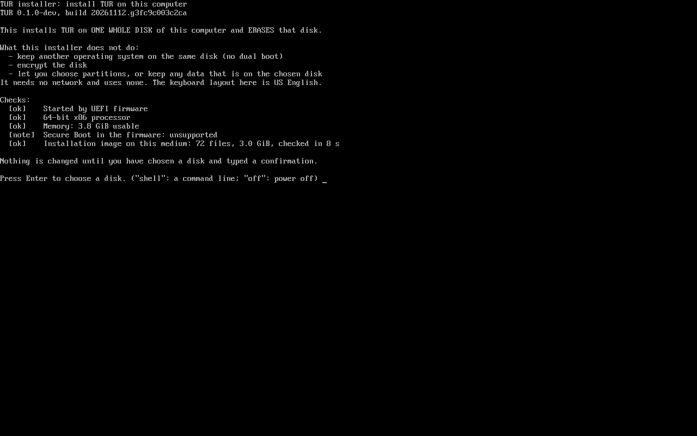
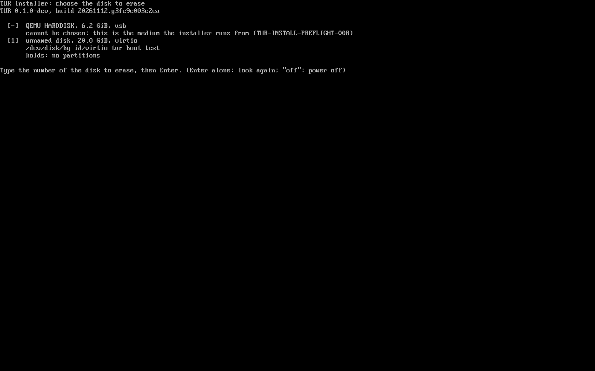
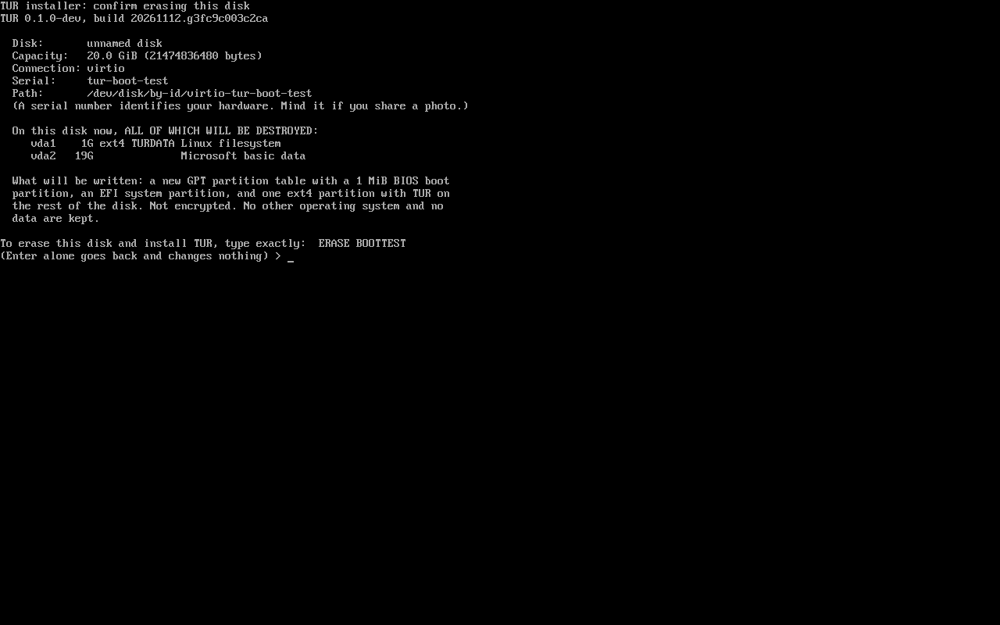
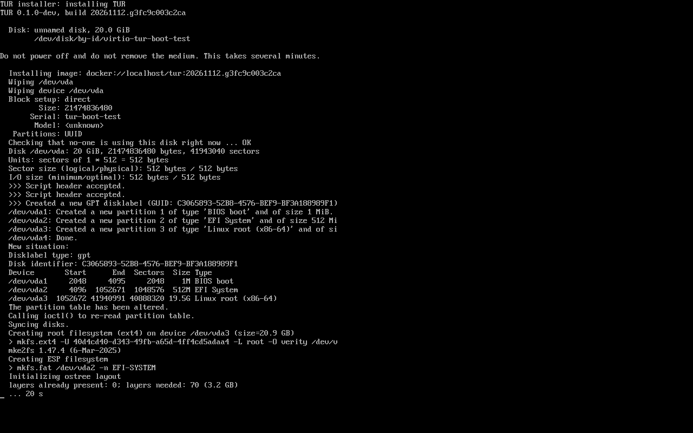
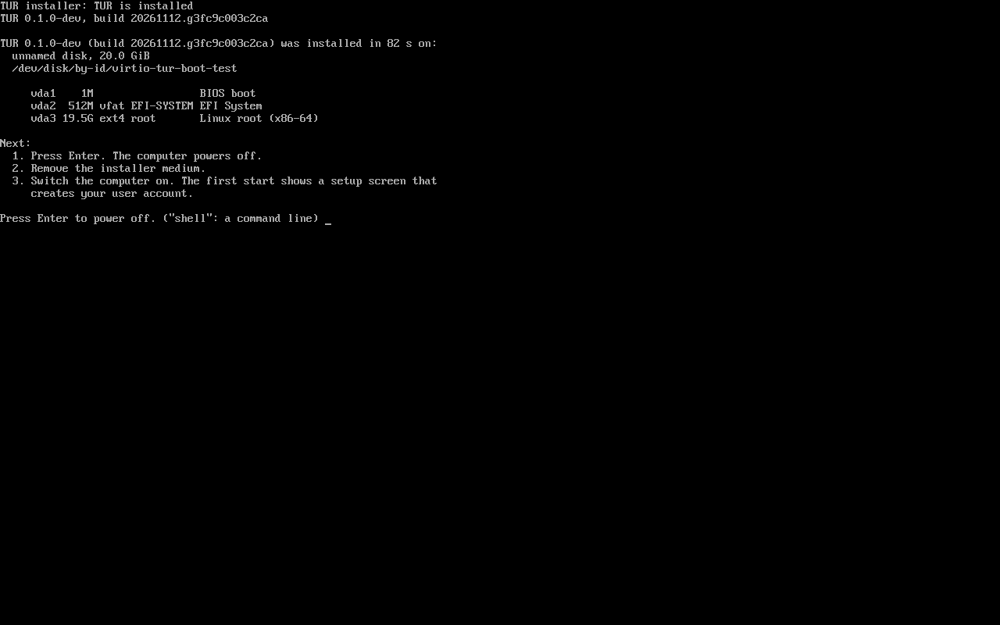

# Installing TUR on a test PC

This is how to put a pre-alpha build of TUR on one of the project's own test
computers from a USB stick. The medium and the installer are described in
[ADR-0018](../adr/0018-first-installer-medium.md); what was tested, and how,
is in [TUR-007](../reports/TUR-007.md).

Read these three points before anything else.

- **The installer erases one whole disk.** Everything on the disk you choose
  is destroyed: every partition, every operating system, every file. It
  cannot keep data, and it cannot put TUR on the same disk as Windows or
  another system. Use a computer, or at least a disk, with nothing on it that
  you need. To keep Windows, install TUR on a second disk (section 7).
- **Everything below was tested in a virtual machine only.** No real
  computer, no real USB stick and no real disk has been used yet. You are the
  first. Section 9 says what to report back.
- **Do not pass the medium on.** The system on it still contains Fedora's
  logos and release packages, which Fedora's terms do not allow in a derived
  system (issue 11). It is for the project's own test machines.

## 1. What you need

| | Needed | Tested |
|---|---|---|
| Processor | 64-bit x86 (Intel or AMD) | A virtual machine with 2 processor cores |
| Firmware | UEFI. The medium does not start in legacy BIOS mode (CSM) | OVMF, the UEFI firmware of virtual machines |
| Memory | The installer refuses less than 3 GiB usable | 4 GiB |
| Disk to install on | At least 20 GiB. It must report a serial number (every ordinary SATA, NVMe and USB disk does) | A 20 GiB virtual disk |
| USB stick | 8 GB or larger. Everything on it is overwritten | A virtual USB stick and a virtual optical drive |
| Keyboard and screen | Attached directly. The installer is text on the screen and assumes a **US English keyboard layout** | A virtual keyboard |
| Network | Not needed and not used by the installer | No network device at all |

Not tested at all: NVMe and SATA disks (the virtual disks are of another
kind), Wi-Fi-only computers, NVIDIA graphics, laptops' special keys, touch
screens, real Windows and BitLocker. Two disks were tested only as in
section 7.

## 2. Get the medium

The medium is not published. A run of the project's `iso` workflow builds it,
tests it, and keeps it for three days only when asked to.

1. On GitHub, open the repository's **Actions** tab and choose the workflow
   **iso**.
2. Choose **Run workflow**, select the branch `main`, tick **upload_medium**,
   and start it.
3. Wait for the run to finish (about 45 minutes). All of its jobs must be
   green. If one is not, do not use that medium.
4. On the run's page, under **Artifacts**, download
   `tur-installer-medium-DO-NOT-REDISTRIBUTE`. It is a zip file of about 6.7 GB, which unpacks to a medium of the same size.
   Unpack it. You get:

   | File | What it is |
   |---|---|
   | `tur-installer.iso` | The medium |
   | `tur-installer.SHA256SUMS` | Its checksum |
   | `tur-installer.manifest.json` | What the medium contains, by hash |
   | `DO-NOT-REDISTRIBUTE.txt` | Why it must not be passed on |

5. Check the file. The checksum you compute must equal the one in
   `tur-installer.SHA256SUMS`.

   | System | Command |
   |---|---|
   | Linux | `sha256sum -c tur-installer.SHA256SUMS` (it also checks the manifest) |
   | macOS | `shasum -a 256 tur-installer.iso` |
   | Windows (PowerShell) | `Get-FileHash tur-installer.iso -Algorithm SHA256` |

The upload step of the workflow has not run yet at the time of writing: it
can only be started once the workflow is on `main`. If it fails, that is the
first thing to report.

## 3. Write the medium to a USB stick

The file is a disk image. It must be written to the stick **as it is, byte
for byte**. Copying the file onto a formatted stick does not work, and
neither does a tool's "ISO mode" that unpacks the image.

None of the tools below has been tried by the project with this medium.

### Linux

1. Plug in the stick. Find its name with `lsblk -o NAME,SIZE,MODEL,TRAN`; it
   is the line whose connection is `usb`, for example `sdb`. **Be certain.**
   The next command overwrites whatever disk you name.
2. Write the image to the whole stick (`/dev/sdb`, not `/dev/sdb1`):

   ```sh
   sudo dd if=tur-installer.iso of=/dev/sdX bs=4M conv=fsync status=progress
   ```

3. Wait for the command to end, then unplug the stick.

### macOS

1. Plug in the stick. Find it with `diskutil list external`; it is named like
   `/dev/disk4`. **Be certain.**
2. Unmount it and write the image, using the `rdisk` form of the name:

   ```sh
   diskutil unmountDisk /dev/diskN
   sudo dd if=tur-installer.iso of=/dev/rdiskN bs=4m
   ```

3. When the command ends, macOS may say the disk is not readable. Choose
   **Eject**.

### Windows

Windows has no built-in tool that writes a disk image to a USB stick. Use a
free program that does, and choose its raw mode:

- **Fedora Media Writer**: choose "Select .iso file".
- **Rufus**: select the file, press Start, and when asked choose
  **"Write in DD Image mode"**. Do not choose ISO Image mode.
- **balenaEtcher**: "Flash from file".

Afterwards Windows may offer to format the stick because it cannot read it.
Decline.

## 4. Firmware settings

Open the computer's firmware setup (often F2, Del or Esc right after power
on) and check:

1. **UEFI boot is on; legacy or CSM boot is off.** The medium has no legacy
   boot code, and TUR does not start in legacy mode.
2. **The disk controller is in AHCI or NVMe mode**, not RAID, Intel RST or
   Optane. In those modes the installer may not see the disk.
3. **Secure Boot.** Leave it as it is. What was tested: in a virtual machine
   whose firmware enforces Secure Boot with Microsoft's keys enrolled (the
   keys PCs ship with), the stick started, the installer reported Secure Boot
   as enabled, the installation completed, and the installed system started
   with its kernel reporting Secure Boot enabled. The same was tested with
   firmware that has no Secure Boot. Not tested: any real computer's
   firmware, and a computer whose Secure Boot keys were changed by its owner.
   If the stick does not start with Secure Boot on, note what the screen
   says, then try once with Secure Boot off and report both.
4. If the firmware has a "fast boot" setting that skips USB devices, turn it
   off.

Then start from the stick: most computers show a one-time boot menu with F12,
F9, F8 or Esc right after power on. Choose the USB stick; if it appears
twice, choose the entry that says UEFI.

## 5. The installer, screen by screen

Screenshots are from the virtual machine in CI.

**Boot menu.** One entry, "Install TUR … (erases the disk you choose)". It
starts by itself after five seconds. Then text scrolls for up to a minute
while the installer environment starts. Nothing has been changed at this
point, and nothing is changed until step 4 below.

**1. First screen.** It says what the installer does and does not do, checks
the copy of TUR on the stick (this takes a while on a slow stick), and lists
its checks. Press Enter to continue.



If it says TUR cannot be installed from here, it gives an error code and a
reason: for example the computer was started in legacy mode, or the stick was
not written correctly. Photograph the screen.

**2. Choose the disk.** Every disk is listed with its name, size,
connection, the end of its serial number, and what it holds, in plain words:
Windows, BitLocker-encrypted volumes, NTFS, Linux filesystems, or nothing.
The installer only reads disks to find this out. The disks you can choose
have a number in brackets. A disk you cannot choose says why: the stick
itself, a disk that is too small, a disk that is in use. Type the number and
press Enter.



If the disk you expect is not listed, see the note about the disk controller
in section 4.

**3. Confirm.** The screen shows the disk's model, capacity, serial number
and everything that is on it now, and what will be written. To go on you must
type the phrase it shows, exactly: the word `ERASE`, a space, and the end of
that disk's serial number, in capital letters. Pressing Enter alone goes back
and changes nothing. A wrong phrase changes nothing. If the disk holds Windows
or BitLocker, the screen adds a warning before the phrase: "This disk holds
Windows. Erasing it removes Windows and everything on it."



Check the model and capacity against the disk you mean. This is the last
moment to stop.

**4. Installing.** The installer shows what it is doing. In the virtual
machine the installation took about one minute; from a real USB stick onto a
real disk it may take several minutes, and reading the stick is likely to be
the slowest part. There is no percentage: the lines change as it works.
Do not switch off and do not pull the stick.



**5. Finished.** Press Enter. The computer powers off. Remove the stick.



If the installation fails, the screen shows an error code and the last lines
of the log. Photograph it. The chosen disk has been erased by then and holds
no working system; to try again, power off and start from the stick again.

At the first screen, the disk list and the last screen you can type `shell`
for a command line (as root, for looking around: `lsblk`, `dmesg`), and `off`
to power off without installing.

## 6. The first start

1. With the stick removed, switch the computer on.
2. If it does not start from the disk by itself, open the firmware's boot
   menu and choose the disk. After the first start the firmware lists an
   entry named **Fedora**: that is TUR. The name is part of Fedora's signed
   boot programs, which TUR uses unchanged
   ([ADR-0013](../adr/0013-bootloader.md)).
3. A boot menu appears briefly, then the system starts. In the virtual
   machine a picture was on the screen about 20 seconds after power-on.
4. The first start shows a setup screen, "Welcome to Plasma Desktop", with
   a **Begin Setup** button. It asks for your language and keyboard and
   creates your user account. **CI has seen this screen but never gone
   through it.** You are the first; note anything that does not work. The
   screen still says "Powered by Fedora Linux": TUR's own branding is not
   done yet (issue 11).
5. After that you reach the desktop.
6. To switch off while the setup screen is showing, use its **Shut Down**
   button. In CI a short press of the power button was received and did
   nothing on that screen.

## 7. Beside an existing Windows: on a second disk

TUR can live on the same computer as Windows **only on a disk of its own**: a
second internal disk, or an external USB SSD. The Windows disk is left as it
is. Installing TUR on the **same** disk as Windows, by making the Windows
partition smaller, is **not supported** by this installer, and nothing in it
offers to.

What was tested, in a virtual machine only: a disk laid out like a Windows
disk (an EFI system partition with `EFI\Microsoft\Boot`, an NTFS partition,
a volume carrying the BitLocker signature) and a firmware entry named
"Windows Boot Manager" for it, with a second, blank disk. The installer
described the first disk as Windows, showed the Windows warning when that
disk was chosen, installed TUR onto the second disk, and afterwards the
Windows disk was byte-for-byte unchanged and its firmware entry was still
there. No real Windows, no real BitLocker and no real firmware were involved.

1. **Back up first.** Copy everything on the Windows computer you cannot lose
   to somewhere else. Nothing below is meant to touch the Windows disk, but a
   wrong choice on the confirmation screen would erase it.
2. **Have the BitLocker recovery key ready.** If Windows uses BitLocker
   (device encryption is on by default on many laptops), changing firmware
   settings, such as Secure Boot or the boot order, can make Windows ask for
   the 48-digit recovery key at its next start. Find it before you change
   anything, and keep it somewhere other than this computer:
   - on the Microsoft account page for the account used on this PC, under
     Devices, "Manage recovery keys" (account.microsoft.com/devices/recoverykey);
   - or in Windows: open a Command Prompt as administrator and run
     `manage-bde -protectors -get C:`. The "Numerical Password" is the key.
3. **Connect the second disk.** For an internal disk, fit it with the computer
   off. For a USB SSD, plug it in. It must be at least 20 GiB, and everything
   on it is erased.
4. **Start from the installer stick** with the firmware's one-time boot menu
   (section 4) and go through section 5. On the disk screen every disk is
   described. The Windows disk says `holds: Windows (EFI/Microsoft/Boot)`,
   usually with `NTFS` and, if it is encrypted, `BitLocker-encrypted volumes`.
   **Choose the other disk**: check its size, model and the end of its serial
   number.
5. If you see the warning **"This disk holds Windows. Erasing it removes
   Windows and everything on it."**, you chose the Windows disk. Press Enter
   alone to go back. Nothing has been changed at that point.
6. On the second disk, type the phrase, install, and power off.
7. **Choosing the system at start-up.** TUR's boot menu does not list Windows.
   Choose with the firmware's one-time boot menu key, which depends on the
   maker: commonly F12 (Dell, Lenovo, Acer), F11 (MSI, ASRock), F8 (ASUS),
   Esc then F9 (HP). "Windows Boot Manager" starts Windows; the entry for
   the second disk ("Fedora", or the disk's name) starts TUR.
   **After TUR's first start, the computer starts TUR by default.** On that
   start, shim (the first program of TUR's boot chain) adds a firmware entry
   named "Fedora" and puts it first; "Windows Boot Manager" stays, unchanged,
   further down. This was measured in the virtual machine. To make Windows
   the default again, move "Windows Boot Manager" to the top of the boot
   order in the firmware setup. The installer itself changes no firmware
   entry.
8. **Secure Boot**: as in section 4. The Windows-disk test above ran without
   Secure Boot; the Secure Boot test ran on a single disk.

**Removing TUR again.** Erase the second disk, or unplug it for good: from
Windows, Disk Management can delete its partitions; any partitioning tool
can. Windows is not affected. If the firmware still lists an entry for the
removed disk, it skips it; the entry can be deleted in the firmware setup.
If TUR was first in the boot order, make "Windows Boot Manager" first again
in the firmware setup.

## 8. What this build cannot do

- **Update itself.** There is no published TUR image to update from. To get a
  newer build, make a new medium and install again, which erases the disk
  again.
- Anything in the list of untested things in section 1.

## 9. What to report back

Whatever happens, these are worth having:

1. The computer: make and model, processor, memory, the disk's make and kind
   (NVMe, SATA), the graphics hardware, whether Secure Boot was on.
2. The build: the line "TUR …, build …" at the top of every installer screen.
3. How far it got: which of the screens in section 5 you reached, and the
   first start.
4. **Photographs** of anything unexpected: an error code, a black screen with
   text, a screen that stays as it is for more than five minutes. A serial
   number of the disk is visible on the confirmation screen; cover it if you
   do not want to share it.
5. How long the installation took (the last screen says), and how long the
   first start took.

If the installed system starts, open a terminal (Konsole) and collect what
the system knows about itself.

If this build has the diagnostic collector (`tur-diag status` prints
something rather than "command not found"):

```sh
tur-diag collect --output ~/tur-report.tar.zst
```

and send that one file. It is made to leave out personal data; its
`redaction-report.json` says what was removed.

Otherwise:

```sh
mkdir ~/tur-report && cd ~/tur-report
journalctl -b --no-pager > journal.txt
systemctl --failed --no-pager > failed-units.txt
lsblk -o NAME,SIZE,TYPE,FSTYPE,MODEL,TRAN,MOUNTPOINTS > disks.txt
tur-boot-health status > boot-health.txt
sudo bootc status > bootc-status.txt
mokutil --sb-state > secure-boot.txt
```

and send the folder. These files contain the computer's host name, hardware
serial numbers and your user name. Read them before you send them.
