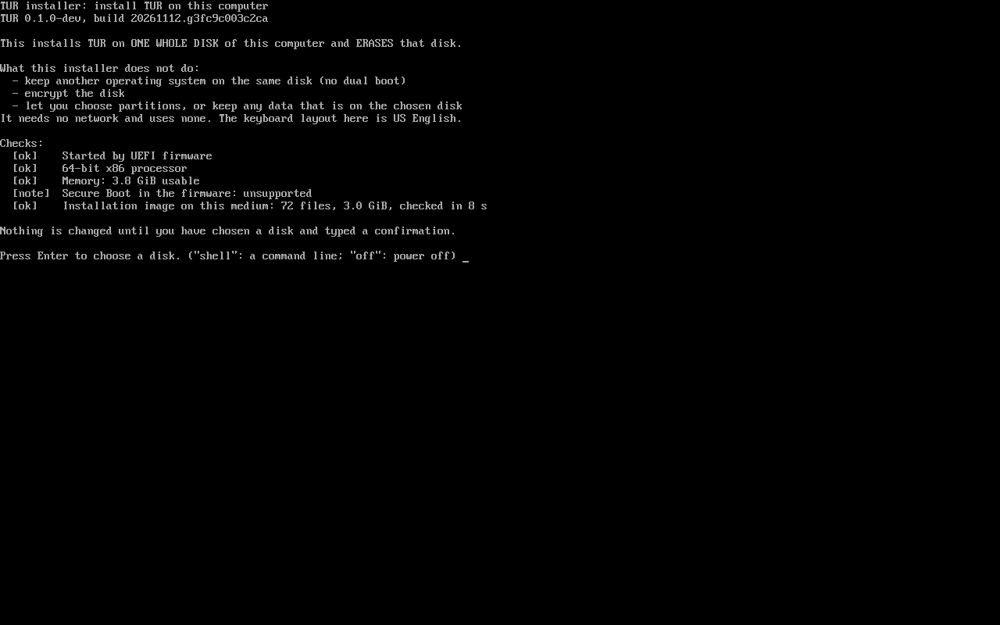
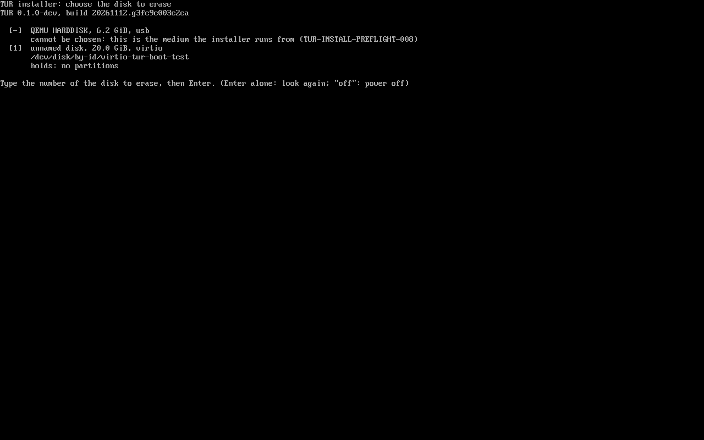
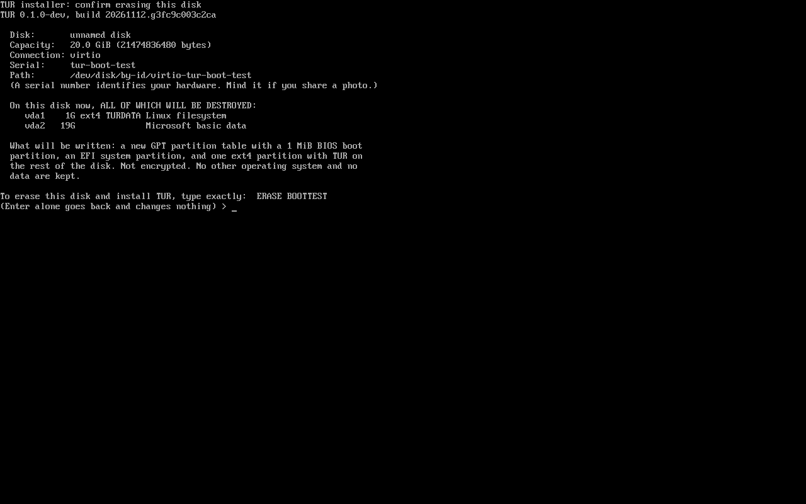
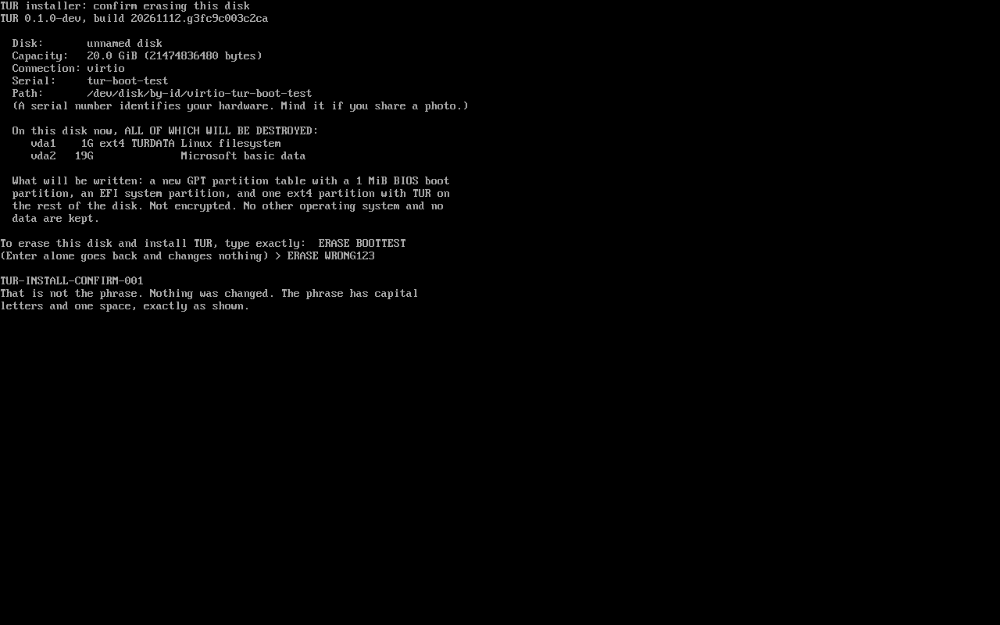
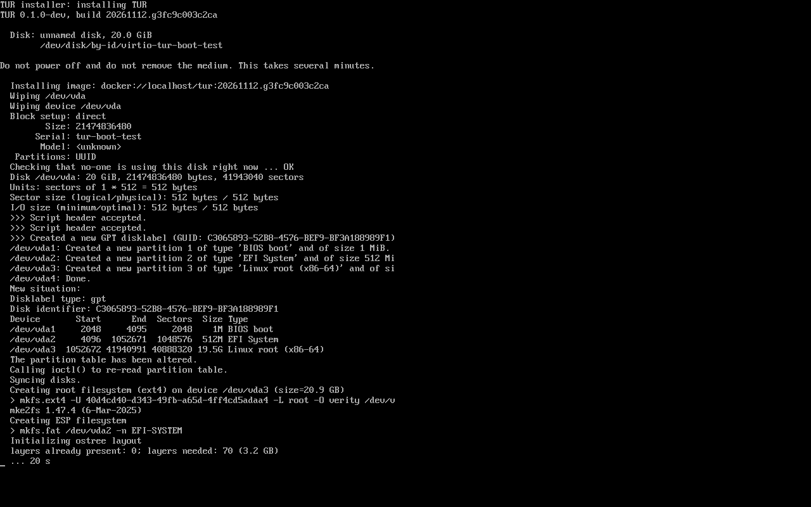
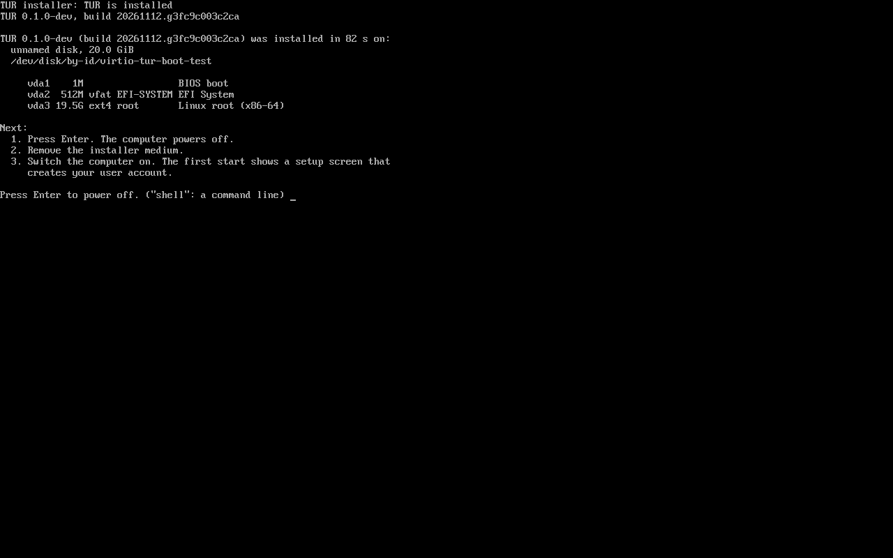
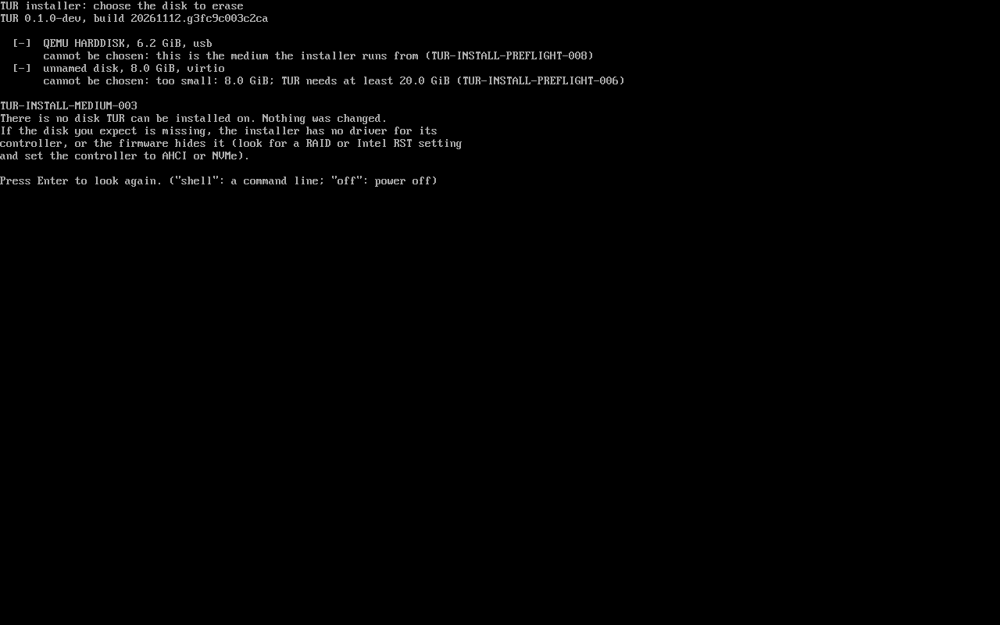
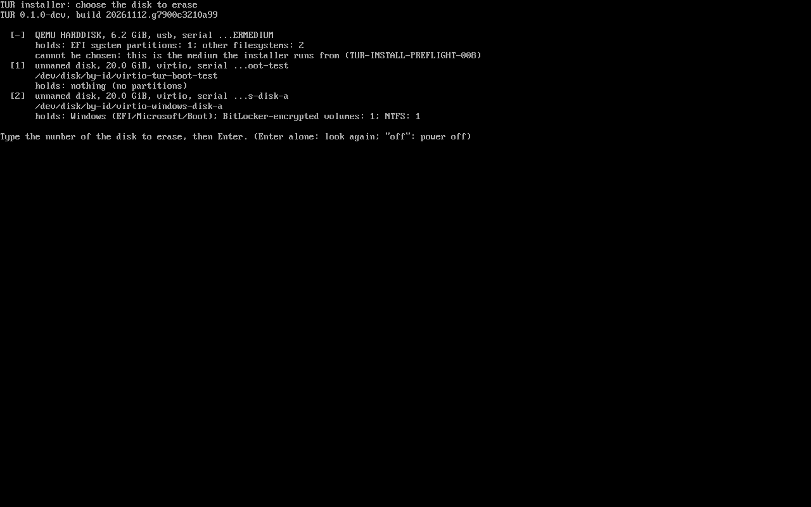
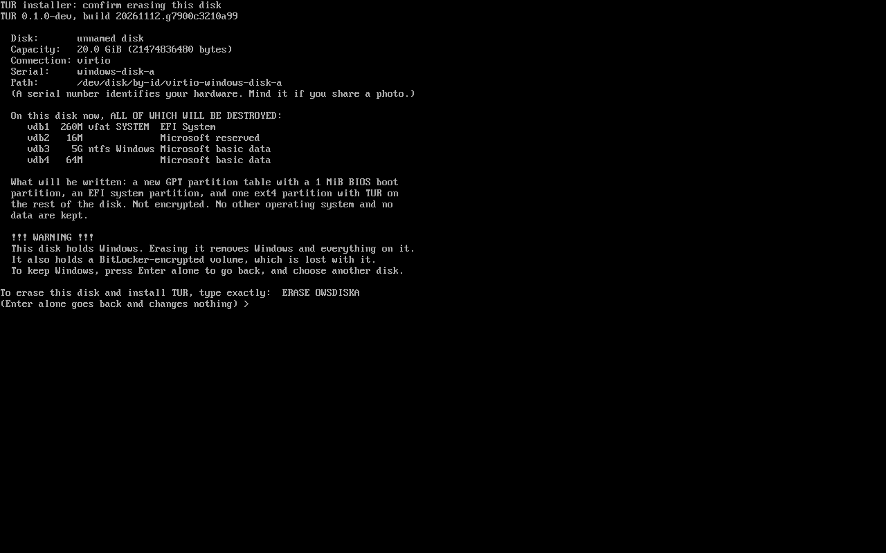
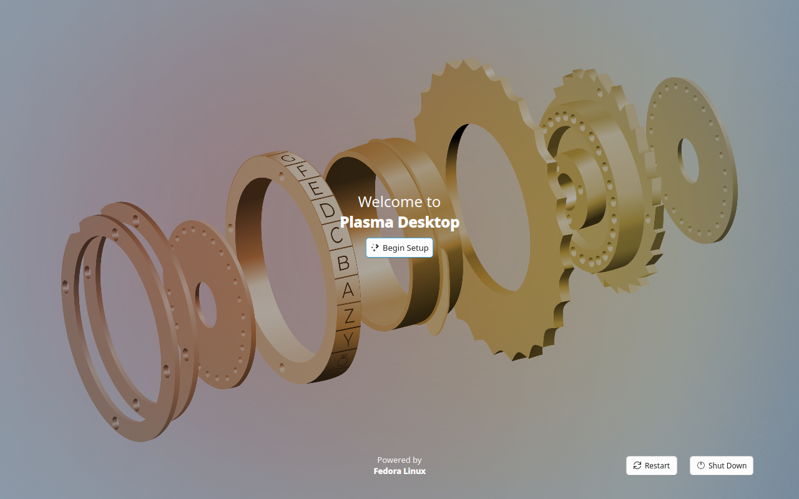

# TUR-007 — The first installer medium

```text
TUR DEVELOPMENT REPORT

Task ID:          TUR-007 (installer medium; ADR-0018)
Subsystem:        Installer medium, installer, VM tests, CI
Build ID:         20261112.g4535f853efa0 (run 43248187285, commit 16d8481)
                  20261112.g3fc9c003c2ca (run 43256524353, commit 7a37ebc)
                  20261112.g7900c3210a99 (run 43275310475, commit c44dc68,
                  after merging main: beside Windows)
Source revision:  feat/installer-iso, pull request 50

SUMMARY
- What changed: a bootable medium for a USB stick (also an optical disc)
  that starts under UEFI through Fedora's unmodified signed shim and GRUB
  and installs the TUR image it carries onto one whole disk, after a typed
  confirmation that names the disk. A new workflow, "iso", builds it from
  the image built from the same commit and proves it in QEMU/KVM with no
  network device: refusals, three installations driven through the
  keyboard (one onto a second disk beside a Windows-like disk), the first
  start of each installed disk, the boot test's own checks and two
  boot-health scenarios on a disk installed from a medium. The disk list
  says in plain words what is on every disk (Windows, BitLocker, NTFS,
  Linux), and a disk holding Windows gets an explicit warning.
- Why it changed: nothing could put TUR on a real computer. A test PC is
  waiting.

FILES
- Added: installer/iso/ (build-medium.sh, medium-manifest.py,
  Containerfile, README.md, the installer and its two units,
  third-party-licensed/grub/ with the boot menu under BSD-3-Clause),
  tests/iso/ (install.py, boot-installed.py, isovm.py, report.py,
  compare-layout.py, disk-info.py, efivars.py, make-data-disk.sh,
  make-windows-disk.sh, guest/),
  .github/workflows/iso.yml, docs/adr/0018-first-installer-medium.md,
  docs/guides/install-on-a-test-pc.md, docs/reports/TUR-007.md,
  docs/reports/assets/TUR-007/
- Modified: docs/adr/README.md (index line)
- Removed: none. Nothing under image/, tests/boot/, scripts/ or
  installer/tur-installer-core/ was changed.

BUILD
- Command: scripts/build-image.sh, then installer/iso/build-medium.sh
  (workflow "iso", jobs "product" and "proof")
- Result: success. Medium 6,668,951,552 bytes (6.21 GiB), built in 364 s
  after the image (193 s). Run 43248187285.
- Warnings: the medium is not bit-for-bit reproducible (dracut-live comes
  from Fedora's repositories on the day); every input is recorded by hash.

TESTS
- Unit tests: none added (shell and Python test drivers; lint: shellcheck,
  py_compile).
- Integration tests, all in QEMU/KVM with OVMF, no network device:
  run 43248187285 (commit 16d8481): every required check passes, 35 in the
  product job and 16 in the proof job. Of 18 informational checks (the
  Secure Boot run and screen responsiveness), 15 pass; the 3 that do not
  are "the display changes after input" on the first-run screen
  (finding 7). Run 43256524353 (commit 7a37ebc, the installer text fixes):
  the same; every required check passes and the same 3 informational
  checks do not. Run 43275310475 (commit c44dc68: beside Windows, on the
  image of the merged main): product job PASS, 48 required checks all
  pass, 16 of 20 informational (the same "display changes" check, now four
  times); proof job FAIL in one required check, the P@x end-to-end test
  that main added to the boot test, whose own controls failed
  intermittently (finding 10). Every other proof check passed.
- Boot tests: tests/boot/report.py, unchanged, on a disk installed from
  the medium: PASS in runs 43248187285 and 43256524353 (85 checks, 62
  required, all pass). On the merged main it has 114 checks, 88 required;
  in run 43275310475 85 of 88 passed, the three that did not being the P@x
  end-to-end test and the two checks that need its scenarios (finding 10).
- Fault-injection and recovery: tests/boot/rollback.py, unchanged, on a
  disk installed from the medium: F1+L1 (failing health check, undone in
  three attempts, no loop) PASS; G1 (good update kept) PASS.
- Hardware tests: NOT RUN. No real firmware, disk or USB stick yet.
- Performance tests: NOT RUN.

DIAGNOSTICS
- Log paths: artifacts tur-installer-medium-test and
  tur-installer-medium-proof of the runs named here: per scenario the
  serial console from firmware on, every installer screen as text and as
  a screenshot, the installer's state lines, lsblk --json --output-all and
  the /dev/disk links of the live environment, the installed disk read
  from the host, the journal of the first start read from the disk.
- Diagnostic bundle path: none; the medium has no tur-diag.
- Relevant error IDs: TUR-INSTALL-PREFLIGHT-001/-003/-005/-006/-007/-008/
  -012, TUR-INSTALL-TARGET-006/-007, TUR-INSTALL-CONFIRM-001/-004,
  TUR-INSTALL-IDENTITY-001 to -003 (from tur-installer-core);
  TUR-INSTALL-MEDIUM-001 to -003 (new, ADR-0018; not yet in the registry).

RECOVERY
- Rollback procedure: revert the pull request. Nothing else depends on it.
- Recovery tested: a failing update on a disk installed from the medium
  is undone by the boot-health mechanism (F1). A failed installation was
  not induced.

KNOWN LIMITATIONS
- Whole-disk installation only: TUR beside Windows only on a second disk;
  no installation on the same disk as another system, no encryption, no
  manual partitioning, no data kept. Text screens, English, US keyboard.
- At its first start TUR becomes the firmware's first boot entry (shim's
  fallback, finding 11).
- None of the specification's installer phase model, session directory,
  diagnostics export or resume is implemented in this medium.
- Medium 6.2 GiB: the image is on it twice.

NEXT SAFE ACTION
- The owner runs the workflow with upload_medium, writes the medium to a
  stick and tries it on the test PC (docs/guides/install-on-a-test-pc.md).
```

## The decision

[ADR-0018](../adr/0018-first-installer-medium.md): a small live environment
assembled by a script in this repository, whose root filesystem is the TUR
image plus Fedora's `dracut-live`, runs the image's own installer:

```sh
bootc install to-disk --source-imgref oci:/run/initramfs/live/payload:payload \
    --target-imgref localhost/tur:<build id> --generic-image --wipe --filesystem ext4 <disk>
```

Anaconda was rejected for this first medium: it offers layouts TUR has not
tested (including for the partition that holds GRUB's environment block), its
unattended mode erases a disk without confirmation, it installs by a path the
boot test does not use, it brings its own Fedora branding, and upstream
documents a defect of bootc systems it installs. image-builder's `generic-iso`
produces the same shape of medium and is the candidate to move to; the reasons
for not starting with it, and the upstream facts with sources, are in the ADR.

What the decision rests on, verified in this task:

| Claim | Evidence |
|---|---|
| A disk installed from the medium has the layout of the boot test's disk | `compare-layout.py`, proof job: identical partition table (types, names, starts, sizes, filesystems, labels), ESP files, ESP and `/boot/grub2` GRUB configuration, fragments and their order, a 1024-byte environment block, one loader entry, the same kernel arguments as a set |
| ADR-0014's mechanism works on it | Boot test: `none, none, trial/1` read from the console, counter removed by `tur-boot-health`; F1: `trial/2, trial/1, trial/0, fallback, none, none`; G1: `trial/2, none` |
| The installer environment is the payload plus `dracut-live` | `build-medium.sh` hashes every file `bootc install` reads, in both images: identical. Packages added: `dracut-live`, `dracut-network`, `fuse` (its dependencies), and `gpg-pubkey` (Fedora's key, imported into the rpm database by dnf). None changed or removed |
| The boot chain is Fedora's, unchanged | Taken from the payload image by hash: `shim-x64-16.1-7` (`shimx64.efi`, `mmx64.efi`), `grub2-efi-x64-1:2.12-83.fc45`, `kernel-core-7.3.3-300.fc45` |
| Offline | No network device in any VM (`-nic none`, the boot tests' network card removed); the image is read from the medium |
| Other disks are not written | The Windows-like disk's SHA-256 (whole 20 GiB image) is the same when made, after the installation onto the second disk, and after TUR's first start with both disks attached |
| No firmware boot entry is written by the installation | bootc 1.17.1 passes `--update-firmware` to bootupd only without `--generic-image` (`crates/lib/src/bootloader.rs`, line 157); bootupd calls `efibootmgr` only in `update_firmware` (`src/efi.rs`). In CI the firmware's variable file read from the host after each installation holds no new entry, and the "Windows Boot Manager" entry is unchanged |

One difference from the boot test's disk, and why it does not matter: the
order of kernel arguments. The boot test passes its test arguments with
`--karg`, which bootc appends after the image's; the proof medium's image
carries them in `/usr/lib/bootc/kargs.d` (the medium takes no test options), so
`$tur_boot_args` comes first. The product medium's installed disk has no test
arguments at all: `root=UUID=… rw tur.boot_contract=1 ostree=…` at boot.

## What the VM proof shows, step by step

Run 43248187285, commit 16d8481. QEMU 8.2.2, OVMF 2024.02-2ubuntu0.10,
KVM, 2 vCPUs, 4 GiB, virtio-vga, **no network device**. The test types on the
virtual keyboard through QMP and reads the screen's text from the serial port,
to which the installer mirrors every line; it never sends anything over the
serial port.

**Product job** (the medium a person would write to a stick; 1923 s):

| Step | Medium as | Disk | What happened | Time |
|---|---|---|---|---|
| Too small | USB stick | 8 GiB blank | The disk is listed as "too small: 8.0 GiB; TUR needs at least 20.0 GiB (TUR-INSTALL-PREFLIGHT-006)", the medium as "the medium the installer runs from (TUR-INSTALL-PREFLIGHT-008)"; the installer says TUR-INSTALL-MEDIUM-003, no disk can be installed to; typing `1` anyway is refused. The command line opens, runs a command, returns. Powered off from the installer. Disk SHA-256 identical before and after | 63 s |
| Data, not confirmed | optical drive | 20 GiB with an ext4 partition holding files and a "Microsoft basic data" partition | The confirmation screen lists both partitions under "ALL OF WHICH WILL BE DESTROYED". `ERASE WRONG123` refused (TUR-INSTALL-CONFIRM-001); the right phrase in lower case refused; Enter alone goes back. Powered off. Disk SHA-256 identical before and after | 71 s |
| Install, blank | USB stick | 20 GiB blank | Installer up 24 s after power-on; image on the medium verified (72 files, 3.0 GiB); `ERASE BOOTTEST` typed; disk looked at again; `bootc install` exit 0 after **66 s**; powered off from the last screen | 112 s |
| First start | none | the same | Rendered screen 18.5 s after power-on (the first-run setup screen); journal read from the disk: `tur.boot_contract=1`, `graphical.target`, `plasmalogin.service`, health gate **passed**, `boot-complete.target`, marked good | 260 s |
| Install over data | optical drive | the disk of "Data, not confirmed" | As above; `bootc install` 60 s | 99 s |
| First start | none | the same | As above; gate passed | 260 s |
| Secure Boot (informational) | USB stick | 20 GiB blank | OVMF `OVMF_CODE_4M.secboot.fd` with `OVMF_VARS_4M.ms.fd` (Microsoft's keys): the medium started through shim and GRUB; the installer reports Secure Boot **enabled**; `bootc install` 65 s | 104 s |
| First start (informational) | none | the same | Kernel: "Secure boot enabled", "Kernel is locked down from EFI Secure Boot mode"; GRUB expanded `$tur_boot_args` to `tur.boot_contract=1`; gate passed | 260 s |

**Beside Windows** (run 43275310475, commit c44dc68, product job):

| Step | What happened |
|---|---|
| Disk A, made on the runner | GPT; 260 MiB FAT32 EFI system partition with `EFI/Microsoft/Boot/bootmgfw.efi`, a one-line **text** placeholder; 16 MiB Microsoft reserved; 5 GiB NTFS made by `mkfs.ntfs` (ntfs-3g 2022.10.3) holding a 1 MiB file; 64 MiB volume whose first sector carries `-FVE-FS-`. No Microsoft file. SHA-256 of the image `ff90b985…6300a` |
| Firmware fixture | The medium started (QEMU boot order on: no Windows entry exists yet to be pruned); in the installer's command line `efibootmgr --create --disk /dev/disk/by-id/virtio-windows-disk-a --part 1 --loader '\EFI\Microsoft\Boot\bootmgfw.efi' --label 'Windows Boot Manager'`, exit 0. Read from the variable file afterwards: `Boot0004 "Windows Boot Manager" HD(1,GPT,0dcea89e-…,0x800,0x82000)/\EFI\Microsoft\Boot\bootmgfw.efi` |
| Disk list | `[1]` the blank disk B: "holds: nothing (no partitions)"; `[2]` disk A: "holds: Windows (EFI/Microsoft/Boot); BitLocker-encrypted volumes: 1; NTFS: 1"; the medium marked and refused (TUR-INSTALL-PREFLIGHT-008) |
| Disk A chosen | The confirmation screen shows "This disk holds Windows. Erasing it removes Windows and everything on it." and "It also holds a BitLocker-encrypted volume"; Enter alone went back |
| Disk B chosen | No warning; `ERASE BOOTTEST`; `bootc install` 82 s onto `/dev/vda`; powered off |
| Firmware after the installation | Boot order: Windows Boot Manager, USB medium, the two virtio disks' automatic entries, UiApp, EFI shell. No new entry. Windows Boot Manager unchanged |
| TUR's first start (disk A attached, no medium, no QEMU boot order) | The firmware tried "Windows Boot Manager" first (the placeholder is not a program), then disk B: rendered screen after 24.7 s, health gate passed, marked good |
| Firmware after the first start | Boot order: **Fedora**, Windows Boot Manager, …. Shim's fallback created "Fedora" and put it first; "Windows Boot Manager" is unchanged, the USB medium's automatic entry is gone because the medium is |
| Disk A | SHA-256 identical when made, after the installation and after the first start |

**Proof job** (a medium built the same way from the boot-test image; 2625 s):

| Step | Result |
|---|---|
| Reference: the boot test's own installation of the same image, from the build host | Measured only |
| Install from the medium (USB, no network) | `bootc install` 114 s; layout identical to the reference |
| tests/boot/run-vm.py and report.py, unchanged, on that disk | PASS: 85 checks, 62 required, all pass. Three boots; graphical.target 29.9 s, 14.5 s, 14.1 s after kernel start; the third boot counted by GRUB (`trial/1`); only `mcelog.service` failed, as listed in `expected-failed-units.txt` |
| tests/boot/rollback.py, unchanged, `check-fails` (F1 and L1) | PASS: `trial/2, trial/1, trial/0, fallback, none, none`; staging 54.7 s |
| tests/boot/rollback.py, `good` (G1) | PASS: `trial/2, none`; staging 50.0 s |

Screenshots, from run 43256524353 (the same code as above plus the two text fixes
under "Findings"):

| | |
|---|---|
| First screen |  |
| Choose the disk |  |
| Confirm (a disk that holds data) |  |
| A wrong phrase |  |
| Installing |  |
| Finished |  |
| A disk too small |  |
| Beside Windows: the disk list (run 43275310475) |  |
| Beside Windows: the Windows disk chosen (run 43275310475) |  |
| First start of the installed disk |  |

## Measurements

| | Value | Source |
|---|---|---|
| Medium | 6,668,951,552 bytes (6.21 GiB) in two runs; 6,684,311,552 bytes after merging main, whose image carries more programs; a different SHA-256 each time | manifests |
| of which the installer environment (SquashFS, zstd 15) | 3,289,333,760 bytes | |
| of which the payload (OCI layout, zstd layers, 72 blobs) | 3,208,945,867 bytes | |
| of which the medium's initramfs | 117,287,678 bytes | |
| Building the medium after the image | 364 s and 401 s (payload copy 37, environment 113 to 120, SquashFS 161 to 206, ISO 22 to 28) | two runs |
| Image build | 193 s | |
| Power-on to installer | 20.7 to 29.7 s | twelve runs, two workflow runs |
| Checking the image on the medium | 7 to 11 s | six runs |
| `bootc install` (product image) | 60 to 86 s | ten runs |
| `bootc install` (boot-test image) | 114 to 129 s | proof job, three runs |
| Power-on to a rendered screen, installed disk | 18.5 to 24.9 s | six runs |
| Workflow | product 32 min, proof 44 min, in parallel | run 43248187285 |

These are virtual-machine figures with the medium and the disk as files on the
runner's disk. A USB stick is much slower to read.

## CI runs

| Run | Commit | Result | What it showed |
|---|---|---|---|
| 43237688037 | b32e528 | lint failed | shellcheck SC1010 on a state named `done` |
| 43237833579 | 08fc5fd | failed | Optical drive: GRUB stopped at its prompt (no menu in the ISO 9660 tree). USB: the installer came up, verified the image, then never read a key: the boot splash held the console |
| 43244447385 | 895a86d | failed | Every scenario reached the disk screen, under Secure Boot too, and the screen was right; the test could not see it (finding 3) |
| 43248187285 | 16d8481 | **success** | Everything above |
| 43256524353 | 7a37ebc | **success** | The same with the two installer text fixes (finding 4); most screenshots are from this run |
| (none) | ee5a2c9 | not run | The pull request had a conflict with main (the ADR index), so no pull-request workflow started |
| 43270485337 | 78e668b | cancelled | Merge of main; replaced by the next push |
| 43275310475 | c44dc68 | product **success**, proof **failure** | Beside Windows, all required checks pass. Proof: the P@x end-to-end test's controls failed (finding 10) |

`rust` ran on every commit that touched `installer/` and passed (16d8481:
43248187214; 7a37ebc: 43256524369; c44dc68: 43275310522). The head commit of
the pull request changes only documents, which start no path-filtered
workflow; `iso` is started on it by hand, and that run is given in the pull
request.

## Findings

1. **The boot splash takes the console from an installer that is not the
   desktop.** Plymouth starts in the initramfs and is told to quit only by
   units of `multi-user.target`, which the installer environment does not
   reach. The installer then could not read a key. Fixed by leaving Plymouth
   out of the medium's initramfs and disabling it, and by the installer
   ignoring SIGTTIN/SIGTTOU and reopening a lost console. Anything else that
   starts a console program outside `multi-user.target` will meet the same.
2. **From an optical drive GRUB reads its menu from the disc's ISO 9660
   filesystem**, not from the EFI system partition image it was loaded from.
   The menu is now in both.
3. A shell variable named `serial` was used both for "the serial port is
   open" and for a disk's serial number; a `local` in the disk scan hid the
   first. Only the test's view was affected.
4. **Two things only the screenshots showed**: the confirmation screen called
   the 1 MiB BIOS boot partition "a small boot partition"; the command line
   showed neither its prompt nor what was typed (bash writes both to stderr,
   which the unit sends to the journal). Both fixed in 7a37ebc.
5. **On the first-run setup screen a short press of the power button does
   nothing.** In all three first starts logind logged "Power key pressed
   short." and the system did not power off within 150 s; the harness then
   stopped QEMU. This is the base image's first-run session (Kinoite's
   `plasma-setup`), not the installer. The guide tells the owner to use the
   screen's Shut Down button. Worth an issue.
6. **The installed system still shows Fedora's marks**: "Powered by Fedora
   Linux" on the first-run screen, the firmware entry "Fedora", the
   `EFI/fedora` directory (issue 11, ADR-0013).
7. **The display did not change after a key press and a pointer movement on
   the first-run screen** (changed fraction 0.0 in every first start; informational).
   The setup screen has no clock or animation, and the pointer is drawn on
   a cursor plane that QMP's `screendump` does not capture, so this says
   nothing either way about whether the screen responds. The installer
   screens themselves showed typed input on every run.
8. The medium's initramfs, built with `--no-hostonly`, was 274 MB with
   Plymouth and is 117 MB without. It still carries network, NFS, iSCSI and
   LVM modules the medium does not use.
9. bootc records the source of the installation as
   `/run/initramfs/live/payload:payload` in `.bootc-aleph.json`, and the
   origin it would update from as `localhost/tur:<build id>`, which no
   registry serves. That is intended: a newer build is installed again.
10. **The P@x end-to-end test, which main added to the boot test, fails
    intermittently in its own controls.** In run 43275310475 the X11 canary
    listener answered `BrokenPipeError`, so the test ran none of its
    scenarios; in run 43261151190 of another branch (`feat/pax-service`) the
    session-bus canary did the same. It is not related to how the disk was
    installed, and `tests/pax` is outside this task.
11. **Beside Windows, TUR becomes the firmware's first boot entry at its
    first start.** Not the installer: shim's fallback program, run because
    the disk is first started through `EFI/BOOT/BOOTX64.EFI`, creates
    "Fedora" and puts it at the front of `BootOrder`. "Windows Boot Manager"
    is left in place and unchanged. The guide tells the owner how to put
    Windows first again. Changing this means changing what bootupd puts on
    the ESP (ADR-0013); a decision for the owner.
12. **OVMF deletes boot entries when QEMU passes a boot order.** With any
    `bootindex`, OVMF rewrites `BootOrder` and deletes `Boot####` variables
    starting with `HD()` that QEMU's order does not name
    (`QemuBootOrderLib`: `BootOrderComplete`, `PruneBootVariables`). A test of
    other systems' boot entries must run without `bootindex`, as the
    beside-Windows test does.
13. The medium's own disk is described as "EFI system partitions: 1; other
    filesystems: 2": accurate, but it could just say "this installer medium".

## What is not proven

- **Real firmware.** Whether a given PC starts the stick (USB boot entries,
  "fast boot", CSM), whether its firmware then finds the installed disk
  (shim's fallback creates the "Fedora" entry on the first start), its
  Secure Boot keys.
- **Real disks.** Only virtio disks were installed to. NVMe (`nvme0n1`,
  `/dev/disk/by-id/nvme-…`), SATA (`sda`, `ata-…`) and USB targets, their
  serial numbers and therefore the confirmation phrase, and the speed of a
  real stick: not run. The installer never takes a kernel name as a target,
  but the naming of real disks has not been seen.
- **A disk without a serial number, a read-only disk, a disk in use, two
  disks with the same serial**: the refusals are implemented and not
  exercised.
- **A failed installation**: no failure was induced; the failure screen and
  TUR-INSTALL-MEDIUM-002 are not shown. Nor is TUR-INSTALL-MEDIUM-001 (a
  damaged medium), nor revalidation catching a disk that changed after the
  confirmation (TUR-INSTALL-CONFIRM-004, -IDENTITY-*).
- **Graphics.** The installer is text on the firmware framebuffer and the
  kernel's DRM console; the installed system was seen only with virtio-vga
  and software rendering. NVIDIA, hybrid graphics and HiDPI panels: not run.
- **Wi-Fi-only machines.** The installer needs no network; the installed
  system's Wi-Fi was not tested.
- **Secure Boot beyond OVMF.** The Secure Boot run is informational in the
  workflow, and OVMF's key database is not a vendor's.
- **The first-run setup assistant** was displayed, never completed.
- **Real Windows and BitLocker.** The Windows-like disk has the layout and
  signatures, none of Windows' files; the BitLocker volume is a signature
  only. How a vendor's firmware shows and orders "Windows Boot Manager"
  beside TUR's entry: not run. BitLocker asking for its recovery key after a
  firmware change: not run.
- **Beside Windows under Secure Boot**: the two-disk test ran without it.
- **Uploading the medium** (`upload_medium`): the step only runs when the
  workflow is started by hand, which is possible only once it is on `main`.
  Not run.
- **Writing the medium to a stick** with any of the tools in the guide.

## Why the medium is not uploaded by default

The repository is public, and an artifact of a workflow run on it can be
downloaded by anyone who can see the run. The image still contains Fedora's
logos and release packages, which Fedora's terms do not allow in a derived
system (issue 11), and the medium adds Fedora's signed boot chain on its own
EFI system partition. So every run uploads the manifest, checksums, logs and
screenshots, and the medium only when the workflow is started by hand with
`upload_medium` checked: under the name `tur-installer-medium-DO-NOT-REDISTRIBUTE`,
with a text file saying why, for three days.

## Follow-ups worth an issue

1. Power button ignored on the first-run setup screen (finding 5).
2. Real-hardware run on the test PC, recorded against "What is not proven".
3. Add `TUR-INSTALL-MEDIUM-001` to `-003` to the error-code registry.
4. Shrink the medium: the payload as a read-only container store inside the
   environment's SquashFS, so that identical files are stored once; a
   host-only-style initramfs without network and NFS modules.
5. Exercise the refusals not yet run (no serial, read-only, in use, changed
   after confirmation) with QEMU disks configured that way, and induce one
   failed `bootc install`.
6. Re-evaluate image-builder's `generic-iso` (ADR-0018, "To revisit").
7. Consolidate `tests/iso/isovm.py` into `tests/boot/vm.py`: it subclasses
   `Machine` to remove the network card, add the medium and Secure Boot
   firmware, and adds keyboard input. Kept separate because `tests/boot/` is
   being changed on another branch.
8. The installer's own log (`/run/tur-installer/`) is lost at power-off;
   copy it to the installed disk, as specification §28.3 asks.
9. The P@x end-to-end test's intermittent control failure (finding 10).
10. Whether TUR should leave the firmware's boot order as it found it when
    installed beside another system (finding 11).
11. Installing on the same disk as Windows (shrinking NTFS): needs
    `tur-installer-core`'s "install alongside" mode and its own proof.
