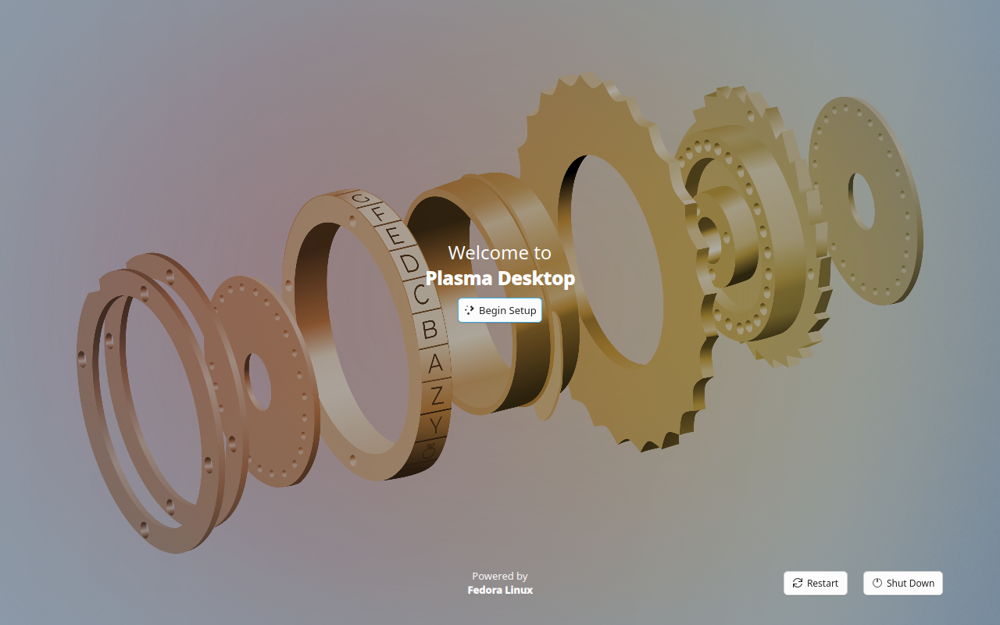
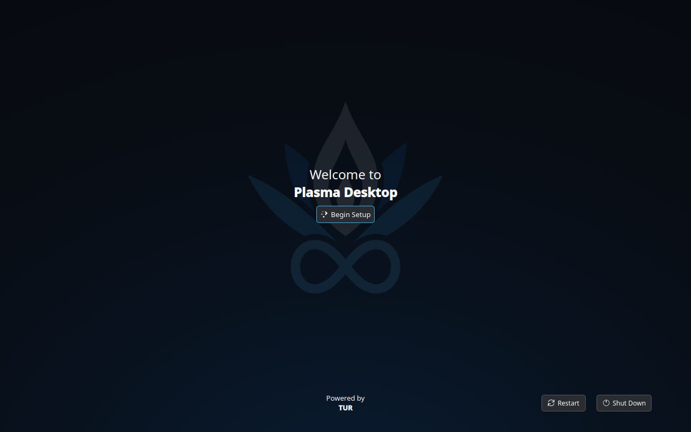
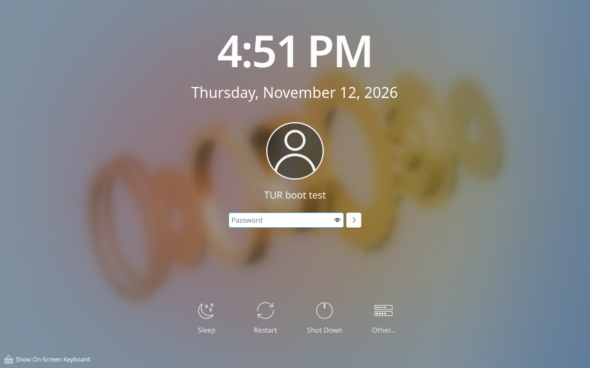
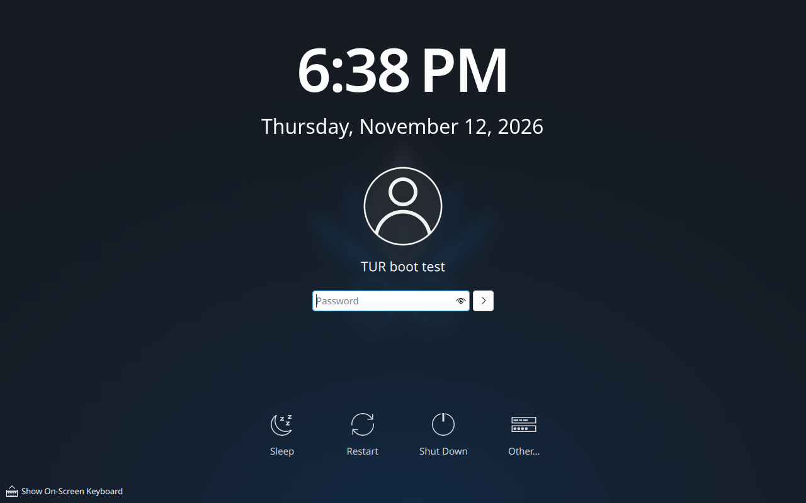
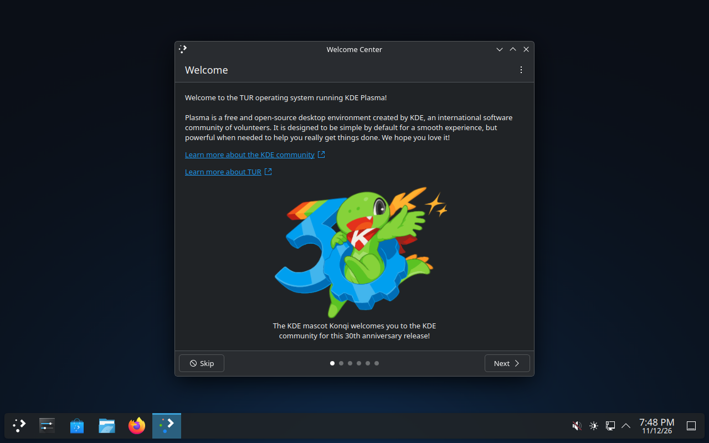

<!-- SPDX-License-Identifier: LicenseRef-TUR-Noncommercial-1.0.0 -->
# TUR-008 — Fedora's marks replaced in the image (desktop task D-03)

```text
TUR DEVELOPMENT REPORT

Task ID:          TUR-008 (desktop task D-03; issue #11)
Subsystem:        Image (image/, branding/), image and boot tests
                  (tests/image/, tests/boot/), build manifest
Build ID:         20261112.g653e06bc5c86 (pull request 63 at 8a7abfd as
                  GitHub merges it for testing, built by CI)
Source revision:  8a7abfd (feat/tur-branding, pull request 63); the
                  commits after it change only this report and its
                  pictures; the workflows ran again on the pull request's
                  head (see "CI runs")

SUMMARY
- What changed: Fedora's logo and release packages are replaced by
  Fedora's own mark-free generic-logos and generic-release, pinned by
  checksum. The image calls itself TUR (ID=tur, ID_LIKE=fedora) everywhere
  it names itself: os-release, the release files, the boot menu, the
  initramfs, the console, the host name, KDE's "About this system", the
  first-run setup. A first-draft flat mark of the lotus and flame, drawn
  for this task, is the system logo and the boot splash; a TUR wallpaper is
  on the desktop, the login screen and the lock screen; Fedora's global
  themes, wallpapers, welcome page, bookmarks, start page and software-
  centre entry are gone; installation counting and the connectivity check
  against Fedora's server are off. The image workflow fails when a Fedora
  mark comes back; the boot workflow boots the disk once more to see the
  splash and a signed-in desktop, and fails if any screenshot's text names
  Fedora.
- Why it changed: AGENTS.md: no image may be published until Fedora's logos
  and release packages have been replaced. The owner's decisions of
  12 November 2026 (desktop-experience.md, 17.1) say how.

FILES
- Added: branding/render.py, branding/README.md, branding/tur-mark.svg,
  tur-icon.svg, tur-icon-small.svg, tur-mark-symbolic.svg, tur-wordmark.svg,
  branding/png/ (13), branding/plymouth/ (37), branding/wallpaper/ (3);
  image/branding/branding.sh, packages.lock, firefox-policies.json;
  image/rootfs/usr/share/plymouth/themes/tur/tur.plymouth,
  image/rootfs/usr/share/plasma/look-and-feel/org.tur.dark/ (2),
  image/rootfs/usr/share/wallpapers/Tur/metadata.json,
  image/rootfs/usr/lib/plasmalogin/plasmalogin.conf.d/10-tur.conf,
  image/rootfs/usr/lib64/firefox/browser/defaults/preferences/tur-default-prefs.js,
  image/rootfs/usr/lib64/firefox/distribution/distribution.ini,
  image/rootfs/usr/share/tur/statement-of-origin.txt;
  tests/image/marks.py, marks-allowlist.tsv, marks-inventory.sh;
  tests/boot/splash.py, screenshot-text.py; docs/reports/TUR-008.md and
  docs/reports/assets/TUR-008/
- Modified: image/Containerfile, image/Containerfile.containerignore,
  image/README.md, tests/image/smoke.sh, scripts/gen-manifest.py,
  scripts/sbom.sh, .github/workflows/image.yml, boot.yml,
  THIRD_PARTY_NOTICES.md,
  docs/dependencies/licence-review.md
- Removed: none. Not touched: the GRUB fragment, the kernel-argument file,
  desktop/, services/, installer/, desktop-experience.md.

BUILD
- Command: scripts/build-image.sh (CI: workflows image, boot, rollback)
- Result: success. Two builds, the second without cache, give one image ID:
  aeb2ddcd745f… (image run 43288903493).
- Warnings: none from the build. The branding step reports, as designed,
  that three packages could only be emptied (their records are kept for
  the packages that require them).

TESTS
- Unit tests: not affected (no Rust code changed).
- Image tests: pass (image run 43288903493). tests/image/smoke.sh: 182
  checks pass, among them the new ones on os-release, the release and logo
  packages, the splash, the initramfs, the desktop defaults, Firefox and the
  contacts of 12.3. tests/image/marks.py: none of the 92 files of
  fedora-logos found by checksum; 137 text files and 9 file names carry
  Fedora's name, every one on the allow-list; nothing in the initramfs.
  SBOM and build manifest valid.
- Boot tests: PASS (boot run 43288903253): 114 checks, all required pass;
  the two informational failures are the ones main already has (P@x grant
  through /home; an AVC denial under no new privileges). The extra boot
  showed TUR's splash and a signed-in desktop; text read from 14 pictures,
  none names Fedora.
- Fault-injection and recovery: workflow rollback, run 43288903174: all 26
  scenarios pass, in six groups.
- Hardware tests: NOT RUN. Nothing here ran on real hardware.
- Performance tests: NOT RUN.

DIAGNOSTICS
- Artifacts: tur-image-metadata (marks.json, marks.md, marks-inventory.txt,
  build-manifest.json, sbom.spdx.json); tur-boot-test (screenshot-*.png,
  splash/frame-*.png, splash/splash.json, splash/serial.log,
  screenshot-text.json).
- Relevant error IDs: none.

RECOVERY
- Rollback procedure: revert the pull request. The change touches a
  boot-critical file, the initramfs, which the build regenerates; the boot
  and rollback workflows passed with it (see "CI runs").
- Recovery tested: the boot-health scenarios of the rollback workflow ran on
  the image with this change.

KNOWN LIMITATIONS
- The base image's layers still contain fedora-logos until a published
  image is squashed or re-chunked (desktop-experience.md, 12.1, item 3).
- The time servers are still Fedora's NTP pool zone.
- The splash is shown only with the rhgb or splash kernel argument, which
  the image does not set.
- The mark is a first draft for the owner.

NEXT SAFE ACTION
- Owner: look at the mark (branding/), decide the open points below.
- Lawyer: the statement of origin and the points in "For the lawyer".
- D-04 replaces org.tur.dark and the wallpaper with the generated themes.
```

## Inventory: where Fedora's marks were (before)

Measured in the pinned base `quay.io/fedora/fedora-kinoite:45` at
`sha256:f857f6c5…f48f537` (45.20261112.0), which is what the TUR image was
built on before this change, by `tests/image/marks-inventory.sh` in a
throw-away run of the image workflow on branch
`scratch/tur-branding-inventory` (run 43266878491, artifact
`marks-inventory`), and from the boot test of `main` at c66fd19 (run
43260160873). Not from memory: every row below is a file, package or
screenshot from those runs.

| # | Where | What a person saw or the image carried | Package |
|---|---|---|---|
| 1 | `/usr/lib/os-release` | `NAME="Fedora Linux"`, `ID=fedora`, `LOGO=fedora-logo-icon`, `CPE_NAME=cpe:/o:fedoraproject:fedora:45`, `DEFAULT_HOSTNAME="fedora"`, Fedora's home, documentation, support and bug addresses, `REDHAT_*`, `VARIANT="Kinoite"`. TUR had rewritten only `PRETTY_NAME`, to "TUR 0.1.0-dev (based on Fedora Linux 45.20261112.0 (Kinoite))" | `fedora-release-identity-kinoite` |
| 2 | `/etc/system-release`, `/etc/fedora-release`, `/etc/redhat-release` → `/usr/lib/fedora-release` | "Fedora release 45 (Forty Five)"; `system-release-cpe`; SWID tags of fedoraproject.org | `fedora-release-common` |
| 3 | Boot menu (GRUB) | "TUR 0.1.0-dev (based on Fedora Linux 45.20261112.0 (Kinoite)) (ostree:0)" | follows 1 |
| 4 | initramfs | "Booting initrd of Fedora Linux 45.20261112.0 (Kinoite) dracut-111-5.fc45 (Initramfs)" on the console; its `system-release` and `initrd-release` | base build |
| 5 | Console | "Welcome to TUR 0.1.0-dev (based on Fedora Linux …)!"; host name `fedora` | follows 1 |
| 6 | Firmware boot entry | "Fedora" (created by shim's fallback from its CSV file; `\EFI\fedora\shimx64.efi`) | `shim-x64` (C1, C2) |
| 7 | Logos | 44 files named after Fedora and the logo under generic names: `fedora-logo-icon` in `hicolor` (16–256 px), `start-here` (hicolor, Bluecurve, Oxygen `start-here-kde-fedora`), `/usr/share/pixmaps/fedora-logo*.png`, `fedora_whitelogo*`, `system-logo-white.png` (shown by KDE's "About this system" through `/etc/xdg/kcm-about-distrorc`), `/usr/share/fedora-logos/*.svg`, the installer's art, boot-loader art, `/etc/favicon.png`, Plymouth's `spinner/watermark.png` and `charge` theme. Licence `LicenseRef-Fedora-Logos` | `fedora-logos` |
| 8 | Boot splash | Default Plymouth theme `bgrt` (firmware logo, spinner, Fedora's watermark). Not shown in practice: no `rhgb`/`splash` argument | `plymouth`, 7 |
| 9 | Global themes | "Fedora", "Fedora Dark", "Fedora Light"; "Fedora" (light) the default in kde-settings' `kdeglobals`; their layout scripts put Fedora's logo on the launcher | `plasma-lookandfeel-fedora`, `kde-settings-plasma` |
| 10 | Wallpaper | "Fedora Forty-Five" (brass gears), `Default` → `F45`, `Fedora` → `Default`; on the desktop, the first-run setup, the login screen and the lock screen | `f45-backgrounds-kde`, `-base`, `desktop-backgrounds-kde`, `kde-settings-plasma`, `-plasmalogin`, `kde-settings` |
| 11 | GNOME wallpapers | `/usr/share/backgrounds/fedora-workstation/` | `fedora-workstation-backgrounds` |
| 12 | First-run setup | "Powered by Fedora Linux" (from `NAME`), the F45 wallpaper (Fedora's patch loads `wallpapers/Default/contents/images{,_dark}/5120x2880.jxl`); its light/dark switch applies Fedora's global themes (Fedora's second patch) | `plasma-setup` |
| 13 | KDE's welcome window | "Welcome to Fedora!", "Fedora loves KDE, and KDE loves Fedora!", a page about Fedora's third-party repositories, `fedora-loves-kde` icon | `plasma-welcome-fedora` |
| 14 | Firefox | Home page `https://start.fedoraproject.org/` and a pinned "Fedora Project - Start Page" (`firefox-redhat-default-prefs.js`); "Mozilla Firefox for Fedora" and `app.distributor=fedora` (`distribution.ini`); default bookmarks | `firefox`, `fedora-bookmarks` |
| 15 | Other KDE defaults | NeoChat's recommended room "Fedora"; Konqueror's "Fedora Bookmarks" | `kde-settings` |
| 16 | Software centre data | AppStream component `org.fedoraproject.fedora` "Fedora Linux" | `fedora-appstream-metadata` |
| 17 | Contact with Fedora's servers | Connectivity check `http://fedoraproject.org/static/hotspot.txt` every 300 s; `rpm-ostree-countme.timer` enabled; `pool 2.fedora.pool.ntp.org` in `/etc/chrony.conf`; `flatpak-add-fedora-repos.service` adds "Fedora Flatpaks" at first start | `NetworkManager-config-connectivity-fedora`, `rpm-ostree`, `chrony`, `flatpak` |
| 18 | Technical | Repositories and keys (`fedora-repos`, `fedora-gpg-keys`, `distribution-gpg-keys`), `macros.dist`, the `.fc45` tag, crypto-policy names, firewalld zone `FedoraWorkstation`, unit and file names, comments, other projects' text (124 text files outside documentation contain "Fedora"; 810 file names contain "fedora", 485 of them signing keys), strings compiled into binaries | table C |

## What replaced each mark (after)

Measured in the image built from 868d41b (image run 43278835858, artifact
`tur-image-metadata`: `marks.json`, `marks-inventory.txt`) and on the booted
disk (boot run 43278836023, artifact `tur-boot-test`). Row numbers follow the
inventory above.

| # | After | How |
|---|---|---|
| 1 | `NAME="TUR"`, `ID=tur`, `ID_LIKE=fedora`, `VERSION_ID=0.1.0-dev`, `PRETTY_NAME="TUR 0.1.0-dev"`, `LOGO=tur-logo-icon`, `CPE_NAME="cpe:/o:tur:tur:0.1.0-dev"`, `DEFAULT_HOSTNAME="tur-pc"`, the four addresses on github.com/giorgiogiudice/TUR, `IMAGE_ID`, `IMAGE_VERSION`, `BUILD_ID`. No `REDHAT_*`, `VARIANT`, `SUPPORT_END`, `OSTREE_VERSION` | `image/branding/branding.sh` writes generic-release's `/usr/lib/os-release` |
| 2 | "TUR release 0.1.0-dev"; `cpe:/o:tur:tur:0.1.0-dev`; no SWID tags | generic-release-common's files, rewritten; Fedora's packages removed |
| 3 | GRUB: "TUR 0.1.0-dev (ostree:0)" (serial console, all three boots) | follows 1 |
| 4 | "Booting initrd of TUR 0.1.0-dev dracut-111-5.fc45 (Initramfs)"; the initramfs's `initrd-release` says `NAME="TUR"`; no text file in it contains "Fedora" | initramfs regenerated in the build |
| 5 | "Welcome to TUR 0.1.0-dev!"; host name `tur-pc` | follows 1 |
| 6 | Still "Fedora" in the boot test | unchanged on purpose (C1, C2): shim's fallback creates it from its own file; the entry bootupd would name from `/etc/system-release` is not created when installing from a container onto a loop device |
| 7 | `fedora-logos` gone; `generic-logos` 18.0.0-29.fc45 in its place; TUR's mark as `tur-logo-icon` (hicolor 16–512 px, scalable, symbolic), as `start-here` (hicolor, scalable and 16–256 px) and as `system-logo-white.png`. None of the 92 files of `fedora-logos` (by the SHA-256 the base's package database records) is anywhere under the artwork directories, `/etc`, `/usr/share/metainfo`, `/usr/share/tur` or in the initramfs | swap, then TUR's files over three of generic-logos' |
| 8 | Plymouth theme `tur` (two-step: the mark on black, a blue spinner, messages below), the default, inside the initramfs | `rootfs/usr/share/plymouth/themes/tur/`, `plymouthd.defaults` |
| 9 | Fedora's three global themes deleted (package record kept: `plasma-workspace` and `plasma-setup` require it); `org.tur.dark` the default (Breeze's dark colours and icons, TUR wallpaper, no splash) | `kdeglobals` of kde-settings edited |
| 10 | Wallpaper `Tur` on the desktop, the first-run setup, the login screen and the lock screen; `Default` and `Fedora` lead to it; F45's pictures deleted (records kept for `desktop-backgrounds-kde`) | see image/README.md |
| 11 | Removed | `rpm -e` |
| 12 | "Powered by TUR", TUR's wallpaper, dark | follows 1 and 10. Its light/dark switch now names a global theme that is gone (finding 3) |
| 13 | `plasma-welcome-fedora` removed. KDE's own welcome window opens at first sign-in: "Welcome to the TUR operating system running KDE Plasma!", "Learn more about TUR" (from `HOME_URL`) | D-04 is to switch it off |
| 14 | Start page `about:home`, no pinned tab (`tur-default-prefs.js`, read after Fedora's file); `distribution.ini` without "for Fedora" (`id=tur`); Fedora's bookmarks are compiled into `omni.ja` (`chrome/browser/content/browser/default-bookmarks.html`), so the enterprise policy `NoDefaultBookmarks` is installed | `rootfs/usr/lib64/firefox/`, `image/branding/firefox-policies.json` |
| 15 | NeoChat's Fedora room removed; Konqueror's Fedora bookmarks emptied | kde-settings' files edited |
| 16 | `fedora-appstream-metadata` removed | `rpm -e` |
| 17 | Counting masked; connectivity check gone (package removed); **time servers unchanged**; Fedora's Flatpak remotes unchanged | 12.3 below |
| 18 | Kept, each line of `tests/image/marks-allowlist.tsv` with its reason: 137 text files with "Fedora" outside documentation (124 in the narrower scan of the inventory before; the image scan also covers `/usr/bin` and Python), 9 file names in artwork directories (generic-logos' neutral art under Fedora's file names, and `wallpapers/Fedora` leading to TUR's) | allow-list |

Text on the screens, read by Tesseract in the boot run: the first-run setup
says "Welcome to Plasma Desktop … Powered by TUR"; the login screen shows
the clock, "TUR boot test" and KDE's buttons; the desktop shows KDE's
welcome window naming TUR. No screenshot of the three boots or of the
desktop names Fedora.

On the text console (the boot test's own boots show text, not the splash),
Fedora's name still appears in: the firmware's "Booting Boot0007 Fedora"
(C2), the kernel's "Loaded X.509 cert 'Fedora kernel signing key'" (C10),
and systemd's lines for the base's services, `fedora-third-party-refresh`
("Refresh Fedora Third-party Repositories"), `fedora-atomic-desktop-*`,
`fedora-kinoite-plasmalogin-workaround` and `flatpak-add-fedora-repos`
("Add Fedora flatpak repositories") (C11).

### Screenshots

Looked at, one by one.

| Before (main, boot run 43260160873) | After |
|---|---|
|  |  |
| First boot: Fedora's brass gears, "Powered by Fedora Linux" | First boot: TUR's wallpaper (the faint mark on dark blue), dark controls, "Powered by TUR" |
|  |  |
| Login: Fedora's wallpaper, blurred | Login: TUR's wallpaper; KDE's words |
| — (the boot test never signed in) |  |
| | First desktop, signed in (extra boot): TUR wallpaper, Breeze Dark, KDE's welcome window "Welcome to the TUR operating system running KDE Plasma!". The launcher's icon is still KDE's (A8: D-04's icon theme) |

**The boot splash.** The boot test's own boots show no splash: the image
sets no `rhgb` or `splash` kernel argument, and the test's serial console
must stay the primary console. `tests/boot/splash.py` therefore boots the
tested disk once more, straight from its kernel and initramfs, with the loader
entry's arguments plus `rhgb quiet plymouth.ignore-serial-consoles`, on a
throw-away overlay, with an automatic sign-in for the test user. In its first
run (boot run 43278836023) the splash did not appear: without
`plymouth.ignore-serial-consoles` Plymouth shows text when a serial console is
listed, and the text console then showed the base's unit names with
"Fedora" in them, which the text check caught. With it (boot run
43288903253):

| | |
|---|---|
|  | 3.6 s after start: TUR's splash, the mark centred on black, the blue spinner below it. Before it, 1.3 s: the firmware's own TianoCore logo (OVMF), which is the firmware's, not the splash's |
|  | 16.4 s: Plasma's own splash at sign-in, "Plasma 30th Anniversary Edition by KDE". Not a Fedora mark; `org.tur.dark` asks for no splash, but a global theme's defaults are written only when the theme is applied to an account. D-04 is to switch it off system-wide |
| Desktop at 200 s | the desktop screenshot above |

Text read from all 14 pictures of that run (the three boots, the desktop and
nine splash frames): none names Fedora. The text-boot frame of the first run
is kept as `assets/TUR-008/text-boot-without-splash-flag.png`.

## os-release: what was checked, and what broke

`ID=tur` with `ID_LIKE=fedora`, as the design asked (D-03: "the boot test
passes with `ID=tur`"). What keys on `ID`, and what happened:

| Consumer | What it does with ID | Result |
|---|---|---|
| bootc install, ostree, bootupd | bootc installs to disk and ostree writes the loader entry (title from `PRETTY_NAME`); bootupd finds the EFI vendor directory from where shim is in its payload (`EFI/fedora`), and names a firmware entry from `/etc/system-release` | Boot test passed: three boots, counting, gate; rollback workflow (below) |
| dnf5 `$releasever` | Read from the package that provides `system-release`: generic-release 45 | `system-release(45)` provided; no dependency unmet (the build checks `rpm -Va --nofiles` before and after) |
| COPR plugin | `/usr/share/dnf/plugins/copr.vendor.conf` from generic-release-common names `distribution = "fedora"` | Not run |
| fwupd | Looks for its EFI directory under `ID`, then `ID_LIKE` | Not run |
| toolbox | Picks its default container from `ID` and `VERSION_ID` | **Not verified**: likely refuses or falls back on an unknown `ID`; follow-up |
| sos | `redhat.py` recognises `ID=fedora` | Falls back to its generic policy; not run |
| Syft (SBOM) | Names RPM packages after `ID` | Broke: `pkg:rpm/tur/bash…?distro=tur-0.1.0-dev`. Fixed: `scripts/sbom.sh` shows Syft the base's identity, which `/usr/lib/tur/release` now records (`TUR_BASE_OS_ID=fedora`, `TUR_BASE_OS_VERSION_ID=45`, `TUR_BASE_OS_VARIANT_ID=kinoite`): back to `pkg:rpm/fedora/bash…?distro=fedora-45` |
| Build manifest | `base.os_id` etc. came from os-release | Would have said `tur`. Fixed: `scripts/gen-manifest.py` reads the base's identity from the TUR release file |
| **tur-diag's redactor** | Not `ID`: the host name, from `DEFAULT_HOSTNAME` | **Broke** with `DEFAULT_HOSTNAME=tur`: the redactor replaces the machine's host name wherever it stands as a word, and "tur" is the first word of `tur-boot-health`, so the support bundle's journal had no `tur-boot-health` record and the boot test's required check failed (run 43274299181). Resolved by `DEFAULT_HOSTNAME=tur-pc`. The redactor itself is still wrong for a host named like a TUR program (follow-up 1) |
| KDE | `NAME`, `HOME_URL`, `LOGO` in About and the welcome window | "TUR", "Learn more about TUR" (screenshot) |

## The flat mark (first draft for the owner)

`branding/tur-mark.svg`: the lotus (two dark-blue back petals `#1267C4`, two
blue front petals `#2AA9F8`), the flame in silver (`#CDD3DC`, core
`#EEF1F6`) with a cut-out, and the infinity sign (`#5BBEFF`), with
transparent gaps where parts overlap so that they stay apart when small.
The ring of the original logo is left out. Gold is not used: it is P@x's
(5.1). `tur-icon.svg` puts it on a round dark tile (`#0B0F17`) so that it
reads on light and dark panels; below 32 px (`tur-icon-small.svg`) the
infinity sign is dropped and the rest drawn larger. `tur-mark-symbolic.svg`
is one colour, following the text colour. `tur-wordmark.svg` is "TUR" in
silver capitals after the logo's lettering. `branding/render.py` draws all of
it from one definition and rasterises the PNGs itself (Python's standard
library, deterministic); I looked at the mark at 256 px on black and on
white, at 16–128 px on both, at 4× magnification at 16–32 px, the splash
layout, the spinner frames and the wallpaper.

Known weaknesses: the bare mark's silver flame disappears on white (use the
tile there); at 16 px the tile is a blue smudge with a light centre; the
wordmark's R is plain.

## Network contact nobody asked for (12.3)

| Contact | Before | After |
|---|---|---|
| Counting of installations | `rpm-ostree-countme.timer` enabled | Masked (`/usr/lib/systemd/system/rpm-ostree-countme.timer` → `/dev/null`) |
| Connectivity check | `http://fedoraproject.org/static/hotspot.txt` every 300 s | Package removed: no check. Captive portals are no longer detected |
| Time servers | `pool 2.fedora.pool.ntp.org` | **Unchanged.** Needs a TUR vendor zone from the NTP Pool, or another decision |
| Browser start page | `start.fedoraproject.org` | `about:home` |
| Flatpak remotes | Fedora's added at first start; Flathub through `fedora-third-party` | Unchanged (a decision for the application centre, 12.3) |

## Decisions the owner may want to reverse

1. **Fedora's generic packages instead of `tur-release` and `tur-logos`.**
   The design asked for two TUR packages built in CI. The image build has no
   RPM build step (`rpmbuild` is not in the base; installing it would pull
   unpinned tooling from Fedora's update repository). Fedora's
   `generic-release` and `generic-logos` are the replacements Fedora's
   guidelines and its bootc documentation name; they keep the package
   database consistent, and TUR's files go over theirs. The price: `rpm -V`
   reports TUR's changes to six files of those packages, and the packages'
   names are "generic". A TUR package can replace them later without
   changing anything else.
2. **`DEFAULT_HOSTNAME=tur-pc`**, not `tur` (see above).
3. **The flame is silver**, not gold.
4. **Firefox's `NoDefaultBookmarks` policy**: any enterprise policy makes
   Firefox say it is managed by an organisation (Settings and the menu). The
   alternative is Fedora's bookmarks in every new profile, or Mozilla's own
   Firefox build.
5. **The connectivity check is off** until TUR runs an address for it.
6. **`org.tur.dark`**, a provisional global theme with Breeze's colours, is
   the default until D-04's generated themes exist.
7. **Packages emptied, not removed** (`plasma-lookandfeel-fedora`,
   `f45-backgrounds-kde`, `f45-backgrounds-base`): other packages require
   them. Their licence files stay.

## For the lawyer

1. The statement of origin, as the owner wrote it, in
   `/usr/share/tur/statement-of-origin.txt` and `THIRD_PARTY_NOTICES.md`.
   `desktop/apps/tur-settings` shows it with one more sentence ("Official
   Fedora software is available at https://fedoraproject.org/."), which the
   owner's answer does not contain; one of the two should change.
2. Whether keeping these is ordinary descriptive or technical use: the names
   of Fedora's repositories, keys and services; `ID_LIKE=fedora`; the
   firmware entry "Fedora" that shim's fallback creates; strings compiled into
   Fedora's binaries; "Fedora Packages: <name>" as the title of a link in
   TUR's catalogue; unit descriptions on the text console.
3. That the base image's layers still hold `fedora-logos` until a published
   image is squashed or re-chunked (A12).
4. TUR's mark, splash and wallpaper carry the TUR software licence, as the
   task asked; desktop-experience.md, 14.2, says a brand needs different
   terms.
5. Firefox's name in TUR: TUR ships Fedora's Firefox build unmodified apart
   from defaults, a policy and `distribution.ini`; whether that is within
   Mozilla's trademark terms for distributions was not examined.

## The installer medium (branch feat/installer-iso)

Not touched. What it would need: the same release identity if its live
system is built from the TUR image (it then inherits everything above),
or its own `os-release` otherwise; a regenerated initramfs carrying the TUR
splash; boot-menu titles in its own boot configuration (GRUB on the ISO is
not configured by ostree); no installer artwork from `fedora-logos`
(generic-logos ships neutral Anaconda art, unused by TUR); the statement of
origin on its first screen; and `tests/image/marks.py` pointed at its root
file system.

## What is not verified

- Real hardware; Secure Boot; HiDPI (the splash's mark is one 160 px image,
  which Plymouth scales up on a 4K screen; the design wanted two sizes).
- The splash on the product's own boots: the image sets no `rhgb` or
  `splash` kernel argument, so Plymouth shows text there. Seen only in the
  extra boot, which adds them.
- The passphrase prompt of the splash (no encrypted disk in the test).
- Firefox, KDE "About this system", the lock screen, Discover: not opened.
  Their files are checked, not their windows.
- toolbox, fwupd, the COPR plugin, sos with `ID=tur`.
- That TUR's changes survive an update from an older TUR image (`/etc` merge
  of the release symlinks).
- That `rpm-ostree install` of a package works with generic-release (the
  dependency check passes; no transaction was run).

## Follow-ups worth an issue

1. tur-diag's redactor over-redacts a host name that is a common word or the
   start of TUR's program names (services/tur-diagnostics/src/redact.rs).
2. The product image shows no splash: decide `rhgb quiet` (or `splash`) as a
   kernel argument, with the boot test's serial console in mind
   (`plymouth.ignore-serial-consoles`).
3. Time servers: TUR's own NTP vendor zone.
4. Squash or re-chunk the published image (A12), and run
   `tests/image/marks.py` on every layer of what is published.
5. `tur-release` and `tur-logos` as packages, if the owner prefers them.
6. The launcher icon (A8), KDE's welcome window and Plasma's sign-in splash: D-04.
7. `plasma-setup`'s light/dark switch applies Fedora's global themes, which
   are gone; `tur-setup` (D-06) replaces it.
8. firewalld's default zone `FedoraWorkstation`.
9. toolbox with `ID=tur`.
10. The rollback workflow does not trigger on `branding/**`; a change to the
    artwork alone does not run it (the file is outside this task's paths).

## CI runs

| Run | Commit | Workflow | Result | What it showed |
|---|---|---|---|---|
| 43266878491 | 6c7f323 (branch `scratch/tur-branding-inventory`, deleted afterwards) | image, inventory only, started by hand | success | The "before" inventory of the base, and Fedora 45's generic packages from the repositories |
| 43272757945, 43272758052 | e9bee57 | image, boot | failure | Python's zipfile cannot read Firefox's `omni.ja`; the build stopped there |
| 43274299264 | f735ee7 | image | failure | Image built; two smoke checks too broad (they matched comments); the first full scan of marks: the allow-list was short |
| 43274299181 | f735ee7 | boot | failure | `DEFAULT_HOSTNAME=tur` broke tur-diag's bundle (see "os-release"); `splash.py` did not find the root partition |
| 43278835858 | 868d41b | image | success | Marks check passes; two builds, one image ID |
| 43278836023 | 868d41b | boot | failure | Boot test PASS; the extra boot showed text instead of the splash, and the text named the base's services |
| 43278836078 | 868d41b | rollback | failure | 25 of 26 scenarios pass; `kernel-truncated` timed out (finding 1) |
| 43288903493 | 8a7abfd | image | success | |
| 43288903253 | 8a7abfd | boot | success | Splash, desktop, text check |
| 43288903174 | 8a7abfd | rollback | success | 26 of 26, `kernel-truncated` included |

The `gate` runs were cancelled by the coordinator (the old gate is being
replaced); they are not results. The commits after 8a7abfd change only this
report and its pictures; because a pull request's path filters look at the
whole pull request, image, boot and rollback ran again on its head, and
the pull request names those runs.

## Findings

1. **`kernel-truncated` is not deterministic.** Jumping into a kernel cut to
   64 KiB runs whatever is in memory after it. On main and on 8a7abfd it ended
   in an X64 exception that the harness sees and answers with a reset; on
   868d41b, whose image differs from 8a7abfd's only in test files, it hung
   without printing anything, so nothing reset the machine and the scenario
   timed out. The harness (`tests/boot/rollback.py`) resets only on the
   printed exception; it could also reset after a period of silence, as a
   person would. Not changed here (outside this task's paths).
2. **tur-diag over-redacts a host name that is a word** (see "os-release").
3. **The product image shows no boot splash** (no `rhgb` or `splash`).
4. **`tur-settings`' statement of origin** has one sentence more than the
   owner's answer.
5. With a serial console listed, Plymouth shows text unless
   `plymouth.ignore-serial-consoles` is given: to be kept in mind when the
   splash argument is decided.


## Proposed text for desktop-experience.md, section 12

Not applied: `desktop-experience.md` is outside this task's paths. Each
paragraph names the subsection it would replace or extend.

**12.1, after "TUR follows the text:", replace item 1 with:**

> 1. **Fedora's own mark-free release and logo packages**, `generic-release`,
>    `generic-release-common` and `generic-logos`, installed in the image
>    build from Fedora's release tree and pinned by checksum
>    (`image/branding/packages.lock`). They provide `system-release`,
>    `system-release(45)` and `system-logos`, so the package database stays
>    consistent; the build fails if the swap leaves any dependency unmet. TUR's
>    `os-release`, release file and CPE overwrite generic-release's files, and
>    TUR's mark overwrites three of generic-logos' files and is added under
>    `tur-logo-icon`. The systemd presets live in the `redhat-systemd-presets-*`
>    packages, which stay; the rpm-ostree polkit rule is carried over with its
>    MIT licence. Packages of TUR's own (`tur-release`, `tur-logos`) remain the
>    cleaner end state; they need an RPM build step that the image build does
>    not have today (TUR-008).

**12.1, the `os-release` block, replace with (as built):**

```text
NAME="TUR"
VERSION=<TUR version>
ID=tur
ID_LIKE=fedora
VERSION_ID=<TUR version>
PRETTY_NAME="TUR <TUR version>"
ANSI_COLOR="0;38;2;42;169;248"
LOGO=tur-logo-icon
CPE_NAME="cpe:/o:tur:tur:<TUR version>"
DEFAULT_HOSTNAME="tur"
HOME_URL, DOCUMENTATION_URL, SUPPORT_URL, BUG_REPORT_URL   github.com/giorgiogiudice/TUR
IMAGE_ID=tur, IMAGE_VERSION=<TUR version>, BUILD_ID=<build ID>
(no REDHAT_* keys, no VARIANT, no OSTREE_VERSION, no SUPPORT_END)
```

**12.1, the paragraph on the consequences of changing `ID`, replace the last
sentence with:** "TUR-008 changed it; what was checked and what was found is
recorded there. `/usr/lib/tur/release` keeps what the base called itself
(`TUR_BASE_OS_ID`, `TUR_BASE_OS_VERSION_ID`, `TUR_BASE_OS_VARIANT_ID`)."

**12.2, replace with:**

> Following the owner's answer (17.1, 3), TUR uses no Fedora mark and no
> "Fedora Remix". Its origin is stated in one factual line, subject to the
> lawyer's review:
>
> > TUR is built from software packaged by the Fedora Project and many other
> > projects. TUR is not provided, endorsed or supported by the Fedora Project
> > or by Red Hat.
>
> It is in the image as `/usr/share/tur/statement-of-origin.txt`, in
> `THIRD_PARTY_NOTICES.md`, and in Settings ▸ About ("TUR and the Fedora
> Project"). The installer shows it when an installer exists. (Note for the
> lawyer: `tur-settings` currently adds a third sentence, "Official Fedora
> software is available at https://fedoraproject.org/.", which the owner's
> answer does not contain.)

The KDE paragraph stays as it is.

**12.3, add a column "In the image (TUR-008)":**

| Contact | In the image (TUR-008) |
|---|---|
| Counting of installations | Off: `rpm-ostree-countme.timer` masked. The repository files still carry `countme=1`, which matters only to dnf, not used on the booted system |
| Connectivity check | Off: `NetworkManager-config-connectivity-fedora` removed. Captive portals are no longer detected until TUR operates an address |
| Time servers | **Unchanged**: `pool 2.fedora.pool.ntp.org` in `/etc/chrony.conf`. Needs TUR's own vendor zone from the NTP Pool (an owner action) |
| Browser start page and bookmarks | Replaced: TUR's defaults file, `distribution.ini` without Fedora's name, and the policy `NoDefaultBookmarks` when Fedora's bookmarks are compiled into the browser |
| Flatpak remotes | Unchanged: `flatpak-add-fedora-repos.service` adds "Fedora Flatpaks" at first start; Flathub through `fedora-third-party` |
| Location, KDE's feedback, update checks | Not changed by this task |

**12.4, table A, add a column "Status (TUR-008)":** A1 done (generic-logos plus
TUR's mark); A2 done (generic-release; presets and rule kept); A3 done; A4
done in the file; the firmware entry in the boot test still reads "Fedora"
because there shim's fallback creates it (C2); A5 done ("TUR <version>
(ostree:0)"); A6 done (theme `tur`; seen only with `rhgb` or `splash`, which
the image does not set); A7 done (regenerated, checked); A8 partly (hicolor
`start-here` is TUR's; Plasma's launcher uses Breeze's
`start-here-kde-symbolic` until D-04's icon theme); A9 done (logo through
`system-logo-white.png`, name and address from `os-release`); A10 partly
("Powered by TUR" and TUR's wallpaper; KDE's words stay until `tur-setup`);
A11 done; A12 **not done** (no publishing workflow yet); A13 not applicable
yet (the installer medium is branch `feat/installer-iso`); A14 done.

**Table B, status:** B1 done (theme directories deleted, package record kept;
`org.tur.dark` provisional default); B2 partly (kdeglobals, kscreenlockerrc,
neochatrc, Konqueror bookmarks); B3 done (`plasma-welcome-fedora` removed;
KDE's own welcome window still appears: D-04); B4 done (Fedora's wallpapers
deleted or removed, `Default` and `Fedora` lead to `Tur`); B5 done; B6 done;
B7 partly (see 12.3); B8 done; B9 unchanged (labels name TUR already; no
licence label).

**Table C, add:**

| # | Item | Why it stays |
|---|---|---|
| C9 | firewalld's zone names `FedoraWorkstation`, `FedoraServer` (the base's default zone) | Technical names; a TUR zone is a follow-up |
| C10 | Strings compiled into Fedora's binaries (gdb's "(Fedora Linux)", podman's build origin, VirtualBox's "_Fedora" version, the ELF package notes) | Factual provenance of unmodified binaries |
| C11 | Unit descriptions that name Fedora's services ("Add Fedora flatpak repositories", "Refresh Fedora Third-party Repositories"), seen on the text console when no splash is shown | They describe Fedora's services truthfully |
| C12 | Shim's fallback file names the boot entry "Fedora" | Part of C2 |

**12.5, replace "`tests/image/smoke.sh` gains a section that fails the build
when:" and the list with:**

> The `image` workflow fails the build when (`tests/image/marks.py`, with
> `tests/image/marks-allowlist.tsv` as table C written down, and the release
> checks in `tests/image/smoke.sh`):
>
> - a package of table A, `fedora-bookmarks` or `plasma-welcome-fedora` is
>   installed, or `system-release` and `system-logos` are not provided by
>   generic-release and generic-logos;
> - a text file anywhere under `/etc` and `/usr` (documentation, licence texts,
>   manual pages and translations excepted), or in the initramfs, contains
>   "Fedora" and the allow-list does not account for it;
> - a file in the places artwork lives is named after Fedora and the allow-list
>   does not account for it;
> - any file in those places, in `/etc` or in the initramfs has the checksum of
>   a file of `fedora-logos` as the base image records it.
>
> The `boot` workflow boots the tested disk once more with the splash shown and
> a user signed in (`tests/boot/splash.py`) and fails if the text recognised in
> any screenshot names Fedora (`tests/boot/screenshot-text.py`). A person still
> looks at the pictures: text recognition does not see a logo.

