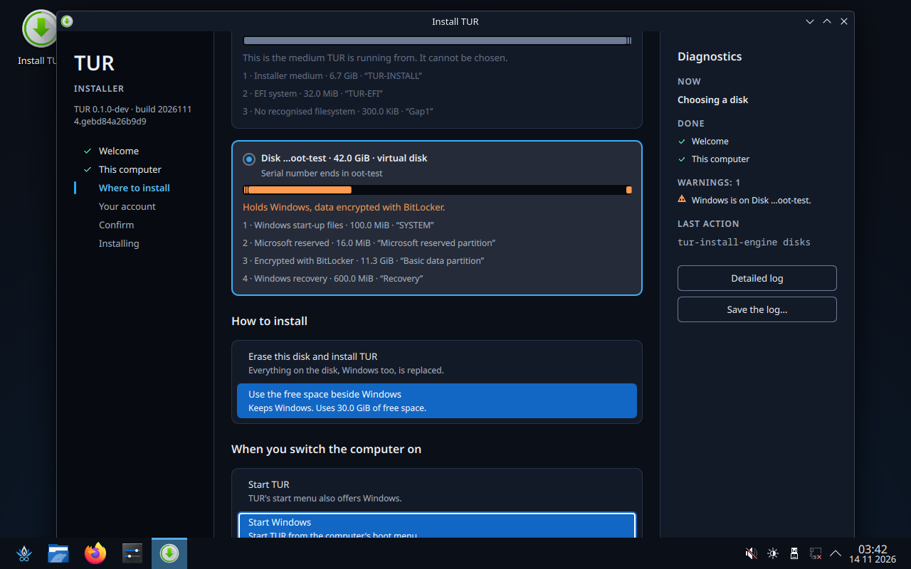
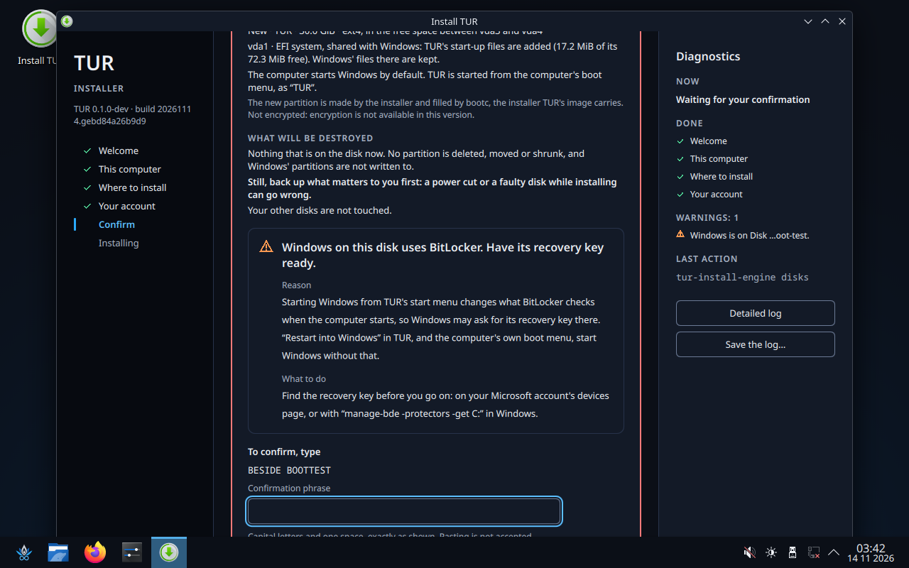
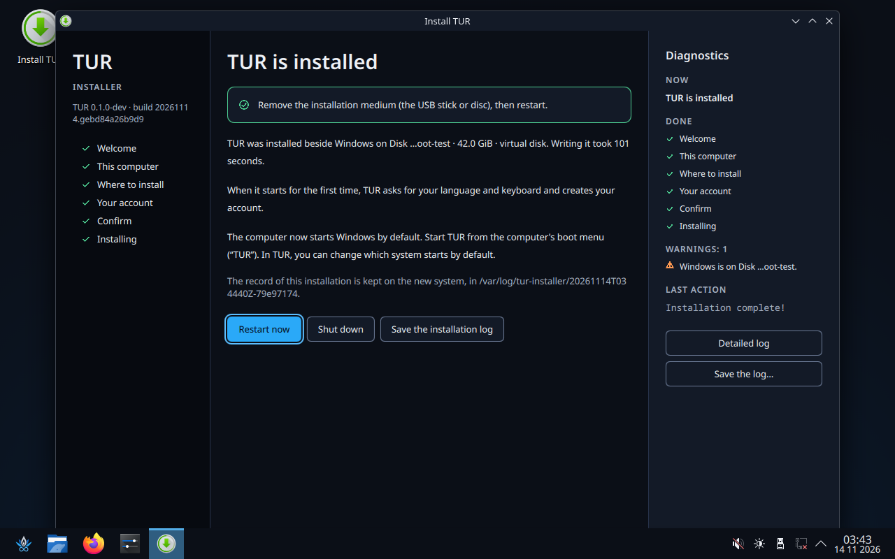
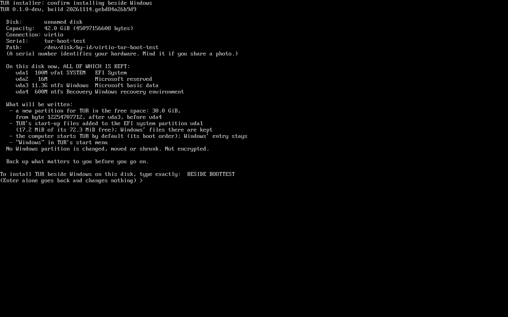
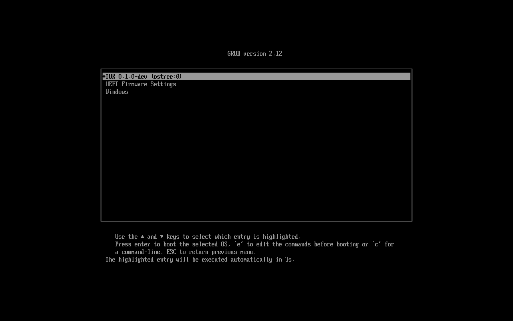
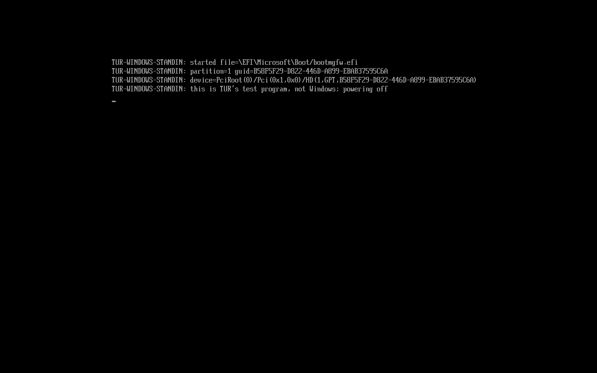

<!-- SPDX-License-Identifier: LicenseRef-TUR-Noncommercial-1.0.0 -->
# TUR-011 — Installing TUR beside Windows on the same disk (issue 64, step 1)

```text
TUR DEVELOPMENT REPORT

Task ID:          TUR-011 (issue #64 step 1; issues #76, #99, #16 in part)
Subsystem:        Installer medium engine (installer/iso), text installer,
                  graphical installer (desktop/apps/tur-installer),
                  installer-medium tests (tests/iso), workflow iso
Build ID:         see the runs of the head commit of pull request 112
Source revision:  the head of feat/beside-windows (pull request 112)

SUMMARY
- What changed: On a disk that holds Windows and has free space the person
  made with Windows' Shrink Volume, both installers offer "Use the free
  space beside Windows". The engine adds one partition in the free space,
  makes ext4 in it, runs `bootc install to-filesystem` into it (bootupd adds
  TUR's boot loader to Windows' EFI system partition and a "TUR" firmware
  entry), puts Windows' fallback boot loader back, writes "Windows" into
  TUR's boot menu, checks that every partition entry and every file
  Windows had on the EFI system partition is unchanged, and sets the system
  the person chose to start by default. Before any of it, it keeps a record
  of the disk on the EFI system partition, with which the medium can remove
  TUR again and leave the disk exactly as it was. tur-dualboot (in the
  image) changes the default system and restarts into Windows through the
  firmware. ADR-0029 (Proposed) records what upstream does and the decisions.
- Why it changed: the owner's test PC has Windows 10 on its only disk.

FILES
- Added: docs/adr/0029-install-beside-windows.md; this report;
  installer/iso/third-party-licensed/grub/windows-entry.cfg.in (BSD-3-Clause);
  tests/iso/make-windows-shared-disk.sh, windows-disk.py, beside-report.py,
  build-standin.sh, standin/standin.c; desktop/apps/tur-installer/fixtures/same-disk/.
- Modified: installer/iso/rootfs/usr/lib/tur-installer/engine.sh,
  usr/libexec/tur-installer/tur-install and tur-install-engine,
  installer/iso/Containerfile (one COPY, one check);
  desktop/apps/tur-installer (engine bridge, Wizard, DiskScreen,
  ConfirmScreen, ProgressScreen, DoneScreen, PartitionBar, Words, tests);
  tests/iso/install.py, boot-installed.py, live.py;
  .github/workflows/iso.yml (jobs beside and beside-faults);
  docs/architecture/installer.md, docs/guides/install-on-a-test-pc.md
  (section 7b), notes in ADR-0018 and ADR-0025.
- Removed: nothing.

BUILD
- Command: the iso workflow (image, medium, stand-in program) and the
  desktop workflow, in CI only.
- Result: see "CI runs".
- Warnings: see "CI runs".

TESTS
- Unit tests: the wizard's QML tests (tst_wizard.qml: five new cases) and
  walks over seven new states, on recorded answers.
- Integration tests: iso jobs beside (refusals, text installer, graphical
  installer) and beside-faults (a power cut at nine points).
- Boot tests: first start of TUR installed beside Windows; "Windows" chosen
  in TUR's boot menu starting the stand-in boot manager.
- Hardware tests: NOT RUN (no hardware runner; no real Windows).
- Performance tests: timings recorded, not judged.

DIAGNOSTICS
- Log paths: /run/tur-installer/ on the medium (beside-table-*.txt,
  beside-esp-*.sha256 beside installer.log); kept on the installed disk in
  /var/log/tur-installer/<session>/; CI artifacts
  tur-installer-beside-windows and tur-installer-beside-windows-power-cuts.
- Diagnostic bundle path: none.
- Relevant error IDs: TUR-INSTALL-BESIDE-001 to -006 and
  TUR-INSTALL-REMOVE-001 to -003 (new, medium only).

RECOVERY
- Rollback procedure: revert pull request 112. Installing on a whole disk is
  unchanged by it. A computer installed beside Windows keeps working; to
  remove TUR from it, guide section 7b.
- Recovery tested: run 43536196180 cut the power at nine points and found
  one window (Windows' fallback boot loader holding TUR's shim; Windows'
  partitions and its own boot files never changed). Removal by the medium
  after each cut is built since and is judged by the head commit's runs.

KNOWN LIMITATIONS
- See "What is not proven" and "Owner decisions".

NEXT SAFE ACTION
- Try it on the test PC after shrinking Windows from Windows (guide 7b), with
  the BitLocker recovery key at hand; report whether Windows starts from
  TUR's menu.
```

## How it works

```text
disk holding Windows, after Windows' own Shrink Volume:
  [ESP 100 MiB][MSR][Windows (NTFS)][   free   ][Recovery]
                                        │
engine.sh beside_look (reads only)      │  GPT? one ESP with EFI/Microsoft/Boot/bootmgfw.efi?
                                        │  no EFI/fedora? free >= 25 GiB? ESP free >= TUR's loader + 4 MiB?
confirmation: phrase "BESIDE <end of serial>" (the erase phrase is refused)
engine.sh run_beside:
  1 record      sfdisk --dump; SHA-256 of every file on the ESP
  2 partition   sfdisk --append: one entry "TUR" (Linux root x86-64) in the free stretch
  3 filesystem  mkfs.ext4 -L root -O verity (as bootc's to-disk)
  4 deploy      bootc install to-filesystem <mounted partition>   (no --generic-image:
                bootupd --update-firmware --auto: EFI loader into the shared ESP,
                firmware entry "TUR" first; "Windows Boot Manager" kept)
  5 fallback    Windows' EFI/Boot/bootx64.efi put back (bootupd overwrote it with shim)
  6 boot-menu   /boot/grub2/custom.cfg: "Windows" (key w) -> chainloader
                /EFI/Microsoft/Boot/bootmgfw.efi on the ESP, by its UUID
  7 check       every ESP file and every partition entry Windows had: unchanged
  8 default     tur-dualboot default tur|windows: the person's choice, first
                in the firmware's boot order
later, on TUR:  tur-dualboot restart-windows (no password)  (BootNext: Windows once,
                from the firmware, no BitLocker prompt) | default tur|windows
  [ESP shared][MSR][Windows][TUR ext4][Recovery]
```

The upstream facts this rests on (read in bootc 1.17.1/1.17.4, bootupd
0.3.2, Fedora 45's GRUB and shim) are in ADR-0029, "State of upstream". The
one that matters most: **`bootc install to-filesystem --replace=alongside`
deletes the ESP's whole `EFI` directory**, Windows' boot manager with it; the
engine never passes `--replace`.

## What CI showed (iso run 43536196180, commit 64427e0)

On a disposable disk image laid out as Windows leaves it after Shrink Volume
(`tests/iso/make-windows-shared-disk.sh`: 42 GiB; a 100 MiB ESP with 26 MiB
of files under Windows' names; MSR; NTFS made by ntfs-3g with known files;
30 GiB free; a recovery partition at the end). **No Microsoft file is in
it**: `EFI/Microsoft/Boot/bootmgfw.efi` and `EFI/Boot/bootx64.efi` are TUR's
own stand-in program (`tests/iso/standin`), which prints the file and
partition it was started from and powers off.

### Job "Beside Windows on the same disk": every check passed

| What | Result |
|---|---|
| Refusals | A disk with no free space: `TUR-INSTALL-BESIDE-003` "the largest free space on the disk is 0 B; TUR needs 25.0 GiB. Make room in Windows: …". A disk whose ESP is full: `-004` "the EFI system partition has 4.3 MiB free; TUR's start-up files need 17.2 MiB". Choosing either led to the erase confirmation only; both disks byte-identical afterwards |
| Text installer | Offered: 30 GiB free after partition 3, before partition 4; ESP 72.3 of 98.4 MiB free, 17.2 MiB needed. The erase phrase was refused (`TUR-INSTALL-CONFIRM-001`); `BESIDE BOOTTEST` accepted. `bootc install to-filesystem` took 62 s. New partition 5 "TUR", 30 GiB, inside the free space |
| Windows after the installation | Every Windows partition (MSR, NTFS, recovery) **byte-identical** (SHA-256 of each partition's bytes); every one of the 13 files that were on the ESP identical; 14 files added, all TUR's (`EFI/fedora/*`, and `fbx64.efi`, `BOOTIA32.EFI`, `fbia32.efi` in `EFI/Boot`); the four partition entries unchanged; the first sector unchanged; `fsck.fat -n` clean. bootupd had replaced `EFI/Boot/bootx64.efi` with shim; the installer put Windows' back (same SHA-256). The same comparison held after TUR's first start and after "Windows" was started from TUR's menu |
| Firmware | "Windows Boot Manager" entry unchanged; "TUR" added (bootupd, `--update-firmware`); order as chosen |
| TUR starts | A rendered screen 24.5 s after power-on, with no medium |
| "Windows" in TUR's menu | Key `w`: the stand-in started from `\EFI\Microsoft\Boot\bootmgfw.efi` on the partition whose GUID is the ESP's |
| Default system | Text run chose TUR: boot order TUR, Windows Boot Manager. `tur-dualboot default windows` then `default tur`, run as root from the medium's command line, switched the order each time, the other entries keeping their places |
| Restart into Windows | `tur-dualboot restart-windows`: the firmware started the stand-in once (from the ESP), the start after that was TUR, and `BootNext` was gone |
| Graphical installer | The same in the live session with the keyboard only, on a disk whose Windows partition carries BitLocker's signature: the erase phrase left the button unavailable, `BESIDE BOOTTEST` enabled it; bootc 101 s; Windows chosen as default: boot order Windows Boot Manager, TUR, and the first start was the stand-in, started by the firmware; the menu entry is titled "Windows (may ask for the BitLocker recovery key)"; Windows' partitions and ESP files identical after the installation and after the first start |

### Job "a power cut at each step": failed, and what it found

QEMU was stopped at once (QMP `stop`, then SIGKILL) at nine points. After
every cut: **every Windows partition byte-identical, everything under
`EFI/Microsoft` identical, the "Windows Boot Manager" firmware entry
unchanged**, the new partition inside the free space, `fsck.fat -n` clean.

| Cut | Where it landed | Windows' side | What the disk then started |
|---|---|---|---|
| partition, partitioned, filesystem | after the new GPT entry, before any file of TUR's | identical; nothing added to the ESP | Windows' start-up file (the stand-in), by itself |
| deploy + 30 s | while bootc copied the image | identical; nothing added to the ESP | the stand-in, by itself |
| **bootloader + 0 s, + 2 s, deployed** | after bootupd, before the installer put Windows' fallback loader back | **`EFI/Boot/bootx64.efi` held TUR's shim**; everything else identical | TUR (the firmware's "TUR" entry was first) |
| boot-menu, check | after the installation had in fact finished (the steps are shorter than the test's reaction) | identical | "Windows" from TUR's menu |

So the three failed checks are one finding, in Windows' half of the disk but
not in Windows itself: for a few seconds a file Windows put on the ESP (its
fallback copy of the boot manager, used only when the firmware has lost its
boot entries) is replaced by TUR's shim, and a power cut then leaves it so,
with TUR first in the boot order. Windows' partitions, its boot manager and
its firmware entry were never changed, and Windows could be started from the
firmware's boot menu.

**What was changed because of it** (in the head commit; shown by its runs):

1. Windows' fallback loader is put back as soon as bootc's output shows that
   bootupd has finished, not only after bootc's end.
2. Before anything else is written, a record of the disk is kept on the ESP
   (`EFI/tur`), and the medium can **remove TUR again** ("Remove TUR from
   this disk", phrase `REMOVE` + end of serial): after a whole installation
   or after any cut, the disk is as before TUR.
3. The test now cuts at eight points, then starts the medium again, removes
   TUR, and requires the disk to be exactly as before: the partition table,
   every partition's bytes, the ESP's files with none added, the free
   space, no "TUR" firmware entry, the boot order of before. The same after
   a complete installation, followed by a start of the disk, which must
   start Windows' start-up file by itself.

The removal's clean-up of the ESP was tried on plain directories on the
development machine (no device, no mount): a whole installation, shim left
in the fallback's place, an unfinished record, a fallback Windows replaced
since, and no fallback before TUR; each ended as before TUR. In a virtual
machine it has not run yet.

### Product medium job and desktop workflow: runner faults

The product job lost its runner during the live-session step ("The hosted
runner lost communication with the server"); no log exists. Every job of
the desktop run 43536196195 failed in seconds because the builder image's
cache entry could not be restored. Neither ran this change's code to a
verdict; both run again with the next push.

## Pictures (iso run 43536196180; looked at before they were put here)

| | |
|---|---|
| Where to install: the Windows disk chosen, "Use the free space beside Windows", and which system starts |  |
| The confirmation: what is kept, the BitLocker note, the phrase |  |
| The phrase typed |  |
| Done, Windows chosen as default |  |
| The text installer's confirmation |  |
| TUR's boot menu with "Windows" |  |
| The stand-in for Windows Boot Manager, started from TUR's menu |  |

Seen in them and not yet changed: the graphical confirmation names
partitions by the kernel's names ("between vda3 and vda4").

## What is not proven (NOT RUN)

- Real BitLocker, with "Restart into Windows" or TUR's menu: NOT RUN.
- `tur-dualboot` through pkexec on an installed TUR (run as root from the
  medium, which is the same image).
- Real Windows: that Windows Boot Manager started from TUR's menu starts
  Windows; that Windows accepts the shared ESP and the new partition; Fast
  Startup or hibernation; Windows' later updates of its recovery partition
  and ESP.
- BitLocker: whether Windows asks for the recovery key when started from
  TUR's menu (upstream bugs say it does: ADR-0029, S8, S9).
- Secure Boot with the "Windows" entry: the stand-in is unsigned, so the
  entry is tested only without Secure Boot. That Fedora 45's GRUB verifies a
  chain-loaded image through shim was read in the source.
- A torn sector: QEMU stops between writes; a real power cut can lose part
  of one, and a cut while the ESP is written can damage its FAT.
- Real firmware and its handling of the "TUR" entry and the boot order.
- Removing TUR, and the earlier put-back of Windows' fallback loader: built
  after run 43536196180; not yet run in a virtual machine.
- What Windows' Disk Management shows for TUR's partition; removing TUR by
  hand from Windows (the guide's steps).
- Windows' clock after TUR has run (universal against local time).

## Owner decisions

Decided by the owner on 14 November 2026 (recorded in ADR-0029):

1. **Boot order: the person decides.** Both installers ask; the installer
   sets the firmware's order with `tur-dualboot default`, which also changes
   it later. Settings page: follow-up.
2. **BitLocker: "Restart into Windows"** (`tur-dualboot restart-windows`,
   BootNext); the GRUB entry stays, titled "Windows (may ask for the
   BitLocker recovery key)" when the disk holds BitLocker.
3. **Shrinking Windows from the installer is to be offered** (pull request
   116, TUR-012).
4. **Minimum free space: 25 GiB.**

Still open:

1. **Windows' `EFI/Boot/bootx64.efi`** is put back after bootupd (every file
   Windows had stays identical). Fedora's installer leaves shim there, which
   recreates TUR's entry if the firmware forgets it. Chosen: put back.
2. **Phrase**: `BESIDE` and the end of the serial number, distinct from
   `ERASE`.
3. **Case-insensitive folders (issue 99)**: ADR-0029 proposes a separate ext4
   `/boot` (no casefold) and a root made with `-O verity,casefold`; not
   implemented, because it changes the layout boot counting was proven on.

## Follow-ups

1. Results and pictures of the runs of pull request 112 into this report.
2. Compare the recorded engine answers (fixtures/same-disk) with the
   `ENGINE>` lines of the beside job's graphical run.
3. A Settings page for the default system and "Restart into Windows".
4. Removing TUR in the graphical installer (the text installer and the
   engine do it); partitions named as "partition 3", not "vda3", there.
7. Keep the computer's clock in local time when TUR is installed beside
   Windows (for the `dualrun` design).
5. After `bootloader-update.service` updates shim (bootupctl update at start),
   put Windows' `EFI/Boot/bootx64.efi` back: bootupd writes shim over it
   again (finding, ADR-0029).
6. Error codes `TUR-INSTALL-BESIDE-001` to `-006` into the registry crate.

## CI runs

| Run | Commit | Result | What it showed |
|---|---|---|---|
| iso 43500349673, desktop 43500349625 | 51851f6 | cancelled | superseded by a push before a runner took them |
| iso 43510905486 | f1038a5 | failed | lint: one shellcheck finding (SC2143, engine.sh, `[ -n "$(grep …)" ]`). **The medium and VM jobs were skipped: nothing about the installation ran** |
| desktop 43510905357 | f1038a5 | failed | built, qmllint clean, every earlier test passed. Failed: the state "installing-beside" was never reached (the recorded answers were written with spaces after the colons, and the replay recognises `{"event":"pause"}` only as the engine writes it, without); one test typed the phrase into a field that still held text |
| rollback 43510905321, image 43510905309, rust 43510905434 | f1038a5 | passed | the image builds with `tur-dualboot`; the rollback scenarios pass on it |
| boot 43510905578 | f1038a5 | failed | the runner's container storage ("layer not known") during the image build, as on another pull request that day; not this change |
| iso 43536196180 | 64427e0 | failed | lint and the proof medium passed; **beside: every check passed**; beside-faults: the window described above (3 checks); product medium: the runner was lost |
| desktop 43536196195 | 64427e0 | failed | every job: the builder image's cache entry could not be restored (not this change) |
| image, boot, rollback | 64427e0 | passed | |

The runs of the head commit are listed in pull request 112.
