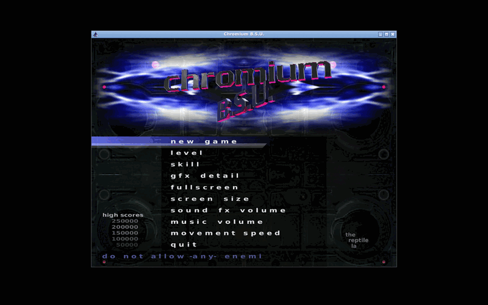
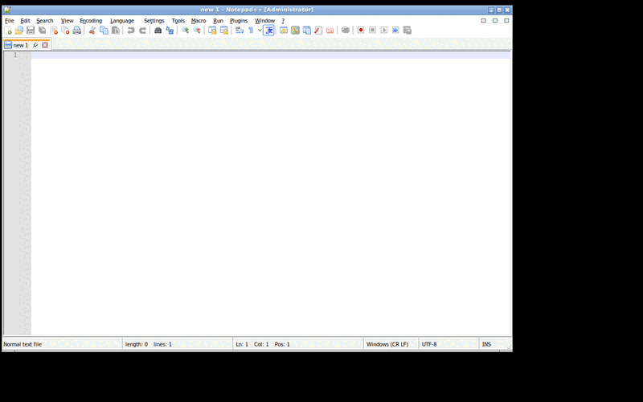

# apps-1 — The application install backend: real installations by the router's route

```text
TUR DEVELOPMENT REPORT

Task ID:          apps-1
Subsystem:        Application install backend (services/tur-apps); catalogue
                  and router (services/tur-catalogue, catalogue/)
Build ID:         not applicable: this task builds no image
Source revision:  a82c41d (feat/app-install-backend, pull request 53),
                  the commit the final runs below come from. The commit
                  that adds this report changes no code.

SUMMARY
- What changed: a new component, tur-apps, takes a catalogue identifier,
  asks the router, prints a plan (source, downloads with size and digest,
  where it installs, what it can reach, how it is removed), and installs by
  the Flatpak route (per user, through the flatpak command line) or the
  Windows route (a pinned, hash-checked publisher download or the user's
  own file, handed to tur-runtime). One list of what is installed; removal
  that keeps the user's data unless told otherwise; events as JSON lines;
  a proposed org.tur.Apps1; two read-only assistant tools. The catalogue
  gains pinned installers for free Windows software, TUR's own test
  records, and entries for Notepad++, PuTTY and Chromium B.S.U.; the router
  gains stable reason codes and sentence identifiers (issue #41).
- Why it changed: nothing installed a Linux application, nothing connected
  the router's answer to an installation, and nothing downloaded anything
  (task D-11 waits for it; ADR-0011).

FILES
- Added: services/tur-apps/** (src, tests, ci/e2e.py, dbus/org.tur.Apps1.xml,
  pax/agent-tools*.json); schemas/app-install-plan.schema.json,
  app-install-event.schema.json, app-installed.schema.json;
  .github/workflows/apps.yml; docs/architecture/app-install-backend.md;
  docs/adr/0019-app-install-backend.md; this report and its assets;
  catalogue/org.notepad-plus-plus.notepad-plus-plus.toml,
  uk.org.greenend.chiark.putty.toml, net.sourceforge.chromium-bsu.toml
- Modified: services/tur-catalogue/src/{lib,model,report,route,validate}.rs,
  tests/{router_space,seed,desktop_fixtures}.rs;
  schemas/app-catalogue-entry.schema.json; catalogue/README.md,
  org.7-zip.7zip.toml, org.videolan.vlc.toml;
  desktop/apps/tur-centre/fixtures/** (regenerated by CI, not edited);
  docs/architecture/catalogue-and-routing.md; docs/adr/README.md;
  docs/dependencies/upstream-projects.md
- Removed: none

BUILD
- Command: cargo clippy --all-targets --all-features -- -D warnings; cargo
  test (workflow "rust"); cargo build --locked (workflow "apps")
- Result: see RUNS
- Warnings: none from the compiler or clippy

TESTS
- tur-apps: 30 unit tests, 12 tests of the program against stand-ins for
  flatpak, curl and tur-runtime (tests/cli.rs), 7 interface checks, 3
  assistant-tool tests. Pass.
- tur-catalogue: 111 unit tests, 16 CLI,
  4 fixture, 11 router-space (every case now also checked for stable
  sentence identifiers), 10 seed, 4 assistant-tool. Pass.
- End to end, Flatpak: job "flatpak" of workflow "apps", real flatpak and
  Flathub. Results below.
- End to end, Windows: job "windows" of workflow "apps", real curl,
  tur-runtime, Wine and bubblewrap. Results below.
- The application centre: workflow "desktop" on the regenerated fixtures.
  Pass.
- Boot tests: NOT RUN. Nothing here can affect boot.
- On the TUR image: NOT RUN. tur-apps is not in the image; neither is Wine.
- Hardware tests: NOT RUN.

DIAGNOSTICS
- Log paths: the GitHub Actions runs below; artifacts apps-flatpak-evidence
  and apps-windows-evidence (every command's output, the plans, the event
  streams, the lists, results.json, summary.md, screenshots)
- Relevant error IDs: 17 new codes, TUR-DESKTOP-APPS-001 to -017

RECOVERY
- Rollback procedure: revert the merge. What an installation leaves is under
  ~/.local/share/tur/apps, the user's Flatpak installation and tur-runtime's
  directories, and is removed by `tur-apps remove`.
- Recovery tested: a failed Flatpak installation takes back what it added
  (stand-in); a refused download leaves nothing (real); a removal checks
  that nothing is left (real, both routes).

NEXT SAFE ACTION
- Switch Flathub on per user at first login (image or first-run setup) and
  let tur-centre's Install button run `tur-apps install --events`.
```

> **Later (TUR-010):** the tool files this report puts under `pax/` were moved to the component's top level (pax-5 for tur-apps and tur-ai-local, TUR-010 for tur-update), where P@x discovers every component's tools, and the image installs them.

## Runs

Every workflow ran on hosted `ubuntu-24.04` runners (image ubuntu24
20261111.370.1, kernel 7.0.0-1017-azure). The runs that fixed something are
listed with what they showed; the last row is the final state.

| Commit | rust | apps: flatpak | apps: windows | pax | desktop |
|---|---|---|---|---|---|
| `2db3461` | tur-apps: 4 borrow errors, 1 clippy lint; tur-catalogue: a shadowed helper in a test; lockfile and formatting needed | no lockfile | no lockfile | failed: `tests/pax/e2e.py` expects exactly five components with tools at the top level | not run |
| `e6526fe` (runs 43251647311, 43251647563) | the stand-ins needed `XDG_DATA_HOME`; the fixtures needed regenerating | `sources enable … --json` refused by the command line | refused by `tur-runtime` (finding 1); the corrupted-download, wrong-file and no-route checks already passed | pass | pass |
| `b71b1dd` (43253115412, 43253115360) | fixtures (vocabulary) | installed, then rolled back (finding 2) | **pass, 29 of 29** | pass | pass |
| `e2bde23` (43254552861, 43254552772) | formatting only | **installed for real**; Klavaro aborted at start (finding 3); every other check passed | pass | failed in its own control check (a canary socket, `BrokenPipeError`), unrelated to this change; passed on the next two commits | pass |
| `1e6c4ab` (43256089109, 43256089287) | pass | pass, 35 of 35; the screenshot taken 2 s after the window appeared was black (finding 5) | pass, 29 of 29 | pass | pass |
| **`a82c41d`** (rust 43257771781, apps 43257771772, pax 43257771770, desktop 43257771783) | **pass** | **pass, 35 of 35** | **pass, 29 of 29** | **pass** | **pass** |

## What was really installed

| | Flatpak job | Windows job |
|---|---|---|
| Application | Chromium B.S.U. 0.9.16.1 (`net.sourceforge.chromium-bsu`), ClArtistic, from Flathub | Notepad++ 8.9.9.1 (`org.notepad-plus-plus.notepad-plus-plus`), GPL-3.0-or-later, from the project's GitHub release |
| By | `tur-apps install net.sourceforge.chromium-bsu --yes --events` | `tur-apps install org.notepad-plus-plus.notepad-plus-plus --yes --events` |
| Route | Flatpak, per user, recommended by the router | Wine, recommended by the router |
| Downloaded | the application (5.6 MB) and its runtime `org.freedesktop.Platform//26.08` with the extensions Flatpak brought: `GL.default` (and its `-extra` branch), `Locale`, `codecs-extra` | `npp.8.9.9.1.Installer.x64.exe`, 7 048 536 bytes, SHA-256 `ce3267f5…3152`, the pin |
| Checked | by Flatpak, against Flathub's key | by tur-apps, size and SHA-256, before tur-runtime ran |
| Started | `tur-apps launch`, which runs `flatpak run --user`; its window found by title | `tur-apps launch`, which runs `tur-runtime app launch`; its window found by title |
| Removed | twice: keeping its data, then (after installing again) deleting it | keeping a document put into its private home |

Every check of both jobs is in the artifact's `summary.md`; the tables
below are copied from the final run.

**Flatpak job: 35 of 35 checks passed** (run 43257771772).

| Check | Result |
|---|---|
| a fresh user has nothing installed | pass |
| with Flathub off, the plan is refused (TUR-DESKTOP-APPS-008) | pass |
| Flathub is switched on for this user | pass |
| flatpak lists the user's flathub remote | pass |
| the plan is made | pass |
| the plan gives the application's download size in bytes | pass |
| the plan names the commit that would be installed | pass |
| the plan reads the permissions from the application's metadata | pass |
| installed per user from Flathub | pass |
| the event stream starts with the plan and every line is an event | pass |
| flatpak's activity reaches the events | pass |
| flatpak lists the application per user | pass |
| nothing was installed system-wide by the test | pass |
| the list shows it, with its version, size and source | pass |
| net.sourceforge.chromium-bsu: its window appears | pass |
| net.sourceforge.chromium-bsu: screenshot flatpak-chromium-bsu.png | pass |
| net.sourceforge.chromium-bsu: no window is left | pass |
| the update check asks Flathub and gives an answer | pass |
| update runs (nothing to update is a success) | pass |
| removed, keeping its data by default | pass |
| its data is still there | pass |
| no reference is left installed for this user (application, runtime, extensions) | pass |
| gone: .local/share/flatpak/app/net.sourceforge.chromium-bsu | pass |
| gone: .local/share/flatpak/exports/share/applications/net.sourceforge.chromium-bsu.desktop | pass |
| gone: .local/share/tur/apps/installed/net.sourceforge.chromium-bsu.json | pass |
| installed again | pass |
| removed with its data | pass |
| its data is gone | pass |
| no reference is left installed | pass |
| no deployment is left under ~/.local/share/flatpak/app or runtime | pass |
| no exported launcher entry, icon or metadata of the application is left | pass |
| the list is empty | pass |
| no route: refused with exit status 3 and TUR-DESKTOP-APPS-003 | pass |
| no route: the message is the router's own reason, as tur-catalogue prints it | pass |
| no route: the reason code is the router's | pass |

**Windows job: 29 of 29 checks passed** (run 43257771772).

| Check | Result |
|---|---|
| the plan is made by catalogue identifier: Wine, the router's recommendation | pass |
| the plan downloads the pinned installer with its size and SHA-256 | pass |
| a download that is not the pinned file is refused (exit 5, TUR-DESKTOP-APPS-006) | pass |
| the file was really downloaded before it was refused | pass |
| nothing ran: no install step started | pass |
| nothing ran: tur-runtime has no application and no prefix | pass |
| nothing is kept of the refused download | pass |
| installed through the whole chain | pass |
| downloaded, then checked, then installed | pass |
| download progress has a total | pass |
| the record keeps the pinned digest | pass |
| tur-runtime holds it under the catalogue's identifier | pass |
| the downloaded installer was deleted | pass |
| the list shows it with its version, size and source, and no update | pass |
| org.notepad-plus-plus.notepad-plus-plus: its window appears | pass |
| org.notepad-plus-plus.notepad-plus-plus: screenshot windows-notepadpp.png | pass |
| org.notepad-plus-plus.notepad-plus-plus: no window is left | pass |
| removed, keeping its documents by default | pass |
| the user's document was kept | pass |
| its Windows settings were kept | pass |
| tur-runtime holds nothing | pass |
| gone: .local/share/tur/runtime/prefixes/org.notepad-plus-plus.notepad-plus-plus | pass |
| gone: .local/share/tur/runtime/launchers/org.notepad-plus-plus.notepad-plus-plus | pass |
| gone: .local/share/tur/apps/installed/org.notepad-plus-plus.notepad-plus-plus.json | pass |
| nothing outside the sandbox in the scratch home | pass |
| a file you give that is not the pinned one is refused before anything runs | pass |
| no route: refused with exit status 3 and TUR-DESKTOP-APPS-003 | pass |
| no route: the message is the router's own reason, as tur-catalogue prints it | pass |
| no route: the reason code is the router's | pass |

## What the runs showed

Each finding below was a failure in a run, and is fixed in this change unless
it says otherwise.

1. **`tur-runtime` will not take a program from a hidden folder of the home
   directory.** The first download went to `~/.cache/tur/apps/downloads`;
   `tur-runtime app install` refused it with `TUR-SECURITY-SANDBOX-006` ("it
   is in a hidden part of the home directory, where credentials and
   application profiles are kept"). A sound rule. Installers now go into a
   new directory under `/var/tmp`, mode 0700, never one that exists, deleted
   afterwards. `/tmp` is in memory on Fedora; the user's runtime directory is
   protected by `tur-runtime`.
2. **`flatpak list --columns=ref` prints a reference without its kind**
   (`net.sourceforge.Klavaro/x86_64/stable`, not `app/…`): the column is
   `flatpak_decomposed_get_pref` in 1.14.6 and 1.18.4. The second run
   installed the application for real, did not find `app/…` in the list,
   took that for a failure and rolled the installation back. Applications
   and runtimes are now listed separately and the kind put in front; the
   stand-in prints what flatpak prints.
3. **A GTK application on the freedesktop 26.08 runtime did not start on the
   runner.** Klavaro (the first choice, GTK 3) was installed, started and
   aborted after about two seconds: GTK loads images through glycin, glycin
   starts its loaders through `flatpak-spawn --sandbox` (the Flatpak portal),
   and every loader "exited early with status 1"; GTK's assertion on the
   missing-image icon ended the program. tur-apps is not involved: this is
   the runner's desktop environment (no portal set-up beyond
   `dbus-run-session`). Chromium B.S.U. (SDL and OpenGL) does not load
   images that way and was used instead. **Not fixed, and worth checking on
   the TUR image**: whether GTK applications on the 26.08 runtime start in a
   TUR session; if a session lacks a working Flatpak portal, they will not.
4. **`sources enable flathub --json`** was refused by the command line
   (`--json` belonged to `sources` only). It is global to the subcommand now.

5. **A window can be on screen and empty.** In run 43256089287 the screenshot
   of Chromium B.S.U., taken two seconds after its window was mapped, was
   all black: the window was found by its title and was viewable, and
   nothing had been drawn in it yet (OpenGL in software, on Xvfb). The job
   now looks again eight seconds later and records what is drawn. In the
   final run both images show the game's menu. Finding the window proves
   that the application started; it does not by itself prove that it
   draws.

## Measurements

Wall-clock on a shared hosted runner, one run each; not a benchmark.

| What | Value |
|---|---|
| Flatpak install of the application, its runtime and extensions, from nothing | 34.0 s (27.5 s in run 43256089287) |
| Flatpak install again (the runtime downloaded again: it had been removed) | 27.6 s |
| Chromium B.S.U.: from `tur-apps launch` to its window | 0.8 s |
| Its window 8 s later: mean brightness (0 black, 1 white), distinct colours | 0.128973, 88672 |
| Entries under `~/.var/app/net.sourceforge.chromium-bsu` after it ran, directories and the test's own marker file included | 137 |
| Left in the user's Flatpak repository after the last removal | 3277 bytes, not itemised; no installed reference and no deployment was left |
| Notepad++: download, check and `tur-runtime app install` | 13.4 s (18.2 s and 19.1 s in the two runs before) |
| Notepad++: from `tur-apps launch` to its window | 2.8 s |
| Its window 8 s later: mean brightness, distinct colours | 0.980201, 2636 |
| Notepad++: the size `tur-apps list` reports | 1329892491 bytes |

The size of Notepad++ is the size of its directory under
`~/.local/share/tur/runtime/prefixes/`: almost all of it is the Wine prefix
`tur-runtime` creates for every application, files counted by size (a file
linked twice counts twice). It is what `tur-apps list` reports as the space
the application takes, and is too large to be useful until `tur-runtime`
shares the prefix's base files; that belongs to the runtime manager.

## Verified upstream

Read from upstream sources on 12 November 2026; nothing was installed on a
development machine.

| Fact | Source |
|---|---|
| flatpak 1.18.4 is the current stable release; Fedora 45 ships it as `1.19.0^really1.18.4-1.fc45` (1.19.0 was withdrawn); Ubuntu 24.04 ships 1.14.6 | GitHub releases of flatpak/flatpak; `src.fedoraproject.org/rpms/flatpak` f45 spec and Bodhi FEDORA-2026-91259c13b9; Launchpad; the CI runner's `flatpak --version` |
| `--json` exists from flatpak 1.17.0 only, and only on list, remote-ls, remotes and a few others; not on install, update, uninstall, info or remote-info | flatpak NEWS 1.17.0; `app/` sources at 1.18.4 and 1.14.6 |
| Without a terminal, tables are tab-separated with no header; `--noninteractive` prints `Installing <ref>` etc. and failures as `Error: Failed to …`; no machine-readable progress; exit status 1 on every failure | `app/flatpak-table-printer.c`, `app/flatpak-quiet-transaction.c`, `app/flatpak-main.c` |
| Sizes in list and remote-info are human-formatted by the locale; `info --show-size` prints bytes | `app/flatpak-builtins-list.c`, `-remote-info.c`, `-info.c` |
| `uninstall --delete-data` removes `~/.var/app/<id>` and the application's permissions (which needs the session bus) | flatpak-uninstall(1); `flatpak_delete_data` |
| The per-user installation is `$FLATPAK_USER_DIR`, else `$XDG_DATA_HOME/flatpak` | flatpak(1), "ENVIRONMENT" |
| Flathub is added with `flatpak remote-add --if-not-exists flathub https://dl.flathub.org/repo/flathub.flatpakrepo`, which carries Flathub's signing key | `https://flathub.org/setup` |
| Flathub's API gives sizes in bytes (`/api/v2/summary/<id>`) and licence and verification (`/api/v2/appstream/<id>`) | `https://flathub.org/api/v2/openapi.json` |
| **Fedora 45 Kinoite** adds the `fedora` remote (enabled) and `fedora-testing` (disabled), both system-wide, by `flatpak-add-fedora-repos.service` at first boot; Flathub only after the user opts into third-party repositories (`fedora-third-party`, offered on Kinoite by Plasma Welcome), and then as a system remote, unfiltered in effect | flatpak f45 spec; `redhat-systemd-presets` f45 `90-default.preset`; `fedora-flathub-remote` and `fedora-third-party` specs; `https://forge.fedoraproject.org/atomic-desktops/config`, branch f45 |
| curl 8.21.0 and flatpak are in the Kinoite base (`packages/common.yaml`), and in the TUR image's SBOM | the same configuration; `docs/dependencies/image-licences.csv` |
| curl: `-q` must be first to skip `~/.curlrc`; `--proto =https`, `--proto-redir`, `--max-filesize`, `--fail`, `--max-redirs` behave as used; available in 8.5.0 (Ubuntu) and 8.21.0 (Fedora) | `https://curl.se/docs/manpage.html` |
| GitHub's ubuntu-24.04 runners restrict unprivileged user namespaces through AppArmor; flatpak's own CI lifts it with `sysctl kernel.apparmor_restrict_unprivileged_userns=0` | flatpak `.github/workflows/check.yml` at 1.18.4; LP#2072811 |

Not verified: Flathub's terms of use for a client that installs on the
user's request (to be read before Flathub is switched on by default);
whether `flatpak run` works without a session bus at all (the job uses
`dbus-run-session`).

## The decisions, and those the owner may want to reverse

| Decision | Why | Reverse by |
|---|---|---|
| A separate component and interface (`tur-apps`, `org.tur.Apps1`), not part of the catalogue service the design names | Installing changes the computer (class 2); the catalogue only reads | Merging the interface into `org.tur.Catalogue1` |
| Downloads through the system's `curl`, not an HTTP library | No TLS code of TUR's own; the system's certificate store and crypto policy; curl is in the base already (ADR-0019) | `ureq` with `rustls`, as `tur-pax-providers` uses |
| A pin only for open-source editions; proprietary software only from the user's file | "Never download proprietary software" | — |
| TUR's test records for 7-Zip, Notepad++, PuTTY and VLC entered as `unknown` | The application centre's Home view says, unconditionally, that TUR has tested nothing and every rating is a named source's; a `good` or `usable` record would make it false, and its guard test (`the_home_view_s_standing_sentence_is_still_true`) fails. Changing the view is not this change's to make | Make the sentence conditional in `tur-centre`, then set 7-Zip to `usable` or `good` (the measurements are in windows-runtime-2) |
| Removal without a flag keeps the data, also without a terminal | "Keeps it by default" | Requiring a flag on the command line, as D-Bus does |
| Downloads under `/var/tmp` | `tur-runtime`'s rule against hidden folders; `/tmp` is in memory | Another root, `--download-dir` |
| Flathub on by default for each user, and not done here | The design's Sources view; ADR-0011 makes only proprietary stores opt-in; Fedora's default is off | Keeping Flathub opt-in |
| The assistant tools under `pax/` | `tests/pax/e2e.py` expects exactly five components at the top level | Adding `tur-apps` to that list |
| Notepad++ as the Windows application of the CI chain | Windows only, so the router recommends Wine; 7-Zip and PuTTY have a Fedora package that the router puts first | `--route wine` for one of those |

## What `tur-runtime` and `tur-centre` need

`tur-runtime` (not changed here):

- An update of an installed application (install the new installer into
  the same prefix), so that `tur-apps update` works for Windows.
- `app uninstall` still deletes the private home without asking (issue
  #32). `tur-apps` copies it aside first; a `--keep-home DIR` option there
  would make the step one program's.
- The space an application takes: today its directory is about 1.3 GB, nearly
  all of it the prefix.
- The launcher entry is still staged, so an application installed by
  `tur-apps` is not in the launcher.

`tur-centre` (not changed here; the fixtures only were regenerated):

- The Home view's standing sentence must become conditional before any TUR
  rating is entered.
- A record `reported_by = "tur-test"` with rating `unknown` reaches the
  router's output as `rating_source.kind = "tur-test"`; the centre's wording
  for it ("Tested by TUR on date … See the report") should not imply a
  rating.
- Translations: `reason_code`, `reason_parts`, `text_id` and `params` are in
  the fixtures and `vocabulary.json` lists every identifier.
- Install, Remove (with the one question), Installed, Updates and Sources:
  the command lines in [app-install-backend.md](../architecture/app-install-backend.md#how-d-11-will-use-it).

## Limits

- Hosted Ubuntu runners, not the TUR image: flatpak 1.14.6, not 1.18.4;
  Ubuntu's Wine 9.0; no GPU; Xvfb with openbox.
- One Flatpak and one Windows application. The Flatpak route was also run
  with Klavaro up to its start (finding 3).
- The update check found nothing to update; an update that changes the
  installed commit was exercised only against the stand-in.
- The user's document in the Windows test was written into the private home
  by the test, not saved by Notepad++.
- System-wide Flatpaks, Flatpak bundles, `.flatpakref` files and every other
  route are not handled.
- No D-Bus service; nothing cancels a running installation.

## Screenshots

From the final run, 43257771772, reduced to 800 pixels wide and 128
colours. Both were looked at. The full-size images, and a second capture of
each window eight seconds later, are in the run's artifacts.

| | |
|---|---|
|  Chromium B.S.U. 0.9.16.1, installed per user from Flathub by `tur-apps install net.sourceforge.chromium-bsu`, started by `tur-apps launch`: its title menu, drawn by OpenGL in software |  Notepad++ 8.9.9.1, downloaded from its publisher's release, checked against the pinned SHA-256, installed by `tur-runtime` and started by `tur-apps launch`, under Wine 9.0 |

The window title "[Administrator]" is Notepad++'s own reading of Wine's
default user, as in windows-runtime-2.
