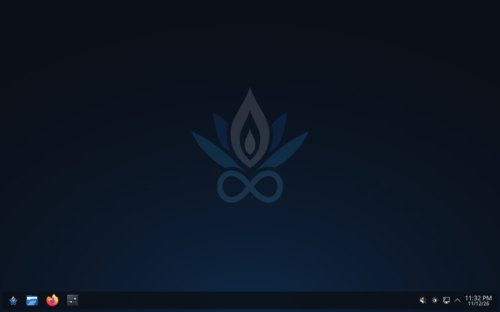
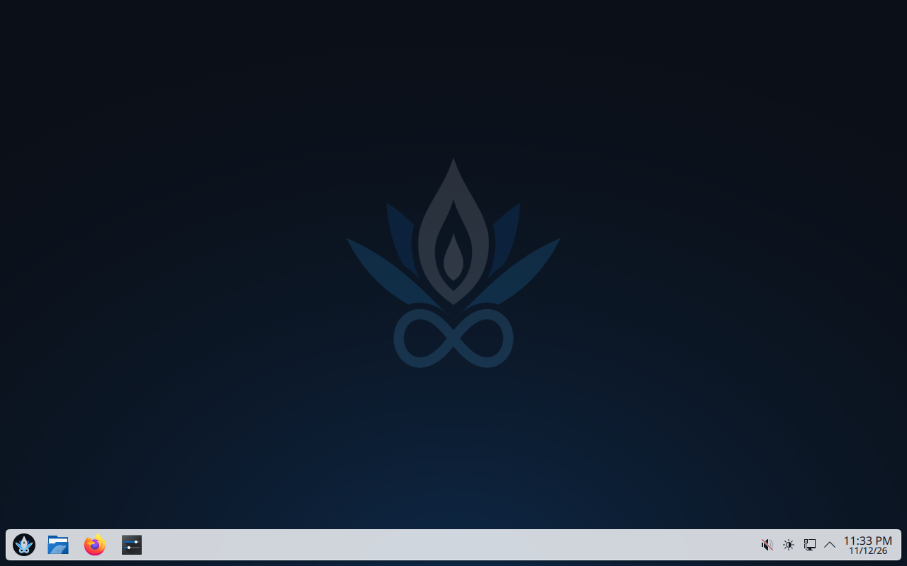
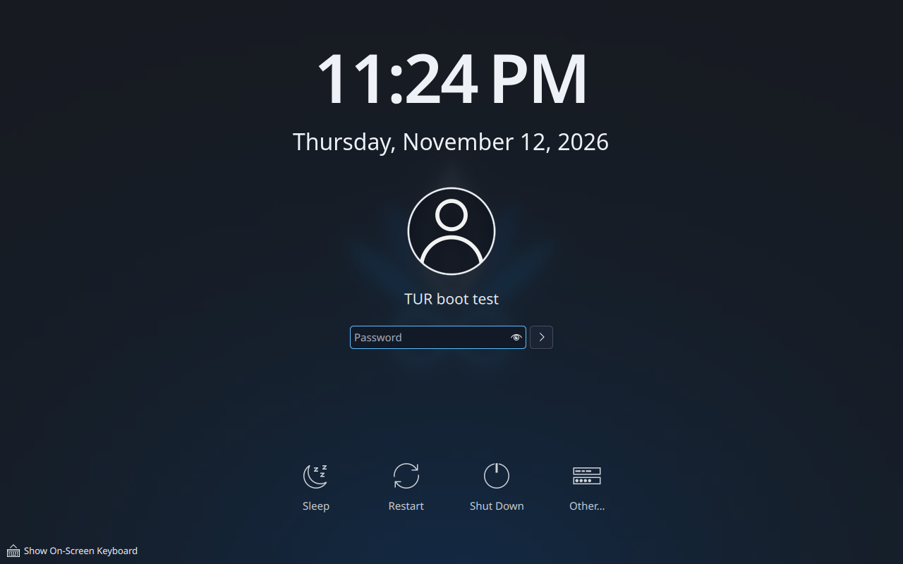
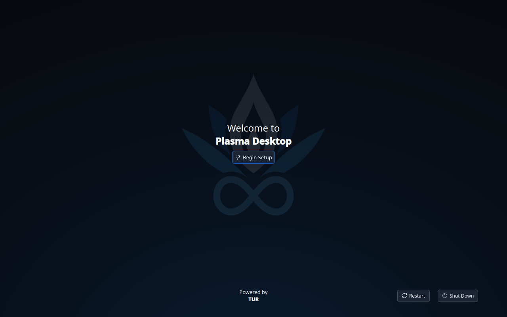
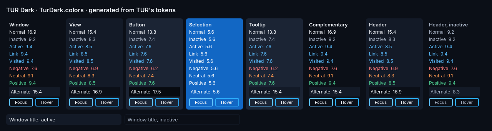
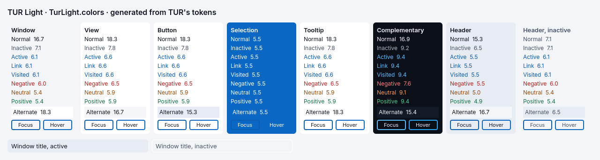

<!-- SPDX-License-Identifier: LicenseRef-TUR-Noncommercial-1.0.0 -->
# desktop-5 — TUR's theme and the defaults of a new account (D-04)

```text
TUR DEVELOPMENT REPORT

Task ID:          desktop-5 (task D-04 of the desktop design,
                  docs/architecture/desktop-experience.md, section 15.5)
Subsystem:        Desktop data (desktop/data), image (one COPY in
                  image/Containerfile), boot test (tests/boot), desktop CI
Build ID:         20261112.gca254afb6c37 (pull request 80 at 30ddb59 as
                  GitHub merges it for testing, built by CI)
Source revision:  30ddb59 (feat/tur-theme, pull request 80). The commit
                  after it adds the two reference pictures, this report and
                  its pictures; the workflows ran again on it (see "CI runs")

SUMMARY
- What changed: TUR's colours reach KDE. Two colour schemes, TurDark and
  TurLight, are generated from the design tokens; two global themes, TUR
  Dark (the default) and TUR Light, are data only. A new account signs in
  to TUR Dark, TUR's wallpaper, one floating panel at the bottom with
  TUR's mark on the launcher and Files, Firefox and Settings pinned, the
  tray and the clock; no KDE welcome window and no Plasma splash. The
  login screen takes TUR Dark too. Double click opens files.
- Why: desktop-experience.md, sections 5, 6.3, 6.4, 7.1 to 7.6 and 17.1
  (dark by default with a light option; blue from the lotus is the
  system; gold is P@x's); TUR-008's follow-ups in issue #77.
- What it does not do: it installs no font (Inter is not in the image),
  no light wallpaper picture, and cannot point plasma-setup's light/dark
  switch at TUR's themes (compiled in; section "plasma-setup").

FILES
- Added: desktop/data/gen_theme.py, schemes.json, MANIFEST.tsv,
  rootfs/ (12 files and 4 links), tests/render_schemes.qml;
  desktop/tests/screenshots/colour-scheme-{dark,light}-ltr-1x.png;
  tests/boot/desktop_checks.py;
  tests/boot/guest/rootfs/usr/libexec/tur-boot-test/desktop-check,
  tests/boot/guest/rootfs/usr/lib/systemd/system/tur-desktop-check.service;
  docs/architecture/tur-theme.md; this report and
  docs/reports/assets/desktop-5/ (5 pictures)
- Modified: image/Containerfile (one delimited block, one COPY),
  image/Containerfile.containerignore (one included path),
  desktop/data/README.md, desktop/README.md, desktop/ci/screenshots.sh,
  .github/workflows/desktop.yml, tests/boot/splash.py,
  tests/boot/guest/Containerfile
- Removed: none. Not touched: desktop-experience.md, image/rootfs (the
  provisional org.tur.dark there is overwritten in the build), boot.yml,
  image.yml, services/, tests/pax, tests/image

BUILD
- Command: scripts/build-image.sh (CI: image, boot, rollback, iso)
- Result: success; image workflow run 43325798544 (two builds, one image)
- Warnings: none new

TESTS
- Unit tests: desktop/data/gen_theme.py --check and --self-test (11
  planted faults, each caught): pass, desktop run 43325798614, boundary
  job. Desktop build and tests: 34 of 34 test programs, 821 test
  functions passed, 1 skipped (unchanged code).
- Screenshots: 203 of 205 pictures match; the 2 new ones are the colour
  schemes, looked at and committed as references (the next run must match).
- Image tests: pass (run 43325798544), the Fedora-marks check included.
- Boot tests: PASS (run 43325798730): 114 checks, the two informational
  failures that main has; and the new desktop check of the extra boot:
  17 checks, all 14 required ones pass (table below).
- Fault-injection and recovery: rollback run 43325798563, all scenarios
  pass.
- Installer medium: iso run 43325798557, pass.
- Hardware tests: NOT RUN. Performance tests: NOT RUN.

DIAGNOSTICS
- Artifacts: tur-boot-test (desktop/desktop-checks.md and .json, the
  guest's facts under desktop/tur-desktop-check/, screenshot-desktop.png,
  screenshot-desktop-light.png); desktop-screenshots (actual/, proposed/).
- Relevant error IDs: none.

RECOVERY
- Rollback procedure: revert the pull request. The change adds files
  under /usr/share and /etc (xdg links, skel); nothing in boot. On an
  installed system an update that removes them leaves accounts' own
  settings alone; accounts made while it was installed keep their panel.

KNOWN LIMITATIONS
- Plasma's splash is locked off: it cannot be chosen in System Settings.
- TUR Light shows the dark wallpaper; no fonts set; three pinned
  applications, not four; plasma-setup's switch is inert.

NEXT SAFE ACTION
- Owner: look at the pictures below; decide the reversible decisions.
- Image owner: fonts, a light wallpaper, the trigger paths (follow-ups).
```

## What a new account gets

Pictures from the extra boot of the boot test (`tests/boot/splash.py`, run
43325798730), 1280 x 800, software rendering. Looked at, one by one.

| | |
|---|---|
|  | **TUR Dark**, 200 s after the start: TUR's wallpaper; the panel floating at the bottom, the launcher with TUR's mark, Files, Firefox and Settings pinned, the tray and the clock. No window: KDE's welcome window did not open |
|  | **TUR Light**, applied by `plasma-apply-lookandfeel --apply org.tur.light` as System Settings applies it: the panel and everything KDE draws in TUR Light; the mark on its dark tile now stands out; the wallpaper stays dark (no light picture yet) |
|  | 13.7 s: the sign-in goes from the boot splash straight to the desktop, without Plasma's splash (compare TUR-008's "Plasma 30th Anniversary Edition by KDE") |
|  | The login screen in TUR Dark: the password field is dark (in TUR-008 it was Breeze Light's white). It reads `/etc/xdg` only |
|  | plasma-setup's first screen, unchanged in look (TUR Dark from TUR-008 onwards); its words are KDE's |

The colour schemes themselves, as the `screenshots` job draws them from the
generated values (`desktop/tests/screenshots/`):




Each column is one colour set of KDE's format; each text role is written in
its own colour with its contrast ratio against the set's background. In
TUR Light the Hover frame on Selection is invisible (blue on the same blue)
and the Focus frame faint: a focus or hover frame is drawn around a
selected row, on the surface beside it, not on the selection, so the check
does not ask for contrast there.

## The desktop check (boot run 43325798730)

| Check | Required | Result | Detail |
|---|---|---|---|
| the account had a Plasma session | yes | pass | plasmashell at uptime 8 s |
| the image has desktop/data's files as MANIFEST.tsv lists them | yes | pass | 16 files and links match |
| a new account gets the global theme TUR Dark | yes | pass | `kdedefaults/package`: org.tur.dark |
| its colours are TUR Dark's | yes | pass | ColorScheme TurDark, window background 11,15,23 as in TurDark.colors |
| Breeze icons, cursor and window frame | yes | pass | breeze-dark, breeze_cursors, org.kde.breeze |
| files open with a double click | yes | pass | SingleClick false |
| the panel as designed | yes | pass | plasmashell's own description: one panel, bottom, floating; kickoff (icon `tur-logo-icon`), icontasks (Files, Firefox, Settings), marginsseparator, systemtray, digitalclock |
| the desktop shows the global theme's wallpaper (no picture of its own) | yes | pass | org.kde.image, no `Image` |
| TUR's wallpaper is on the screen | yes | pass | five patches of the picture against `branding/wallpaper`: largest difference 0.6 of 255 |
| KDE's welcome window did not open | yes | pass | no process; the daemon ran and wrote LastSeenVersion 6.8.2 |
| Plasma's sign-in splash did not run | yes | pass | Engine none; nothing of plasma-ksplash.service or ksplashqml in the account's journal |
| the system offers TUR Dark and TUR Light | yes | pass | `plasma-apply-lookandfeel --list` |
| TUR Light applies to the account | yes | pass | exit 0; TurLight; window background 243,245,249; Breeze icons |
| the panel is dark in TUR Dark and light in TUR Light (pictures) | yes | pass | panel strip mean (11, 19, 29) then (208, 214, 221) |
| the login screen took TUR Dark | no | pass | `/var/lib/plasmalogin/.config/kdedefaults/package`: org.tur.dark |
| the launcher's favourites are Files, Firefox, Settings | no | pass | the launcher's stored order |
| plasma-setup's light/dark switch names TUR's themes | no | **fail** (expected) | its library holds `org.fedoraproject.fedora.desktop` and `org.fedoraproject.fedoradark.desktop` |

## What the first run found, and what changed

The first run of the boot test (43320682140, commit 6794721) passed every
desktop check but one: **Plasma's splash still ran** for the new account,
from 8.3 to 13.0 s. The account's `kdedefaults/ksplashrc` said
`Engine=KSplashQML`, `Theme=org.tur.dark`. A global theme writes that at
every sign-in, even one without a splash of its own (a Plasma global theme
falls back to Breeze's, so Plasma counts every theme as having a splash),
and the account's defaults come before `/etc/xdg`. The design (6.4) and
TUR-008 assumed a setting in the global theme would turn the splash off;
Plasma 6.8 has no such setting ("TODO: a way to set none as splash in the
l&f" in its source). The system's `ksplashrc` is now locked (`[$i]`), and
the second run shows no splash. The same run's check of the splash had
looked at the wrong evidence (the unit's start time, which read 0); it now
reads the account's journal, and re-judging the first run's facts with it
finds the splash.

The first run also found that plasma-setup's theme names are stored in
UTF-16, so the guest's search found none; it now searches both encodings.
The desktop workflow failed once on the new picture's QML (a property
named `data`, which every Qt Quick item already has).

## Licence placement

- Everything installed is data (side B): INI files, JSON metadata, links,
  the generated colour schemes. Under the project's licence, SPDX line in
  every file whose format has comments; in the global themes'
  `metadata.json` as the string `X-TUR-Licence` and in `License`.
- The global themes live in Plasma's package directory but hold no QML and
  no script: Plasma reads them, it does not run them. `gen_theme.py` fails
  on a `contents/splash` or `contents/layouts` in them. No side C code, no
  ADR needed; `desktop/upstream-licensed/` stays empty.
- The panel is data in `/etc/skel`, not the layout script the design held
  in reserve. Nothing of KDE's was copied: KDE's files were read for their
  key names; values are TUR's.
- The test-only guest check (`desktop-check`) asks plasmashell for its own
  description of the layout over D-Bus (`dumpCurrentLayoutJS`); it sends no
  script into Plasma.

## Decisions the owner may want to reverse

1. **The splash is locked off**: it cannot be chosen in System Settings.
   The alternative (a per-account `ksplashrc` in `/etc/skel`) is undone
   the first time a person applies any global theme.
2. **No TUR icon theme**: Breeze stays; TUR's mark is set as the launcher's
   icon in the new account's panel. An account that re-adds the launcher
   gets KDE's icon.
3. **System defaults as links in `/etc/xdg`** to files under
   `/usr/share/tur/xdg`: `/etc/xdg` is the only directory the login screen
   reads.
4. **Header colours**: a step from the window (`surface.raised` dark,
   `surface.sunken` light); KDE's frame shading lowered to 4.
5. **Three pinned applications** (Files, Firefox, Settings) until the
   application centre is in the image.
6. **The login screen now looks like TUR Dark** (it was Breeze Light's
   controls on TUR's wallpaper).
7. **Visited links are the same blue as links**: TUR has no second link
   colour, and adding one would be a new token.

## Limits

- TUR Light on the dark wallpaper; no fonts; plasma-setup's switch inert
  and starting on "light" (read in its source, not operated in a test).
- Only a new account was tested. An account made before this change keeps
  its own settings and gets the new defaults only where it has none of its
  own (the login screen and the splash change for everyone).
- One screen size (1280 x 800), software rendering, scale 1. No HiDPI, no
  real hardware.
- The panel's height (44 px) and the colours of KDE's own applications
  were not compared with anything; the pictures show the panel and the
  wallpaper, not an open KDE application.

## Follow-ups (for desktop-experience.md and issue #77)

Proposed for `desktop-experience.md` (not edited here):

- 3.2, "Default colours … splash": a global theme cannot turn the splash
  off in Plasma 6.8; the setting is the system's `ksplashrc`, locked.
- 3.2, "Light by day, dark by night": the keys are `[KDE]
  DefaultLightLookAndFeel`, `DefaultDarkLookAndFeel`, `AutomaticLookAndFeel`
  in `kdeglobals` (verified).
- 6.4: "Plasma's splash screen is turned off (a setting in the global
  theme's defaults)" becomes "(the system's `ksplashrc`, locked)".
- 7.1: the launcher's icon is set in the panel file (`icon=tur-logo-icon`),
  not through an icon theme; pinned: Files, Firefox, Settings, the
  application centre when it is in the image.
- 7.6: the defaults live under `/usr/share/tur/xdg`, linked from `/etc/xdg`
  (decided by D-04: the login screen reads `/etc/xdg` only); no icon theme
  `tur`/`tur-dark`.
- 15.5, D-04: done, with the departures above. Issue #77, D-04 line: the
  themes, the launcher icon, the welcome window and the splash are done;
  plasma-setup's switch is not (D-06).

Engineering follow-ups: fonts in the image; a light wallpaper picture
(`branding.sh` step 6 and `render.py`); `desktop/data/**` in the trigger
paths of the `boot` and `image` workflows; the image smoke test to check
`/etc/xdg/kdeglobals`; previews for the two global themes; delete the
provisional `image/rootfs/.../org.tur.dark`; plasma-setup's switch (D-06 or
a downstream patch).

## Findings

1. **TUR-008's "no splash" setting was never read** (see above); the splash
   ran on every sign-in until now.
2. **Plasma 6.8 looks for the font keys in the wrong groups** when it
   decides whether a global theme sets fonts
   (`KLookAndFeelManager::packageContents`: `font` etc. under `[WM]`,
   `activeFont` under `[General]`, the reverse of where it then reads them).
   A theme that sets fonts must take that into account; an upstream bug
   report is due.
3. **The login screen ignored TUR's theme before this change**: it reads
   `/etc/xdg` only, and TUR-008 set the default theme in Fedora's
   `kde-settings` directory, which only Plasma sessions read.

## CI runs

| Run | Commit | Workflow | Result | What it showed |
|---|---|---|---|---|
| 43320682145 | 6794721 | image | success | Image built with the COPY; marks check clean |
| 43320682164 | 6794721 | desktop | failure | Boundary and theme checks pass; the scheme picture's QML did not compile (`data`) |
| 43320682140 | 6794721 | boot | failure | Boot test PASS; desktop check: 13 of 14 required pass; Plasma's splash ran |
| 43325798544 | 30ddb59 | image | success | |
| 43325798614 | 30ddb59 | desktop | failure | Everything passes; the two new pictures have no reference yet (expected) |
| 43325798730 | 30ddb59 | boot | success | Boot test PASS; desktop check all required pass |
| 43325798563 | 30ddb59 | rollback | success | |
| 43325798557 | 30ddb59 | iso | success | |
| 43325798589 | 30ddb59 | rust | success | (starts on docs/architecture) |

The runs on the final commit are listed in the pull request.
