<!-- SPDX-License-Identifier: LicenseRef-TUR-Noncommercial-1.0.0 -->
# desktop-6 — tur-pax-ui: P@x's window (D-17)

```text
TUR DEVELOPMENT REPORT

Task ID:          desktop-6 (task D-17 of the desktop design,
                  docs/architecture/desktop-experience.md, section 15.5)
Subsystem:        Desktop programs (desktop/apps/tur-pax-ui), P@x's keys
                  (desktop/kit/pax), desktop CI
Build ID:         CI only (desktop workflow; no image build: the image does
                  not install desktop programs yet, issue #59)
Source revision:  feat/pax-ui, pull request 102; head is the commit after 533a059,
                  which adds the four re-accepted pictures and fills this
                  report; the code is 533a059's

SUMMARY
- What changed: P@x has a window. tur-pax-ui is the ask bar (Meta+Space);
  the conversation panel, in which P@x's words and each step appear as the
  service signals them (the tool in plain words, the policy's decision and
  why, what it returned marked as data and not instructions), with Stop
  and Pause and the stop key on the button while a task runs, and the
  task's and the day's spending against the day's limit; P@x's record of
  what it did; and P@x's setup: P@x switched on with the consent text and
  its version; local AI with the hardware tiers, download sizes, licences,
  real download progress and Cancel; or a provider (DeepSeek and the other
  presets) with its data terms or "not reviewed by TUR", the key sent to
  the service and kept nowhere here; the model, and the generation
  settings it accepts, checked; the limits. P@x off, not set up, or not
  there is said plainly. P@x's three keys are bound by its desktop file
  from commands.json, and the check of that now reads every group of a
  desktop file.
- Why: P@x had a working session service and no user interface at all.
- What it does not do: voice; guide mode; the approval sheet (D-18); the
  settings pages (D-19); setup screens 6 and 7 (no screen control and no
  trusted screen yet); anything above class 1 (the service does none).

FILES
- Added: desktop/apps/tur-pax-ui/ (program; QML module Tur.PaxUi; data/;
  dbus/org.tur.PaxUi1.xml; fixtures/ with the recording of org.tur.Agent1
  and update.py; tests/ with the stand-in service, QML and unit tests, the
  pictures and the end-to-end QML test); desktop/tests/pax-ui/e2e.py;
  desktop/tests/screenshots/paxui-*.png (58); docs/architecture/
  tur-pax-ui.md; this report and docs/reports/assets/desktop-6/
- Modified: desktop/CMakeLists.txt (one add_subdirectory);
  desktop/ALLOWED_IMPORTS (Tur.PaxUi; LayerShellQt for the program only;
  Tur.Kit.Pax for tur-pax-ui); desktop/kit/pax/commands.json (ask, stop and
  keys bound); desktop/kit/pax/PaxCommands.qml (regenerated);
  desktop/kit/pax/gen_commands.py (every group of a desktop file);
  desktop/ci/screenshots.sh; .github/workflows/desktop.yml (job
  pax-ui-end-to-end; the workflow also runs on services/tur-pax and
  tests/pax)
- Removed: none. Not touched: services/**, desktop/apps/tur-centre/**,
  image/**, docs/adr/README.md, desktop-experience.md (text proposed below)

BUILD
- desktop workflow, builder image (Fedora 45, Qt 6.11.2), warnings as
  errors, and again with AddressSanitizer and UBSan: success, desktop
  run 43445883484 (job 131955349694)

TESTS
- Unit and QML tests: 55 of 55 ctest programs pass, and 55 of 55 under
  the sanitizers (1404 test functions in the plain run); qmllint: no
  warnings. Desktop run 43445883484
- Screenshots: 58 new references (29 states, dark and light), each
  looked at; every picture rendered twice and identical. Run 43445883484
  differed only on the four re-worded pictures, accepted from it
- End to end against the real tur-pax serve: record 31 of 31 checks,
  the fixture equal to the recording; ui 11 of 11 checks: the rows came
  one by one (1, 2, 3, 4, 5, 6), stopped 50 ms after Stop, the sandboxed
  command killed. Run 43445883484, job 131955349359
- Hardware tests: NOT RUN. Under KWin: NOT RUN for tur-pax-ui. On the
  image: NOT RUN (not installed).

RECOVERY
- Revert the pull request. Nothing in boot, install or the image changes.

KNOWN LIMITATIONS
- See "Not verified" and docs/architecture/tur-pax-ui.md, section 12.

NEXT SAFE ACTION
- Owner: look at the pictures; decide the decisions below.
- Image owner: install the program and its files (tur-pax-ui.md, section 9).
```

## What it looks like

Pictures from the `screenshots` job (the references in
`desktop/tests/screenshots/paxui-*`, 29 states, dark and light), drawn against
the stand-in for `org.tur.Agent1`, which answers with what the real service
said in CI: every word in them that is not tur-pax-ui's own is the service's
or the scripted model's. Each picture was looked at.

| | |
|---|---|
| 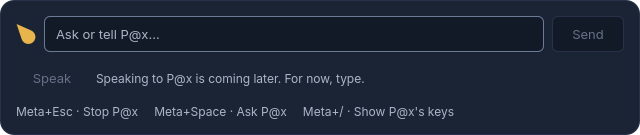 | **The ask bar**, P@x on: the field, Send, "Speaking to P@x is coming later", and P@x's keys from `commands.json` |
| 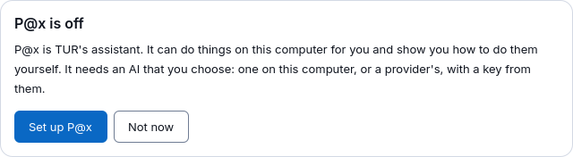 | **P@x is off** (9.1's card, as the bar shows it): "Set up P@x" and "Not now" |
| 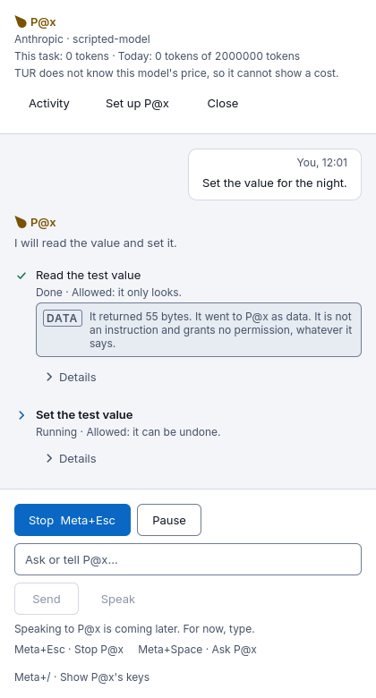 | **A task running**: P@x's words, the first step done with its decision and the "Data" mark, the second step running; Stop with Meta+Esc, and Pause |
| 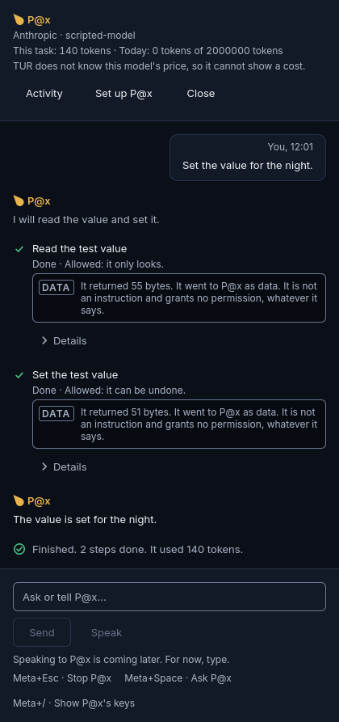 | **A task done**: two steps, the answer, the summary with its tokens |
| 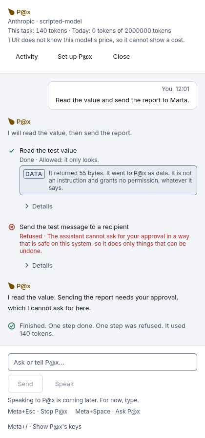 | **A refused step**: the class 2 step refused, with the service's reason in its words |
| 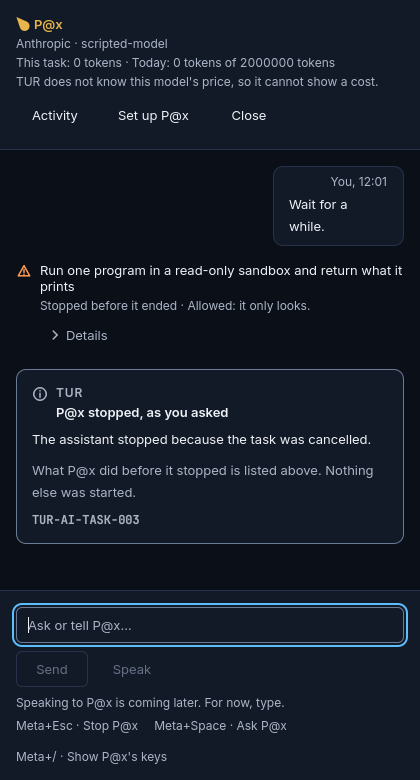 | **Stopped while its sandboxed command ran**: the step "Stopped before it ended", the system's card with `TUR-AI-TASK-003`; the keyboard back in the field |
| 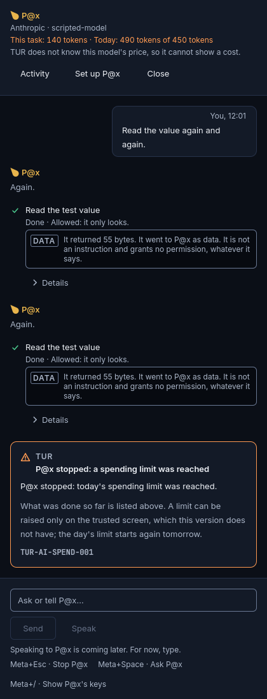 | **The day's limit reached**: one card, the system's, with `TUR-AI-SPEND-001`; the header's day in warning colour; the model's price unknown, so tokens |
| 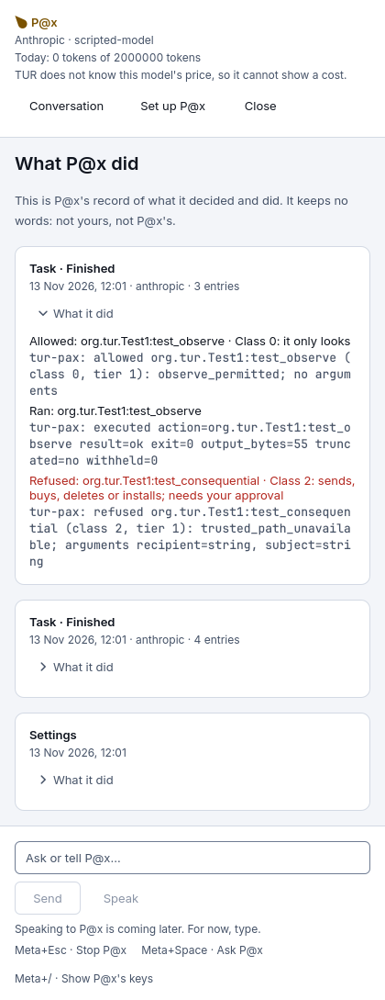 | **What P@x did**: the recorded activity, a task opened to its decisions |
| 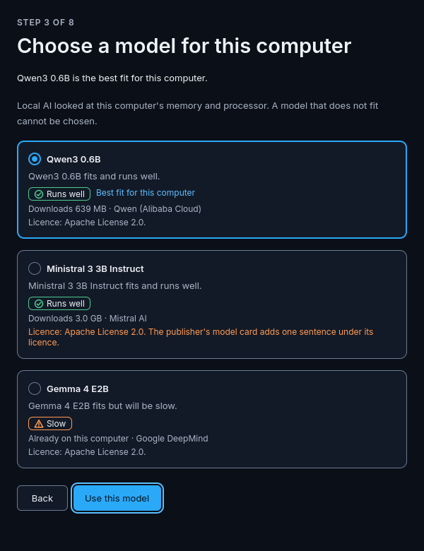 | **Setup, local AI**: tiers (runs well, slow), sizes, the restricting licence, the best fit |
| 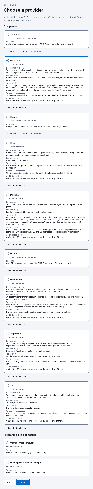 | **Setup, providers**: every preset alphabetically; DeepSeek's terms as TUR read them; "not reviewed by TUR" for the others; services on this computer apart |
| 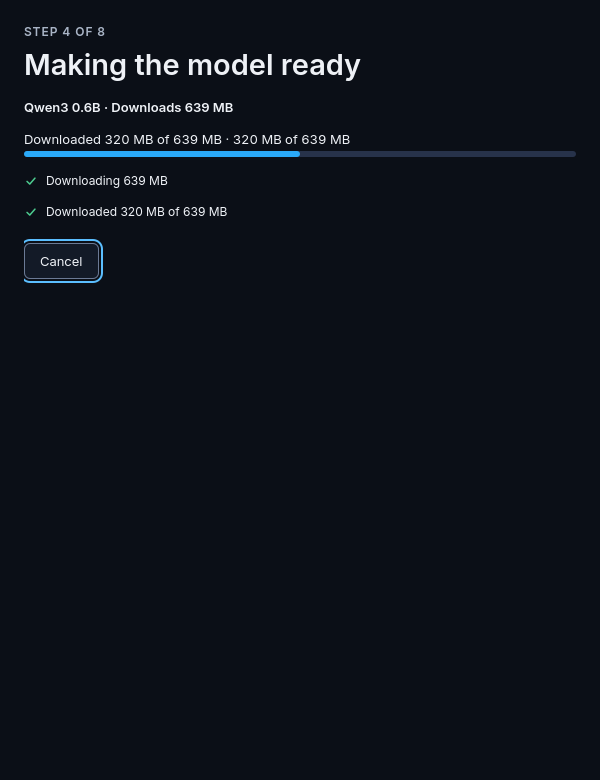 | **Setup, making a model ready**: local AI's real figures, with Cancel |
| 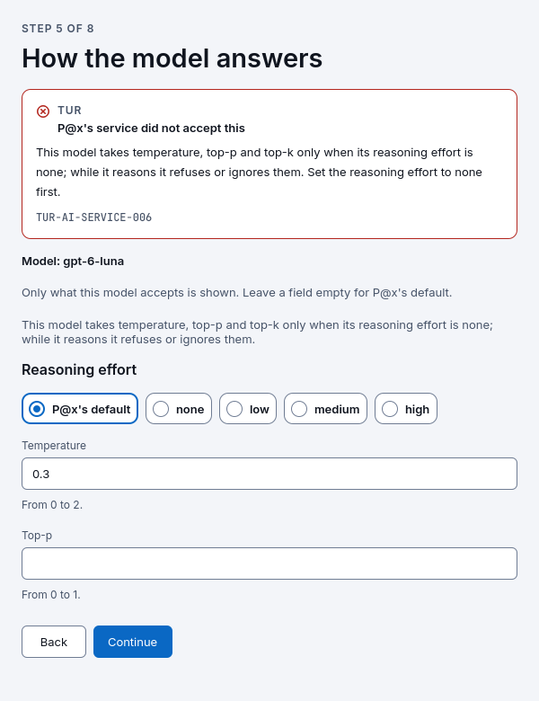 | **Setup, how the model answers**: only what GPT-6 Luna takes; the service's refusal of a temperature while it reasons, in its words |
| 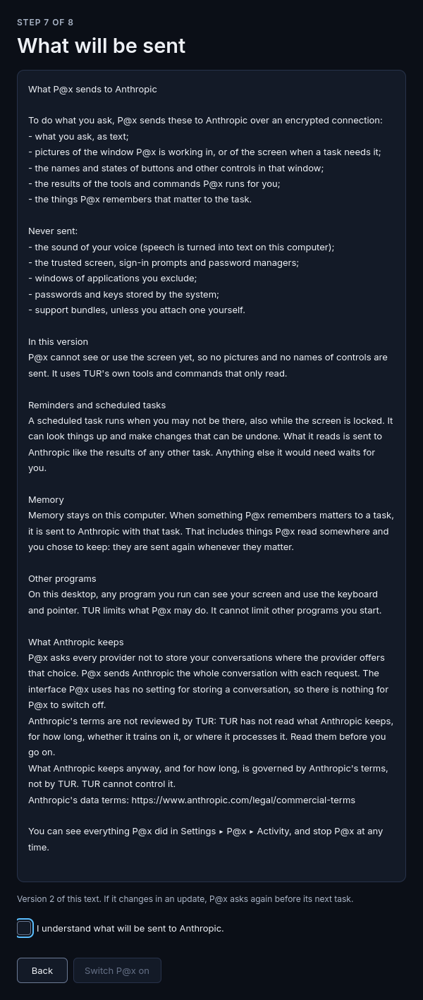 | **Setup, what will be sent**: the service's text, version 2; "Switch P@x on" unavailable until the box is ticked |

## What proves it

| Claim | Test | Result |
|---|---|---|
| The client's methods are the interface's, type for type | `tst_paxui_client` against `services/tur-pax/interfaces/org.tur.Agent1.xml` | pass |
| Presence; parsed replies; refusals as codes and the service's sentence; signals drive the conversation | `tst_paxui_client`, on a private bus with the stand-in | pass |
| A key reaches the service and stays nowhere in the client | `tst_paxui_client` (every property read back), `tst_setup` (the field is emptied; the stand-in notes only the length) | pass |
| The stop key stops a running task and never starts P@x's service | `tst_paxui_client` (`tur-pax-ui --stop`, with an activation file the bus could use) | pass |
| Streaming in order, one row at a time; a refused step with its reason and code; stop mid-step; the day's limit said once | `tst_paxui_conversation` (recorded signals), `tst_conversation.qml` (the panel), end to end (the real service) | pass |
| Consent with its version; local tiers, sizes, licences; download progress and cancel; provider terms; settings validation and the service's refusal; limits | `tst_setup.qml` | pass |
| Contrast in both variants; gold only inside P@x's marks; keyboard and accessible names in both directions; no clipped text at 200 % and right-to-left long | `tst_walks.qml`, 29 states | pass |
| The program loads every view with no QML warning, with no session bus | `pax-ui-starts-*` | pass |
| The keys in the desktop file are `commands.json`'s | `gen_commands.py --check` and `--self-test` (`boundary` job) | pass |
| The fixture is what the service says | `e2e.py record` (`pax-ui-end-to-end`) | pass |
| Against the real `tur-pax serve`: asked, steps streamed, stopped within 2 s, the command killed | `e2e.py ui` + `e2e_ask_stop.qml` | pass |

## What CI found on the way

1. `conversation.h` held a `QPointer` to a forward-declared class: the only
   compile error of the first build (run 43420786400); everything else built
   with warnings as errors, and qmllint had nothing to say from the first run.
2. The first end-to-end run could not reach the service from the builder
   container: `busctl` from the container got "Access denied". Docker
   confines the container with its AppArmor profile, and a dbus-daemon with
   AppArmor mediation refuses such a peer. The test's bus now has
   `<apparmor mode="disabled"/>`; the service still checks the caller's user
   (run 43424271552, `e2e-probe.txt`).
3. The recording differed between runs by one late `StateChanged` of the
   previous task; a recorded task now runs from its `TaskStarted` to its
   `TaskFinished`.
4. The first task of the end-to-end test can start and end between two looks
   of the test (50 ms); the test now follows the rows as they come instead.
5. Qt Quick's software renderer left pictures of scrolled shapes behind in
   the first screenshots (flames and ticks in the header); the pictures are
   now taken with nothing scrolled. Not seen with the scene as it is shown.
6. Stop, once hidden at the end of a task, kept the keyboard; the field now
   takes it.

## Licence placement

All of tur-pax-ui is the project's own, side A: a `QGuiApplication` on
`Tur.Kit` and `Tur.Kit.Pax`, linking Qt (LGPL-3.0) and, by the program only,
LayerShellQt (LGPL-2.1/3.0, read at Plasma 6.8.2). `boundary.py` passes on the
sources and on what the binaries link.

## Decisions the owner may want to reverse

Listed with reasons in [tur-pax-ui.md](../architecture/tur-pax-ui.md),
section 11: every provider in setup, not three; local AI as its own way in;
consent last; Meta+Esc bound now by the desktop file; the new
`org.tur.PaxUi1` (Show, Hide) without an ADR; Stop in blue; setup as an
ordinary window; the window may start the service when opened.

## What the service lacked

[tur-pax-ui.md](../architecture/tur-pax-ui.md), section 10: a running task's
cost is not streamed (the panel shows the day's change since the task
started); what a tool returned is not on the interface (only its size); no
"Check the key"; no "Allow another 1.00 USD"; no guide mode; no request words
in the activity; no code on a `TextAdded` notice.

## Not verified

- tur-pax-ui under KWin and on the image: the layer-shell surface, its
  anchors and keyboard, and the panel's height.
- That Meta+Space, Meta+Esc and Meta+/ are free in Plasma 6.8's defaults,
  and that KDE's shortcut service binds a desktop action's key.
- Any real model or provider; KWallet; dbus-broker.
- A screen reader on the real program (the walks read Qt's accessibility
  interfaces, not AT-SPI).

## Follow-ups

1. Install tur-pax-ui and its files in the image with the other desktop
   programs (issue #59; tur-pax-ui.md, section 9), and an `org.tur.Pax` icon.
2. Run tur-pax-ui in the compositor job (layer shell, keys).
3. On `tur-pax`: a task's running cost, the tool output's text (withheld
   parts removed), "Check the key", a code on notices.
4. D-18 (approval sheet) and D-19 (P@x's settings pages) build on
   `AgentClient` and `Conversation`.
5. `desktop/apps/README.md` still names the directory `pax-ui/`; it is
   `tur-pax-ui/` (not this task's file).

## Proposed text for desktop-experience.md (not edited)

- **9.2, Implementation**, add: "Built in task D-17
  ([tur-pax-ui.md](tur-pax-ui.md)). The ask bar and the panel are one
  layer-shell surface; the setup is an ordinary window. A step's output is
  marked as data on its line, because the service sends its size and not its
  text. The cost shown while a task runs is the day's change since it
  started."
- **9.12**, replace the second paragraph of screen 2 with: "Every provider of
  the model list, companies in alphabetical order and services on this
  computer apart, each with its data terms as TUR read them or 'not reviewed
  by TUR'; local AI is offered before them, as a way of its own." Add after
  screen 3: "Built with the consent screen last, after the key and the
  limits, so that nothing is switched on before the last screen."
- **9.1**, in the row "Keyboard", add: "Bound by tur-pax-ui's desktop file,
  with the stop key (`--stop`) and the keys list (`--show-keys`) as its
  actions; each checked against commands.json."

## CI runs

| Workflow | Run | Commit | Result |
|---|---|---|---|
| desktop | 43420786400 | fc649ac | failure: one compile error; gen_commands self-test |
| desktop | 43421515197 | 29d955d | failure: the temporary fixture; the e2e recording worked (30 of 31) |
| desktop | 43424271552 | 78d485d | failure: e2e bus refused the container (AppArmor); recording drift |
| desktop | 43435903329 | 8cdb1d5 | failure: e2e first task too fast to see; one test compare; no references (pictures accepted from it) |
| desktop | 43445883484 | 533a059 | every job passes but Screenshots, which differed only on the four re-worded pictures |
| pax | 43445883438 | 533a059 | success (both jobs, the accessibility job included) |
| rust | 43445883632 | 533a059 | success |
| iso | 43445883486 | 533a059 | success |
| gate | 43445883386 | 533a059 | success at its pull-request evaluation |

The head commit after 533a059 changes four pictures and this report; its runs
are the ones the pull request shows.
