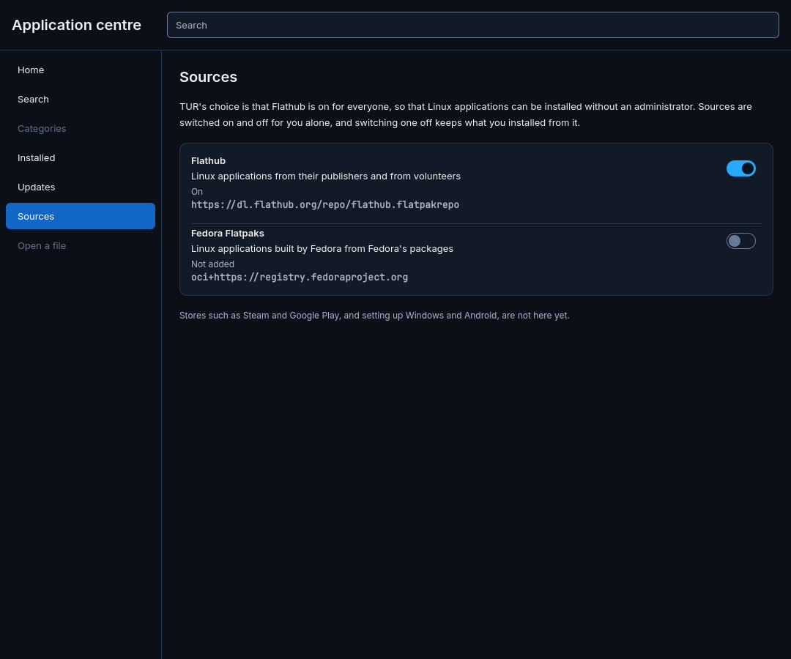
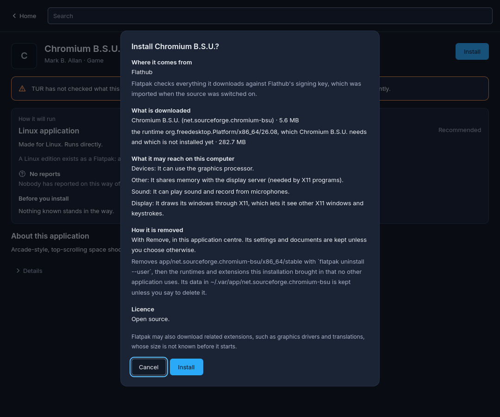
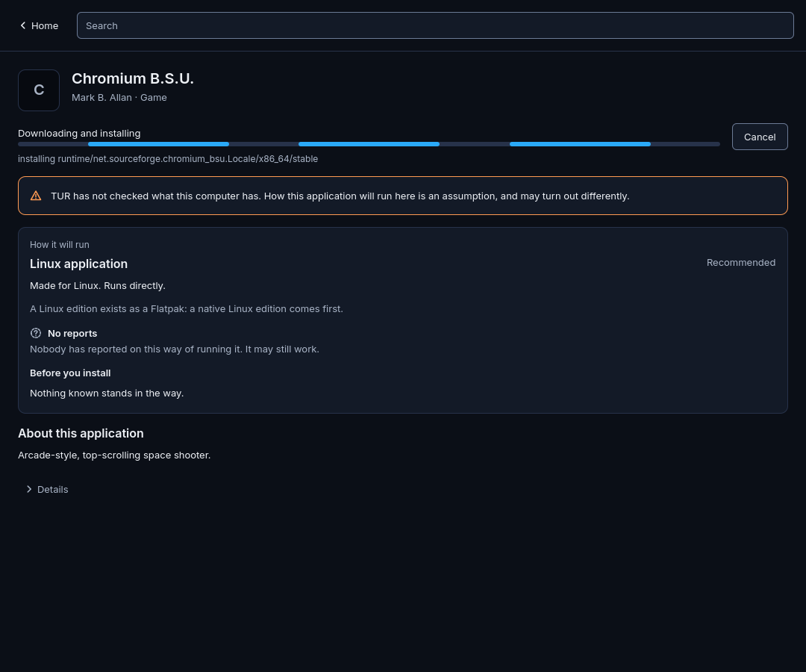
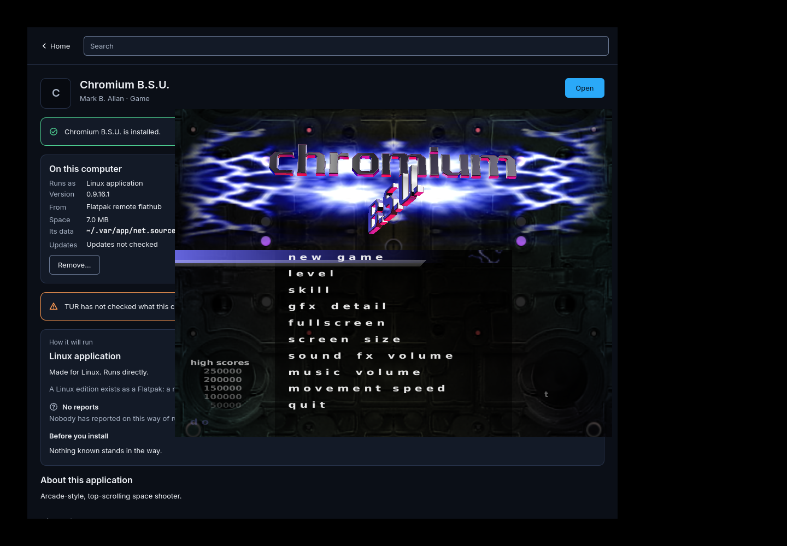
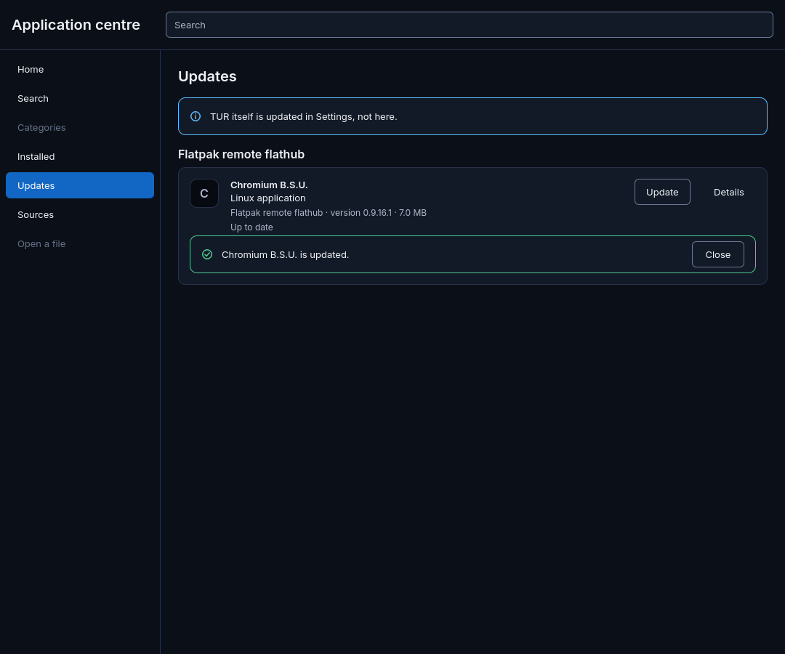
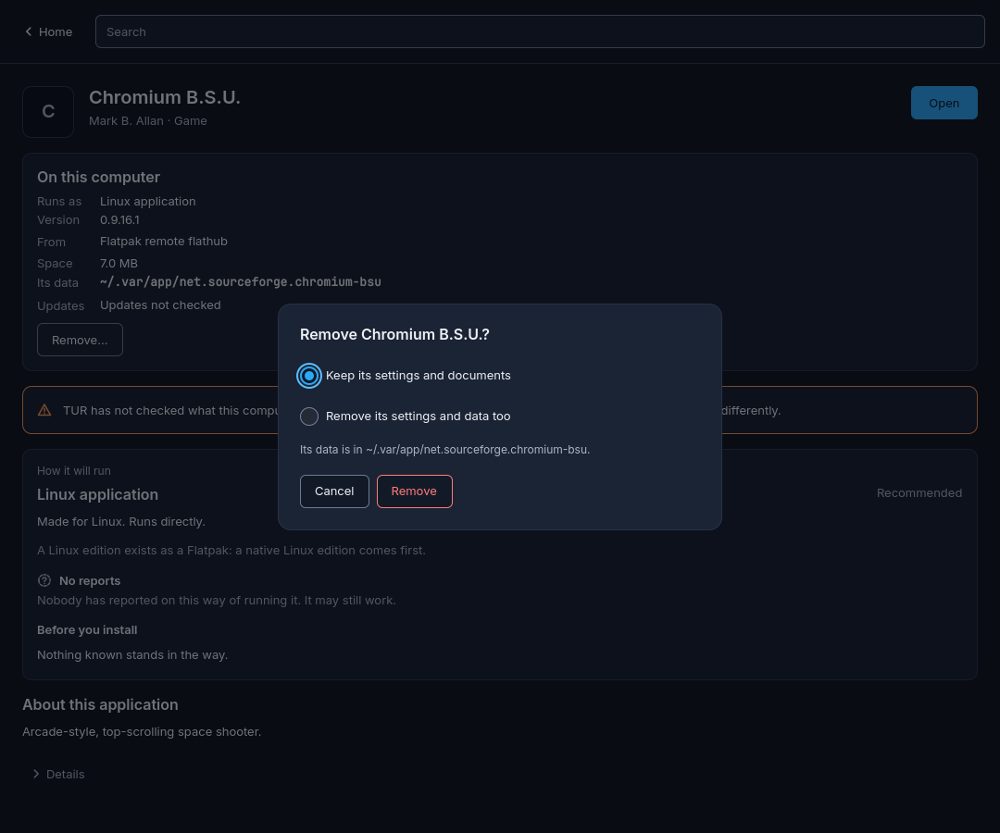
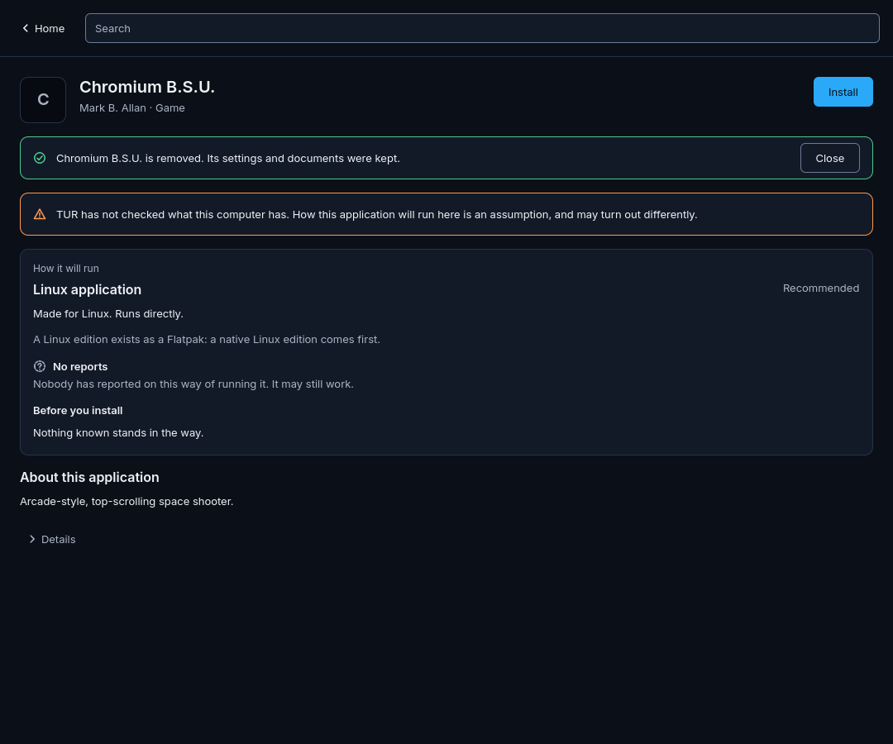
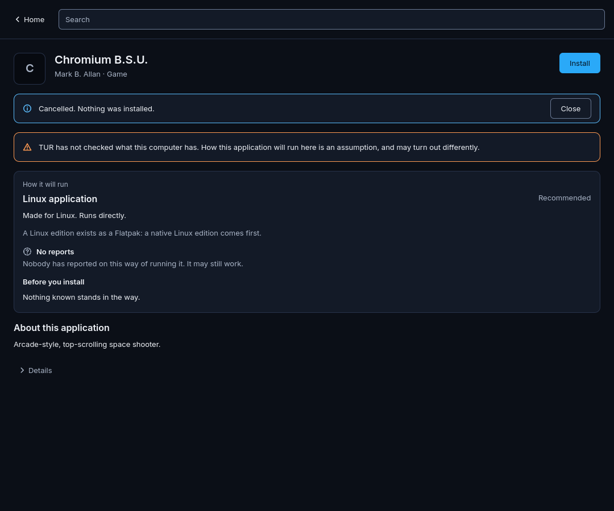

<!-- SPDX-License-Identifier: LicenseRef-TUR-Noncommercial-1.0.0 -->
# desktop-7 — The application centre installs, updates and removes (D-11)

```text
TUR DEVELOPMENT REPORT

Task ID:          desktop-7 (task D-11 of the desktop design,
                  docs/architecture/desktop-experience.md, section 15.5,
                  "tur-centre 2: install")
Subsystem:        Application centre (desktop/apps/tur-centre); install
                  backend (services/tur-apps, two small changes); catalogue
                  (one entry, validate --json); desktop CI (a new job)
Build ID:         not applicable: no image is built for this change
Source revision:  the head of feat/centre-install (pull request 101). The
                  end-to-end results, recordings and pictures below come
                  from desktop run 43426720987 on def9d7c; the commits
                  after it add the references, this report, two test
                  corrections and one button's condition; the screenshots
                  and the end-to-end job passed again on 4a968b6 (desktop
                  run 43428734577), and every workflow ran again on the
                  head commit (the pull request lists those runs)

SUMMARY
- What changed: the Install button installs. It runs tur-apps' plan and
  shows it (source and how it is checked, what is downloaded and its size,
  what the application may reach, how it is removed, licence and who
  packages it); "Install" carries it out with tur-apps' events as progress,
  Cancel while it can still be taken back, the failure as a two-layer
  message with its code, and "Open" at the end. Installed, Updates (one or
  all), Remove with its one question (data kept by default) and Sources
  (Flathub and Fedora's, per person) are built; "I have the installer file"
  for Windows applications; Google Chrome offered on Home for people coming
  from Windows, installed per user from Flathub, with where it comes from
  said plainly. Home's standing sentence is conditional. The router's
  reasons, prerequisites and the caveats without parameters are written
  from their identifiers, translatable. tur-autopilot is in the vocabulary,
  with "Works with these settings".
- Why: D-11; issues #41, #67, #91, #98; desktop-experience.md 8.1 to 8.6
  and 17.1, answer 4.
- tur-apps gained cancelling (the line "cancel" on standard input of
  install --events), an update measured against what is installed (it
  recorded "not updated" after a commit moved outside tur-apps) and
  recording what an update brings in (removal left it behind), and no
  terminal control sequences in its activity lines. All found or needed
  here; each with a test.

FILES
- Added: desktop/apps/tur-centre/src/{apps,appssource,appsprocess,
  appsfixture}.{h,cpp}; qml/{RouterWords,ChoiceRow,InstallSheet,RemoveSheet,
  InstallerDialog,OperationBlock,OnThisComputer,InstalledRow,InstalledView,
  UpdatesView,SourcesView}.qml; tests/{tst_install,tst_routerwords}.qml,
  tests/unit/{tst_apps.cpp,apps-helper.sh}, tests/e2e/{RealCentre,
  e2e_install,e2e_update,e2e_remove}.qml; fixtures/apps/<8 scenarios>/
  runs.json and fixtures/apps/update.py; the catalogue fixtures of
  Chromium B.S.U., Chrome, Notepad++ and validate.json (written by CI);
  desktop/ci/centre-e2e/{run.sh,inside.sh,session.sh,watch.sh,record.py};
  catalogue/com.google.chrome.toml; services/tur-apps/src/cancel.rs;
  this report and docs/reports/assets/desktop-7/; reference pictures
- Modified: tur-centre's main.cpp, catalogue.*, cataloguesource.*,
  processsource.cpp, fixturesource.cpp, Main, Shell, HomeView,
  ApplicationView, WayBlock, CaveatRow, ResultRow, Words, CMakeLists,
  CentreHost, tst_main.cpp, tst_shell, tst_application, tst_vocabulary,
  tst_walks, shots/render_centre.qml, unit/tst_answers.cpp;
  services/tur-apps/src/{cli,download,exec,lib,main,ops}.rs,
  tests/cli.rs, tests/fakes/flatpak; services/tur-catalogue/src/main.rs,
  tests/{cli,desktop_fixtures}.rs; .github/workflows/desktop.yml (one job,
  one trigger path); docs/architecture/tur-centre.md;
  docs/architecture/catalogue-and-routing.md (two lines: validate --json,
  and the sentence about the Home view that became untrue)
- Removed: none. Not touched: desktop/kit (no change was needed),
  desktop/apps/tur-pax-ui, image/, services/tur-pax*, docs/adr/README.md,
  app-install-backend.md (see "Decisions")

BUILD
- Command: desktop/ci/build.sh ci and ci-sanitize (workflow desktop);
  cargo build/clippy/test (workflows rust, apps)
- Result: success in every run since 28a5f11 (both presets; the
  compositor job builds too); qmllint: no warnings
- Warnings: none from the compilers, clippy or qmllint (a warning fails)

TESTS
- tur-apps (rust workflow): every test passes, with two new ones
  (a_cancelled_flatpak_installation_is_stopped_and_takes_back_what_it_added;
  exec::tests::a_program_is_stopped_with_what_it_started_when_asked), an
  extended update test (measured against the installed commit; a runtime
  it brings in is removed with the application) and
  ops::tests::terminal_control_sequences_are_not_activity.
- tur-catalogue (rust workflow): validate --json (tests/cli.rs); the
  fixtures are the router's output, with validate.json and the three new
  applications.
- apps workflow (tur-apps against the real flatpak and Wine, unchanged
  scripts): pass.
- Desktop, Build, lint and test: 45 test programs. On def9d7c, 44 passed;
  centre-qml had 282 of 284 functions pass, the two failures being a test
  that pressed a button before its row was laid out and a threshold of 20
  options where the fixtures have 19. On 4a968b6 one function failed: the
  same test asserted which recorded list of sources answers after the
  switch, which is the recording's order, not the program's; the assertion
  was removed. The pull request's checks on its head commit are the final
  word.
  New: tst_centre_apps (13 functions), tst_install (10), tst_routerwords
  (5), four centre-starts tests; tst_walks over 22 states (contrast: every
  new state 0 failures in both variants; keyboard; 200 % and
  right-to-left text).
- Screenshots: 271 rendered, rendered twice and identical; 118 centre
  pictures new or changed (66 new: 11 new states x 6; 52 changed: the line
  under the button, the side list, Home), looked at and committed as
  references from run 43426720987. Every other picture matches.
- End to end (job centre-e2e, run 43426720987): 12 of 12 checks pass;
  table below.
- Boot, image, installer tests: run by CI on the pull request because the
  catalogue changed; nothing here touches the image.
- Hardware tests: NOT RUN.

DIAGNOSTICS
- Artifacts: desktop-centre-e2e (summary.md, every log, the recordings,
  the pictures of every step and of the opened game); desktop-screenshots;
  desktop-build-test (test and lint logs)
- Relevant error IDs: TUR-DESKTOP-CENTRE-008 (new: an installed
  application could not be started); TUR-DESKTOP-APPS-013 now also ends a
  cancelled installation

RECOVERY
- Rollback procedure: revert the pull request. Nothing is installed by the
  change itself; what a person installs with it is per user and removed
  with Remove, or with tur-apps remove.
- Recovery tested: a cancelled installation takes back what flatpak had
  added (stand-in and real); a failure half-way leaves nothing (stand-in);
  removal leaves no reference tur-apps installed (real, checked from
  outside the centre).

KNOWN LIMITATIONS
- Hosted Ubuntu runner, Fedora 45 container: not the TUR image, not
  Plasma, no GPU. One small Flathub game end to end; Chrome through
  tur-apps only, not through the centre's controls.
- No progress figures for a Flatpak (flatpak gives none).
- Closing the window during an installation cancels it (up to 30 s).

NEXT SAFE ACTION
- Owner: look at the pictures; decide the reversible decisions below.
- Image/first-run owner: switch Flathub on for each person.
```

## What runs where

```text
tur-centre (QML + C++, the person's session)
  ├─ Catalogue ── tur-catalogue search|show|route|validate --json      (part 1; validate new)
  └─ Apps ─────── tur-apps plan --json                                  the sheet
                  tur-apps install --yes --events   ← "cancel" on stdin progress, Cancel, the end
                  tur-apps update|remove --keep-data|--delete-data --events
                  tur-apps list [--check-updates] --json                Installed, Updates, the page
                  tur-apps sources [enable|disable] --json              Sources
                  tur-apps launch (detached)                            Open
```

Why a child process and not `org.tur.Apps1`: tur-centre.md, section 2a.

## End to end (desktop run 43426720987)

The job `centre-e2e`: the Fedora 45 builder image as a privileged
container with the network, `dnf install flatpak xorg-x11-server-Xvfb …`;
tur-apps and tur-catalogue built on the runner; the centre's QML module and
C++ driven by `tst_centre -input tests/e2e/e2e_*.qml` on Xvfb (xcb), under
a session bus of its own, as a fresh user, through the centre's own
controls (`mouseClick` on its buttons and switch). flatpak 1.18.4
(`1.19.0^really1.18.4-1.fc45`), bubblewrap 0.13.1, curl 8.21.0, Qt 6.11.2.

| Check | Result |
|---|---|
| the recordings were made, and every expectation of record.py was met (below) | pass |
| the centre: e2e_install: Sources, Flathub's switch, the page, Install, the plan, progress, Installed, Open, the Installed view | pass |
| the game's window appeared after Open (`"Chromium B.S.U.": ("chromium-bsu" "chromium-bsu") 800x600`) | pass |
| flatpak lists the application for this user | pass |
| nothing was installed system-wide | pass |
| flatpak put the earlier commit bee584343a60… in place | pass |
| the centre: e2e_update: the Updates view lists it; Update; `updated: true`; up to date after | pass |
| the centre: e2e_remove: Remove's question with "Keep" chosen; removed; Install again; Cancel once flatpak reported its first operation; "Cancelled. Nothing was installed." | pass |
| its data is still there after Remove (kept by default) | pass |
| no reference the centre installed is left after Remove and the cancel | pass |
| no deployment of the application is left | pass |
| no record of tur-apps is left | pass |

What record.py checked while recording (the same run): with Flathub not
added the plan is refused with TUR-DESKTOP-APPS-008; Flathub switched on;
the plan made; installed; the update moved the application to another
commit; removed, its data kept, nothing tur-apps installed left; cancelled
with TUR-DESKTOP-APPS-013 after flatpak's first line ("installing
runtime/net.sourceforge.chromium_bsu.Locale/x86_64/stable"), nothing
installed, flatpak lists nothing; **Google Chrome installed per user from
Flathub** (Flatpak fetched Google's package from dl.google.com; added the
app, the 25.08 runtime and its GL extensions) **and removed, nothing of it
left**; the stand-in's failure half-way reported with TUR-DESKTOP-APPS-010.

The earlier commit is put in place with `flatpak update --commit` by the
test itself; the runtime 25.08 it brought in is listed in
`logs/brought-in-by-the-downgrade.txt` and is the only thing left at the
end (`logs/left-at-the-end.txt`).

### What the runs found and what was fixed

1. **A cancel was triggered by a terminal sequence.** flatpak 1.18 writes
   `ESC[?25h` even without a terminal; tur-apps forwarded it as activity,
   the recorder cancelled on it, and the centre would have shown it.
   tur-apps now drops control sequences from activity lines.
2. **An update after a commit moved outside tur-apps said "not updated".**
   tur-apps compared the new commit with the one recorded at installation.
   It now compares with the installed commit before the update.
3. **What an update brought in was left behind by removal.** tur-apps now
   records references an update adds, so that removal takes them too
   (stand-in test).
4. **Two lists at once returned the older answer.** The centre asked
   `list` again when a view opened while the first was still running; it
   now asks once, and afresh after a change.

### Pictures of the real program

| | |
|---|---|
|  Sources after the person turned Flathub's switch on (it was "Not added" for the fresh user) |  The plan, from the real tur-apps and Flathub: 5.6 MB and the 282.7 MB runtime, what it may reach, how it is removed |
|  Progress in place of the button: flatpak's own line, Cancel offered |  "Open": the game's window over the centre, which says it is installed and what is on this computer |
|  Updates: updated from the earlier commit |  Remove asks one question, keeping chosen |
|  Removed, its settings and documents kept |  Installed again and cancelled: nothing was installed |

All in the artifact `desktop-centre-e2e` of the run, with the others
(1-sources, 3-application, 6-installed, 7-installed-view, 8-updates,
10-on-this-computer, 13-cancelling). Looked at, one by one. The cancel was
answered within the 300 ms the picture waits, so 13 and 14 are the same.

The pictures of every state rendered from the recordings, in the kit's
matrix, are `desktop/tests/screenshots/centre-*.png`: for example
`centre-install-plan-light-ltr-1x.png`, `centre-install-progress-dark-ltr-1x.png`,
`centre-install-failed-dark-ltr-1x.png`, `centre-remove-question-light-ltr-1x.png`,
`centre-sources-dark-rtl-long-1x.png` (right to left, lengthened strings),
`centre-home-dark-ltr-1x.png` (Chrome's card).

## The Chrome decision

The owner asked for Chrome for people coming from Windows
(desktop-experience.md, 17.1, answer 4): offered, not preinstalled,
"installed from Google's own source and updated by it", and the person
told plainly that it comes from Google.

| Way | What it is | Verdict |
|---|---|---|
| Flathub's `com.google.Chrome` | A Flatpak maintained by Flathub's volunteers, **not verified** by Flathub as coming from Google (`/api/v2/verification/com.google.Chrome/status`: `"verified": false`), licence `LicenseRef-proprietary`. It contains no copy of Chrome: its metadata declares *extra data*, Google's Debian package at `https://dl.google.com/linux/chrome/deb/pool/main/g/google-chrome-stable/google-chrome-stable_157.0.8103.78-1_amd64.deb` (147 497 676 bytes) with its SHA-256, which Flatpak downloads from Google and checks at installation, and again on each update | **Chosen.** Per user, no administrator, no restart; tur-apps installs it as any Flatpak (the recorder installed and removed it on the runner); the browser itself comes from Google's server; TUR bundles nothing of Google's |
| Google's RPM repository (`dl.google.com/linux/chrome/rpm/stable/x86_64`, `google-chrome-stable`) | Google's own Linux package and updates | Not chosen: on Fedora Kinoite it means `rpm-ostree install`, a layered system package for every user, administrator rights and a restart or a live apply, outside tur-apps; reports of signature trouble when layering Google's repository |
| An official Google Flatpak | Does not exist. Google merged experimental Flatpak packaging into Chromium's source in August 2026, behind a build flag that is off; Chromium's developers say it does not mean an official Flatpak is coming | When it exists and Flathub verifies it, the catalogue entry changes its `flatpak_id` and `packaging = "publisher"` |

Sources, read 13 November 2026: `https://flathub.org/apps/com.google.Chrome`
and Flathub's API (`/api/v2/appstream/com.google.Chrome`,
`/api/v2/summary/com.google.Chrome`,
`/api/v2/verification/com.google.Chrome/status`);
`https://github.com/flathub/com.google.Chrome`; Fedora Kinoite's "Getting
Started" (package layering); reports of Chromium's experimental Flatpak
packaging (It's FOSS; OMG! Ubuntu, August 2026).

What the person reads, on Home, on Chrome's page and in its plan: "Chrome
is made by Google, and Google's terms apply to it. TUR does not include it.
Flatpak downloads it from Google's own server while it installs; the
package around it is kept by Flathub's volunteers, not by Google. It is
updated the same way." Home's card: "Coming from Windows? Google Chrome can
be installed with one action. Firefox is TUR's browser; Chrome is offered,
not included." and "Install Google Chrome…", which opens Chrome's page with
its plan: one action to the plan, one to install. The first-run welcome is
not this task's (it does not exist yet).

## Decisions the owner may want to reverse

| Decision | Why | The other way |
|---|---|---|
| tur-apps as a child process, not the `org.tur.Apps1` service | Same user, per-user installs; the command line has everything; no image change (tur-centre.md, 2a) | Implement the service when P@x or notifications must watch jobs |
| Install shows the plan first, in a sheet | The task asks for it; the design's "starts at once" predates the plan | Start at once and show the plan under "Details" |
| Cancel ends with `TUR-DESKTOP-APPS-013` | A new code would need the design note's table (not this task's file) | `TUR-DESKTOP-APPS-018`, "Cancelled" |
| Cancel is offered only while tur-apps can take everything back; not while tur-runtime installs or the installation is recorded | "Cancelling is offered while it is safe" (8.5) | Let tur-runtime be stopped and roll back itself |
| Closing the window during an installation cancels it, waiting up to 30 s; an update or removal is let finish | The centre's child process ends with the window | A service that outlives the window |
| "Install" acts only for the routes tur-apps installs by; other routes say so in a line | No button that is bound to fail | Let tur-apps refuse with `TUR-DESKTOP-APPS-004` and show it |
| Chrome per user from Flathub (the package is volunteers'; the browser is Google's) | Above | Google's RPM, layered |
| Home's sentence from `tur-catalogue validate --json` (added) | `route --json` cannot say it; a catalogue-wide count is one question | A count in the router's output |
| `tur-autopilot` listed with every reporter in vocabulary.json | Issue #98; it never rates, so it is not a `rating_source_kind` | Keep `Reporter::ALL` |
| The requirement caveats stay in the router's words | One identifier has two sentences ("Its anti-cheat …", "This game's anti-cheat …") and no parameter tells them apart | A parameter for the subject, then translate them |
| Recorded runs of tur-apps from the real program on CI (one stand-in run, for a failure half-way) | "Nobody writes a fixture by hand"; Flathub does not fail on demand | Generate every scenario against the stand-ins in tur-apps' own tests |
| Flathub not switched on by the centre itself | Turning on a network source is the person's or the image's act; Sources and the plan's failure offer it | Switch it on silently at first start |

## Limits

- Hosted Ubuntu 24.04 runner, the Fedora 45 builder image as a privileged
  container with Fedora's flatpak 1.18.4 and Xvfb: not the TUR image, not a
  Plasma session, no Wayland, no GPU, no portal (flatpak-session-helper
  only). The centre ran under X11 (xcb).
- One application end to end through the centre's controls (Chromium
  B.S.U.); Chrome was installed and removed by the recorder through
  tur-apps, not through the centre's controls; Windows applications were
  planned only (no Wine in the container: TUR-DESKTOP-APPS-009).
- The update end to end needed an earlier commit put in place with flatpak
  itself; the runtime that brought in (25.08) is the test's, not the
  centre's, and is excluded from the "nothing left" check.
- The pictures of the centre are rendered offscreen from recordings; the
  end-to-end pictures are of the real program on Xvfb.
- No translation is loaded; the identifiers make it possible.

## Follow-ups

- Image or first-run setup: Flathub on for each person (issue #67).
- tur-apps: identifiers for the plan's sentences; a code of its own for a
  cancel; `launch --detach`; the size of an application's data.
- Router: a parameter that tells the requirement caveats' two forms apart;
  then the rest of `RouterWords`.
- `org.tur.Apps1` when anything but the centre must watch or cancel.
- D-12 ("Open a file"), D-25 (Windows set-up), Categories, stores.
- Run the end-to-end on the TUR image in a Plasma session.
