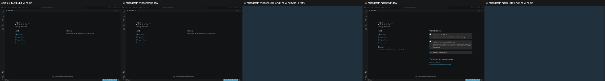
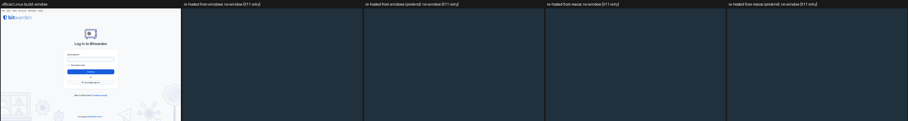
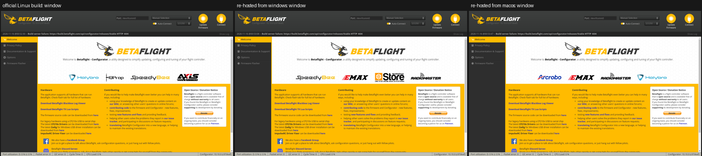
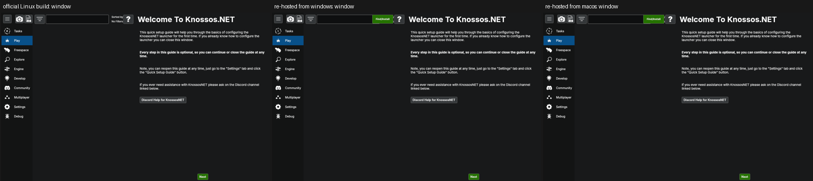

<!-- SPDX-License-Identifier: LicenseRef-TUR-Noncommercial-1.0.0 -->
# exp-rehost-1 — Windows and macOS packages re-hosted on the Linux build of their own runtime (experiment)

> **Status: experiment finished (time box).** Pull request 123, branch
> `exp/rehost`. The tables come from run 43778332673 (commit `b237162`),
> shards e1, e2, e4, n1 and g1, and run 43768570046 (commit `cf933b6`)
> for shard e3. Every contact sheet of those shards was looked at before a
> window was counted. GitHub Actions is now disabled for the owner's
> account, so no further run is possible; section 13 says which fixes that
> leaves untested.

```text
TUR DEVELOPMENT REPORT

Task ID:          exp-rehost-1 (time-boxed research spike, continued)
Subsystem:        application compatibility: a candidate route between
                  native Linux and Wine; no TUR service changed
Build ID:         not applicable: this task builds no image
Source revision:  exp/rehost (pull request 123); measurements at b237162

SUMMARY
- What changed: the previous engineer's harness ran but its numbers could
  not be trusted (section 2.5). This work made the measurement trustworthy
  (the test session no longer dies, hidden-window Electron programs are
  measured, accessibility is measured, Java paints), fixed fourteen faults
  of the re-hoster itself, added a tier that builds native Node modules
  from their npm source, ran the corpus three more times, looked at every
  contact sheet, and wrote this report.
- Why: to settle the registered kill criterion with numbers that hold.

FILES
- Added: tests/experiments/rehost/rehostlib/build.py,
  docs/reports/exp-rehost-1.md, docs/reports/assets/exp-rehost-1/*.png
- Modified: tests/experiments/rehost/ci-run.sh,
  harness/{run,session,summary,atspi_probe}.py,
  rehostlib/{detect,natives,rehost,pyi_loader}.py,
  .github/workflows/exp-rehost.yml
- Removed: none

BUILD
- Command: workflow exp-rehost (ci-run.sh in a Fedora 45 container), in CI
  only; nothing was built or run on a development machine
- Result: every shard green (green means the harness ran; outcomes are
  findings)
- Warnings: Fedora 45 lacks java-atk-wrapper, liberation-fonts, p7zip;
  its accessibility bus has no ScreenReaderEnabled property

TESTS
- Unit tests: selftest.py (synthetic packages) passes in every shard
- Integration tests: the corpus, 56 applications in six shards
- Boot tests: NOT RUN (nothing here can affect boot)
- Hardware tests: NOT RUN (headless compositor in a container, no GPU)
- Performance tests: start-up and memory, section 6

DIAGNOSTICS
- Log paths: artifacts exp-rehost-<shard> of the runs named above:
  results-<shard>.md, app-*.json, sheets/*.png, shots/*.log,
  harness-<shard>.log, session-logs/
- Diagnostic bundle path: not applicable
- Relevant error IDs: none

RECOVERY
- Rollback procedure: revert the branch; nothing outside
  tests/experiments/rehost, its workflow and this report changed
- Recovery tested: not applicable

KNOWN LIMITATIONS
- Section 13.

NEXT SAFE ACTION
- The owner's lawyer on section 11 (questions 1-5 and 10 first); the
  owner's decision on section 12; then a second spike with proprietary
  packages the owner holds a licence for, run by the owner, not in CI.
```

## The answer

**The hypothesis survives: the kill criterion is not triggered, by a wide
margin.**
Of the 24 Electron applications with an official Linux build, **20 reach a
working window from the Windows package alone and 20 from the macOS
package alone (83% and 83%); 20 (83%) from either**. The threshold was 30%
(8 of 24). Even without building any native module from source, at least
16 of 24 (67%) do (section 3.1).

- **Equal to the publisher's Linux build where it works.** For the working
  re-hosts the page has the same number of elements as the official build's
  (Joplin 520 against 523; VSCodium from macOS shows a fuller welcome page),
  the accessibility tree the same number of nodes in 36 of 40 cases (the
  other four are a timing difference and a fuller welcome page), the first
  window appears at the same time (median difference 0.0 s, at 0.4 s
  resolution) and memory is the same (median PSS ratio 1.006 from Windows,
  1.009 from macOS).
- **What fails is native code without a public identity.** The four
  Electron failures are an application's own Rust or C++ module that is not
  on npm, or a module bundled by webpack so that its name is gone, and one
  undiagnosed old Electron 20 program (section 3.2). The detector sees the
  first kind in the package before anything runs.
- **Native modules: build them.** The Windows and macOS payloads carry 138
  foreign native modules between them; a published Linux build (carried,
  npm, per-platform package, release asset) was found for 55, and 53 were
  compiled from their npm source with node-gyp: **27 distinct modules, 1 to
  43 s each, none failing**. What remains is Windows- or macOS-only by the
  package's own declaration (10), or the dead ends above (20) (section 4).
- **The other runtimes** (section 5): NW.js 3/3 from both packages; Godot
  3 of 5 fully and one partly (a GDExtension, which is native code, stops
  the fifth); LÖVE 2/2; Ren'Py 1/1; JVM 5 of 6 from Windows and 3 of 4 from
  macOS; .NET 3 of 5 from each (one more was correctly refused: SourceGit
  is compiled ahead of time); frozen Python 3/3 command-line programs.
- **Telling the payload it runs on Windows or macOS never helped** and broke
  13 of 40 working re-hosts (section 3.3).
- **For macOS** (section 10): re-hosting is the only route in TUR's plan
  that runs a macOS application package; it reached a working window from
  38 of 47 macOS packages here, all of them applications built on a
  cross-platform runtime. Applications written for the Mac alone are out of
  its reach.

## 1. Hypothesis and kill criterion (registered before any run)

Many "Windows-only" and "Mac-only" applications are a portable payload
(Electron's `app.asar`, NW.js, .NET IL, JVM bytecode, a Godot `.pck`, Ren'Py,
LÖVE) in a thin native shell. TUR can detect the runtime in the person's own
installer or bundle (exe, msi, NSIS, Inno, Squirrel, zip, dmg, pkg, `.app`),
take the payload out, and run it on the native Linux build of the same
runtime: no Wine, no virtual machine, native windows, visible to P@x through
accessibility.

**Kill criterion:** fewer than 30% of the Electron corpus reach a working
window from the Windows or macOS package alone. The corpus is open-source
applications that also publish an official Linux build, which is the ground
truth.

## 2. Method

### 2.1 Corpus

`tests/experiments/rehost/corpus.json`: 56 open-source applications, each
with its project's own release assets (Windows, macOS and Linux where the
project publishes them), pinned by the SHA-256 GitHub publishes for each
asset (read 2026-11-14; for older releases without one, the digest of what
was downloaded is recorded). No proprietary application was downloaded,
opened or run.

| Family | Applications | What the package carries |
|---|---|---|
| Electron | 24 with an official Linux build; GitHub Desktop (Windows and macOS only) | `app.asar` or `app/`, native Node modules, helper programs |
| NW.js | 3 (Betaflight, INAV and EmuFlight configurators) | `package.nw` or files beside `nw.exe` |
| .NET | 6 (ArchiSteamFarm, Sonarr, Wasabi Wallet, SourceGit, SS14 Launcher, Knossos.NET), and ILSpy as a WPF negative control | IL assemblies, self-contained or single-file; Avalonia for the user interface |
| JVM | 6 (ATLauncher, Unciv, Angry IP Scanner, Logisim-evolution, PDFsam Basic, Shattered Pixel Dungeon); Freeplane for detection only | jars, launch4j or jpackage wrappers, SWT, LWJGL |
| Godot | 5 (Pixelorama, Material Maker, Lorien, ROTA, Bosca Ceoil Blue) | a `.pck` beside or inside the program |
| LÖVE | 2 (Hawkthorne, LIKO-12) | a `.love` zip fused to `love.exe` |
| Ren'Py | 1 (The Question, packaged in the job by the Ren'Py 8.5.3 SDK's own `distribute` command) | `game/` scripts and assets |
| Frozen Python (PyInstaller) | 3 (yt-dlp, Black, spotDL), command-line programs | a PYZ archive of bytecode in the program |
| Native negative controls | KeePassXC (Qt), LocalSend (Flutter), Yaak (Tauri) | must be refused |

### 2.2 What TUR's prototype does with a package

`rehostlib/` (Python, standard library only; `tur-rehost` is the
command-line shape):

1. **Open, never run** (`unpack.py`): NSIS, Inno Setup (innoextract), MSI
   (msitools), Squirrel `Setup.exe` (the archive is cut out of the
   program), zip, 7z, dmg, pkg, AppImage, deb. The installer is never
   executed.
2. **Detect** (`detect.py`): runtime, version and platform from version
   strings, property lists, `package.json`, `runtimeconfig.json`, jar
   manifests and archive headers; a verdict (`rehostable`,
   `rehostable-with-work`, `not-rehostable`) with reasons.
3. **Re-host** (`rehost.py`) on the Linux build of the same runtime at the
   payload's version: Electron's and NW.js's Linux releases (verified against
   their published SHA-256), Godot's export template, LÖVE's AppImage, the
   Ren'Py SDK; Fedora 45's .NET, OpenJDK and CPython. Platform pieces are
   swapped for their Linux builds:
   - native Node modules (`natives.py`), in order: a Linux build the package
     already carries; the `linux-x64` sibling of a per-platform npm package;
     a Linux prebuild in the module's own npm tarball; its release prebuild
     (prebuild-install, node-pre-gyp naming); **a build from the module's
     npm source with node-gyp against Electron's headers** (`build.py`, new
     in this work); otherwise needs-build or dead-end;
   - per-platform npm packages that carry a helper program (ripgrep);
   - .NET: the self-contained package made framework-dependent, the
     Windows or macOS NuGet runtime assets replaced by the Linux ones of the
     same package version;
   - JVM: SWT and JavaFX platform jars replaced from Maven Central;
   - frozen Python: the PYZ bytecode run under the same CPython minor
     version with Linux wheels of its extension packages;
   - Electron's fuses copied from the publisher's binary.
4. **Pretend** (Electron only, a measured side variant): a shim tells the
   payload's own code that it runs on Windows or macOS.

### 2.3 Measurement

`harness/run.py`, in a Fedora 45 container on GitHub's Ubuntu runners
(workflow `exp-rehost`, six shards), as an unprivileged user:

- a private session bus, the accessibility bus with `IsEnabled` set,
  **sway** headless (wlroots, software rendering) with Xwayland, 1280×800;
- every start gets a fresh home directory; the official Linux build and
  every re-hosted variant are started **the same way, with the same flags**:
  `--disable-gpu` and `--force-renderer-accessibility` for Chromium, the
  remote-debugging port to read the page; a Chromium program that stays
  alive with a complete page and no window after 15 s is started again as
  an X11 client (section 2.5);
- recorded: time to first window (0.4 s resolution), sway's window list
  (Wayland or Xwayland), a screenshot, the page as the program's own
  Chromium reports it (DevTools), the AT-SPI tree (up to 2,500 nodes, 12 s),
  PSS memory of the program's processes (the session's own processes
  excluded), whether text inserted through DevTools arrived, the files
  written to the home directory, error lines;
- command-line programs: a regular expression on `--version` output; Sonarr:
  an HTTP answer from its port.

### 2.4 What counts as a working window

The harness's verdict (`window`, `no-window`, `blank-window`,
`empty-page`, `error-page`, `window-then-gone`) is automatic. **A window
counts only after its contact sheet has been looked at**: the application's
own user interface, at least as complete as the official build's on the same
display (a start page, a welcome dialog, an editor), not a splash screen, an
error page, a crash dialog or a blank surface. Every contact sheet of the
final run was looked at; section 3.4 lists where the sheet overruled the
verdict.

### 2.5 Runs

| Run | Commit | What it showed | Kept |
|---|---|---|---|
| 43537130080 | `3bccd04` | the workflow file failed validation; no job | — |
| (second) | `0ae0654` | every shard stopped at the package install (dnf5 option order) | — |
| 43544136201 | `e076a05` | first measurements; Chromium's GPU process died in the container; no accessibility at all | fixed in `e8e2474` |
| 43557782687 | `e8e2474` | **not trustworthy**: shard g1 measured in a dead session after Xwayland was killed with an application; seven official Electron builds never mapped a window; Joplin refused a harness flag in every variant; AT-SPI saw only Chromium's frame | fixed in `ac32eb0` |
| 43754196480 | `ac32eb0` | every official build came up except SS14's (arm64 directory taken) and PDFsam's (wrong main class); contact sheets exposed NW.js error pages counted as windows, blank Java windows, a ripgrep helper package | fixed in `cf933b6` |
| 43768570046 | `cf933b6` | every official build came up but PDFsam's; MarkText from Windows, Tabby, SS14, Angry IP Scanner, Logisim, spotDL and the NW.js programs from Windows now worked; exposed the "darwin-x64 contains win-x64" bug, NW.js translations, PDFsam's JavaFX | fixed in `b237162` |
| 43778332673 | `b237162` | **the tables below** (shards e1, e2, e4, n1, g1); shard e3 was cancelled by the platform after nine minutes, so shard e3's rows come from run 43768570046 (none of the three fixes in `b237162` touches its six applications: no darwin-x64 package, no NW.js layout, no JVM start script) | — |

The commit messages of `ac32eb0`, `cf933b6` and `b237162` list every fault
and its fix. In short, the harness's: the test session killed with an
application, hidden-window Electron programs, a flag Joplin refuses,
accessibility off, AWT under a non-reparenting compositor, `libatomic`
missing for NW.js, a start failure crashing the harness. The re-hoster's:
NW.js pages and translations left behind, the macOS NuGet assets not
swapped, arm64 directories preferred, an SWT name not parsed, PDFsam's main
class and JavaFX, frozen Python's program name, resources and pins,
per-platform helper packages, and the darwin-x64 name bug.

## 3. Electron: the kill criterion

### 3.1 Result

"Works" means a working window, judged on the contact sheet against the
official Linux build on the same display. "X11": in the headless compositor
this program (official build included) maps its window only as an X11
client; the same display was used for its re-hosted variants (section
2.3). Native modules: **C** a Linux build the package already carries,
**N** in the module's npm tarball, **P** the linux-x64 per-platform npm
package, **R** a release prebuild, **B** built from the npm source here,
**x** declared for Windows or macOS only (not needed on Linux), **D** dead
end.

| Application | Electron | Official Linux build | From Windows | From macOS | Native modules: Windows / macOS |
|---|---|---|---|---|---|
| AFFiNE | 39.8.10 | works | **no** | **no** | 1D / 1D |
| Bitwarden | 43.5.0 | works | **no** | **no** | 3D 2N / 2D 2N |
| Bruno | 37.6.1 | works (X11) | works | works | 1B 1P / 1B 2P 1D 1x |
| draw.io | 44.10.2 | works | works | works | — |
| balenaEtcher | 44.9.1 | works (X11) | works | works | 2D (not loaded) / — |
| Freelens | 44.10.0 | works | works | works | 1N / 1N |
| Heroic Games Launcher | 43.1.1 | works | works | works | — |
| Hyper | 20.3.6 | works | **no** | **no** | 3B / 3B 1x |
| Jitsi Meet | 43.8.3 | works (X11) | works | works | 1B 1C / 1B 1C 1x |
| Joplin | 42.11.18 | works | works | works | 1N 2R / 2R |
| Logseq | 42.3.0 | works (X11) | works | works | 1P 1R / 1R |
| LosslessCut | 42.11.15 | works | works | works | 1C / 1C; ffmpeg and ffprobe linked to Fedora's |
| MarkText | 42.1.0 | works | works | works | 2B 1R, ripgrep package / same |
| Mattermost | 43.8.3 | works | works | works | 4B 1P / 4B 2P |
| Min | 43.4.1 | works | works | works | — |
| MQTTX | 39.2.7 | works | works | works | 1R / 1R |
| Podman Desktop | 44.4.2 | works | works | works | — / 1x |
| Rocket.Chat | 43.8.1 | works (X11) | works | works | — / 1x |
| Standard Notes | 35.2.0 | works (X11) | works | works | 1C 1P 2R / 1B 1C 1P 2R |
| Tabby | 43.7.0 | works | works | works | 4B 3C 1R 1x / same |
| Trilium Notes | 45.2.3 | works | works | works | 1N 1P / same |
| VSCodium | 43.7.7 | works | works | works | 12B 1N 1P 1R 1D 1x / 9B 1N 1P 1R 1D 2x |
| Zettlr | 44.10.2 | works (X11) | **no** | **no** | 1D / 1D |
| Zulip | 45.1.0 | works | works | works | — / 1B |
| **Total (24)** | | **24** | **20** | **20** | |
| GitHub Desktop (no Linux build) | 44.9.1 | — | **no** | not in the corpus | 6D 1P |

**Kill criterion: not triggered.** From the Windows package 20 of 24
(83%), from the macOS package 20 of 24 (83%), from either 20 (83%);
the threshold was 8 (30%). Without the source-build tier: the 14
applications whose working variants needed no build at all, plus VSCodium
and Mattermost, which reached the same window in run 43557782687 with
their unbuilt modules still Windows binaries: **at least 16 of 24 (67%)**.
Tabby is the clear case of an application that needs a source build (its
splash screen never cleared while `fontmanager-redux` was missing).

Two caveats belong next to the number. First, a "working window" is the
application's own first screen, the same as the official build's; no
feature was exercised beyond a click and typed text, so a native module
that is loaded late (VSCodium's file watcher, Joplin's keychain) is known
to be present, not known to work. Second, the corpus is open-source
applications, whose native modules are mostly on npm; section 3.2 says why
commercial ones will do worse.

### 3.2 Why the failures fail

Every Electron failure is **native code that has no public Linux build and
no identity a public source can be found by**:

| Application | What stops it (same from Windows and macOS) |
|---|---|
| Bitwarden | `@bitwarden/desktop-napi`, a Rust (napi-rs) module built from the application's own repository and not published on npm: "Cannot find module '@bitwarden/desktop-napi-linux-x64-gnu'" |
| AFFiNE | `@affine/native`, likewise a Rust module of the application's own, not on npm: "Cannot find native binding" |
| Zettlr | the spell checker `Nodehun.node`, bundled by webpack into `.webpack/main/native_modules/` without its `package.json`, so neither its name nor its version can be read; "invalid ELF header" |
| Hyper (3.4.1, Electron 20) | every native module was found or built; the page stays at 12 elements, with no error in its log. Not diagnosed |
| GitHub Desktop (no Linux build) | six webpack-bundled modules (`registry.node`, `keytar.node`, `fs_admin.node`, …) without identity |

The productisation consequence is direct: an application's **own** native
module (a Rust or C++ addon of the publisher's that is not on npm) is a dead
end for re-hosting, and commercial Electron applications are more likely to
carry one than open-source ones. The detector sees these in the package
(`native-modules` with "no package.json above the file"), so the router can
say so before anything is downloaded.

### 3.3 Telling the payload it runs on Windows or macOS

The "pretend" variant (a shim that sets `process.platform` for the
application's code only) never made an application work that did not work
without it (0 of 9 failing variants rescued), and it broke 13 of the 40
working ones (VSCodium, Bruno, Mattermost, MQTTX and Trilium from both
packages; Freelens from macOS; Standard Notes and Zulip from Windows). The usual failure is the
application then loading its own Windows or macOS native file
(`desktop_napi.win32-x64-msvc.node`, `registry.node`, `cf-prefs.node`:
"invalid ELF header"). It is not a route; section 9.3.

### 3.4 Where the contact sheets overruled the automatic verdict

- **NW.js from Windows, run 43754196480**: verdict "window" for all three
  programs; the sheets showed Chromium's "Your file couldn't be accessed"
  page. A re-hoster fault (the application's `main.html` left behind),
  fixed; a Chromium error page is now its own verdict.
- **Tabby from both packages, run 43754196480**: verdict "window, page
  incomplete"; the sheet shows the splash screen only. Not counted. In the
  final run, with `fontmanager-redux` built from source, Tabby reaches its
  welcome page.
- **Betaflight from Windows, run 43768570046**: verdict "window"; the sheet
  shows the application's message keys instead of its text
  (`defaultWelcomeIntro`). Fixed (its translations sit in `locales/` beside
  Chromium's `.pak` files and were left out with them).
- **Logisim-evolution and ATLauncher, run 43754196480**: "blank-window" and
  "window"; the sheets showed blank Java windows for the official builds
  too: a property of the test compositor (sway does not reparent; AWT needs
  `_JAVA_AWT_WM_NONREPARENTING`), fixed in the session.
- **MQTTX, pretending to be macOS**: verdict "blank-window", correctly; and
  pretending to be Windows: verdict "window", but the sheet shows only an
  empty menu bar. Not counted.
- **Material Maker from both packages, final run**: verdict "window"; the
  sheets show the editor without its default material node and with empty
  previews ("No matching function found for: 'preview_2d'"). Counted as
  partly working, not working (section 5).
- **MQTTX's official build, final run**: its release-notes pane had not
  rendered when the screenshot was taken, while the re-hosted ones had (the
  AT-SPI counts, 126 against 503, show the same). Both are working windows.
- **VSCodium from macOS, final run**: a fuller welcome page than the
  official build's (walkthroughs and announcements shown); a working
  window.
- Every other verdict of the final run agrees with its sheet.

## 4. Native modules

Every foreign `.node` file in the 49 Electron payloads (24 applications ×
2 packages, and GitHub Desktop's Windows one), grouped by the package that
owns it:

| Outcome | From Windows | From macOS | What it means for TUR |
|---|---|---|---|
| carried: the package already holds a Linux x86-64 build (prebuildify) | 6 | 6 | nothing to do |
| npm prebuild in the module's own tarball | 6 | 5 | fetch from npm |
| per-platform npm package, linux-x64 sibling fetched | 7 | 7 | fetch from npm |
| release prebuild (prebuild-install, node-pre-gyp naming) | 9 | 9 | fetch from the module's releases |
| **built from the npm source** (node-gyp, Electron's headers) | **27** | **26** | a build service |
| declared for Windows or macOS only (`os` in `package.json`), or builds nothing on Linux | 2 | 8 | not needed on Linux |
| **dead end** | **14** | **6** | the re-host fails if the module is loaded |
| total | 71 | 67 | |

- **The build tier works.** 27 distinct modules (the VS Code family's
  `spdlog`, `sqlite3`, `native-keymap`, `policy-watcher`, `deviceid`,
  `@parcel/watcher`; `node-pty`, `native-reg`, `registry-js`, `ced`,
  `fontmanager-redux`, `cbor-extract`, `fs-xattr`, `@jitsi/electron-sdk`, …)
  compiled from the source in their npm tarballs with node-gyp 11.2.0
  against each payload's Electron headers, in 1 to 43 s each on a GitHub
  runner, with Fedora's compiler and the X11, xkbfile, libsecret and
  fontconfig headers. In the last two runs none failed; in run
  43754196480 four did (`native-keymap` twice, `fontmanager-redux`,
  `native-reg`), for want of system headers or of `node-addon-api`, which
  the recipe now supplies. Many of the built modules are Windows-only in
  purpose (`windows-mutex`, `windows-registry`) and compile to a harmless
  stub on Linux.
- **The dead ends are of one kind**: a `.node` file with no `package.json`
  above it, because the application bundled it (webpack's
  `native_modules/`, GitHub Desktop's root directory) or because it is the
  application's own module, never published (Bitwarden's `desktop-napi`,
  AFFiNE's `@affine/native`, both Rust); or a module not on the registry at
  all (VSCodium's built-in `microsoft-authentication`, which VSCodium does
  not load at start). balenaEtcher's two dead ends are not loaded at start
  either: the window works.
- **The macOS packages carry more platform-only modules** (`fsevents` in
  five applications, `macos-native-processlist`) and one more kind of dead
  end (Bruno's `iconv-corefoundation`, not loaded at start); the result is
  the same window count.
- A bug the final run fixed belongs in the record: "darwin-x64" contains
  "win-x64", and every macOS per-platform package name had been rewritten
  to one that does not exist, until run 43768570046 showed it.

## 5. The other runtimes

Command-line programs are judged by their output (a version string; Sonarr
by an HTTP answer from its port); the rest by their contact sheets.

| Family | Application | Official Linux build | From Windows | From macOS | What decides it |
|---|---|---|---|---|---|
| NW.js | Betaflight Configurator | works | works | works | NW.js 0.50 for Linux; the payload beside `nw.exe` or in `package.nw` |
| NW.js | INAV Configurator | works | works | works | |
| NW.js | EmuConfigurator | works | works | works | |
| .NET | ArchiSteamFarm (CLI) | works | works | works | single-file bundle unpacked; Fedora's .NET 10 |
| .NET | Sonarr (server) | works | **no** | **no** | Windows: `Sonarr.Mono.dll` is only in the Unix packages; macOS: `MonoPosixHelper` not swapped for Linux |
| .NET | Wasabi Wallet | works | **no** | **no** | starts, then exits: it runs its bundled Tor from `linux-x64/Tor/tor`, which only the Linux package has |
| .NET | SourceGit | works | refused | refused | compiled ahead of time (NativeAOT) on every platform: correctly not re-hostable |
| .NET | SS14 Launcher (Avalonia) | works | works | works | the Linux assets of the same NuGet packages (HarfBuzzSharp, Mono.Posix, zstd, e_sqlite3, …); the macOS package's arm64 directory is skipped for the x86-64 one |
| .NET | Knossos.NET (Avalonia) | works | works | works | |
| JVM | ATLauncher | works | works | no package | |
| JVM | Unciv (LWJGL) | works | works | no package | |
| JVM | Angry IP Scanner (SWT) | works | works | works | SWT for GTK from Maven Central replaces win32 and cocoa SWT |
| JVM | Logisim-evolution (Swing) | works | works | works | |
| JVM | PDFsam Basic (JavaFX) | works | **blocked** | **no** | Windows: the application is inside a jlink runtime image; macOS: JavaFX now supplied, but the start script's `--enable-preview` is not carried (a prototype gap) |
| JVM | Shattered Pixel Dungeon (LWJGL) | works | works | works | |
| Godot | Pixelorama | works | works | works | Godot 4 export template; the `.pck` cut out of the program |
| Godot | Material Maker | works | partly | partly | editor opens; its default node and previews are missing (files beside the program not carried, a prototype gap) |
| Godot | Lorien | works | works | works | |
| Godot | ROTA | works | works | works | |
| Godot | Bosca Ceoil Blue | works | **no** | **no** | a GDExtension (`libgdsion`): native code whose Linux library only the Linux package has |
| LÖVE | Journey to the Center of Hawkthorne | works | works | works | LÖVE 11.5 AppImage; the `.love` cut out of `love.exe` |
| LÖVE | LIKO-12 | works | works | works | |
| Ren'Py | The Question | works | works | works | Ren'Py 8.5.3 SDK's engine with the package's `game/` |
| PyInstaller | yt-dlp (CLI) | works | works | works | PYZ bytecode under Fedora's CPython of the same minor version |
| PyInstaller | Black (CLI) | works | works | works | its mypyc-compiled modules fall back to pure Python, as Black allows |
| PyInstaller | spotDL (CLI) | works | works | works | its pinned distributions installed together, so pydantic-core matches |

Totals, working (partly working not counted):

| Family | Windows packages | macOS packages |
|---|---|---|
| NW.js | 3 of 3 | 3 of 3 |
| .NET (re-hostable kind) | 3 of 5 | 3 of 5 |
| JVM | 5 of 6 | 3 of 4 |
| Godot | 3 of 5 (1 partly) | 3 of 5 (1 partly) |
| LÖVE | 2 of 2 | 2 of 2 |
| Ren'Py | 1 of 1 | 1 of 1 |
| PyInstaller (command line) | 3 of 3 | 3 of 3 |

Negative controls: KeePassXC (Qt), LocalSend (Flutter) and Yaak (Tauri)
are detected as native programs and refused, route Wine; SourceGit
(NativeAOT) likewise. **ILSpy was meant as a WPF control, but ILSpy 11.2's
Windows package is an Avalonia program** (`Microsoft.NETCore.App` only,
Avalonia's ANGLE library): the detector's "rehostable" is correct and the
corpus note is wrong; it was not run (detection only). **Freeplane's Inno
Setup installer was detected as a native program: a detector miss** (the
Java program inside was not found).

## 6. Accessibility, start-up and memory

### 6.1 Accessibility: what P@x would see

A re-hosted program is exactly as visible on the AT-SPI bus as the
publisher's own Linux build, no more and no less:

| Program kind | Official Linux build | Re-hosted | Note |
|---|---|---|---|
| Electron (20 working applications) | 30 to 1,045 nodes; 0 to 152 actionable | **the same count in 36 of 40 variants** | the other four: Joplin 398 against 399; VSCodium from macOS 236 against 202 (a fuller welcome page); MQTTX 503 against 126 (the official page had not finished, section 3.4) |
| Java with SWT (Angry IP Scanner) | 233 nodes, 74 actionable | 233, 74 (both packages) | SWT is GTK, which speaks AT-SPI |
| Java with Swing or LWJGL, Godot, LÖVE, Ren'Py, NW.js, Avalonia | 0 to 2 | 0 to 2 | invisible either way: Fedora 45 has no java-atk-wrapper; the others expose nothing to AT-SPI in this session |

Chromium exposes its page only when told to: in run 43557782687, without
`--force-renderer-accessibility`, every Electron program showed AT-SPI its
frame and nothing else. Fedora 45's accessibility bus has no
`ScreenReaderEnabled` property, through which Chromium could have been
told. So TUR must start Electron programs, official and re-hosted alike,
with accessibility switched on while P@x is enabled; that is a TUR launcher
property, not a re-hosting one.

### 6.2 Start-up and memory

| | Electron, from Windows | Electron, from macOS | Other runtimes |
|---|---|---|---|
| First window, re-hosted minus official | median 0.0 s, range −0.4 to 0.0 s | median 0.0 s, range −0.4 to +0.8 s | equal in every working case (0.4 to 1.2 s) |
| Memory (PSS of the program's processes), re-hosted ÷ official | median **1.006**, range 0.70 to 1.11 | median **1.009**, range 0.70 to 1.09 | Knossos.NET 1.17, ATLauncher 1.08, Logisim 0.88 to 0.92, EmuConfigurator from Windows 0.81 (Material Maker, partly working, 0.77); the rest within ±6% |
| Preparing the re-host (unpack, fetch from cache, swap, build from cache) | median 3.0 s, at most 42 s (Mattermost, first source builds) | | under 1 s, at most 2 s |

The first-window time has the harness's 0.4 s resolution; programs that
show their window only as X11 clients took 2 to 4 s whichever build it was.
The 0.70 ratio is balenaEtcher, whose official build runs one process more
(10 against 9; not investigated); VSCodium from Windows is the 1.11.
Memory was measured once per variant on a shared runner: a difference
under about 10% is noise.

## 7. Contact-sheet evidence

Each contact sheet shows, left to right, the official Linux build, the
re-host from Windows (and its "pretend" variant), the re-host from macOS
(and its variant), each 1280×800 screenshot scaled down, with the
automatic verdict above it. All of them are in the artifacts
`exp-rehost-<shard>` (directory `sheets/`) of the runs named at the top;
the screenshots at full size are in `shots/`, with each program's output
beside them. Four are kept here:

VSCodium, Electron 43.7.7: 12 native modules built from source for the
Windows payload; the same welcome page as the official build (the
"pretend" variants fail):



Bitwarden: the official build works; the re-hosts have no window, because
the application's own Rust module is not on npm:



Betaflight Configurator, NW.js 0.50, from the final run (in the run before,
the Windows re-host showed its message keys):



Knossos.NET, .NET with Avalonia, from a single-file bundle with the
Windows and macOS SkiaSharp and HarfBuzzSharp assets replaced by the Linux
ones:



## 8. Prevalence: what re-hosting could reach

`tests/experiments/rehost/prevalence.tsv` lists 69 widely used Windows and
macOS applications with no Linux edition (or none found), with the runtime
each ships, **from public information only** (publishers' pages and a
binary-scanning site, read 2026-11-14). Nothing in it was downloaded or
run; every row is NOT RUN.

| Runtime of the Windows/macOS edition | Applications | Re-hostable class? |
|---|---|---|
| Electron | 20 (Notion, Notion Calendar, Figma, Linear, Loom, Miro, Canva, Asana, Superhuman, Spark, Evernote, GitHub Desktop, Tidal, Streamlabs, Trello, monday.com, Splice, Framer, Zeplin, Cookie Clicker), plus 2 that now have a Linux edition | yes |
| NW.js (RPG Maker MV games) | 6 (OMORI, Fear & Hunger 1 and 2, The Coffin of Andy and Leyley, Ib, The Witch's House MV) | yes |
| LÖVE | 5 (Balatro, Moonring, Arco, SNKRX, Intravenous 2) | yes |
| Godot | 4 (Cruelty Squad, Webfishing, KinitoPET, Road to Vostok), plus 1 with a Linux edition | yes, unless it uses a GDExtension (section 5) |
| Ren'Py | 1, with a Linux edition | yes |
| Native host around CEF or WebView2 | 14 (Teams, new Outlook, WhatsApp, Grammarly, Raycast, Power BI, Adobe Creative Cloud, EA app, Battle.net, Ubisoft Connect, Riot Client, Overwolf, Xbox app, Rockstar launcher), plus Epic's launcher with Linux | **no**: the host is native code |
| Qt | 4 (Amazon Music, Scrivener, Tableau, Autodesk Fusion) | no |
| .NET with a Windows user interface | 2 (Paint.NET, ShareX) | no: Wine |
| Native macOS only (Swift, AppKit, Cocoa) | 5 (Sketch, Bear, Alfred, Balsamiq Wireframes, Affinity) | **no** |
| Unity; other | 2 (Vampire Survivors, Doki Doki Literature Club Plus!); 2 | no |

Of the 69, **35 have no Linux edition and ship a runtime class the
experiment re-hosts** (Electron, NW.js, LÖVE, Godot). That is a statement
about the runtime class, not about any of these applications: none was
tried. Two of the Electron rows are already known to carry native code no
public source rebuilds (Spark's Swift mail core compiled for Windows; Cookie
Clicker's Steam add-on), and section 3.2 shows that such native code is the
commonest reason an Electron payload fails.

## 9. What productising takes

### 9.1 Where "re-hosted" sits in the router

Proposed as a new route, `rehost`, in the ladder of
[catalogue-and-routing.md](../architecture/catalogue-and-routing.md):

| Rung | Route | Listed when |
|---|---|---|
| 1 | Flatpak, then native Linux | A Linux edition exists |
| 2 | Web application, primary | unchanged |
| 3 | Container of another distribution | unchanged |
| **3½** | **Re-hosted on the Linux build of its runtime** | **A Windows or macOS edition exists, the detector says `rehostable` or `rehostable-with-work` for its package, and a TUR record (or the person's own successful run) says it works** |
| 4 | Proton for a game; Wine for any other Windows application | unchanged |
| 4 | Windows guest | unchanged |
| 5–7 | Android, web (not primary), Darling | unchanged |

Reasons:

- **Below the official Linux edition, always.** A publisher's Linux build is
  supported, updated and tested by the publisher; a re-hosted one is none of
  those. Even where the re-hosted Windows edition measured the same as the
  Linux one (sections 3 and 6), it is the publisher's Windows code running
  on a platform it was not tested on.
- **Above Wine, when it works.** A re-hosted application is a Linux process
  with native Wayland or X11 windows, the same accessibility tree as the
  publisher's Linux build (section 6), about the same memory, no Wine prefix
  and no Windows path semantics. When the re-host works it is closer to "a
  Linux application" than Wine can be.
- **Only with evidence.** An unmeasured re-host is `doubtful`, not `clear`:
  payloads that detect as re-hostable still fail for reasons the detector
  cannot see (a native module that is not on npm, a platform-only helper
  program, an assembly that exists only in the Linux build; sections 3.2
  and 5).
  The router's honesty rule applies unchanged: TUR's own record, with the
  run that produced it.
- **Router input.** The detector's verdict is a fact about the package, not
  about the application: a catalogue entry gains a `rehost` record per
  edition and runtime version; the detector supplies `runtime`, `version`,
  `verdict` and `reasons` (`native-modules`, `platform-helper-binaries`,
  `dotnet-single-file`, …) as reason codes.

### 9.2 What the component would be

A standalone TUR program (`tur-runtime`, over D-Bus; the licence rules allow
it as a separate program), with five parts that each exist here as a
prototype (`tests/experiments/rehost/tur-rehost` is the command-line shape):

1. **Open and detect** without running anything (`rehostlib/unpack.py`,
   `detect.py`): NSIS, Inno, MSI, Squirrel, zip, 7z, dmg, pkg, AppImage,
   deb.
2. **Fetch the runtime** at the payload's exact version from its project's
   release location, verified against the project's published SHA-256
   (Electron's `SHASUMS256.txt`, GitHub's asset digests) and pinned in a
   TUR-maintained index, never "latest".
3. **Lay out** the payload under it (`rehost.py`), swap platform pieces for
   their Linux builds (native Node modules, NuGet runtime assets, SWT and
   JavaFX jars, Python wheels), and refuse with a reason when it cannot.
4. **A build service for native Node modules** (`build.py` is its
   prototype): TUR's CI compiles open-source modules from their npm source
   for each Electron version, signs the result and serves it; a person's
   machine never compiles. Only modules published under an open licence;
   never a proprietary one. A build runs the package's own `binding.gyp`,
   which can execute commands, so the service builds in a throw-away,
   network-restricted sandbox per module, from the npm tarball whose
   integrity hash the registry publishes, and keeps a build log with each
   binary. The demand is small and cacheable: 27 distinct modules served 9
   applications here, several of them shared between applications
   (`native-keymap`, `native-reg`, `native-process-working-directory`).
5. **Platform helper programs**: per-platform npm packages (ripgrep) are
   fetched like native modules; programs the system provides (ffmpeg,
   ffprobe; Tor and pandoc would be next) are linked in place of the
   package's Windows or macOS builds; anything else is a refusal with a
   reason.

### 9.3 Sandboxing

A re-hosted payload is the publisher's code, unchanged, running on a runtime
build it was not tested with. It should run at least as confined as a
Flatpak application:

- bubblewrap with its own home directory (the experiment gave every start a
  fresh one and recorded what it wrote: "Profile files" in the tables), the
  file chooser and opener through the desktop portal, the network allowed
  (these applications need it), no access to other applications' data;
- Chromium's own sandbox kept on (the experiment ran with it: user
  namespaces were available in every shard); the re-host must never add
  `--no-sandbox`;
- Electron's fuses copied from the publisher's binary (`rehost.py` does
  this: `RunAsNode`, `EnableNodeOptionsEnvironmentVariable`,
  `OnlyLoadAppFromAsar`, …), so the Linux binary is no more permissive than
  the one the publisher shipped. One fuse must be turned off:
  `EnableEmbeddedAsarIntegrityValidation`, because the payload's hash is
  embedded in the publisher's Windows or macOS binary, which is not used.
  TUR should compute and record its own hash of the payload and check it at
  each start instead;
- the "pretend to be Windows or macOS" variant is **not** to be
  productised: it never made an application work that did not work without
  it (section 3.3), it broke several that did, and it misreports the
  platform to the publisher's servers (section 11, question 7).

### 9.4 Updates

- Electron applications update themselves through Squirrel or
  electron-updater, which on a re-hosted payload would fetch a Windows
  installer or a macOS zip, or, on Linux, find no AppImage and stop (Logseq
  logged "APPIMAGE env is not defined, current application is not an
  AppImage"). The re-host must keep the in-application updater off and own
  updates: watch the publisher's update feed for the edition it re-hosts
  (`latest.yml`, `RELEASES`, Sparkle's appcast), fetch the new package on
  the person's behalf only where the publisher offers it to anyone, and
  re-host again. Where the package needs a licence or a login to download,
  the person supplies the new one.
- The runtime follows the payload: the payload names its Electron version
  and TUR fetches exactly that Linux build. Chromium's security fixes then
  arrive when the publisher ships them, as on Windows; TUR cannot move a
  payload to another Electron without testing it.
- Native modules follow the payload too: the build service is keyed by
  module version and Electron version.
- A re-host is a deployment like any other: the previous one is kept until
  the new one has started once, so an update that no longer re-hosts falls
  back to the last good one and the router says so.

### 9.5 Telling the person

- In the application centre: "**Windows edition, running on Linux's own
  Electron 43.** Not the publisher's Linux version; the publisher does not
  support this. Tested by TUR on <date>: works / works without <feature>."
  The words come from the record, not from the detector alone.
- Before the first start: what will be downloaded (the runtime, from where,
  under which licence), and that nothing of the package leaves the machine.
- Problem reports for a re-hosted application go to TUR, not to the
  publisher; the diagnostics bundle names the route and the runtime version.
- P@x says the same, from the same record; and because the window is a
  Linux one, P@x sees and operates it through AT-SPI as it does the
  publisher's Linux build (section 6).

## 10. "Some Mac stuff": what TUR can honestly promise

Re-hosting is the only route in TUR's plan that can run a macOS
*application package* with a working window. The other macOS route in
[ADR-0007](../adr/0007-app-centric-routing.md) is Darling, experimental and
off by default, which "does not run mainstream macOS GUI applications"
(ADR-0007's own words); a macOS virtual machine is excluded by Apple's
licence. What re-hosting measured here is therefore what TUR can offer for
"some Mac stuff".

**Measured, from the macOS package alone:** Electron 20 of 24; NW.js 3
of 3; .NET 3 of 5; JVM 3 of 4; Godot 3 of 5 (and one partly); LÖVE 2 of 2;
Ren'Py 1 of 1; frozen Python 3 of 3 (command line): **38 of 47 macOS
packages reached a working window**, every one of them the Linux runtime's
own windows, as visible to P@x as the publisher's Linux build.

What TUR can honestly promise:

1. **Applications whose macOS package carries a portable payload**
   (Electron, NW.js, a JVM program, a .NET program with a cross-platform
   toolkit such as Avalonia, a Godot or LÖVE game, a Ren'Py novel, a frozen
   Python program) **may run from the `.dmg` or `.zip` the person already
   has**, named one by one after TUR has tested them, never as a class.
2. **Never an application written for the Mac**: Swift or Objective-C with
   AppKit, SwiftUI, Catalyst, Metal, or anything that needs macOS
   frameworks. Every Mac-only application in the prevalence table (Sketch,
   Bear, Alfred, Balsamiq Wireframes, Affinity) is of that kind, and so are
   the macOS editions of WhatsApp, Grammarly and Raycast. Re-hosting cannot
   touch them and nothing else in TUR's plan can either.
3. **In practice the Mac package is rarely the only way in.** Every
   portable application in this corpus and every Electron application in
   the prevalence table that has a macOS edition also has a Windows one,
   and here the macOS package re-hosted exactly as often as the Windows
   one. So "some Mac stuff" means *cross-platform applications, from
   whichever package the person has*, and a Mac-only portable application
   is the exception, not the rule.
4. **The macOS package has failure modes of its own**, all seen here:
   universal packages with an arm64 directory first (SS14, until the
   detector preferred x86-64), macOS-only native modules (`fsevents`,
   `iconv-corefoundation`, `cf-prefs`, `fs-xattr`; mostly not needed on
   Linux), macOS-only NuGet assets (SkiaSharp, e_sqlite3, MonoPosixHelper;
   swapped since run 43754196480, except Sonarr's), and per-platform npm
   packages whose name had to be read carefully ("darwin-x64").

Proposed wording for the README's macOS row, replacing "a macOS
compatibility layer is available as an experimental option": "**Some macOS
applications built on cross-platform runtimes (Electron, Java, .NET with
Avalonia, Godot and others) can run from their macOS package on Linux's own
build of that runtime, by name, as tested. Applications written for the Mac
alone (Swift, AppKit) cannot.** Experimental."

## 11. Licence and legal questions for the owner's lawyer

None of these is answered here. Each is a question, with what the experiment
did and did not do.

**Running a proprietary application's payload under its terms of use**

1. **Extraction without execution.** TUR opens the person's own installer
   (NSIS, MSI, Inno, dmg, pkg) with archive tools and copies files out of
   it, without running the installer or showing its click-through licence.
   Is installing by extraction, on an operating system the licence does not
   name, "use" the licence permits? Does it matter whether the person
   accepted the same terms on the publisher's website, or never saw them?
2. **Platform clauses.** Many end-user licences grant use "on a device
   running Windows" or "on Apple-branded products running macOS" (Apple's
   standard licence for Mac App Store applications says the latter; many
   publishers copy such wording). Does running the payload on Linux breach
   such a clause, and is a clause of that kind enforceable against a person
   in the EU and in the United States?
3. **Adaptation for interoperability.** The re-host changes the package: it
   replaces the platform binary (Electron's, the .NET host, the JVM
   launcher), replaces native modules with open-source builds of the same
   version, rewrites `runtimeconfig.json` for .NET, and turns off
   Electron's asar integrity fuse. Is that an adaptation the lawful user may
   make without the publisher's permission (Directive 2009/24/EC, article
   5(1): "necessary for the use of the computer program by the lawful
   acquirer in accordance with its intended purpose"; 17 U.S.C. § 117(a)(1):
   "an essential step in the utilization of the computer program in
   conjunction with a machine"), or a derivative work that needs permission?
   Can an end-user licence that forbids modification override article
   5(1)?
4. **Integrity checks as protection measures.** Electron's
   `EnableEmbeddedAsarIntegrityValidation` checks that the payload is the
   one the publisher shipped; the re-host turns it off on the Linux binary
   because the expected hash lives in the publisher's Windows binary. Is
   that check a "technological measure" whose circumvention is prohibited
   (17 U.S.C. § 1201; Directive 2001/29/EC, article 6), given that it
   controls neither access to the work nor copying of it? Would TUR
   computing its own hash and turning the check back on change the answer?
5. **Who performs the act.** TUR's program performs the extraction and the
   adaptation on the person's machine, from the person's copy, at the
   person's request; TUR never receives, stores or distributes the payload.
   Is the person then exercising the user's rights with TUR as a tool (as
   with Wine), or could TUR be said to induce a breach of the publisher's
   terms by building and advertising the feature?
6. **Naming applications.** The application centre would say "Notion
   (Windows edition), re-hosted: works". Is naming a proprietary
   application and showing its icon in that context a trademark use the
   publisher can object to, and what disclaimer is needed ("not supported
   by the publisher")?
7. **Online services.** A re-hosted application talks to its publisher's
   servers from Linux, with a Linux user agent. Do the services' terms (as
   distinct from the software licence) restrict clients or platforms? The
   "pretend" variant measured here misstates the platform to those servers;
   the report recommends against it (section 9.3). Is that misstatement a
   breach in itself?
8. **Games bought on a store.** For Godot, LÖVE and RPG Maker (NW.js) games
   bought on Steam: the Steam Subscriber Agreement and the game's own
   licence; is running the Windows edition's payload on the Linux engine
   different in kind from running the same edition in Proton, which Valve
   itself provides?

**What TUR itself would fetch or serve**

9. **The runtimes.** Re-hosting fetches, to the person's machine, the Linux
   builds of Electron (MIT, with Chromium's third-party licences), NW.js
   (MIT), Godot's export templates (MIT), LÖVE (zlib) and Ren'Py (MIT, with
   LGPL parts), and uses Fedora's .NET (MIT), OpenJDK (GPL-2.0 with the
   Classpath Exception) and CPython (PSF). Is fetching them on the person's
   behalf, rather than shipping them in the image, enough to keep TUR out of
   redistribution, and what notices must TUR show?
10. **Electron's bundled codecs.** Electron's Linux release carries
    `libffmpeg.so` built with Chromium's proprietary codecs (H.264 and AAC
    decoding); TUR's rules forbid shipping codecs from outside Fedora.
    Electron also publishes, for every release, `ffmpeg-v<version>-linux-
    x64.zip`, built with open codecs only. Options: (a) fetch Electron
    unchanged to the person's machine, as Proton is fetched (does the patent
    position change because TUR's program does the fetching?); (b) always
    replace `libffmpeg.so` with the open-codecs build, at the cost of H.264
    and AAC playback inside re-hosted applications (video calls in Jitsi
    Meet, Mattermost or Rocket.Chat would lose H.264; they also speak VP8,
    VP9 and Opus); (c) another build, from Fedora or licensed. The
    experiment used Electron's release unchanged, in CI only, and played no
    media. A decision is needed before any productisation.
11. **Native modules built by TUR.** The build service compiles open-source
    modules (MIT, BSD, Apache-2.0, ISC; a few LGPL) and serves the
    binaries; their notice requirements then apply to TUR as distributor.
    Proprietary native modules are dead ends by policy.
12. **Swapped NuGet and Maven assets.** The .NET and JVM re-hosts fetch the
    Linux assets of the same package version (SkiaSharp, SQLitePCLRaw,
    HarfBuzzSharp, SWT, JavaFX) from NuGet and Maven Central; their licences
    (MIT, EPL-2.0, GPL-2.0 with the Classpath Exception) allow use; TUR
    would list what it fetched in the re-host's manifest.

## 12. Proposed decision text (not an ADR)

> **Re-hosting portable payloads.** TUR may run the Windows or macOS
> edition of an application on the Linux build of the runtime it is built
> on (Electron, NW.js, .NET with a cross-platform toolkit, the JVM, Godot,
> LÖVE, Ren'Py, frozen Python), from the person's own package, without
> Wine and without a virtual machine. The route is listed after any Linux
> edition and before Wine, only for an application whose re-host TUR has
> measured or the person has run successfully; it is never presented as
> the publisher's Linux version. It is a standalone program that never runs
> the installer, fetches the runtime at the payload's exact version from
> its project's release, runs the application confined (its own home,
> portals, Chromium's sandbox on), copies Electron's fuses from the
> publisher's binary, keeps the application's own updater off and re-hosts
> each new version itself, and keeps the previous re-host until the new
> one has started. Native modules without a published Linux build are
> built from their open source by TUR's CI, never on the person's machine;
> an application's own unpublished native module is a dead end. The
> application is never told it runs on another platform. For macOS this is
> the only route that runs an application package, and TUR promises it
> only for named applications built on these runtimes, never for
> applications written for the Mac alone. Productisation waits for the
> owner's decisions on section 11, questions 1 to 5 and 10, and on
> Electron's codecs.

Not proposed: the "pretend" variant; any route for applications whose
payload is native code (Qt, Flutter, Tauri, CEF or WebView2 hosts,
NativeAOT .NET, Unity); any claim for a proprietary application before it
has been measured.

## 13. Limits

- **Open-source applications only.** No proprietary package was opened or
  run (the brief forbids it, and so does the licence position in section
  11). Proprietary Electron applications are likelier to carry their own
  native modules, which are the dead ends here; the 83% is an upper bound
  for them, not an estimate.
- **"Working window" is the first screen.** No feature was exercised beyond
  a click and inserted text; signing in, files, notifications, the system
  tray, printing, media and updates were not tested.
- **A headless test compositor, not Plasma.** sway with software rendering
  and Xwayland in a container on a GitHub runner. Seven Electron programs,
  official builds included, map their window there only as X11 clients;
  whether they do on KWin was not measured. Java needed
  `_JAVA_AWT_WM_NONREPARENTING`, which KWin does not.
- **x86-64 only.** No ARM machine, no Apple silicon package re-hosted on
  ARM Linux.
- **Re-hoster gaps found in the final run and not fixed** (fixes are
  small, but would need another run): files beside a Godot program
  (Material Maker), a start script's JVM options (PDFsam's
  `--enable-preview`), helper programs the system provides beyond ffmpeg
  (Wasabi's Tor), and jlink runtime images (PDFsam from Windows). Freeplane's
  Inno Setup installer is a detector miss. Hyper is undiagnosed.
- **The build tier ran the packages' own build descriptions** in a
  throw-away container; a production build service needs its own sandbox
  and review (section 9.2).
- **One measurement per variant.** Memory and timing differences under
  about 10% are noise.
- **CI is unavailable.** GitHub Actions has been disabled for the owner's
  account (a workflow dispatch answers 422, "Actions has been disabled for
  this user"); no new run can start until that is resolved. Consequences,
  plainly:
  - **Shard e3 was not measured at the final commit.** Its rows (AFFiNE,
    Heroic, Hyper, LosslessCut, Min, Tabby) come from run 43768570046 at
    `cf933b6`: the final run's e3 job was cancelled by the platform after
    nine minutes, and the re-run requested for it (run 43778332673,
    second attempt) is queued and will not start. **The three fixes of
    `b237162` are therefore untested on these six applications.** By
    reading the code they cannot change them: none of the six has a
    darwin-x64 per-platform package, an NW.js layout or a JVM start script.
  - **Every other fix on the branch was measured**: `ac32eb0` in run
    43754196480, `cf933b6` in 43768570046, `b237162` in 43778332673 (shards
    e1, e2, e4, n1, g1).
  - **The gaps listed above are neither fixed nor tested**, and neither is
    the corpus note that still calls ILSpy a WPF control (correcting
    `corpus.json` would start a run).
  - The report commit itself (documentation only) starts no
    measurement.
