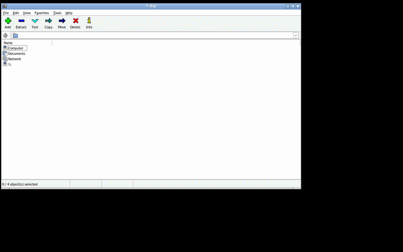
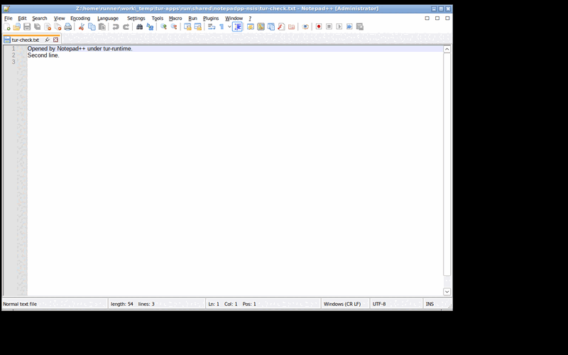
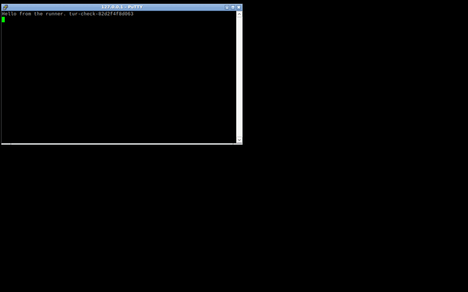
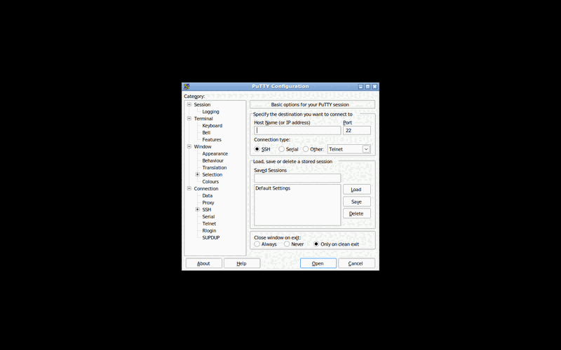
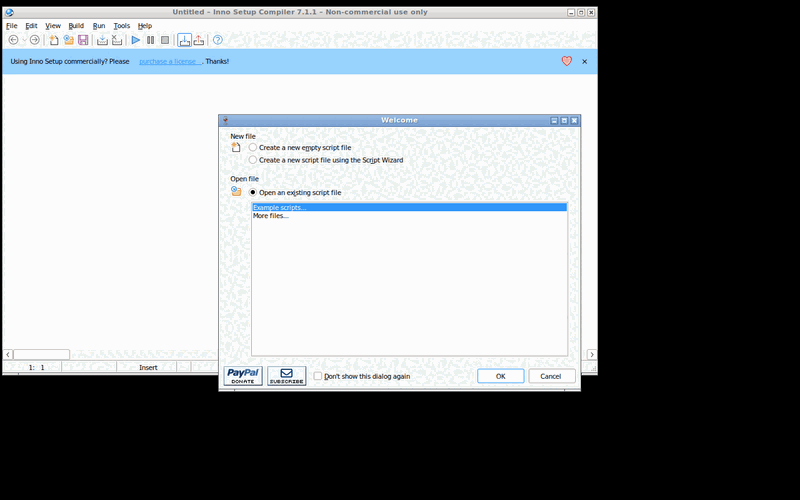
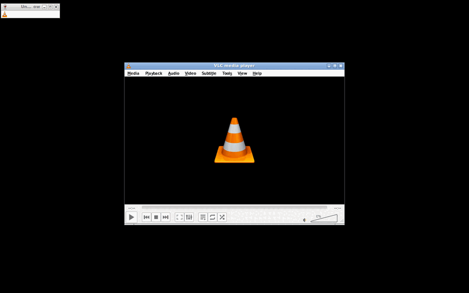

# windows-runtime-2 — Install, start, use and remove real Windows applications

```text
TUR DEVELOPMENT REPORT

Task ID:          windows-runtime-2
Subsystem:        Universal Runtime Manager (services/tur-runtime)
Build ID:         not applicable: this task builds no image
Source revision:  389af3c (feat/windows-real-apps, pull request 45), which
                  is the commit the measurements below come from. The commit
                  that adds this report follows it and changes no code.

SUMMARY
- What changed: tur-runtime can install a Windows application. It tells what
  kind of installer a file is from its content; runs the installer in its
  documented unattended mode, in a fresh prefix, inside the sandbox, with a
  time limit; finds what was installed from the prefix (new programs, the
  shortcuts and uninstall entries the installer left); writes an application
  record, a profile and a launcher entry with the program's own icon; starts
  the application; and removes it again, running its own uninstaller first
  and checking that nothing is left. The windows-runtime workflow has a
  second job that does all of that with eight installers of five real, free
  applications and publishes a compatibility table.
- Why it changed: nothing beyond two test programs had ever run
  (issue #32, third item; specification 7.2, 19.2; priority 5 of AGENTS.md:
  "Windows applications, validated with real applications").

FILES
- Added: services/tur-runtime/src/{app_record,discover,icon,install,installer,
  pe_res,sha256,shortcut,winreg}.rs, services/tur-runtime/tests/app_cli.rs,
  schemas/app-record.schema.json,
  tests/windows-runtime/{apps.py,apps.json,installer.c},
  docs/reports/windows-runtime-2.md,
  docs/reports/assets/windows-runtime-2/*.png
- Modified: services/tur-runtime/src/{codes,desktop,exec,launch_host,lib,
  limits,main,paths,plan,prefix,runtime_cmd}.rs,
  tests/windows-runtime/{e2e.py,build.sh},
  .github/workflows/windows-runtime.yml, docs/architecture/runtime-manager.md
- Removed: none

BUILD
- Command: cargo clippy --all-targets --all-features -- -D warnings; cargo
  test (workflow "rust"); cargo build --locked (workflow "windows-runtime")
- Result: see RUNS below
- Warnings: none from the compiler or clippy

TESTS
- Unit tests: 313 in services/tur-runtime (248 before this task). Pass.
- Integration tests: 28 tests of the binary (23 before); the five new ones
  give it a scratch home, name the runtime on the command line, and carry
  out for real what starts no runtime. Pass.
- End to end, launch path: job "end-to-end" of workflow "windows-runtime",
  322 checks (259 before), Ubuntu's Wine 9.0 without its 32-bit half. Pass.
- End to end, real applications: job "real-applications" of the same
  workflow, eight installers, Ubuntu's Wine 9.0 with wine32:i386. Table
  below.
- Boot tests: NOT RUN. Nothing here can affect boot.
- Hardware tests: NOT RUN. No GPU, no audio device, no real display.
- Performance tests: NOT RUN. Times to install and to first window were
  recorded; they are measurements on a shared runner, not a benchmark.
- On the TUR image: NOT RUN. Wine is not in the image.
- Proton, games, proprietary applications, applications that need a
  Microsoft component: NOT RUN.

DIAGNOSTICS
- Log paths: GitHub Actions runs below; artifact
  "windows-runtime-applications" (for every application: the identification,
  the installation report, the application record, the profile, the launcher
  entry, the icon's size and digest, screenshots, launch output, the
  operations log, the removal report; results.json; compatibility.md;
  proposed catalogue records); artifact "windows-runtime-evidence" for the launch-path job
- Diagnostic bundle path: none; no bundle format exists yet
- Relevant error IDs: 11 new codes, TUR-WINDOWS-APP-001 to -011

RECOVERY
- Rollback procedure: revert the merge. No shared file is changed. What an
  installation leaves is under $XDG_DATA_HOME/tur/runtime and
  $XDG_STATE_HOME/tur/runtime and is removed by `app uninstall`.
- Recovery tested: a failed installation is rolled back (real Wine, stand-in
  installers that fail, hang and install nothing); removal was checked to
  leave nothing for all eight installations.

KNOWN LIMITATIONS
- See "What was not tested" and "Limits" below.

NEXT SAFE ACTION
- Put Wine in the TUR image and run both jobs of this workflow against it.
  The table below is about Ubuntu's Wine; it says nothing about TUR's.
```

## Runs

| Commit | Workflow | Run | Result |
|---|---|---|---|
| `71f66c7` (first push) | rust | 43227564622 | Failed for `services/tur-runtime`: six findings of one clippy lint, and rustfmt drift. The library compiled |
| `71f66c7` | windows-runtime | 43227564843 | Passed (the launch-path job; the applications job did not exist yet) |
| `cf188ba` | rust | 43228908158 | Passed, all ten components; 313 unit tests |
| `cf188ba` | windows-runtime | 43228908197 | Launch-path job passed. **Applications job: 31 of 32 steps passed on its first run.** The one failure was this test's own expectation: it named Inno Setup's main program `Compil32.exe`, and version 7 calls it `ISIDE.exe`. `tur-runtime` had chosen correctly |
| `4977ad5` | rust | 43230779017 | Passed |
| `4977ad5` | windows-runtime | 43230778894 | Passed: launch-path job, 310 of 310 checks; applications job, 32 of 32 steps |
| `6bdf8de` | rust, windows-runtime | 43232014875, 43232014872 | Cancelled by the next push before they finished. No result |
| `cd7bde0` | rust, windows-runtime | 43232271622, 43232271777 | Cancelled by the next push before they finished. No result |
| `e358873` | rust | 43232475625 | Passed, all twelve components; 313 unit tests in `services/tur-runtime` |
| `e358873` | windows-runtime | 43232475907 | Passed: launch-path job, 322 of 322 checks; applications job, 32 of 32 steps. The screenshots are from this run |
| `46c7404` (the first version of this report) | rust, windows-runtime | 43233847621, 43233847616 | Passed: 322 of 322 checks; 32 of 32 steps |
| `389af3c` | rust | 43234925411 | Passed, all twelve components; 313 unit tests in `services/tur-runtime` |
| `389af3c` | windows-runtime | 43234925560 | Passed: launch-path job, 322 of 322 checks; applications job, 32 of 32 steps. **This report is written from this run** |
| `389af3c` | pax | 43234925432 | Passed |

The measurements in this report are from the last three rows. The commit
that brings the report up to them is later and changes no code; its runs are
named in the pull request.

The applications job has now run five times to the end: once with 31 of 32
steps passing, for the reason above, and four times with 32 of 32. After
that correction to the test, no step's result changed from one run to the
next.

## Where this ran

```text
runner image: ubuntu24 20261101.360.1
os: Ubuntu 24.04.5 LTS
kernel: 7.0.0-1017-azure
wine: wine-9.0 (Ubuntu 9.0~repack-4build3)
bubblewrap: bubblewrap 0.9.0
unzip: UnZip 6.00 of 20 April 2009, by Debian. Original by Info-ZIP.
python: Python 3.12.3
packages:
  bubblewrap:amd64 0.9.0-1ubuntu0.3
  imagemagick:amd64 8:6.9.12.98+dfsg1-5.2build2
  libwine:amd64 9.0~repack-4build3
  libwine:i386 9.0~repack-4build3
  openbox:amd64 3.6.1-12build5
  unzip:amd64 6.0-28ubuntu4.1
  wine:all 9.0~repack-4build3
  wine32:i386 9.0~repack-4build3
  wine64:amd64 9.0~repack-4build3
  wmctrl:amd64 1.07-7ubuntu3
  xvfb:amd64 2:21.1.12-1ubuntu1.9
wine programs:
  lrwxrwxrwx 1 root root   22 Apr  1  2024 /usr/bin/wine -> /etc/alternatives/wine
  lrwxrwxrwx 1 root root   28 Apr  1  2024 /usr/bin/wineserver -> /etc/alternatives/wineserver
  
  /usr/lib/wine/:
  total 1352
  -rwxr-xr-x 1 root root  13796 Apr  1  2024 wine
  -rwxr-xr-x 1 root root  14640 Apr  1  2024 wine64
  -rwxr-xr-x 1 root root    115 Apr  1  2024 wineapploader
  -rwxr-xr-x 1 root root    382 Apr  1  2024 wineserver
  -rwxr-xr-x 1 root root 695244 Apr  1  2024 wineserver32
  -rwxr-xr-x 1 root root 643080 Apr  1  2024 wineserver64
ntsync device: ls: cannot access '/dev/ntsync': No such file or directory
```

**This is Ubuntu's Wine on a GitHub-hosted runner. It is not the TUR image**,
which ships no Wine yet. There is no GPU: the display is an X server without a
screen (Xvfb, 1280 by 800, 24-bit) with the Openbox window manager, and
everything is drawn in software. There is no audio device. Nothing is pinned
on the runner side: Wine 9.0 is what Ubuntu 24.04's archive carried on the
day, and a later run can get another build.

Nothing was installed for any application: no Microsoft component, no
redistributable runtime (Visual C++, .NET), no winetricks verb, no Mono, no
Gecko, no Proton. Wine's 32-bit half (`wine32:i386`, from Ubuntu) is installed
in the applications job, because two of the installers are 32-bit programs;
the launch-path job still runs without it.

## The applications, their licences and where they came from

Each licence and each download location was read on 12 November 2026. Every
file is downloaded by the workflow from the location below, checked against
the pinned size and SHA-256, and deleted with the runner. Nothing is committed
or redistributed. The pins are in `tests/windows-runtime/apps.json`.

| Application | Version | Licence, and where it was read | Downloaded from | Hash checked against |
|---|---|---|---|---|
| 7-Zip (installer and package) | 26.06 | LGPL-2.1-or-later; parts of `7z.dll` carry the unRAR restriction, BSD-3-Clause and BSD-2-Clause. `https://www.7-zip.org/license.txt` | The project's GitHub releases (`ip7z/7zip`), which `https://www.7-zip.org/download.html` links to | The digest GitHub publishes for each release asset |
| Notepad++ (installer and portable archive) | 8.9.9.1 | GPL-3.0-or-later with the project's clarifications. The `LICENSE` file at tag `v8.9.9.1` | The project's GitHub releases (`notepad-plus-plus/notepad-plus-plus`), which `https://notepad-plus-plus.org/downloads/` links to | The digest GitHub publishes for each release asset |
| PuTTY (package and single program) | 0.85 | MIT. `https://www.chiark.greenend.org.uk/~sgtatham/putty/licence.html` | `https://the.earth.li/~sgtatham/putty/0.85/w64/`, the project's own download site | The project's `sha256sums` file for 0.85 |
| Inno Setup | 7.1.1 | Inno Setup License: use for any purpose, redistribution allowed, with attribution conditions. `license.txt` at tag `is-7_1_1`. See the note below | The project's GitHub releases (`jrsoftware/issrc`), which `https://jrsoftware.org/isdl.php` links to | The digest GitHub publishes for the release asset |
| VLC media player | 3.0.24 | GPL-2.0-or-later. `https://www.videolan.org/legal.html` | `https://download.videolan.org/pub/videolan/vlc/3.0.24/win64/` | The `.sha256` file beside the installer |

**Inno Setup.** Its licence text permits any use. Its download page asks
commercial users to buy a licence, and its window says "Non-commercial use
only" (see the screenshot). This is automated testing by a noncommercial
project, which the licence text and the request both allow. It is listed
among the decisions the owner may want to reverse: another Inno Setup-built
application would cover the same installer kind.

Between them the eight installers cover six installer kinds (7-Zip's own
installer, two Windows Installer packages, two NSIS installers of which both
are 32-bit programs, Inno Setup, a portable zip archive, a single program) and
five ways of building a user interface (plain Win32 with the application's own
controls, Win32 with Scintilla, Win32 dialogs with an application-drawn
terminal, Delphi VCL, Qt 5).

## The compatibility table, as measured

| Application | Version | Installer kind | Install | Launch | Check | Uninstall | Notes |
|---|---|---|---|---|---|---|---|
| 7-Zip | 26.06 | seven-zip-installer | pass (15.6 s) | pass (window after 1.0 s) | pass | pass (2.0 s) | 7z.exe wrote a zip archive that Python's zipfile reads back intact, and a 7z archive (29% of the input) that it extracts again; SHA-256 of the 680 kB test file round-trips. Window: '7-Zip', 952x566. |
| 7-Zip | 26.06 | msi | pass (14.5 s) | pass (window after 1.0 s) | pass | pass (2.2 s) | 7z.exe wrote a zip archive that Python's zipfile reads back intact, and a 7z archive (29% of the input) that it extracts again; SHA-256 of the 680 kB test file round-trips. Window: '7-Zip', 952x566. |
| Notepad++ | 8.9.9.1 | nsis | pass (11.9 s) | pass (window after 2.5 s) | pass | pass (2.4 s) | given a file on its command line, it opened it: its window is titled 'Z:\\home\\runner\\work\\_temp\\tur-apps\\run\\shared\\notepadpp-nsis\\tur-check.txt - Notepad++ [Administrator]' after 2.3 s (closed). Window: 'new 1 - Notepad++ [Administrator]', 1016x666. |
| Notepad++ (portable) | 8.9.9.1 | portable-zip | pass (9.7 s) | pass (window after 2.5 s) | pass | pass (0.1 s) | given a file on its command line, it opened it: its window is titled 'Z:\\home\\runner\\work\\_temp\\tur-apps\\run\\shared\\notepadpp-zip\\tur-check.txt - Notepad++ [Administrator]' after 2.3 s (closed). Window: 'new 1 - Notepad++ [Administrator]', 1016x666. It has no uninstaller; removing it is deleting its prefix. |
| PuTTY | 0.85 | msi | pass (11.4 s) | pass (window after 0.8 s) | pass | pass (2.0 s) | plink.exe made a raw TCP connection to a listener on the runner and printed the line it was sent. Window: 'PuTTY Configuration', 450x410. |
| PuTTY (single program) | 0.85 | plain-exe | pass (9.3 s) | pass (window after 0.8 s) | pass | pass (0.1 s) | putty.exe made a raw TCP connection to a listener on the runner and opened its terminal window, titled '127.0.0.1 - PuTTY', after 0.8 s (exited when the connection closed). Window: 'PuTTY Configuration', 450x410. It has no uninstaller; removing it is deleting its prefix. |
| Inno Setup | 7.1.1 | inno-setup | pass (13.3 s) | pass (window after 2.0 s) | pass | pass (2.9 s) | ISCC.exe compiled a script into a 2102 kB installer, which `tur-runtime installer identify` recognises as Inno Setup. Window: 'Untitled – Inno Setup Compiler 7.1.1 – Non-commercial use only', 952x566. It also opened: 'Welcome'. |
| VLC media player | 3.0.24 | nsis | pass (22.3 s) | pass (window after 1.0 s) | pass | pass (3.2 s) | vlc.exe, without its window, decoded a 2 s 440 Hz WAV, resampled it from 44.1 to 22.05 kHz and wrote 1.95 s of a 440 Hz tone, measured from the samples. Window: 'VLC media player', 600x420. |

Outside the sandbox: nothing appeared in the home directory of the user running the test, in any of the places Wine or an installer would use without one (~/.wine, ~/.local/share/applications, ~/.local/share/icons, ~/.local/share/mime, ~/.local/share/desktop-directories, ~/.config/menus, ~/.cache/wine, ~/Desktop).

pass: the step worked. fail: it did not; the note says what happened. partial: the application was removed, and its own uninstaller did not succeed. Times are wall-clock on the runner. A pass is a measurement of these steps for this version, not a statement that the application is compatible.

What each column is:

- **Install**: `tur-runtime app install <file> --app-id <id>`, and nothing
  else: no `--main-exe`, no `--name`, except `--portable` for PuTTY's single
  program. Passing means exit status 0, a valid application record, the main
  program this test expected, the installer's SHA-256 in the record, and a
  launcher entry whose command and icon are what they should be. The time is
  the whole command; about ten seconds of it is creating the prefix.
- **Launch**: the command line of the generated launcher entry is run as it
  is written, on the virtual display. Passing means a viewable window of the
  window class the entry declares (`StartupWMClass`) with the expected title.
  The time is from starting the command to seeing the window, polled about
  four times a second.
- **Check**: one thing the program is for, verified by something other than
  the program. Described per application in the notes.
- **Uninstall**: `tur-runtime app uninstall <id>`. Passing means the
  application's own uninstaller ran and succeeded (where it has one), every
  directory kept for the application is gone, no file or directory anywhere
  under the runtime manager's data and state is named after it, no Wine
  server is running and no window is left.

No result was retried. No application failed, so no row is classed as a TUR
bug or a Wine limitation; what was learned on the way is in the next section.

Times move from run to run. Over the five runs of the job, in seconds:

| Application | Install | First window |
|---|---|---|
| 7-Zip, installer | 12.9 to 18.4 | 1.0 to 1.3 |
| 7-Zip, package | 12.2 to 15.4 | 1.0 to 1.3 |
| Notepad++, installer | 11.9 to 13.6 | 2.5 to 3.3 |
| Notepad++, portable archive | 9.7 to 10.9 | 2.5 to 3.0 |
| PuTTY, package | 11.4 to 12.6 | 0.8 to 1.0 |
| PuTTY, single program | 9.3 to 10.4 | 0.8 to 1.0 |
| Inno Setup | 13.3 to 15.3 | 2.0 to 2.5 |
| VLC | 22.3 to 24.8 | 1.0 to 2.0 |

Creating the prefix is about ten seconds of every installation. No installer
or uninstaller that went through Wine took less than two seconds, however
little it had to do; the likely reason is the Wine server's delay before it
exits, which `tur-runtime` waits out so that the registry is written. That
was not measured on its own. The window is looked for about four times a
second, so the second column is coarse.

**This table is small and friendly.** These are well-behaved, widely used free
applications, picked for licences that allow the test. Eight passes say that
the installation path works for six installer kinds on this Wine. They do not
say that Windows applications in general install and run, and the catalogue
should not read them that way.

## What the runs showed

Things found, in the order they would matter to a user.

1. **Every installer kind that was tried installed unattended and uninstalled
   cleanly.** Each application's own uninstaller removed every program it had
   installed and its uninstall entry; none left a program behind. The two
   kinds without an installer (the zip archive and the single program) have
   nothing to run and are removed by deleting their prefix.
2. **The main program was chosen by rule in all eight cases**, with no hint:
   five by "the one program a shortcut points to", PuTTY's package by "the
   shortcut named after the application" (its installer makes shortcuts to
   four programs: PuTTY, PSFTP, PuTTYgen and Pageant), the Notepad++ archive
   by "the program at the top of what was unpacked" (it also holds an
   updater), and PuTTY's single program by "the only program".
3. **The names come out as the installers wrote them**: "7-Zip 26.06 (x64)"
   from the installer and "7-Zip 26.06 (x64 edition)" from the package;
   "Notepad++ (64-bit x64)"; "PuTTY release 0.85 (64-bit)". Versions likewise:
   "26.06" and "26.06.00.0" for the same 7-Zip. A launcher that shows these
   will want a cleaner name from the catalogue.
4. **Icons.** Three of the five applications have icons that are not PNGs
   inside the program: 7-Zip's is an 8-bit bitmap, PuTTY's a 4-bit one, Inno
   Setup's a 32-bit one. All were decoded and written as PNG files that an
   independent reader (Python's `zlib`, in the test) accepts, and that look
   right. Notepad++ and VLC carry a 256-pixel PNG, which was copied.
5. **Wine tells applications that the user is an administrator.** Notepad++
   puts "[Administrator]" in its title. Inside the sandbox that grants
   nothing, but applications decide things by it: these installers all
   installed for all users, into `C:\Program Files`.
6. **The window class is the program's file name in lower case**, as read
   from Wine's source, for all eight: `7zfm.exe`, `notepad++.exe`,
   `putty.exe`, `iside.exe`, `vlc.exe`. The generated entries declare it, so
   a desktop can match windows to entries.
7. **Some applications open more than one window.** Inno Setup opens its main
   window and a "Welcome" dialog; VLC opens its main window and a small
   untitled one that belongs to its notification-area icon, for which the
   virtual display has no tray.
8. **Wine complains on every start** that it cannot run its menu builder.
   That is the override that switches it off doing its job: launcher entries
   come from `tur-runtime`. The RpcSs errors during prefix creation that the
   first report noted are still there; none of the steps measured here was
   affected, including the two Windows Installer packages.
9. **VLC found no audio device** and said so. Its conversion check does not
   need one. Playing sound was not tested.

## What was built, and which test proves it

| Built | Proved by |
|---|---|
| Installer kind from content: package, NSIS, Inno Setup, 7-Zip's installer, portable zip, plain program; what is refused | Unit tests on files built by hand, with names that lie (`installer::tests`); the eight real files, each identified as expected (`apps.py`, "identify") |
| The unattended command for each kind, in the sandbox, with only the installer file shown | `install::tests` read the bubblewrap arguments back and hold them to the same boundary assertions as every other sandbox; `app_cli.rs` on the binary; the real installers ran |
| A time limit on an installer, and stopping it with everything it started | `exec::tests` (a real process, stopped after one second); `e2e.py`: a stand-in installer that never finishes is stopped, no process of it is left, `TUR-WINDOWS-APP-004` |
| A failing installer, and one that installs nothing: reported and rolled back | `e2e.py` with real Wine: `TUR-WINDOWS-APP-003` and `-005`, no prefix left, the log kept; `--keep-failed` keeps the prefix |
| `--portable` is refused for a file whose content says it is an installer or an archive | `install::tests` |
| Reading shortcuts, uninstall entries, version resources and icons out of a prefix; nothing outside it is read | Unit tests, including links that lead out of the prefix, truncated files at every length and hostile sizes; the real prefixes |
| Choosing the main program by rule, and refusing to guess | `discover::tests`; the eight real installations |
| The application record and its schema | `app_record::tests` (schema and types in step, 27 kinds of invalid record refused); the record on disk compared with the one reported, for every application |
| The launcher entry and the icon; staged, with destinations stated | `desktop::tests`, `install::tests`; every real application was started from the command in its generated entry, and its windows had the class the entry declares |
| `app launch`, `app list`, `app show` | `app_cli.rs`; `e2e.py` (a program installed with `--portable` is started and returns its exit status) |
| Removal: the uninstaller, then deletion, then the check | `install::tests`, `app_cli.rs` (carried out for real without the uninstaller); all eight real removals, with an independent search for leftovers |
| A failing uninstaller does not stop a removal | `e2e.py` with real Wine: the record of a fresh installation is edited to name an uninstaller that exits with status 3; the removal succeeds and reports `TUR-WINDOWS-APP-011`, the status and what was left in the prefix. No real application's uninstaller failed |
| Nothing escapes the sandbox during installation | The harness compares the places in the runner's home directory where Wine or an installer would write without a sandbox (`~/.wine`, menu entries, icons, file associations, the desktop) before and after the whole run |
| Error codes `TUR-WINDOWS-APP-001` to `-011` | `codes::tests` for their form. Produced by a test: 001, 002, 005, 006, 007, 008 and 010 in unit or integration tests; 002, 003, 004, 005, 007 and 011 with real Wine in `e2e.py`. **009 (something was left after a removal) is produced by no test**: the check behind it is tested as a plan, where a path that is still there is a finding, and no removal left anything |

## What was not tested

| Not tested | Why |
|---|---|
| Anything on the TUR image | Wine is not in the image. Ubuntu 24.04, Ubuntu's Wine 9.0, AppArmor, no SELinux, no Plasma |
| A GPU, Direct3D, Vulkan, video playback | The runner has no GPU. VLC's window opened; no video was played |
| Sound | The runner has no audio device |
| Using an application | One window and one function each. No menus, dialogs, file choosers, printing, clipboard, drag and drop, preferences, updates |
| KWin, task switching, the application launcher of a desktop | The window manager was Openbox on a virtual display. The entry is staged, not installed (§19.2's "launches from the TUR application launcher" is not met) |
| An application that needs a Microsoft component | None was chosen, on purpose. One whose main program is a .NET program would be installed, recorded as needing .NET and reported; that path has a unit test and no real application behind it |
| A real application's own uninstaller failing | None did. The path was exercised with a stand-in |
| A 32-bit application | Two 32-bit installers ran. Everything they installed is 64-bit |
| Installers that ask questions, other installer kinds (WiX Burn, InstallShield, Squirrel, self-extracting archives) | Not built; reported as plain programs |
| Paths and names outside ASCII | None of these applications has one. The parsers are tested with them; the single-byte path in a shortcut is read as Latin-1, which is wrong for other code pages, and the UTF-16 path is preferred when a shortcut has one |
| A second Wine version, migration of an installed application | One Wine was installed |
| Proton, games, proprietary applications, trial software | Out of scope and, for the last three, not allowed |
| Network use beyond the loopback interface | PuTTY connected to a listener on the runner. Nothing reached the internet on purpose; the sandbox shares the network by default, and what the applications did on their own was not observed |

## Limits

- **Removing an application deletes what the user saved in it.** Its private
  home goes with its prefix. Files in granted directories are untouched.
  Backups are kept.
- **An icon that is a PNG inside the program is handed on undecoded**, to
  whatever shows the launcher entry. See the design note.
- **A plain program is only installed when the user says it is the
  application.** There is no way yet to run an unknown installer with its
  windows.
- **`app install` creates the prefix with the network shared**, as
  `prefix create` does, unless `--no-network` is given. An installer can
  reach the network while it runs.
- **Only exit status 0 is success** for an installer. A package that asks for
  a restart (3010) would be reported as failed. None did.
- **The time limit is one number**, 15 minutes by default, for installers of
  any size.
- **The launcher entry is not installed.** Nothing appears in a desktop's
  menu.
- **The window test needs a window manager's cooperation to close a window.**
  All eight closed when asked.
- **An installer reaches its file through the prefix's `Z:` drive**, as every
  program started from outside its prefix does. A prefix hardened by removing
  that drive would break both.

## Screenshots

From run 43232475907, reduced to 800 pixels wide and 128 colours. Each was looked
at. The run this report is written from produced the same images, byte for
byte.

| | |
|---|---|
|  7-Zip 26.06, started from its launcher entry |  Notepad++ 8.9.9.1 showing the file it was given |
|  PuTTY 0.85 on a raw connection to the runner, showing the line it was sent |  PuTTY 0.85, started from its launcher entry |
|  Inno Setup 7.1.1: its main window and its "Welcome" dialog |  VLC 3.0.24: its main window, and the small window of its notification-area icon |

The icon files `tur-runtime` wrote are not committed: they are parts of the
applications. Those of 7-Zip (from an 8-bit bitmap, 48 pixels), PuTTY (4-bit,
48 pixels), Inno Setup (32-bit, 128 pixels) and Notepad++ (a 256-pixel PNG,
copied) were opened, from the artifacts of runs 43228908197 and 43232475907,
and are the applications' icons, with their transparency. From `389af3c` on
the job no longer uploads them: the Windows guest design says that icons
extracted from Windows programs stay on the user's machine, and the test now
keeps each icon's dimensions and digest instead. Every run still reads each
icon back with an independent PNG reader.

## Proposed catalogue changes

Nothing under `catalogue/` was changed. Two of the five applications have
entries: 7-Zip (`org.7-zip.7zip`) and VLC (`org.videolan.vlc`). The
applications job writes a record for each in the form `catalogue/README.md`
describes, as files in its artifact (`catalogue/*.record.toml`). They are
proposals for the entries' owner:

```toml
# Proposed record for catalogue/org.7-zip.7zip.toml, under its Windows edition.
# Measured by tests/windows-runtime/apps.py, application 7zip-exe.
[[editions.records]]
route = "wine"
rating = "good"
reported_by = "tur-test"
test_report = "docs/reports/windows-runtime-2.md"
version_tested = "26.06"
date = "2026-11-12"
notes = "Automated test of seven-zip-installer installer 7z2606-x64.exe: install pass, launch pass, check pass, uninstall pass. wine-9.0 (Ubuntu 9.0~repack-4build3) from Ubuntu on a hosted runner, software rendering; not the TUR image. One window and one function were looked at."

# Proposed record for catalogue/org.7-zip.7zip.toml, under its Windows edition.
# Measured by tests/windows-runtime/apps.py, application 7zip-msi.
[[editions.records]]
route = "wine"
rating = "good"
reported_by = "tur-test"
test_report = "docs/reports/windows-runtime-2.md"
version_tested = "26.06"
date = "2026-11-12"
notes = "Automated test of msi installer 7z2606-x64.msi: install pass, launch pass, check pass, uninstall pass. wine-9.0 (Ubuntu 9.0~repack-4build3) from Ubuntu on a hosted runner, software rendering; not the TUR image. One window and one function were looked at."

# Proposed record for catalogue/org.videolan.vlc.toml, under its Windows edition.
# Measured by tests/windows-runtime/apps.py, application vlc-nsis.
[[editions.records]]
route = "wine"
rating = "unknown"
reported_by = "tur-test"
test_report = "docs/reports/windows-runtime-2.md"
version_tested = "3.0.24"
date = "2026-11-12"
notes = "Automated test of nsis installer vlc-3.0.24-win64.exe: install pass, launch pass, check pass, uninstall pass. wine-9.0 (Ubuntu 9.0~repack-4build3) from Ubuntu on a hosted runner, software rendering; not the TUR image. One window and one function were looked at. Not tested: playing sound or video; the runner has no audio device and no GPU."
```

Before taking them:

- **The rating.** The test writes `good` when all four steps pass, and
  `unknown` when they pass but what the application is mainly for could not
  be tried: VLC installed, opened its window and converted a sound file, on
  a machine that can play neither sound nor video, so its record carries the
  steps and no rating. For 7-Zip the function that was checked is the
  function: archives were written, read by another implementation and
  extracted. The scale defines `good` as "runs as intended, with no
  workaround worth mentioning"; one window and one function is still thin
  evidence for that, and `usable` would be the cautious reading until
  someone has used the application. That is the owner's call.
- **Two records for 7-Zip** would say the same thing; one is enough, naming
  both installers.
- **7-Zip's entry lists a native Linux edition first**, which is right: the
  Windows edition is only interesting for its file manager.
- **Notepad++, PuTTY and Inno Setup have no entries.** Adding them is a
  catalogue decision; the measurements are in the table above.
- A record with `test_report = "docs/reports/windows-runtime-2.md"` is
  checked against the file's existence by the catalogue's seed tests, which
  the rust workflow runs for a change under `catalogue/`.
  (`catalogue-and-routing.md` still says, under "Not done yet", that the
  workflow does not list `catalogue/`. It does now; that sentence is out of
  date, and is not this change's to correct.)

## Dependencies

No crate was added. `services/tur-runtime/Cargo.lock` is unchanged. SHA-256,
CRC-32, Adler-32, the PNG writer and the parsers are written in this
component and checked against published values and real files. `unsafe` is
still forbidden.

Programs started at run time, none of them linked or shipped by this change:

| Program | Licence | Used for | On the TUR image |
|---|---|---|---|
| `unzip` (Info-ZIP) | Info-ZIP | Unpacking a portable archive, inside the sandbox | Yes, 6.0 |
| `install` (GNU coreutils) | GPL-3.0-or-later | Copying a single program into a prefix, inside the sandbox | Yes |
| Wine's `msiexec` | LGPL-2.1-or-later | Windows Installer packages | No Wine in the image |

CI only: Openbox, wmctrl, ImageMagick, x11-utils, Xvfb, and Ubuntu's
`wine32:i386`.

## Decisions the owner may want to reverse

1. **Inno Setup as the Inno Setup example**, given what its publisher asks of
   commercial users.
2. **Error codes are `TUR-WINDOWS-APP-*`**, not a new family and not
   `TUR-INSTALL-*`.
3. **A plain program is refused without `--portable`**, and unknown installers
   are never run with their windows.
4. **Removal goes on when the application's own uninstaller fails**, and
   reports the failure; and **removal deletes the private home** without
   asking.
5. **Backups are kept at removal** unless `--remove-backups` is given.
6. **The launcher entry is staged**, not installed.
7. **The application identifier defaults to `local.<file name>`**; the
   catalogue's identifier is expected to be passed in.
8. **Names and versions are recorded as the installer states them**, not
   normalised.
9. **`prefix remove` now also deletes a staged launcher entry**, and a backup
   now includes the application record and profile when they exist.
10. **The test fails when a result differs from `apps.json`**, in either
    direction, so that the table cannot drift unnoticed.
11. **No assistant tool was added.** Two read-only ones would fit
    (`installer identify`, `app list`); they need entries in P@x's own tests,
    outside this change's paths.
12. **The CI artifact holds screenshots of the applications and no extracted
    icon files.** The screenshots were asked for; the icons follow the guest
    design's rule for publishers' works.
13. **An icon that is already a PNG is copied, not decoded and re-encoded**,
    unlike what the guest design says of its own entries.

## Changes needed in shared files

None was made. Worth making by their owners:

- `docs/adr/`: this change adds an interchange format (the application
  record, `schemas/app-record.schema.json`) and decides how installation
  works where the specification is silent. AGENTS.md asks for an ADR when a
  change affects an interface. None was written, because `docs/adr/` is
  outside this change's paths; the decisions are listed in the design note
  and below, ready to be turned into one.
- `catalogue/`: the records above, if wanted.
- `docs/dependencies/upstream-projects.md`: `unzip` is now started by
  `tur-runtime` (as a separate program: no licence constraint).
- `specification.md` §7.2 lists "detect bundle/package/install formats" and
  "register application desktop entries" without saying what an installation
  is; the decisions table in the design note could become its text.
- `README.md`: the status table, if it lists what the runtime manager can do.

## Issue #32

"Try real applications" is done for a first eight. "Installers" is done for
unattended installation of six kinds; "dependency recipes" is not started and
"file associations" is not started. The other items are untouched: the TUR
image, Proton, sandbox hardening, `ntsync`, DXVK, a stop command, the link
from a catalogue route to an installation, D-Bus, 32-bit applications, a real
migration.
